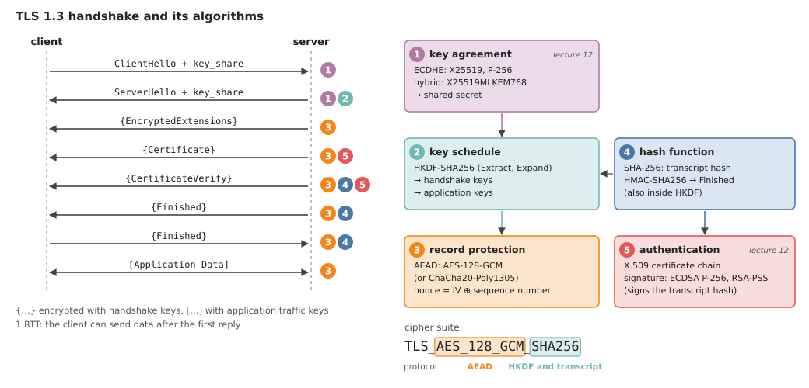
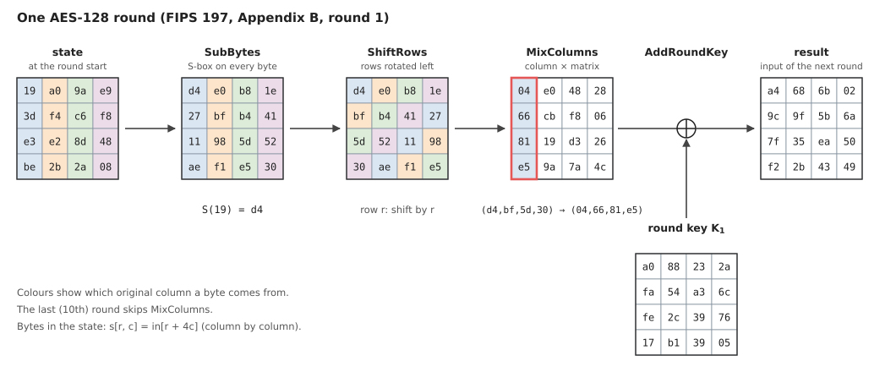
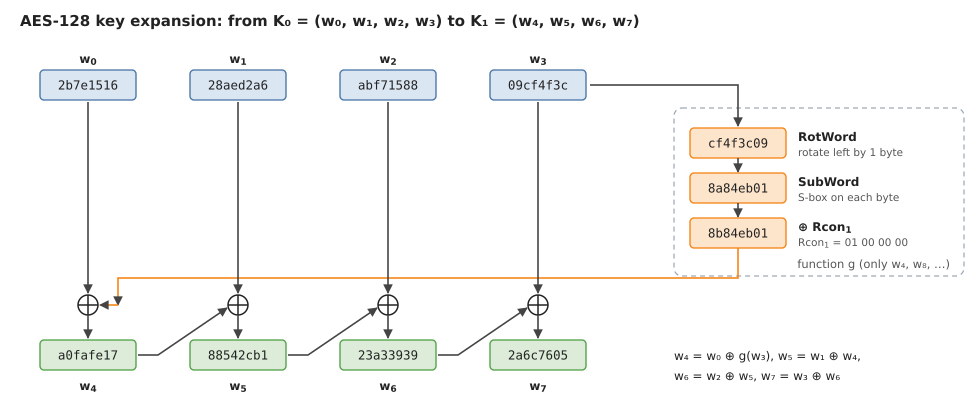
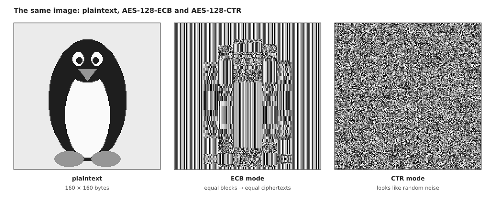
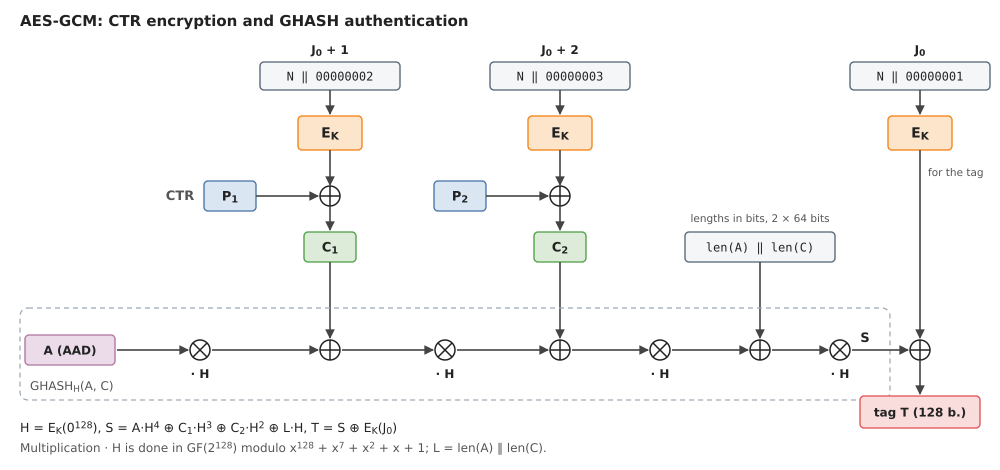
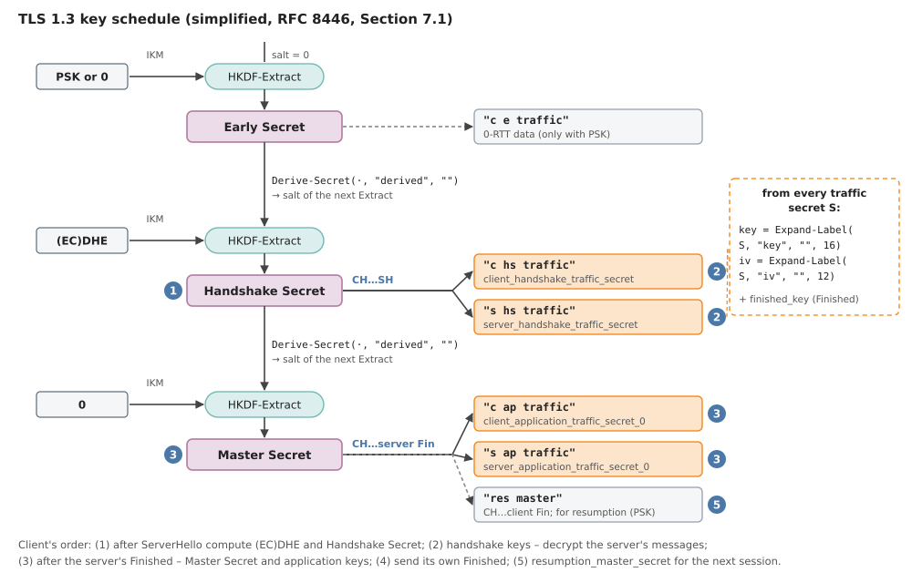

# 11. Cryptography in TLS 1.3: AES and Hash Functions

Here we look at the *symmetric* part of TLS 1.3 (record encryption and key derivation);
the asymmetric part (key exchange and signatures) is covered in the next lecture.

**Learning outcomes:**

* Compute the transformations of one AES-128 round (`SubBytes`, `ShiftRows`, `MixColumns`, `AddRoundKey`)
  and a key expansion step, performing the operations in the Galois field $GF(2^8)$.
* Explain the problems of the ECB mode; describe how the GCM mode provides both
  confidentiality and integrity (AEAD).
* Describe how TLS 1.3 uses HKDF and SHA-256 to derive the record keys
  (*record layer keys*) and nonce values from the *shared secret*.

## Introduction: the TLS 1.3 Algorithm Suite

*TLS* (*Transport Layer Security*) is the protocol that protects most Internet traffic:
HTTPS, e-mail (IMAP, SMTP), VPNs and the APIs of many applications. The current version, TLS 1.3, is
specified in [RFC 8446](https://www.rfc-editor.org/rfc/rfc8446) (2018). A connection
starts with a *handshake*, in which the client and the server agree on keys and the
server proves its identity; after that, all data is sent in encrypted *records*.
Four kinds of algorithms take part in the handshake:

1. **Key exchange** -- the elliptic-curve Diffie–Hellman protocol with ephemeral keys (ECDHE),
   for example, with the curve X25519 or P-256; both sides obtain the same *shared secret*.
2. **Authentication** -- the server sends an X.509 certificate chain and signs a hash of the whole
   handshake transcript (ECDSA or RSA-PSS).
3. **Key derivation** -- HKDF with SHA-256 derives all the
   necessary keys and initialization vectors from the shared secret.
4. **Record protection** -- every record is encrypted and authenticated with an AEAD algorithm, for example, AES-128-GCM.

*The TLS 1.3 handshake (left) and the algorithms that process each message (right).
Algorithms 1 and 5 are the topic of the next lecture, algorithms 2, 3 and 4 are the topic of this lecture.*

**Cipher suite.** The name of a TLS 1.3 *cipher suite*, for example,
`TLS_AES_128_GCM_SHA256`, determines only the symmetric algorithms: `AES_128_GCM` is the AEAD algorithm
for records (AES with a $128$-bit key in GCM mode), and `SHA256` is the hash function used by HKDF and
for the handshake transcript. The key exchange group and the signature algorithm are negotiated separately
(in the extensions `supported_groups` and `signature_algorithms`). TLS 1.3 defines only five cipher
suites; `TLS_AES_128_GCM_SHA256` is mandatory for all implementations, but in practice
`TLS_AES_256_GCM_SHA384` and `TLS_CHACHA20_POLY1305_SHA256` are also common.

### Symmetric and Asymmetric Cryptography

In *symmetric* algorithms (AES, HMAC) both sides share the same secret key. They are very
fast -- a modern processor encrypts several gigabytes per second with AES-GCM -- but they do not answer the
question of how the two sides obtain a common key if they have never met. In *asymmetric*
algorithms (Diffie–Hellman key exchange, signatures) each side has a key pair: a private and a
public key. They make it possible to agree on a key over an open channel and to verify the other side's
identity, but they are several orders of magnitude slower. Therefore TLS (like many other
practical protocols) is *hybrid*: first the asymmetric algorithms agree on a key and
authenticate the server, and then the symmetric algorithms protect the data itself.

TLS 1.3 dropped all the old symmetric algorithms that had often been a source of attacks in
earlier versions: the RC4 stream cipher, CBC mode with a separate MAC (attacks *Lucky 13*, *POODLE*),
data compression (attack *CRIME*), as well as MD5 and SHA-1 in signatures. Only AEAD algorithms are allowed
(see the subsection "The AEAD Concept" below).

**Adversary model:**

In cryptography we assume that the adversary fully controls the network (*the Dolev–Yao model*): it can
eavesdrop on all messages, modify, delete, delay and replay them, and send its own messages;
it knows all the algorithms but not the secret keys (*Kerckhoffs's principle*). We expect the protocol to
provide the following properties:

* *confidentiality* (only the two endpoints can read the data);
* *integrity* (any modification, deletion or replay of data becomes visible);
* *authenticity* (the client talks to the server it intended to reach, not to the adversary).

## The Galois Field GF(2^8)

AES processes data byte by byte, and it treats bytes as elements of the Galois field $\text{GF}(2^8)$.
We already constructed this field in the lecture
[Error Correction: Reed-Solomon Codes]({{ '/lectures/lossy_reed_solomon/' | relative_url }})
(where the example $\text{GF}(2^3)$ is studied in detail): a byte $b_7 b_6 \ldots b_1 b_0$ is the polynomial

$$b(x) = b_7 x^7 + b_6 x^6 + \ldots + b_1 x + b_0, \qquad b_i \in \lbrace 0, 1 \rbrace,$$

whose coefficients are added and multiplied modulo $2$. For example, $\texttt{0x57} = 01010111_2$
corresponds to the polynomial $x^6 + x^4 + x^2 + x + 1$.

**Addition and multiplication:**

*Addition* is addition of polynomials modulo $2$, i.e., bitwise XOR:
$\texttt{0x57} + \texttt{0x83} = \texttt{0x57} \oplus \texttt{0x83} = \texttt{0xD4}$. Every element
is its own negative ($a + a = 0$), so subtraction is the same as addition.

*Multiplication* is multiplication of polynomials, after which the result is divided by the irreducible polynomial

$$m(x) = x^8 + x^4 + x^3 + x + 1 \quad (\texttt{0x11B})$$

and we keep the remainder (degree $\leq 7$, i.e., again a byte). All multiplication can be expressed with one
basic operation $\textsf{xtime}$ -- multiplication by $x$ (i.e., by $\texttt{0x02}$): the byte is shifted
one bit to the left, and if the top bit ($x^8$) falls out, we add $x^8 \bmod m(x) = x^4 + x^3 + x + 1$,
i.e., XOR with $\texttt{0x1B}$. This is exactly the same step that the CRC register performs in the lecture
[Error Correction: Hamming Codes]({{ '/lectures/lossy_hamming/' | relative_url }}) -- only with a different
polynomial and with $8$ bits instead of $32$.

*Example* (from FIPS 197): we compute $\texttt{0x57} \cdot \texttt{0x83}$. First we apply $\textsf{xtime}$ repeatedly:

| $x^k \cdot \texttt{0x57}$ | $k=0$ | $1$ | $2$ | $3$ | $4$ | $5$ | $6$ | $7$ |
| --- | --- | --- | --- | --- | --- | --- | --- | --- |
| value | `57` | `AE` | `47` | `8E` | `07` | `0E` | `1C` | `38` |

For example, $x^2 \cdot \texttt{0x57} = \textsf{xtime}(\texttt{0xAE})$: the shift gives $\texttt{0x15C}$,
the top bit falls out, therefore $\texttt{0x5C} \oplus \texttt{0x1B} = \texttt{0x47}$.
Since $\texttt{0x83} = x^7 + x + 1$,

$$\texttt{0x57} \cdot \texttt{0x83} = \texttt{0x38} \oplus \texttt{0xAE} \oplus \texttt{0x57} = \texttt{0xC1}.$$

This is also how hardware and simple programs work: for every one-bit of the multiplier $b$ they add
the corresponding $x^k \cdot a$ (see the function `gmul` in the file [figs/aes128.py](figs/aes128.py)).

*Remark.* Reed-Solomon codes usually use a *primitive* polynomial (for example, $\texttt{0x11D}$),
for which $x$ generates the field. The AES polynomial $\texttt{0x11B}$ is irreducible but not primitive:
the multiplicative order of $x = \texttt{0x02}$ is only $51$, whereas, for example, $\texttt{0x03} = x + 1$ is a generator
(order $255$). The field is the same (all fields $\text{GF}(2^8)$ are isomorphic); only the byte representation differs.

**The inverse element:**

Since $m(x)$ is irreducible, every byte $a \neq 0$ has an inverse $a^{-1}$ such that
$a \cdot a^{-1} = 1$. It can be found in two ways.

* **The extended Euclidean algorithm** for polynomials: it finds $s(x), t(x)$ such that
  $s(x) a(x) + t(x) m(x) = \gcd(a, m) = 1$; then $a^{-1} = s(x)$. This is the same algorithm that is used
  for integers modulo $p$, only with polynomial division (see Problem 11.1).
* **Exponentiation:** the multiplicative group has $255$ elements, so $a^{255} = 1$ (Lagrange's theorem,
  just like Fermat's little theorem modulo $p$), and $a^{-1} = a^{254}$. The power is computed by
  repeated squaring ($254 = 11111110_2$, i.e., $7$ squarings and $6$ multiplications).

For example, $\texttt{0x53}^{-1} = \texttt{0xCA}$ (check: $\texttt{0x53} \cdot \texttt{0xCA} = \texttt{0x01}$).
The element $0$ has no inverse; AES uses the convention that the "inverse" of $0$ is $0$. The inverse element
is the basis of the S-box.

## The AES-128 Block Cipher

In 1997 the US standards institute NIST announced an open competition to replace the aging
DES cipher ($56$-bit key). Out of $15$ candidates, the winner in 2000 was the cipher *Rijndael* by the Belgian cryptographers
Joan Daemen and Vincent Rijmen, which was published in 2001 as the standard
*AES* (*Advanced Encryption Standard*, [NIST FIPS 197](https://nvlpubs.nist.gov/nistpubs/fips/nist.fips.197.pdf)).
See also [Advanced Encryption Standard](https://en.wikipedia.org/wiki/Advanced_Encryption_Standard) on Wikipedia.

AES is a *block cipher*: using the key $K$, it maps a $128$-bit (16-byte) plaintext block to a
$128$-bit ciphertext block, and for every key this map is a bijection (a permutation).
The key length can be $128$, $192$ or $256$ bits; accordingly the cipher performs $10$, $12$ or $14$
*rounds*. The $16$ bytes of the block $\mathit{in}_0, \ldots, \mathit{in}_{15}$ are written into
a $4 \times 4$ byte *state* matrix column by column: $s_{r,c} = \mathit{in}_{r+4c}$.
Every round is a composition of four simple transformations; AES-128 encryption in pseudocode:

$\textsf{AES-Encrypt}(\mathit{block}, \mathit{key})$
1. $w_0, \ldots, w_{43} \gets \textsf{KeyExpansion}(\mathit{key})$ $\quad$ *// 11 round keys of 4 words each*
2. $s \gets \mathit{block}$ $\quad$ *// 16 bytes in a 4 × 4 matrix, column by column*
3. $s \gets \textsf{AddRoundKey}(s, w_0 \ldots w_3)$
4. **for** $r = 1$ **to** $10$
5. $\quad s \gets \textsf{SubBytes}(s)$ $\quad$ *// S-box for every byte*
6. $\quad s \gets \textsf{ShiftRows}(s)$ $\quad$ *// cyclic shifts of the rows*
7. $\quad$ **if** $r < 10$ $\quad$ *// no MixColumns in the last round*
8. $\quad\quad s \gets \textsf{MixColumns}(s)$ $\quad$ *// mixing the columns*
9. $\quad s \gets \textsf{AddRoundKey}(s, w_{4r} \ldots w_{4r+3})$ $\quad$ *// XOR with the round key*
10. **return** $s$

*The first AES-128 round with the numbers from Appendix B of FIPS 197. The colors show which column a byte comes from:
after ShiftRows every column contains one byte from each of the four columns, and MixColumns mixes them.*

All transformations are simple, but they have different purposes: SubBytes is the only *nonlinear* part
(*confusion*), ShiftRows and MixColumns spread the influence of each byte over the whole state
(*diffusion*), and AddRoundKey brings in the key. A teaching implementation that prints
all the intermediate results is in the file [figs/aes128.py](figs/aes128.py).

### SubBytes and the S-box

SubBytes replaces every byte $a$ of the state by $S(a)$, where $S$ is a fixed $8$-bit permutation --
the *S-box*. In practice it is stored in a $256$-byte table, but its definition is algebraic and
consists of two steps:

1. **Inverse:** $b = a^{-1}$ in the field $\text{GF}(2^8)$ (and $0 \mapsto 0$).
2. **Affine transformation** over $\text{GF}(2)$: the bits of $b$ are multiplied by a fixed $8 \times 8$ bit
   matrix, and the constant $\texttt{0x63}$ is added. Equivalently, with cyclic bit rotations to the left
   ($\mathrm{rotl}$):

$$S(a) = b \oplus \mathrm{rotl}(b,1) \oplus \mathrm{rotl}(b,2) \oplus \mathrm{rotl}(b,3) \oplus \mathrm{rotl}(b,4) \oplus \texttt{0x63}.$$

*Example:* $S(\texttt{0x00}) = \texttt{0x63}$, because $b = 0$ and only the constant remains. For the byte $\texttt{0x53}$
we first get $b = \texttt{0x53}^{-1} = \texttt{0xCA} = 11001010_2$; then

| | bits |
| --- | --- |
| $b$ | `11001010` |
| $\mathrm{rotl}(b,1)$ | `10010101` |
| $\mathrm{rotl}(b,2)$ | `00101011` |
| $\mathrm{rotl}(b,3)$ | `01010110` |
| $\mathrm{rotl}(b,4)$ | `10101100` |
| $\texttt{0x63}$ | `01100011` |
| XOR sum | `11101101` $= \texttt{0xED}$ |

so $S(\texttt{0x53}) = \texttt{0xED}$ -- exactly as in the S-box table (row `5`, column `3`).

**Why exactly this way?** The inversion map is far from any linear function: for every
input difference $\Delta \neq 0$ the equation $S(x \oplus \Delta) \oplus S(x) = \Delta'$ has at most
$4$ solutions out of $256$, so the best *differential* probability for a single S-box is $4/256 = 2^{-6}$.
However, $a \mapsto a^{-1}$ is an algebraically very simple function ($a^{254}$), and it has the fixed points
$0 \mapsto 0$ and $1 \mapsto 1$. The affine step complicates the algebraic expression of the S-box in the field $\text{GF}(2^8)$ and
ensures that there is no $a$ with $S(a) = a$ or $S(a) = \bar{a}$ (bitwise complement). The affine step does not change
the differential and linear properties.

### ShiftRows and MixColumns

**ShiftRows** cyclically shifts row $r$ of the state by $r$ positions to the left ($r = 0, 1, 2, 3$):
row zero stays in place, the last row is shifted by three. After that, every column contains one byte from
each of the previous columns (in the figure -- one of each color).

**MixColumns** multiplies every column $(a_0, a_1, a_2, a_3)^\top$ by a fixed matrix over the field $\text{GF}(2^8)$:

$$
\begin{pmatrix} a'_0 \\ a'_1 \\ a'_2 \\ a'_3 \end{pmatrix} =
\begin{pmatrix}
\texttt{02} & \texttt{03} & \texttt{01} & \texttt{01} \\
\texttt{01} & \texttt{02} & \texttt{03} & \texttt{01} \\
\texttt{01} & \texttt{01} & \texttt{02} & \texttt{03} \\
\texttt{03} & \texttt{01} & \texttt{01} & \texttt{02}
\end{pmatrix}
\begin{pmatrix} a_0 \\ a_1 \\ a_2 \\ a_3 \end{pmatrix}.
$$

Multiplication by $\texttt{02}$ is $\textsf{xtime}$, by $\texttt{03}$ it is $\textsf{xtime}(a) \oplus a$, so
MixColumns is cheap. An equivalent description uses polynomial algebra: a column is the polynomial
$a_3 y^3 + a_2 y^2 + a_1 y + a_0$ with coefficients from $\text{GF}(2^8)$, and MixColumns multiplies it by
$c(y) = \texttt{03}\, y^3 + \texttt{01}\, y^2 + \texttt{01}\, y + \texttt{02}$ modulo $y^4 + 1$.
For example, in the figure the column $(\texttt{d4}, \texttt{bf}, \texttt{5d}, \texttt{30})$ becomes
$(\texttt{04}, \texttt{66}, \texttt{81}, \texttt{e5})$.

**Diffusion.** The MixColumns matrix is an *MDS* (*maximum distance separable*) matrix: if the input column has
$k \geq 1$ nonzero bytes, the output has at least $5 - k$ of them. The pairs (input, output) form a linear code of
length $8$, dimension $4$ and minimum distance $5$ -- exactly one that reaches the Singleton bound
$d = n - k + 1$, just like Reed-Solomon codes (they can be recovered from any $k$ symbols). Together with
ShiftRows this means: if one byte of the plaintext is changed, $4$ bytes change after one round, and after
two rounds all $16$ do. The designers proved that every $4$-round differential trail involves at least
$25$ S-boxes, so its probability does not exceed $(2^{-6})^{25} = 2^{-150}$ (the *wide trail strategy*).

### AddRoundKey and Key Expansion

**AddRoundKey** adds (XORs) a $128$-bit *round key* to the state. AES-128 needs $11$ round
keys (at the start and after each of the $10$ rounds), i.e., $44$ words $w_0, \ldots, w_{43}$ of $4$ bytes each.
They are obtained by *key expansion* (*key schedule*): the first four words are the key itself,
and each next word is the XOR of the previous word and the word four positions earlier; for every fourth word
the previous word is first processed by a nonlinear function $g$.

$\textsf{KeyExpansion}(\mathit{key})$
1. **for** $i = 0$ **to** $3$
2. $\quad w_i \gets (\mathit{key}_{4i}, \mathit{key}_{4i+1}, \mathit{key}_{4i+2}, \mathit{key}_{4i+3})$
3. **for** $i = 4$ **to** $43$
4. $\quad t \gets w_{i-1}$
5. $\quad$ **if** $i \bmod 4 = 0$
6. $\quad\quad t \gets \textsf{SubWord}(\textsf{RotWord}(t)) \oplus \mathit{Rcon}_{i/4}$ $\quad$ *// the function $g$*
7. $\quad w_i \gets w_{i-4} \oplus t$
8. **return** $w_0, \ldots, w_{43}$

Here $\textsf{RotWord}(b_0, b_1, b_2, b_3) = (b_1, b_2, b_3, b_0)$ is a cyclic shift by one byte,
$\textsf{SubWord}$ applies the S-box to every byte, and the round constant is
$\mathit{Rcon}_j = (x^{j-1}, 0, 0, 0)$ -- a power of the polynomial $x$ in the field $\text{GF}(2^8)$:
$\texttt{01}, \texttt{02}, \texttt{04}, \texttt{08}, \texttt{10}, \texttt{20}, \texttt{40}, \texttt{80}, \texttt{1B}, \texttt{36}$
(after $\texttt{80}$ comes $\textsf{xtime}(\texttt{80}) = \texttt{1B}$). The constants make the rounds different
(otherwise *slide attacks* would be possible), and the S-box makes the expansion nonlinear.

*The first key expansion step for the key from Appendix A.1 of FIPS 197: $w_4 = w_0 \oplus g(w_3) = \texttt{a0fafe17}$.*

Key expansion is invertible: from any round key all the others can be recovered, including the
key itself. Therefore, for example, in a side-channel attack it suffices to find the last round key.

### Decryption

All four transformations are invertible, so decryption applies the inverse transformations in reverse
order: $\textsf{InvShiftRows}$ (shift to the right), $\textsf{InvSubBytes}$ (the inverse S-box),
$\textsf{AddRoundKey}$ (XOR is its own inverse) and $\textsf{InvMixColumns}$ (multiplication by the
inverse matrix with the entries $\texttt{0E}, \texttt{0B}, \texttt{0D}, \texttt{09}$, which is slightly
more expensive). The round keys are used in reverse order -- from $w_{40} \ldots w_{43}$ down to $w_0 \ldots w_3$.

In TLS 1.3 all AES modes (GCM, CCM) use the block cipher as a generator for a *stream cipher*
(see the subsection "CTR Mode"), so both encryption and decryption need only the function
$\textsf{AES-Encrypt}$. The inverse cipher is not needed in TLS 1.3 at all.

**Hardware support for AES.** Since 2010 Intel and AMD processors have had the *AES-NI* instructions
(`AESENC` performs one whole round, `AESENCLAST` the last round, `AESKEYGENASSIST` helps with key expansion), and
ARMv8 processors (including phones) have the instructions `AESE`/`AESMC`. Together with an instruction for
carry-less multiplication (`PCLMULQDQ`, `PMULL`), which is used by GHASH, AES-128-GCM reaches several gigabytes per second
on a single processor core. Just as important is the fact that these instructions run in
*constant time*, independently of the data and the key, so they prevent cache-timing attacks on
table-based implementations (see the subsection "Side-Channel Attacks on AES").

## Block Cipher Modes of Operation

A block cipher by itself encrypts exactly $16$ bytes. To encrypt a longer message (for example, a TLS record
of up to $16$ KiB), we need a *mode of operation* -- a rule for how to apply the block cipher to the
blocks of the message. A good mode must also hide whether two blocks (or two messages) are equal, and
for TLS it must also provide integrity.

### ECB Mode

The simplest is the *ECB* (*Electronic Codebook*) mode: the message is split into blocks $P_1, \ldots, P_n$
(the last one is padded to $16$ bytes, for example, with PKCS#7), and every block is encrypted separately with the same key:

$$C_i = E_K(P_i).$$

ECB is deterministic and encrypts each block independently of its position, so **equal plaintext
blocks give equal ciphertext blocks**. The adversary does not learn the contents of the blocks, but sees their repetition
structure. The classic example is the "ECB penguin": the pixel bytes of an image, encrypted in ECB mode, still show
the outlines of the image, because areas of the same color become equal ciphertext blocks.

*The same grayscale image (1 byte per pixel), encrypted with AES-128 in ECB and CTR mode.
The figure is produced by the script [figs/ecb_penguin.py](figs/ecb_penguin.py).*

ECB must not be used to encrypt messages. It is suitable only for encrypting a single random block (for example,
for wrapping another key) or as a "building block" inside other modes.

### CTR Mode

*Counter mode* (CTR) turns a block cipher into a *stream cipher*. It encrypts not the message
but counter blocks -- a unique *nonce* (*number used once*) $N$ together with the block number $i$ --, and the
resulting *keystream* is added to the plaintext:

$$C_i = P_i \oplus E_K(N \,\Vert\, i), \qquad P_i = C_i \oplus E_K(N \,\Vert\, i).$$

Properties of CTR:

* encryption and decryption are the same operation, and only $E_K$ is needed;
* all blocks can be computed **in parallel**, and any block can be decrypted separately (random access);
* no padding is needed: the last keystream block is simply truncated to the required length;
* equal plaintext blocks in different positions give different ciphertexts (noise in the penguin image).

However, CTR is very sensitive to **nonce reuse**. If two messages are encrypted with the same $K$ and $N$,
they share the same keystream, and

$$C_1 \oplus C_2 = P_1 \oplus P_2,$$

i.e., the adversary obtains the XOR of the plaintexts. If one of the texts is known (or partially guessable, for example,
an HTTP header), the adversary learns the other one (see Problem 11.4). Moreover, CTR **does not provide integrity**:
by flipping a ciphertext bit, the adversary flips exactly the same plaintext bit (for example, changing
the amount in a payment), and the recipient does not notice.

**CTR mode for video content: Common Encryption.** Streaming services (Netflix, YouTube, Disney+ etc.)
encrypt video and audio files (MP4, DASH, HLS) according to the standard *Common Encryption*
(*CENC*, ISO/IEC 23001-7). The scheme `cenc` uses AES-128 in CTR mode: every sample (for example, a video frame) has
its own $8$-byte IV, which together with an $8$-byte block counter forms the counter block. Only the video
"payload" is encrypted, while the NAL unit headers are left in the clear (*subsample encryption*), so the file can be
split into segments, transferred and inspected without the key. CTR is convenient because decryption can start
from any position (seeking) and decryption is cheap even on weak devices. One and the same
encrypted file works with several DRM systems (Widevine, PlayReady, FairPlay), which differ only in how
the client obtains the key (license). The scheme `cbcs` intended for Apple devices uses CBC mode and encrypts only some of the
blocks (for example, $1$ out of every $10$). Note that CENC provides only confidentiality -- integrity
is not as critical for video streaming, and it is provided by the transport layer (TLS again).

### GCM Mode

*GCM* (*Galois/Counter Mode*, [NIST SP 800-38D](https://csrc.nist.gov/pubs/sp/800/38/d/final))
combines CTR encryption with the fast authentication code *GHASH*. The input is a key $K$, a $96$-bit nonce $N$,
the plaintext $P$ and *additional authenticated data* $A$ (AAD), which
is not encrypted but is protected against modification (in TLS, the record header). The output is the ciphertext $C$
(as long as $P$) and a $128$-bit *authentication tag* $T$.

*AES-GCM for two plaintext blocks: CTR encryption at the top, GHASH at the bottom, which evaluates a polynomial
at the point $H$.*

1. **Encryption.** The initial counter block is $J_0 = N \,\Vert\, \texttt{00000001}$; the data blocks are encrypted in CTR
   mode with the counters $J_0 + 1, J_0 + 2, \ldots$ (only the last $32$ bits are incremented).
2. **The GHASH key** is $H = E_K(0^{128})$ -- the encryption of the zero block; it is secret because it depends on $K$.
3. **GHASH.** The data $A$ and $C$ are padded with zeros to full blocks, and the block
   $L = \mathrm{len}(A) \,\Vert\, \mathrm{len}(C)$ (lengths in bits) is appended. The resulting blocks $X_1, \ldots, X_m$ are treated as
   elements of the field $\text{GF}(2^{128})$ (modulus $x^{128} + x^7 + x^2 + x + 1$), and we compute
   $$S = X_1 H^m \oplus X_2 H^{m-1} \oplus \ldots \oplus X_m H,$$
   i.e., the value of the polynomial with coefficients $X_1, \ldots, X_m$ at the point $H$. This is done with Horner's scheme:
   $Y_0 = 0$, $Y_j = (Y_{j-1} \oplus X_j) \cdot H$, $S = Y_m$.
4. **The tag** is $T = S \oplus E_K(J_0)$. The added $E_K(J_0)$ is a "one-time pad" that hides $S$.

When decrypting, the recipient first recomputes the tag from $A$ and $C$; if it does not match the received $T$, the message
is rejected **without decrypting it or returning a single byte**.

**Connection with Reed-Solomon codes.** GHASH is the evaluation of a polynomial at one secret point, just as
Reed-Solomon encoding is the evaluation of a polynomial at many public points. Security rests on the same fact:
a nonzero polynomial of degree $d$ has at most $d$ roots. If the adversary replaces $(A, C)$ with
$(A', C') \neq (A, C)$ and hopes that the tag will not change, then
$\textsf{GHASH}_H(A, C) = \textsf{GHASH}_H(A', C')$ must hold, i.e., $H$ must be a root of the difference
polynomial. The difference polynomial is not zero, and its degree is $d \leq m$, so for a random $H$ the forgery succeeds with probability
at most $d / 2^{128}$ -- practically never.

Multiplication in the field $\text{GF}(2^{128})$ in GHASH is *carry-less* multiplication (as for polynomials modulo $2$) followed
by division by the modulus -- just as in $\text{GF}(2^8)$, only with $128$-bit blocks. In processors it is performed by
the instruction `PCLMULQDQ`.

### The AEAD Concept

GCM is an example of *authenticated encryption with associated
data* (AEAD, [RFC 5116](https://www.rfc-editor.org/rfc/rfc5116)). An AEAD algorithm is a pair of two functions:

* $\textsf{Seal}(K, N, A, P) \to C$ -- encrypts $P$ and appends a tag that covers both $C$ and $A$;
* $\textsf{Open}(K, N, A, C) \to P$ or $\bot$ (error) -- returns the plaintext only if
  neither $C$ nor $A$ has been modified.

The user must follow one rule: **for a given key, each nonce may be used only once**.
The nonce does not have to be secret or random -- a counter suffices. If the rule is followed, AEAD
provides confidentiality and integrity at the same time, and the programmer does not have to combine a cipher with a MAC
(where it is easy to get the order and the checks wrong, as in the CBC mode of TLS 1.2).

TLS 1.3 protects every record exactly with $\textsf{Seal}$: $A$ is the $5$-byte record header
(type `0x17`, version `0x0303`, length), $N$ is the record nonce (see the subsection "Record Nonces and Key
Updates"), and $P$ is the data with the real
content type appended and, if needed, zero bytes that hide the length of the message.

**ChaCha20-Poly1305.** The second TLS 1.3 AEAD algorithm ([RFC 8439](https://www.rfc-editor.org/rfc/rfc8439),
D. Bernstein) combines the stream cipher ChaCha20 ($256$-bit key) with the authentication code Poly1305.
ChaCha20 uses only $32$-bit addition, cyclic rotation and XOR (an *ARX* construction), so it is fast and
constant-time even on processors without AES instructions (older phones, microcontrollers). Poly1305 is the same
idea as GHASH -- evaluating a polynomial at a secret point --, only in a prime field modulo $2^{130} - 5$.
A client can list ChaCha20-Poly1305 as its first choice in its ClientHello if it has no hardware AES support.

## Hash Functions and Key Derivation

In TLS 1.3 the hash function (usually SHA-256) is needed in three places: for the *transcript hash* of the
handshake messages, which the server signs and which "binds" the keys to the particular
handshake; for the HMAC computation in the Finished messages; and for key derivation (HKDF). The structure of SHA-256 was already discussed
in the lecture [Error Correction: Hamming Codes]({{ '/lectures/lossy_hamming/' | relative_url }}), so here we
only recall the main points.

### Properties of SHA-256

A cryptographic hash function $H$ must be fast to compute and must satisfy three requirements:

* *preimage resistance*: for a given value $h$ one cannot find $m$ with $H(m) = h$;
* *second preimage resistance*: for a given $m$ one cannot find $m' \neq m$ with $H(m') = H(m)$;
* *collision resistance*: one cannot find any pair $m \neq m'$ with $H(m) = H(m')$.

SHA-256 follows the *Merkle–Damgård construction*: the message is padded, split into $512$-bit
blocks, and a compression function $f$ updates a $256$-bit state, $H_i = f(H_{i-1}, M_i)$; the result is
the last state $H_N$.

This is exactly why $H(K \,\Vert\, m)$ is **not** a secure message authentication code (MAC). The result is
the whole internal state $H_N$, so an adversary who knows $H(K \,\Vert\, m)$ and the length of $K \,\Vert\, m$ (but
not $K$) can continue the chain: compute
$H(K \,\Vert\, m \,\Vert\, \mathit{pad} \,\Vert\, m')$ for any continuation $m'$ (a *length extension attack*).
SHA-3 does not have this problem, and neither do truncated versions such as SHA-384, which
output only part of the state.

### HMAC

*HMAC* ([RFC 2104](https://www.rfc-editor.org/rfc/rfc2104)) builds a MAC from any hash function:

$$\textsf{HMAC}(K, m) = H\big((K \oplus \mathit{opad}) \,\Vert\, H((K \oplus \mathit{ipad}) \,\Vert\, m)\big),$$

where the key $K$ is padded with zeros to the block length ($64$ bytes for SHA-256; a longer key is first
hashed), $\mathit{ipad}$ is the byte $\texttt{0x36}$ and $\mathit{opad}$ the byte $\texttt{0x5C}$, repeated $64$ times.

The inner hash is exactly the insecure construction $H(K' \,\Vert\, m)$, but its result is never
published: it is hashed again with a different key $K \oplus \mathit{opad}$. The adversary can extend the inner
chain but cannot compute the outer hash, because its beginning depends on the key. The security of HMAC is proved under the
assumption that the compression function is a *pseudorandom function* (PRF), and HMAC itself
is a PRF -- that is why it is used not only for authentication but also for key derivation.

### HKDF and the TLS 1.3 Key Schedule

*HKDF* ([RFC 5869](https://www.rfc-editor.org/rfc/rfc5869)) is a key derivation function with two
steps:

* **Extract:** $\mathit{PRK} = \textsf{HMAC}(\mathit{salt}, \mathit{IKM})$. The input keying material
  $\mathit{IKM}$ (for example, the ECDHE shared secret -- a coordinate of a curve point) is not uniformly distributed
  over the set of bit strings; Extract "concentrates" it into a $32$-byte pseudorandom key $\mathit{PRK}$.
* **Expand:** from $\mathit{PRK}$ we obtain as many bytes as needed, binding them to the context $\mathit{info}$:
  $T_1 = \textsf{HMAC}(\mathit{PRK}, \mathit{info} \,\Vert\, \texttt{0x01})$,
  $T_i = \textsf{HMAC}(\mathit{PRK}, T_{i-1} \,\Vert\, \mathit{info} \,\Vert\, i)$; the result is $T_1 \Vert T_2 \Vert \ldots$
  truncated to the required length. Different values of $\mathit{info}$ give (practically) independent keys.

TLS 1.3 uses *Expand* with a fixed structure:
$\textsf{HKDF-Expand-Label}(\mathit{Secret}, \mathit{Label}, \mathit{Context}, \mathit{Length})$, where
$\mathit{info}$ consists of the length ($2$ bytes), the label `"tls13 "` + $\mathit{Label}$ and the context (both preceded
by a length byte). The most frequently used form is

$$\textsf{Derive-Secret}(S, \mathit{Label}, \mathit{Msgs}) = \textsf{HKDF-Expand-Label}(S, \mathit{Label}, \textsf{Transcript-Hash}(\mathit{Msgs}), 32),$$

i.e., the context is the SHA-256 of all the handshake messages sent so far. Therefore every key depends
on the **whole** handshake: if the adversary had modified even one message, the two sides would have different keys, and
the Finished check would fail.

The *key schedule* (RFC 8446, Section 7.1) is a chain of three secrets. In each step HKDF-Extract
adds new keying material: the *Early Secret* -- the PSK of an earlier session (or zeros), the *Handshake Secret* --
the ECDHE shared secret, the *Master Secret* -- nothing more (zeros). Between them,
$\textsf{Derive-Secret}(\cdot, \texttt{"derived"}, \text{""})$ gives the salt for the next Extract.

*A simplified TLS 1.3 key schedule. CH, SH and Fin are the messages ClientHello, ServerHello and Finished;
"CH…SH" means the transcript hash of all messages from ClientHello up to and including ServerHello.*

From every *traffic secret* $S$ we obtain an AEAD key and IV:

$$\mathit{key} = \textsf{HKDF-Expand-Label}(S, \texttt{"key"}, \text{""}, 16), \qquad
\mathit{iv} = \textsf{HKDF-Expand-Label}(S, \texttt{"iv"}, \text{""}, 12),$$

as well as the Finished key $\mathit{finished\_key} = \textsf{HKDF-Expand-Label}(S, \texttt{"finished"}, \text{""}, 32)$.

In a full handshake, the client derives the keys in the following order:

1. It sends ClientHello with its ECDHE public key (without a PSK, the Early Secret is a constant).
2. Having received ServerHello, it computes the ECDHE shared secret and the *Handshake Secret*.
3. It derives `c hs traffic` and `s hs traffic` (context: CH…SH) and from them the handshake keys and IVs;
   with the server's key it decrypts EncryptedExtensions, Certificate, CertificateVerify and Finished. The server's
   Finished is checked as $\textsf{HMAC}(\mathit{finished\_key}, \textsf{Transcript-Hash}(\ldots))$.
4. It computes the *Master Secret* and `c ap traffic`, `s ap traffic` (context: CH…server Finished) --
   the application traffic keys.
5. It sends its own Finished (encrypted with the client handshake key) and switches to the application traffic keys.
6. After its Finished it derives `res master` -- the secret from which the PSK for fast resumption of the next session is made.

### Record Nonces and Key Updates

Each side and each direction has its own traffic secret, key and $12$-byte $\mathit{iv}$. Every
record is numbered with a $64$-bit *sequence number* $\mathit{seq}$ ($0, 1, 2, \ldots$; after each key change again
from $0$). The record nonce is

$$N = \mathit{iv} \oplus (0^{32} \,\Vert\, \mathit{seq}),$$

i.e., the sequence number is padded with zeros on the left to $12$ bytes and added (XOR) to $\mathit{iv}$.
Since $\mathit{seq}$ never repeats, **the nonce never repeats** either -- and the only rule of AEAD is
satisfied without any source of randomness. The sequence number is not sent over the network: both sides count it themselves, so
a reordered, replayed or deleted record gets a wrong nonce, and its tag does not match. Adding $\mathit{iv}$
ensures that the nonce values are different and unpredictable for different connections.

One must not encrypt too much data with one key. Intuition: AES is a permutation, so in the CTR keystream
blocks never repeat, but in a truly random sequence a repetition is expected after $q$ blocks with probability about
$q^2 / 2^{128}$ (the birthday paradox); the more blocks, the easier it is to notice this difference. Therefore RFC 8446
recommends encrypting at most $2^{24.5}$ full-size records with one AES-GCM key (about
$2^{34.5}$ blocks) -- then this probability stays around $2^{-57}$. Before reaching the limit, a side sends a
*KeyUpdate* message, and both sides switch to the next secret
$S_{n+1} = \textsf{HKDF-Expand-Label}(S_n, \texttt{"traffic upd"}, \text{""}, 32)$. The old keys are then
deleted, so even a later key leak does not reveal the earlier data.

## Attacks on AES and AEAD, Other Security Risks

Sometimes correct algorithms can be broken by an incorrect implementation or usage.
In this section we look at some ways of breaking them and some implementation
subtleties.

### Side-Channel Attacks on AES

No practical mathematical attack against full AES is known, but particular implementations can "leak"
the key through *side channels*: execution time, cache state, power consumption or
electromagnetic radiation.

**Cache-timing attacks.** Fast software AES implementations (without AES-NI) combine SubBytes,
ShiftRows and MixColumns into four tables of $1$ KiB each (*T-tables*). In the first round the table index is
$p_i \oplus k_i$ -- the XOR of a plaintext byte and a key byte. A cache line ($64$ bytes) holds $16$ table
entries, so an adversary who can observe which cache lines were used (for example, another process on the same
machine using the *Prime+Probe* or *Flush+Reload* methods) learns the upper $4$ bits of each $p_i \oplus k_i$, and with
known $p_i$ the upper bits of the key byte $k_i$. With a few thousand encryptions and a second-round analysis
the whole key is recovered (D. A. Osvik, A. Shamir, E. Tromer, 2006). D. Bernstein (2005) showed that even
the network response time can reveal an OpenSSL AES key. Protection: hardware instructions (AES-NI, ARMv8)
or *bitsliced* implementations, which evaluate the S-box as a Boolean circuit without tables and without data-dependent memory accesses.

**Power analysis.** In smart cards, payment terminals and IoT devices the adversary can measure the power consumption
during each encryption (*DPA*, *differential power analysis*, P. Kocher et al., 1999). The consumption at the moment
when the S-box output is written to a register is roughly proportional to its *Hamming weight* -- the number of ones,
i.e., the Hamming distance to the zero word (see the lecture on Hamming codes). The attack (*CPA*, *correlation power
analysis*) tries all $256$ guesses $k$ for every key byte: it computes the expected Hamming weight
$\mathrm{HW}(S(p_i \oplus k))$ for all measurements and compares (correlates) it with the measured consumption. For the correct guess
the correlation is clearly larger. Thus instead of a $2^{128}$ search, $16 \cdot 256$ guesses and a few hundred or
thousand measurements suffice. Protection: *masking* (a random mask, different for each encryption, is added to the
intermediate values), shuffling the order of operations, noise generators in hardware.

**White-box cryptography.** TLS implementations keep the keys in process memory or in a hardware
security module (HSM), so *white-box* AES is not used there. However, it is relevant for DRM systems
(see Common Encryption in the subsection "CTR Mode") and mobile payments: there the AES key is "baked" into large tables
of a program that runs on the adversary's device. The *DCA* attack (*differential computation analysis*, J. Bos et al., 2016)
uses traces of the program's memory accesses (obtained, for example, by
dynamic instrumentation) instead of power measurements, together with the same correlation statistics; it automatically broke many public
white-box implementations.

### Nonce Reuse in GCM Mode

GCM is even more sensitive to nonce reuse than CTR. Suppose that two messages $(A_1, C_1)$ and $(A_2, C_2)$
are encrypted with the same $K$ and $N$. Then

* both have the same keystream, so $C_1 \oplus C_2 = P_1 \oplus P_2$ (as in CTR mode);
* both tags contain the same $E_K(J_0)$, so it cancels in the sum of the tags:
  $$T_1 \oplus T_2 = \textsf{GHASH}_H(A_1, C_1) \oplus \textsf{GHASH}_H(A_2, C_2).$$

The right-hand side is a known polynomial in $H$ (with known coefficients -- the ciphertext blocks), so $H$ is a root of the polynomial
$$Q(X) = \textsf{GHASH}_X(A_1, C_1) \oplus \textsf{GHASH}_X(A_2, C_2) \oplus T_1 \oplus T_2.$$
Finding the roots of a polynomial over a finite field is efficient (for example, with the Cantor–Zassenhaus algorithm), and there are
few roots; a third message selects the right one. Knowing $H$, the adversary computes $E_K(J_0)$ from any tag and can
create a valid tag for **any** ciphertext with this nonce -- i.e., forge messages. This attack was named
the "forbidden attack" by Antoine Joux in 2006; in Problem 11.5 we
carry it out for one-block messages.

The same polynomial fact that guaranteed security above works against us here: the security proof
said that a forgery succeeds only if the random $H$ is a root of the difference polynomial, which happens with probability
$\leq d / 2^{128}$. Two messages with the same nonce *give* the adversary exactly such a polynomial whose root is $H$.

This is not just theory: in 2016 Hanno Böck et al. found more than $180$ HTTPS servers on the Internet
(TLS 1.2) that repeated GCM nonces, and tens of thousands of servers with random nonces, for which a repetition is
possible. TLS 1.2 let each implementation choose part of the nonce itself; TLS 1.3 constructs it
deterministically from the sequence number, so such a mistake is impossible.

### Other Risks

**Replay of 0-RTT data.** When resuming a session with a PSK, a TLS 1.3 client can send data already in the first
message together with ClientHello (*0-RTT*, *early data*), encrypted with a key derived only from the PSK. The server has not yet
contributed its own randomness, so an adversary can record this message and **replay** it -- the server
will accept it again. Moreover, 0-RTT data has no forward secrecy. Therefore 0-RTT may only be used for
*idempotent* requests (for example, HTTP GET), whose repetition changes nothing; servers restrict its
use (single-use tickets, a ClientHello register), and an HTTP server can respond with the status
`425 Too Early` ([RFC 8470](https://www.rfc-editor.org/rfc/rfc8470)).

**ECB by default.** Many libraries let you choose an algorithm without a mode and then silently use
ECB. For example, Java `Cipher.getInstance("AES")` with the standard provider means `"AES/ECB/PKCS5Padding"`.
In 2020 Citizen Lab discovered that the videoconferencing tool Zoom encrypted audio and video with AES-128 in ECB mode.
Cryptographic APIs should always be called with the full mode name, preferably through an AEAD interface.

## Problems

**Problem 11.1:** The Galois field $\text{GF}(2^8)$ with the modulus $m(x) = x^8 + x^4 + x^3 + x + 1$.

* (a) Compute $\texttt{0x57} \cdot \texttt{0x13}$.
* (b) If $a \in \text{GF}(2^8)$ is an arbitrary field element, in which cases does $a + a = \texttt{0x02} \cdot a$ hold?
* (c) Use the extended Euclidean algorithm to find the inverse of the byte $\texttt{0x80}$ and check the result.

**Answer:**

**(a)** $\texttt{0x13} = x^4 + x + 1$, so using the $\textsf{xtime}$ table in the lecture,
$\texttt{0x57} \cdot \texttt{0x13} = x^4 \cdot \texttt{0x57} \oplus x \cdot \texttt{0x57} \oplus \texttt{0x57} = \texttt{0x07} \oplus \texttt{0xAE} \oplus \texttt{0x57} = \texttt{0xFE}$.

**(b)** In a field of characteristic $2$ we always have $a + a = 0$. On the other hand, $\texttt{0x02} \cdot a = 0$ only
if $a = 0$ (a field has no zero divisors, and $\texttt{0x02} \neq 0$). Thus the equality holds only for $a = 0$.
(With integers, $a + a = 2a$ always -- here "$\texttt{0x02}$" is the polynomial $x$, not the number $1 + 1$.)

**(c)** $\texttt{0x80} = x^7$. The Euclidean algorithm (division with remainder of polynomials modulo $2$):

$$
\begin{aligned}
x^8 + x^4 + x^3 + x + 1 &= x \cdot x^7 + (x^4 + x^3 + x + 1), \\
x^7 &= (x^3 + x^2 + x)(x^4 + x^3 + x + 1) + x, \\
x^4 + x^3 + x + 1 &= (x^3 + x^2 + 1) \cdot x + 1.
\end{aligned}
$$

The last nonzero remainder is $1$, so $\gcd = 1$. We express the remainders as $s(x) \cdot x^7 \pmod{m}$:
$x^4 + x^3 + x + 1 \equiv x \cdot x^7$; $\; x \equiv x^7 + (x^3 + x^2 + x) \cdot x \cdot x^7 = (x^4 + x^3 + x^2 + 1)\, x^7$;
$\; 1 \equiv x \cdot x^7 + (x^3 + x^2 + 1)(x^4 + x^3 + x^2 + 1)\, x^7 = (x^7 + x + 1)\, x^7$.
Thus $\texttt{0x80}^{-1} = x^7 + x + 1 = \texttt{0x83}$.

Check: $\texttt{0x80} \cdot \texttt{0x83} = x^{14} \oplus x^8 \oplus x^7$. With $\textsf{xtime}$:
$x^8 = \texttt{0x1B}$, and six more times: $\texttt{0x36}, \texttt{0x6C}, \texttt{0xD8}, \texttt{0xAB}, \texttt{0x4D}, \texttt{0x9A} = x^{14}$.
The sum is $\texttt{0x9A} \oplus \texttt{0x1B} \oplus \texttt{0x80} = \texttt{0x01}$. $\square$

**Problem 11.2:**  
Compute the S-box value $S(\texttt{0x02})$ from the definition of the S-box (inverse and affine
transformation). Compare with the S-box table -- see [Rijndael S-Box](https://en.wikipedia.org/wiki/Rijndael_S-box).

*Hint:* $\texttt{0x02} = x$, and $x^8 = x^4 + x^3 + x + 1$ in the field $\text{GF}(2^8)$.

**Answer:** From $x^8 + x^4 + x^3 + x = 1$ we get $x \cdot (x^7 + x^3 + x^2 + 1) = 1$, so
$b = \texttt{0x02}^{-1} = x^7 + x^3 + x^2 + 1 = \texttt{0x8D} = 10001101_2$. The affine step:

| | bits |
| --- | --- |
| $b$ | `10001101` |
| $\mathrm{rotl}(b,1)$ | `00011011` |
| $\mathrm{rotl}(b,2)$ | `00110110` |
| $\mathrm{rotl}(b,3)$ | `01101100` |
| $\mathrm{rotl}(b,4)$ | `11011000` |
| $\texttt{0x63}$ | `01100011` |
| XOR sum | `01110111` $= \texttt{0x77}$ |

$S(\texttt{0x02}) = \texttt{0x77}$, which matches row `0`, column `2` of the table. $\square$

**Problem 11.3:**  
Perform one AES-128 key expansion step (obtain $w_4$ from $w_0,\ldots,w_3$, and then also $w_5, w_6, w_7$)
for the key `000102030405060708090a0b0c0d0e0f` (used in the example of Appendix C.1 of FIPS 197).
Take the S-box values from the table.  
*Remark:* A key expansion example for a different key is in
[FIPS 197](https://nvlpubs.nist.gov/nistpubs/fips/nist.fips.197.pdf), Appendix A.1, and in the figure in the lecture.

**Answer:** $w_0 = \texttt{00010203}$, $w_1 = \texttt{04050607}$, $w_2 = \texttt{08090a0b}$, $w_3 = \texttt{0c0d0e0f}$.

* $\textsf{RotWord}(w_3) = \texttt{0d0e0f0c}$;
* $\textsf{SubWord}$: $S(\texttt{0d}) = \texttt{d7}$, $S(\texttt{0e}) = \texttt{ab}$, $S(\texttt{0f}) = \texttt{76}$, $S(\texttt{0c}) = \texttt{fe}$, i.e., $\texttt{d7ab76fe}$;
* $\oplus\, \mathit{Rcon}_1 = \texttt{01000000}$: $\texttt{d6ab76fe}$;
* $w_4 = w_0 \oplus \texttt{d6ab76fe} = \texttt{d6aa74fd}$.

Then without the function $g$: $w_5 = w_1 \oplus w_4 = \texttt{d2af72fa}$, $w_6 = w_2 \oplus w_5 = \texttt{daa678f1}$,
$w_7 = w_3 \oplus w_6 = \texttt{d6ab76fe}$. The first round key is `d6aa74fdd2af72fadaa678f1d6ab76fe` --
exactly as in Appendix C.1 of FIPS 197 (`round[ 1].k_sch`). $\square$

**Problem 11.4:**  
An adversary intercepted two $16$-byte ciphertexts encrypted with AES-128 in CTR mode with the same
key and the same nonce:

* $C_1 = $ `c0a74231fa511d62f03baff07917e3a6`,
* $C_2 = $ `d3b64222fc5b6903e54fcbff61168ca6`.

The adversary knows (or guesses) that the first plaintext is the ASCII string `ATTACK AT DAWN!!`. Find the second
plaintext. What could the adversary learn if neither plaintext were known?

**Answer:** The keystream $E_K(N \Vert 2)$ is the same for both, so $C_1 \oplus C_2 = P_1 \oplus P_2 =$
`13110013060a74611574640f18016f00`. Then

$$P_2 = C_1 \oplus C_2 \oplus P_1 = \texttt{13110013\ldots} \oplus \texttt{41545441\ldots} = \texttt{5245545245415420\ldots},$$

i.e., the ASCII string `RETREAT AT NOON!`. The adversary does not need to know the key or the keystream itself ($C_1 \oplus P_1$).
If neither text is known, $P_1 \oplus P_2$ still reveals a lot: the zero bytes show the positions where the two texts
coincide (here position 3, `T`, and position 16, `!`), and by guessing frequent words in one text
(*crib dragging*) one immediately sees the corresponding fragment of the other text. $\square$

**Problem 11.5:**  
An exercise on a repeated nonce (the "forbidden attack"). Two $16$-byte messages without AAD are encrypted with AES-128-GCM with
the same key (unknown to the adversary) and the same nonce `cafebabefacedbaddecaf888`.
The adversary sees:

* $C_1 = $ `387e417fd9e07f33c30cbd2dd15347f4`, $\; T_1 = $ `b1ee85781df2f20409071e20cf681ff7`;
* $C_2 = $ `387e417fdae37450bf1cbc2dc15347f4`, $\; T_2 = $ `2d6fdb7a33538dfc0b526cdf458ac003`

and knows that the first plaintext is `PAY ALICE 100EUR`.

* (a) Find the second plaintext.
* (b) Write down the formulas of both tags and find the GHASH key $H$.
* (c) Create a ciphertext $C_3$ and a tag $T_3$ with the same nonce that the recipient will accept and decrypt as
  `PAY EVE 9999 EUR`.

For the computations use the Python package `galois` (the field $\text{GF}(2^{128})$ with the modulus $x^{128} + x^7 + x^2 + x + 1$).
Note that GCM "reflects" the bits of a block in a field element: the first bit of the block is the coefficient of $x^0$.

**Answer:**

**(a)** As in Problem 11.4: $P_2 = C_1 \oplus C_2 \oplus P_1 = $ `PAY BOB 9000 EUR`.

**(b)** The message has one ciphertext block and the length block $L = \mathrm{len}(A) \Vert \mathrm{len}(C) = 0 \,\Vert\, 128$, so
$$T_j = C_j H^2 \oplus L H \oplus E_K(J_0), \qquad j = 1, 2.$$
Adding them: $T_1 \oplus T_2 = (C_1 \oplus C_2) H^2$, i.e., $H$ is a root of the polynomial $(C_1 \oplus C_2) X^2 \oplus (T_1 \oplus T_2)$.
In the field $\text{GF}(2^{128})$ squaring is a bijection (because $(a + b)^2 = a^2 + b^2$), so the root is unique:
$$H^2 = \frac{T_1 \oplus T_2}{C_1 \oplus C_2}, \qquad H = (H^2)^{2^{127}} = \texttt{f8bee55ba5d128d97234bf564a213f2f}.$$
(For longer messages the degree of the polynomial is larger, and the roots have to be found with a general algorithm.)

**(c)** From the first message $E_K(J_0) = T_1 \oplus C_1 H^2 \oplus L H = $ `27857250a5f93a6422916b939897b40b`. The first keystream
block is $C_1 \oplus P_1$, so
$C_3 = C_1 \oplus P_1 \oplus P_3 = $ `387e417fddfa7350bf15b524c15347f4` and
$T_3 = C_3 H^2 \oplus L H \oplus E_K(J_0) = $ `7759ff69991a6d1290a436b814b0d5b4`.
The solution program (with `galois`) is in the file [figs/gcm_nonce_reuse.py](figs/gcm_nonce_reuse.py); it also checks that
the real AES-GCM decryption is `PAY EVE 9999 EUR`. The adversary forged a message without knowing the key $K$. $\square$

**Problem 11.6:**  
Apply MixColumns to the single column $(\texttt{db}, \texttt{13}, \texttt{53}, \texttt{45})^\top$ (compute at least the first
output byte by hand).

**Answer:** $a'_0 = \texttt{02} \cdot \texttt{db} \oplus \texttt{03} \cdot \texttt{13} \oplus \texttt{53} \oplus \texttt{45}$.
$\textsf{xtime}(\texttt{db})$: the shift gives $\texttt{1B6}$, the top bit falls out, so $\texttt{B6} \oplus \texttt{1B} = \texttt{AD}$.
$\texttt{03} \cdot \texttt{13} = \textsf{xtime}(\texttt{13}) \oplus \texttt{13} = \texttt{26} \oplus \texttt{13} = \texttt{35}$.
Thus $a'_0 = \texttt{AD} \oplus \texttt{35} \oplus \texttt{53} \oplus \texttt{45} = \texttt{8E}$.
Similarly $a'_1 = \texttt{4D}$, $a'_2 = \texttt{A1}$, $a'_3 = \texttt{BC}$; the output column is
$(\texttt{8e}, \texttt{4d}, \texttt{a1}, \texttt{bc})^\top$. $\square$

**Problem 11.7:**  
The $\mathit{iv}$ of a TLS 1.3 server handshake key is `5d313eb2671276ee13000b30`.

* (a) What is the nonce for the records with sequence numbers $0$, $1$ and $256$?
* (b) Write down the bytes $\mathit{info}$ that $\textsf{HKDF-Expand-Label}(S, \texttt{"key"}, \text{""}, 16)$ passes to the function
  HKDF-Expand.
* (c) Why can't the nonce simply be $\mathit{seq}$ (without $\mathit{iv}$), if the keys are different in every connection anyway?

**Answer:**

**(a)** The sequence number is padded to $12$ bytes and added (XOR) to $\mathit{iv}$:
$\mathit{seq} = 0$: `5d313eb2671276ee13000b30`; $\mathit{seq} = 1$: `5d313eb2671276ee13000b31`;
$\mathit{seq} = 256 = \texttt{0x100}$: `5d313eb2671276ee13000a30`.

**(b)** The length $16$ ($2$ bytes), the label length $9$ and `"tls13 key"`, the length of the empty context $0$:
`00 10 09 74 6c 73 31 33 20 6b 65 79 00`.

**(c)** For security, unique nonces would suffice. However, if all connections use the nonces $0, 1, 2, \ldots$, an adversary who
records very many connections can mount *multi-target* attacks: checking one key guess with
nonce $0$ works for all connections at once. The secret $\mathit{iv}$ makes the nonces of each connection unpredictable and
prevents this "economy". $\square$

## References

**[FIPS197]** NIST, *FIPS 197: Advanced Encryption Standard (AES)*, 2001 (updated 2023).
[https://doi.org/10.6028/NIST.FIPS.197-upd1](https://doi.org/10.6028/NIST.FIPS.197-upd1).

**[SP800-38D]** M. Dworkin, *Recommendation for Block Cipher Modes of Operation: Galois/Counter Mode (GCM) and GMAC*,
NIST SP 800-38D, 2007. [https://csrc.nist.gov/pubs/sp/800/38/d/final](https://csrc.nist.gov/pubs/sp/800/38/d/final).

**[RFC8446]** E. Rescorla, *The Transport Layer Security (TLS) Protocol Version 1.3*, RFC 8446, 2018.
[https://www.rfc-editor.org/rfc/rfc8446](https://www.rfc-editor.org/rfc/rfc8446).

**[RFC5869]** H. Krawczyk, P. Eronen, *HMAC-based Extract-and-Expand Key Derivation Function (HKDF)*, RFC 5869, 2010.

**[RFC2104]** H. Krawczyk, M. Bellare, R. Canetti, *HMAC: Keyed-Hashing for Message Authentication*, RFC 2104, 1997.

**[RFC8439]** Y. Nir, A. Langley, *ChaCha20 and Poly1305 for IETF Protocols*, RFC 8439, 2018.

**[DR02]** J. Daemen, V. Rijmen, *The Design of Rijndael: AES -- The Advanced Encryption Standard*, Springer, 2002.

**[PP10]** C. Paar, J. Pelzl, *Understanding Cryptography*, Springer, 2010. Lecture videos: [https://www.crypto-textbook.com](https://www.crypto-textbook.com).

**[Jou06]** A. Joux, *Authentication Failures in NIST Version of GCM*, comment to NIST, 2006.

**[BZD16]** H. Böck, A. Zauner, S. Devlin, J. Somorovsky, P. Jovanovic, *Nonce-Disrespecting Adversaries: Practical Forgery
Attacks on GCM in TLS*, USENIX WOOT, 2016.

**[OST06]** D. A. Osvik, A. Shamir, E. Tromer, *Cache Attacks and Countermeasures: the Case of AES*, CT-RSA, 2006.

**[KJJ99]** P. Kocher, J. Jaffe, B. Jun, *Differential Power Analysis*, CRYPTO, 1999.

**[BHMT16]** J. W. Bos, C. Hubain, W. Michiels, P. Teuwen, *Differential Computation Analysis: Hiding Your White-Box
Designs is Not Enough*, CHES, 2016.

**[CENC]** ISO/IEC 23001-7, *Information technology -- MPEG systems technologies -- Part 7: Common encryption in ISO
base media file format files*.
