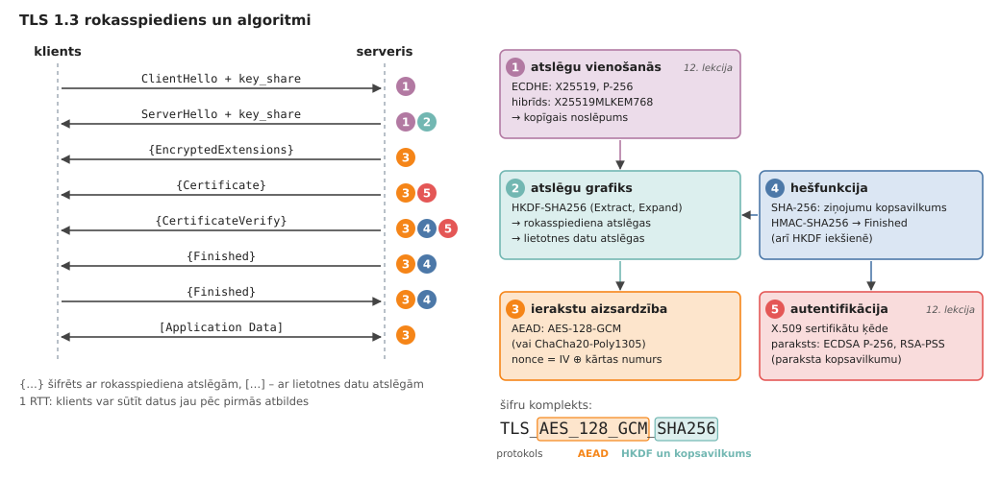
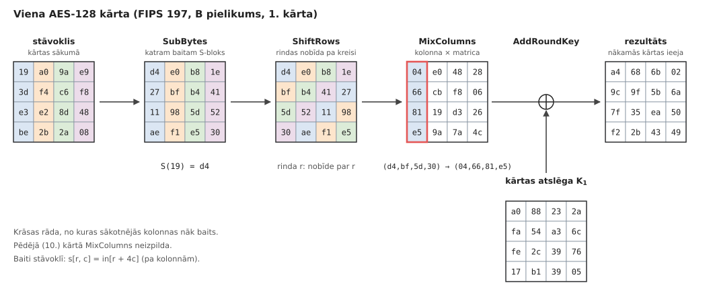
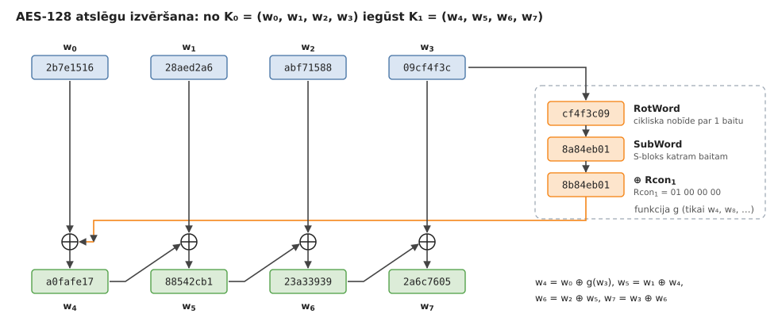
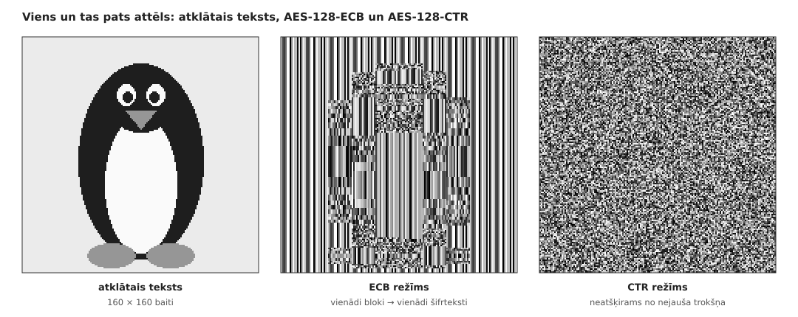
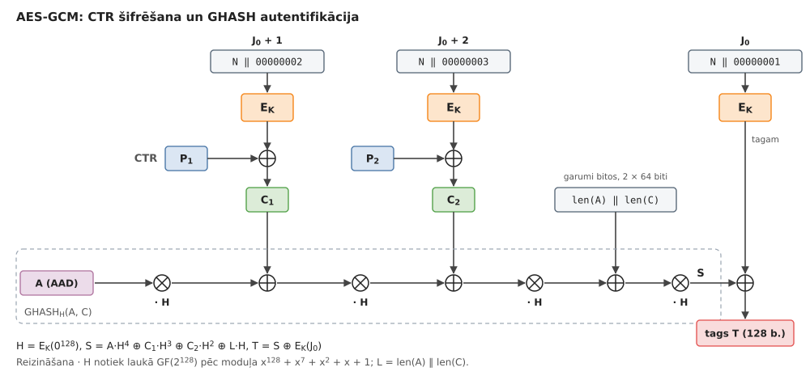
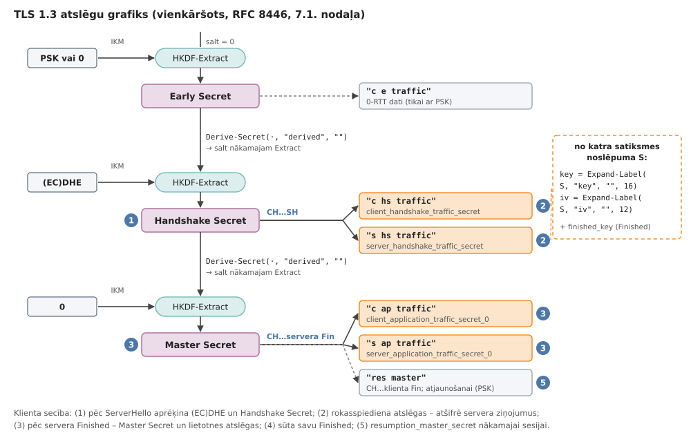

# 11. Kriptogrāfija TLS 1.3: AES un hešfunkcijas

Šeit aplūkojam  TLS 1.3 *simetrisko* daļu (ierakstu šifrēšanu un atslēgu atvasināšanu); 
asimetrisko daļu (atslēgu apmaiņu un parakstus) aplūkojam nākamajā lekcijā.

**Mācīšanās rezultāti:**

* Aprēķināt AES-128 vienas kārtas pārveidojumus (`SubBytes`, `ShiftRows`, `MixColumns`, `AddRoundKey`)
  un atslēgu izvēršanas soli, veicot darbības Galuā laukā $GF(2^8)$.
* Paskaidrot ECB režīma problēmas; aprakstīt, kā GCM režīms nodrošina gan
  konfidencialitāti, gan integritāti (AEAD).
* Aprakstīt, kā TLS 1.3 no kopīgā noslēpuma (*shared secret*) ar HKDF un SHA-256 atvasina ierakstu atslēgas
  (*record layer key*) un nonce vērtības.

## Ievads: TLS 1.3 algoritmu komplekts

*TLS* (*Transport Layer Security*) ir protokols, kas aizsargā lielāko daļu interneta satiksmes:
HTTPS, e-pastu (IMAP, SMTP), VPN un daudzu lietotņu API. Pašreizējā versija TLS 1.3 ir
aprakstīta dokumentā [RFC 8446](https://www.rfc-editor.org/rfc/rfc8446) (2018). Savienojums
sākas ar *rokasspiedienu* (*handshake*), kurā klients un serveris vienojas par atslēgām un
serveris pierāda savu identitāti; pēc tam visus datus sūta šifrētos *ierakstos* (*records*).
Rokasspiedienā piedalās četru veidu algoritmi:

1. **Atslēgu apmaiņa** -- eliptisko līkņu Difija-Helmana protokols ar īslaicīgām atslēgām (ECDHE),
   piemēram, ar līkni X25519 vai P-256; abas puses iegūst vienu un to pašu *kopīgo noslēpumu*.
2. **Autentifikācija** -- serveris nosūta X.509 sertifikātu ķēdi un paraksta visu rokasspiediena
   kopsavilkumu (ECDSA vai RSA-PSS).
3. **Atslēgu atvasināšana** -- no kopīgā noslēpuma ar HKDF un SHA-256 iegūst visas
   vajadzīgās atslēgas un inicializācijas vektorus.
4. **Ierakstu aizsardzība** -- katru ierakstu šifrē un autentificē ar AEAD algoritmu, piemēram, AES-128-GCM.

*TLS 1.3 rokasspiediens (pa kreisi) un algoritmi, kas apstrādā katru ziņojumu (pa labi).
Algoritmi 1 un 5 ir nākamās lekcijas tēma, algoritmi 2, 3 un 4 -- šīs lekcijas tēma.*

**Šifru komplekts.** TLS 1.3 *šifru komplekta* (*cipher suite*) nosaukums, piemēram,
`TLS_AES_128_GCM_SHA256`, nosaka tikai simetriskos algoritmus: `AES_128_GCM` ir AEAD algoritms
ierakstiem (AES ar $128$ bitu atslēgu GCM režīmā), bet `SHA256` -- hešfunkcija, ko lieto HKDF un
rokasspiediena kopsavilkumā. Atslēgu apmaiņas grupu un paraksta algoritmu puses izvēlas atsevišķi
(paplašinājumos `supported_groups` un `signature_algorithms`). TLS 1.3 definē tikai piecus šifru
komplektus; `TLS_AES_128_GCM_SHA256` ir obligāts visām implementācijām, bet praksē bieži lieto arī
`TLS_AES_256_GCM_SHA384` un `TLS_CHACHA20_POLY1305_SHA256`.

### Simetriskā un asimetriskā kriptogrāfija

*Simetriskajos* algoritmos (AES, HMAC) abām pusēm ir viena un tā pati slepenā atslēga. Tie ir ļoti
ātri -- mūsdienu procesors ar AES-GCM šifrē vairākus gigabaitus sekundē --, bet neatbild uz
jautājumu, kā abas puses iegūst kopīgu atslēgu, ja tās nekad nav tikušās. *Asimetriskajos*
algoritmos (Difija-Helmana atslēgu apmaiņa, paraksti) katrai pusei ir atslēgu pāris: privātā un
publiskā atslēga. Tie ļauj vienoties par atslēgu atklātā kanālā un pārbaudīt otras puses
identitāti, bet ir par vairākām kārtām lēnāki. Tāpēc TLS (tāpat kā daudzi citi
praktiskie protokoli) ir *hibrīds* -- vispirms asimetriskie algoritmi vienojas par atslēgu un
autentificē serveri, bet simetriskie algoritmi aizsargā pašus datus.

TLS 1.3 izmeta visus vecos simetriskos algoritmus, kuri iepriekšējās versijās bija bieži
uzbrukumu avoti: RC4 plūsmas šifru, CBC režīmu ar atsevišķu MAC (uzbrukumi *Lucky 13*, *POODLE*),
datu saspiešanu (uzbrukums *CRIME*), kā arī MD5 un SHA-1 parakstos. Atļauti ir tikai AEAD algoritmi
(sk. apakšnodaļu "AEAD jēdziens" zemāk).

**Uzbrucēja modelis:**

Kriptogrāfijā pieņem, ka uzbrucējs pilnībā kontrolē tīklu (*Dolev-Yao modelis*): tas var
noklausīties visus ziņojumus, tos mainīt, dzēst, aizkavēt, atkārtot un sūtīt savus ziņojumus;
viņš zina visus algoritmus, bet nezina slepenās atslēgas (*Kerkhofa princips*). No protokola sagaidām
šādas īpašības:

* *konfidencialitāte* (*confidentiality*; datus var izlasīt tikai abi galapunkti);
* *integritāte* (*integrity*; jebkura datu izmaiņa, dzēšana vai atkārtošana kļūst redzama);
* *autentiskums* (*authenticity*; klients runā ar to serveri, kuru gribēja sasniegt, nevis ar uzbrucēju).

## Galuā lauks GF(2^8)

AES apstrādā datus pa baitiem, un baitus tas uzskata par Galuā lauka $\text{GF}(2^8)$
elementiem. Šo lauku jau konstruējām lekcijā
[Kļūdu korekcija: Rīda-Solomona kodi]({{ '/lectures/lossy_reed_solomon/' | relative_url }})
(tur sīki aplūkots piemērs $\text{GF}(2^3)$): baits $b_7 b_6 \ldots b_1 b_0$ ir polinoms

$$b(x) = b_7 x^7 + b_6 x^6 + \ldots + b_1 x + b_0, \qquad b_i \in \lbrace 0, 1 \rbrace,$$

kura koeficientus saskaita un reizina pēc moduļa $2$. Piemēram, $\texttt{0x57} = 01010111_2$
atbilst polinomam $x^6 + x^4 + x^2 + x + 1$.

**Saskaitīšana un reizināšana:**

*Saskaitīšana* ir polinomu saskaitīšana pēc moduļa $2$, t.i., bitu XOR:
$\texttt{0x57} + \texttt{0x83} = \texttt{0x57} \oplus \texttt{0x83} = \texttt{0xD4}$. Katrs elements
pats sev ir pretējais ($a + a = 0$), tāpēc atņemšana sakrīt ar saskaitīšanu.

*Reizināšana* ir polinomu reizināšana, pēc kuras rezultātu dala ar nereducējamo polinomu

$$m(x) = x^8 + x^4 + x^3 + x + 1 \quad (\texttt{0x11B})$$

un paturam atlikumu (pakāpe $\leq 7$, t.i., atkal baits). Visu reizināšanu var izteikt ar vienu
pamatoperāciju $\textsf{xtime}$ -- reizināšanu ar $x$ (t.i., ar $\texttt{0x02}$): baitu pabīda par
vienu bitu pa kreisi, un, ja izkrīt augstākais bits ($x^8$), pieskaita $x^8 \bmod m(x) = x^4 + x^3 + x + 1$,
t.i., XOR ar $\texttt{0x1B}$. Tas ir tieši tas pats solis, ko izpilda CRC reģistrs lekcijā
[Kļūdu korekcija: Heminga kodi]({{ '/lectures/lossy_hamming/' | relative_url }}) -- tikai ar citu
polinomu un $8$, nevis $32$ bitiem.

*Piemērs* (no FIPS 197): aprēķinām $\texttt{0x57} \cdot \texttt{0x83}$. Vispirms atkārtoti piemērojam $\textsf{xtime}$:

| $x^k \cdot \texttt{0x57}$ | $k=0$ | $1$ | $2$ | $3$ | $4$ | $5$ | $6$ | $7$ |
| --- | --- | --- | --- | --- | --- | --- | --- | --- |
| vērtība | `57` | `AE` | `47` | `8E` | `07` | `0E` | `1C` | `38` |

Piemēram, $x^2 \cdot \texttt{0x57} = \textsf{xtime}(\texttt{0xAE})$: pēc bīdes iznāk $\texttt{0x15C}$,
izkrīt augstākais bits, tāpēc $\texttt{0x5C} \oplus \texttt{0x1B} = \texttt{0x47}$.
Tā kā $\texttt{0x83} = x^7 + x + 1$, tad

$$\texttt{0x57} \cdot \texttt{0x83} = \texttt{0x38} \oplus \texttt{0xAE} \oplus \texttt{0x57} = \texttt{0xC1}.$$

Tā darbojas arī aparatūra un vienkāršas programmas: reizinātāja $b$ katram vieniniekbitam pieskaita
attiecīgo $x^k \cdot a$ (sk. funkciju `gmul` failā [figs/aes128.py](figs/aes128.py)).

*Piezīme.* Rīda-Solomona kodos parasti izvēlas *primitīvu* polinomu (piemēram, $\texttt{0x11D}$),
kuram $x$ ir lauka ģenerators. AES polinoms $\texttt{0x11B}$ ir nereducējams, bet nav primitīvs:
$x = \texttt{0x02}$ multiplikatīvā kārta ir tikai $51$, bet ģenerators ir, piemēram, $\texttt{0x03} = x + 1$
(kārta $255$). Lauks ir tas pats (visi $\text{GF}(2^8)$ ir izomorfi), atšķiras tikai baitu pieraksts.

**Apgrieztais elements:**

Tā kā $m(x)$ ir nereducējams, katram baitam $a \neq 0$ ir apgrieztais elements $a^{-1}$, kuram
$a \cdot a^{-1} = 1$. To var atrast divos veidos.

* **Paplašinātais Eiklīda algoritms** polinomiem: atrod tādus $s(x), t(x)$, ka
  $s(x) a(x) + t(x) m(x) = \gcd(a, m) = 1$; tad $a^{-1} = s(x)$. Tas ir tas pats algoritms, ko lieto
  veseliem skaitļiem pēc moduļa $p$, tikai ar polinomu dalīšanu (sk. 11.1. uzdevumu).
* **Kāpināšana:** multiplikatīvajā grupā ir $255$ elementi, tāpēc $a^{255} = 1$ (Lagranža teorēma,
  tāpat kā mazā Ferma teorēma pēc moduļa $p$), un $a^{-1} = a^{254}$. Kāpināšanu veic ar
  atkārtotu kāpināšanu kvadrātā ($254 = 11111110_2$, tātad $7$ kāpināšanas kvadrātā un $6$ reizināšanas).

Piemēram, $\texttt{0x53}^{-1} = \texttt{0xCA}$ (pārbaudiet: $\texttt{0x53} \cdot \texttt{0xCA} = \texttt{0x01}$).
Elementam $0$ apgrieztā nav; AES vienojas, ka $0$ "apgrieztais" ir $0$. Apgrieztais elements ir
S-bloka pamatā.

## AES-128 bloku šifrs

1997.gadā ASV standartu institūts NIST izsludināja atklātu konkursu, lai aizstātu novecojušo
DES šifru ($56$ bitu atslēga). No $15$ kandidātiem 2000.gadā uzvarēja beļģu kriptogrāfu
J.Dāmena (*Joan Daemen*) un V.Reimena (*Vincent Rijmen*) šifrs *Rijndael*, ko 2001.gadā publicēja kā standartu
*AES* (*Advanced Encryption Standard*, [NIST FIPS 197](https://nvlpubs.nist.gov/nistpubs/fips/nist.fips.197.pdf)).
Sk. arī [Advanced Encryption Standard](https://en.wikipedia.org/wiki/Advanced_Encryption_Standard) Vikipēdijā.

AES ir *bloku šifrs*: tas ar atslēgu $K$ attēlo $128$ bitu (16 baitu) atklātā teksta bloku par
$128$ bitu šifrteksta bloku, un katrai atslēgai šis attēlojums ir bijekcija (permutācija).
Atslēgas garums var būt $128$, $192$ vai $256$ biti; attiecīgi šifrs izpilda $10$, $12$ vai $14$
*kārtas* (*rounds*). Bloka $16$ baitus $\mathit{in}_0, \ldots, \mathit{in}_{15}$ ieraksta
$4 \times 4$ baitu *stāvokļa* (*state*) matricā pa kolonnām: $s_{r,c} = \mathit{in}_{r+4c}$.
Katra kārta ir četru vienkāršu pārveidojumu kompozīcija; AES-128 šifrēšana pseidokodā:

$\textsf{AES-Encrypt}(\mathit{block}, \mathit{key})$
1. $w_0, \ldots, w_{43} \gets \textsf{KeyExpansion}(\mathit{key})$ $\quad$ *// 11 kārtu atslēgas pa 4 vārdiem*
2. $s \gets \mathit{block}$ $\quad$ *// 16 baiti 4 × 4 matricā pa kolonnām*
3. $s \gets \textsf{AddRoundKey}(s, w_0 \ldots w_3)$
4. **for** $r = 1$ **to** $10$
5. $\quad s \gets \textsf{SubBytes}(s)$ $\quad$ *// S-bloks katram baitam*
6. $\quad s \gets \textsf{ShiftRows}(s)$ $\quad$ *// rindu cikliskas nobīdes*
7. $\quad$ **if** $r < 10$ $\quad$ *// pēdējā kārtā MixColumns nav*
8. $\quad\quad s \gets \textsf{MixColumns}(s)$ $\quad$ *// kolonnu sajaukšana*
9. $\quad s \gets \textsf{AddRoundKey}(s, w_{4r} \ldots w_{4r+3})$ $\quad$ *// XOR ar kārtas atslēgu*
10. **return** $s$

*AES-128 pirmā kārta ar FIPS 197 B pielikuma skaitļiem. Krāsas rāda, no kuras kolonnas nāk baits:
pēc ShiftRows katrā kolonnā ir pa baitam no visām četrām kolonnām, un MixColumns tos sajauc.*

Visi pārveidojumi ir vienkārši, bet to uzdevumi ir dažādi: SubBytes ir vienīgā *nelineārā* daļa
(*sajaukšana*, *confusion*), ShiftRows un MixColumns izplata katra baita ietekmi pa visu stāvokli
(*difūzija*, *diffusion*), un AddRoundKey ienes atslēgu. Mācību implementācija, kas izdrukā
visus starprezultātus, ir failā [figs/aes128.py](figs/aes128.py).

### SubBytes un S-bloks

SubBytes katru stāvokļa baitu $a$ aizstāj ar $S(a)$, kur $S$ ir fiksēta $8$ bitu permutācija --
*S-bloks* (*S-box*). Praktiski to glabā $256$ baitu tabulā, bet tā definīcija ir algebriska un
sastāv no diviem soļiem:

1. **Apgrieztais elements:** $b = a^{-1}$ laukā $\text{GF}(2^8)$ (un $0 \mapsto 0$).
2. **Afīnais pārveidojums** virs $\text{GF}(2)$: $b$ bitus pareizina ar fiksētu $8 \times 8$ bitu
   matricu un pieskaita konstanti $\texttt{0x63}$. Ekvivalenti -- ar bitu cikliskām nobīdēm pa kreisi
   ($\mathrm{rotl}$):

$$S(a) = b \oplus \mathrm{rotl}(b,1) \oplus \mathrm{rotl}(b,2) \oplus \mathrm{rotl}(b,3) \oplus \mathrm{rotl}(b,4) \oplus \texttt{0x63}.$$

*Piemērs:* $S(\texttt{0x00}) = \texttt{0x63}$, jo $b = 0$ un paliek tikai konstante. Baitam $\texttt{0x53}$
vispirms $b = \texttt{0x53}^{-1} = \texttt{0xCA} = 11001010_2$; tad

| | biti |
| --- | --- |
| $b$ | `11001010` |
| $\mathrm{rotl}(b,1)$ | `10010101` |
| $\mathrm{rotl}(b,2)$ | `00101011` |
| $\mathrm{rotl}(b,3)$ | `01010110` |
| $\mathrm{rotl}(b,4)$ | `10101100` |
| $\texttt{0x63}$ | `01100011` |
| XOR summa | `11101101` $= \texttt{0xED}$ |

tātad $S(\texttt{0x53}) = \texttt{0xED}$ -- tieši tā, kā S-bloka tabulā (rinda `5`, kolonna `3`).

**Kāpēc tieši tā?** Apgrieztā elementa attēlojums ir tālu no jebkuras lineāras funkcijas: jebkurai
ieejas starpībai $\Delta \neq 0$ vienādojumam $S(x \oplus \Delta) \oplus S(x) = \Delta'$ ir ne vairāk kā
$4$ atrisinājumi no $256$, tāpēc labākā *diferenciālā* varbūtība vienam S-blokam ir $4/256 = 2^{-6}$.
Taču $a \mapsto a^{-1}$ ir algebriski ļoti vienkārša funkcija ($a^{254}$), un tai ir nekustīgie punkti
$0 \mapsto 0$ un $1 \mapsto 1$. Afīnais solis sarežģī S-bloka algebrisko pierakstu laukā $\text{GF}(2^8)$ un
nodrošina, ka nav neviena $a$ ar $S(a) = a$ vai $S(a) = \bar{a}$ (bitu inversija). Diferenciālās un lineārās
īpašības afīnais solis nemaina.

### ShiftRows un MixColumns

**ShiftRows** cikliski nobīda stāvokļa $r$-to rindu par $r$ pozīcijām pa kreisi ($r = 0, 1, 2, 3$):
nulles rinda paliek vietā, pēdējā rinda nobīdās par trim. Pēc tā katrā kolonnā ir pa vienam baitam no
katras iepriekšējās kolonnas (attēlā -- pa vienai krāsai).

**MixColumns** katru kolonnu $(a_0, a_1, a_2, a_3)^\top$ pareizina ar fiksētu matricu laukā $\text{GF}(2^8)$:

$$
\begin{pmatrix} a'_0 \\ a'_1 \\ a'_2 \\ a'_3 \end{pmatrix} =
\begin{pmatrix}
\texttt{02} & \texttt{03} & \texttt{01} & \texttt{01} \\
\texttt{01} & \texttt{02} & \texttt{03} & \texttt{01} \\
\texttt{01} & \texttt{01} & \texttt{02} & \texttt{03} \\
\texttt{03} & \texttt{01} & \texttt{01} & \texttt{02}
\end{pmatrix}
\begin{pmatrix} a_0 \\ a_1 \\ a_2 \\ a_3 \end{pmatrix}.
$$

Reizināšana ar $\texttt{02}$ ir $\textsf{xtime}$, ar $\texttt{03}$ -- $\textsf{xtime}(a) \oplus a$, tāpēc
MixColumns ir lēta. Ekvivalents pieraksts ir polinomu algebra: kolonna ir polinoms
$a_3 y^3 + a_2 y^2 + a_1 y + a_0$ ar koeficientiem no $\text{GF}(2^8)$, un MixColumns to reizina ar
$c(y) = \texttt{03}\, y^3 + \texttt{01}\, y^2 + \texttt{01}\, y + \texttt{02}$ pēc moduļa $y^4 + 1$.
Piemēram, attēlā kolonna $(\texttt{d4}, \texttt{bf}, \texttt{5d}, \texttt{30})$ pārvēršas par
$(\texttt{04}, \texttt{66}, \texttt{81}, \texttt{e5})$.

**Difūzija.** MixColumns matrica ir *MDS* (*maximum distance separable*) matrica: ja ieejas kolonnā ir
$k \geq 1$ nenulles baiti, izejā to ir vismaz $5 - k$. Pāri (ieeja, izeja) veido lineāru kodu ar
garumu $8$, dimensiju $4$ un minimālo attālumu $5$ -- tieši tādu, kas sasniedz Singltona robežu
$d = n - k + 1$, tāpat kā Rīda-Solomona kodi (tos var atjaunot no jebkuriem $k$ simboliem). Kopā ar
ShiftRows tas nozīmē: ja atklātajā tekstā maina vienu baitu, pēc vienas kārtas mainās $4$ baiti, bet pēc
divām kārtām -- visi $16$. Dizaineri pierādīja, ka jebkurā $4$ kārtu diferenciālajā ceļā piedalās vismaz
$25$ S-bloki, tāpēc tā varbūtība nepārsniedz $(2^{-6})^{25} = 2^{-150}$ (*plašā ceļa stratēģija*,
*wide trail strategy*).

### AddRoundKey un atslēgu izvēršana

**AddRoundKey** stāvoklim pieskaita (XOR) $128$ bitu *kārtas atslēgu*. AES-128 vajag $11$ kārtas
atslēgas (sākumā un pēc katras no $10$ kārtām), tātad $44$ vārdus $w_0, \ldots, w_{43}$ pa $4$ baitiem.
Tos iegūst *atslēgu izvēršanā* (*key expansion*, *key schedule*): pirmie četri vārdi ir pati atslēga,
un katrs nākamais ir iepriekšējā vārda un vārda pirms četriem pozīcijām XOR; katram ceturtajam vārdam
iepriekšējo vārdu vispirms apstrādā ar nelineāru funkciju $g$.

$\textsf{KeyExpansion}(\mathit{key})$
1. **for** $i = 0$ **to** $3$
2. $\quad w_i \gets (\mathit{key}_{4i}, \mathit{key}_{4i+1}, \mathit{key}_{4i+2}, \mathit{key}_{4i+3})$
3. **for** $i = 4$ **to** $43$
4. $\quad t \gets w_{i-1}$
5. $\quad$ **if** $i \bmod 4 = 0$
6. $\quad\quad t \gets \textsf{SubWord}(\textsf{RotWord}(t)) \oplus \mathit{Rcon}_{i/4}$ $\quad$ *// funkcija $g$*
7. $\quad w_i \gets w_{i-4} \oplus t$
8. **return** $w_0, \ldots, w_{43}$

Šeit $\textsf{RotWord}(b_0, b_1, b_2, b_3) = (b_1, b_2, b_3, b_0)$ ir cikliska nobīde par vienu baitu,
$\textsf{SubWord}$ katram baitam piemēro S-bloku, bet kārtas konstante ir
$\mathit{Rcon}_j = (x^{j-1}, 0, 0, 0)$ -- polinoma $x$ pakāpe laukā $\text{GF}(2^8)$:
$\texttt{01}, \texttt{02}, \texttt{04}, \texttt{08}, \texttt{10}, \texttt{20}, \texttt{40}, \texttt{80}, \texttt{1B}, \texttt{36}$
(pēc $\texttt{80}$ seko $\textsf{xtime}(\texttt{80}) = \texttt{1B}$). Konstantes padara kārtas atšķirīgas
(citādi būtu iespējami *slīdēšanas uzbrukumi*, *slide attacks*), bet S-bloks -- izvēršanu nelineāru.

*Atslēgu izvēršanas pirmais solis FIPS 197 A.1 pielikuma atslēgai: $w_4 = w_0 \oplus g(w_3) = \texttt{a0fafe17}$.*

Atslēgu izvēršana ir apgriežama: no jebkuras kārtas atslēgas var atjaunot visas pārējās, arī pašu
atslēgu. Tāpēc, piemēram, sānu kanālu uzbrukumā pietiek atrast pēdējās kārtas atslēgu.

### Atšifrēšana

Visi četri pārveidojumi ir apgriežami, tāpēc atšifrēšana izpilda apgrieztos pārveidojumus apgrieztā
secībā: $\textsf{InvShiftRows}$ (nobīde pa labi), $\textsf{InvSubBytes}$ (apgrieztais S-bloks),
$\textsf{AddRoundKey}$ (XOR ir pats sev apgriezts) un $\textsf{InvMixColumns}$ (reizināšana ar
apgriezto matricu ar elementiem $\texttt{0E}, \texttt{0B}, \texttt{0D}, \texttt{09}$, kas ir nedaudz
dārgāka). Kārtas atslēgas lieto pretējā secībā -- no $w_{40} \ldots w_{43}$ līdz $w_0 \ldots w_3$.

TLS 1.3 visi AES režīmi (GCM, CCM) izmanto bloku šifru kā *plūsmas šifra* ģeneratoru
(sk. apakšnodaļu "CTR režīms"), tāpēc gan šifrēšanā, gan atšifrēšanā vajag tikai funkciju
$\textsf{AES-Encrypt}$. Apgrieztais šifrs TLS 1.3 nav vajadzīgs vispār.

**AES aparatūras atbalsts.** Kopš 2010.gada Intel un AMD procesoriem ir instrukcijas *AES-NI*
(`AESENC` izpilda visu vienu kārtu, `AESENCLAST` -- pēdējo kārtu, `AESKEYGENASSIST` palīdz atslēgu izvēršanā), bet
ARMv8 procesoriem (arī telefonos) -- instrukcijas `AESE`/`AESMC`. Kopā ar instrukciju bezpārneses
reizināšanai (`PCLMULQDQ`, `PMULL`), ko lieto GHASH, AES-128-GCM sasniedz vairākus gigabaitus sekundē
uz vienu procesora kodolu. Tikpat svarīgi ir tas, ka šīs instrukcijas izpildās
*konstantā laikā*, neatkarīgi no datiem un atslēgas, tāpēc tās novērš kešatmiņas laika uzbrukumus
tabulu implementācijām (sk. apakšnodaļu "Sānu kanālu uzbrukumi AES").

## Bloku šifru darbības režīmi

Bloku šifrs pats par sevi šifrē tieši $16$ baitus. Lai šifrētu garāku ziņojumu (piemēram, TLS ierakstu
līdz $16$ KiB), vajag *darbības režīmu* (*mode of operation*) -- likumu, kā bloku šifru lietot
ziņojuma blokiem. Labam režīmam jāslēpj arī tas, vai divi bloki (vai divi ziņojumi) ir vienādi, un
TLS vajadzībām tam jānodrošina arī integritāte.

### ECB režīms

Vienkāršākais ir *ECB* (*Electronic Codebook*) režīms: ziņojumu sadala blokos $P_1, \ldots, P_n$
(pēdējo papildina līdz $16$ baitiem, piemēram, ar PKCS#7) un katru bloku šifrē atsevišķi ar to pašu atslēgu:

$$C_i = E_K(P_i).$$

ECB ir deterministisks un šifrē katru bloku neatkarīgi no tā pozīcijas, tāpēc **vienādi atklātā teksta
bloki dod vienādus šifrteksta blokus**. Uzbrucējs neuzzina bloku saturu, bet redz to atkārtošanās
struktūru. Klasiskais piemērs ir "ECB pingvīns": attēla pikseļu baiti, šifrēti ECB režīmā, joprojām rāda
attēla kontūras, jo vienādas krāsas laukumi kļūst par vienādiem šifrteksta blokiem.

*Viens un tas pats pelēktoņu attēls (1 baits pikselim), šifrēts ar AES-128 ECB un CTR režīmā.
Attēlu veido skripts [figs/ecb_penguin.py](figs/ecb_penguin.py).*

ECB nedrīkst lietot ziņojumu šifrēšanai. Tas der tikai viena nejauša bloka šifrēšanai (piemēram,
citas atslēgas iesaiņošanai) vai kā "būvbloks" citos režīmos.

### CTR režīms

*Skaitītāja režīms* (*Counter mode*, CTR) no bloku šifra veido *plūsmas šifru*. Šifrē nevis ziņojumu,
bet skaitītāja blokus -- unikālu *nonce* (*number used once*) $N$ kopā ar bloka numuru $i$ --, un iegūto
*atslēgas plūsmu* (*keystream*) pieskaita atklātajam tekstam:

$$C_i = P_i \oplus E_K(N \,\Vert\, i), \qquad P_i = C_i \oplus E_K(N \,\Vert\, i).$$

CTR īpašības:

* šifrēšana un atšifrēšana ir viena un tā pati operācija, un vajag tikai $E_K$;
* visus blokus var aprēķināt **paralēli** un jebkuru bloku var atšifrēt atsevišķi (brīvpiekļuve);
* papildināšana nav vajadzīga: pēdējo atslēgas plūsmas bloku vienkārši apgriež līdz vajadzīgajam garumam;
* vienādi atklātā teksta bloki dažādās pozīcijās dod dažādus šifrtekstus (pingvīna attēlā -- troksnis).

Taču CTR ir ļoti jutīgs pret **nonce atkārtošanu**. Ja divus ziņojumus šifrē ar to pašu $K$ un $N$,
tiem ir viena un tā pati atslēgas plūsma, un

$$C_1 \oplus C_2 = P_1 \oplus P_2,$$

t.i., uzbrucējs iegūst atklāto tekstu XOR. Ja viens no tekstiem ir zināms (vai daļēji uzminams, piemēram,
HTTP galvene), uzbrucējs uzzina otru (sk. 11.4. uzdevumu). Turklāt CTR **nenodrošina integritāti**:
apgriežot šifrteksta bitu, uzbrucējs apgriež tieši to pašu atklātā teksta bitu (piemēram, mainot
summu maksājumā), un saņēmējs to nepamana.

**CTR režīms video saturam: Common Encryption.** Straumēšanas servisi (Netflix, YouTube, Disney+ u.c.)
video un audio failus (MP4, DASH, HLS) šifrē pēc standarta *Common Encryption*
(*CENC*, ISO/IEC 23001-7). Shēma `cenc` lieto AES-128 CTR režīmā: katram paraugam (piemēram, video kadram) ir
savs $8$ baitu IV, kas kopā ar $8$ baitu bloku skaitītāju veido skaitītāja bloku. Šifrē tikai video
datu "kravu", bet NAL vienību galvenes atstāj atklātas (*subsample encryption*), tāpēc failu var
sadalīt segmentos, pārsūtīt un pārbaudīt bez atslēgas. CTR ir izdevīgs, jo var sākt
atšifrēt no jebkuras vietas (pārtīšana) un atšifrēšana ir lēta arī vājās ierīcēs. Viens un tas pats
šifrētais fails der vairākām DRM sistēmām (Widevine, PlayReady, FairPlay), kuras atšķiras tikai ar to, kā
klients saņem atslēgu (licenci). Apple ierīcēm paredzētā shēma `cbcs` lieto CBC režīmu un šifrē tikai daļu
bloku (piemēram, $1$ no katriem $10$). Ievērojiet, ka CENC nodrošina tikai konfidencialitāti -- integritāte
video straumēšanai nav tik kritiska, un to nodrošina transporta slānis (atkal TLS).

### GCM režīms

*GCM* (*Galois/Counter Mode*, [NIST SP 800-38D](https://csrc.nist.gov/pubs/sp/800/38/d/final))
apvieno CTR šifrēšanu ar ātru autentifikācijas kodu *GHASH*. Ievade ir atslēga $K$, $96$ bitu nonce $N$,
atklātais teksts $P$ un *papildu autentificētie dati* $A$ (*additional authenticated data*, AAD), kurus
nešifrē, bet aizsargā pret izmaiņām (TLS gadījumā -- ieraksta galvene). Izvade ir šifrteksts $C$
(tikpat garš kā $P$) un $128$ bitu *autentifikācijas tags* $T$.

*AES-GCM diviem atklātā teksta blokiem: augšā CTR šifrēšana, apakšā GHASH, kas novērtē polinomu
punktā $H$.*

1. **Šifrēšana.** Skaitītāja sākuma bloks ir $J_0 = N \,\Vert\, \texttt{00000001}$; datu blokus šifrē CTR
   režīmā ar skaitītājiem $J_0 + 1, J_0 + 2, \ldots$ (palielina tikai pēdējos $32$ bitus).
2. **GHASH atslēga** ir $H = E_K(0^{128})$ -- nulles bloka šifrs; tā ir slepena, jo atkarīga no $K$.
3. **GHASH.** Datus $A$ un $C$ papildina ar nullēm līdz pilniem blokiem un pievieno bloku
   $L = \mathrm{len}(A) \,\Vert\, \mathrm{len}(C)$ (garumi bitos). Iegūtos blokus $X_1, \ldots, X_m$ uzskata par
   lauka $\text{GF}(2^{128})$ elementiem (modulis $x^{128} + x^7 + x^2 + x + 1$) un aprēķina
   $$S = X_1 H^m \oplus X_2 H^{m-1} \oplus \ldots \oplus X_m H,$$
   t.i., polinoma ar koeficientiem $X_1, \ldots, X_m$ vērtību punktā $H$. To dara ar Hornera shēmu:
   $Y_0 = 0$, $Y_j = (Y_{j-1} \oplus X_j) \cdot H$, $S = Y_m$.
4. **Tags** $T = S \oplus E_K(J_0)$. Pieskaitītais $E_K(J_0)$ ir "vienreizējā parole", kas slēpj $S$.

Atšifrējot saņēmējs vispirms pārrēķina tagu no $A$ un $C$; ja tas nesakrīt ar saņemto $T$, ziņojumu
noraida, **neatšifrējot un neatgriežot nevienu baitu**.

**Saistība ar Rīda-Solomona kodiem.** GHASH ir polinoma novērtēšana vienā slepenā punktā, tāpat kā
Rīda-Solomona kodēšana ir polinoma novērtēšana daudzos publiskos punktos. Drošība balstās uz to pašu faktu:
nenulles polinomam ar pakāpi $d$ ir ne vairāk kā $d$ saknes. Ja uzbrucējs nomaina $(A, C)$ ar
$(A', C') \neq (A, C)$ un cer, ka tags nemainīsies, tad tam jāizpildās
$\textsf{GHASH}_H(A, C) = \textsf{GHASH}_H(A', C')$, t.i., $H$ jābūt starpības polinoma saknei. Starpības
polinoms nav nulle, un tā pakāpe ir $d \leq m$, tāpēc pie nejauša $H$ viltojums izdodas ar varbūtību
ne lielāku kā $d / 2^{128}$ -- praktiski nekad.

GHASH reizināšana laukā $\text{GF}(2^{128})$ ir *bezpārneses* reizināšana (kā polinomiem pēc moduļa $2$) ar
sekojošu dalīšanu ar moduli -- tāpat kā $\text{GF}(2^8)$, tikai ar $128$ bitu blokiem. Procesoros to izpilda
instrukcija `PCLMULQDQ`.

### AEAD jēdziens

GCM ir piemērs *autentificētajai šifrēšanai ar papildu datiem* (*authenticated encryption with associated
data*, AEAD, [RFC 5116](https://www.rfc-editor.org/rfc/rfc5116)). AEAD algoritms ir divu funkciju pāris:

* $\textsf{Seal}(K, N, A, P) \to C$ -- šifrē $P$ un pievieno tagu, kas aptver gan $C$, gan $A$;
* $\textsf{Open}(K, N, A, C) \to P$ vai $\bot$ (kļūda) -- atgriež atklāto tekstu tikai tad, ja
  ne $C$, ne $A$ nav mainīti.

Lietotājam jāievēro viens noteikums: **vienai atslēgai katru nonce drīkst lietot tikai vienu reizi**.
Nonce nav jābūt slepenam vai nejaušam -- pietiek ar skaitītāju. Ja noteikums ir izpildīts, AEAD
nodrošina vienlaikus konfidencialitāti un integritāti, un programmētājam nav pašam jākombinē šifrs ar MAC
(kur viegli kļūdīties secībā un pārbaudēs, kā TLS 1.2 CBC režīmā).

TLS 1.3 katru ierakstu aizsargā tieši ar $\textsf{Seal}$: $A$ ir $5$ baitu ieraksta galvene
(tips `0x17`, versija `0x0303`, garums), $N$ ir ieraksta nonce (sk. apakšnodaļu "Ierakstu nonce un atslēgu
atjaunošana"), bet $P$ ir dati, pie kuriem pievienots īstais
satura tips un, ja vajag, nulles baiti, kas slēpj ziņojuma garumu.

**ChaCha20-Poly1305.** Otrs TLS 1.3 AEAD algoritms ([RFC 8439](https://www.rfc-editor.org/rfc/rfc8439),
D.Bernstein) apvieno plūsmas šifru ChaCha20 ($256$ bitu atslēga) ar autentifikācijas kodu Poly1305.
ChaCha20 lieto tikai $32$ bitu saskaitīšanu, ciklisku nobīdi un XOR (*ARX* konstrukcija), tāpēc tas ir ātrs un
konstanta laika arī procesoros bez AES instrukcijām (vecāki telefoni, mikrokontrolleri). Poly1305 ir tāda
pati ideja kā GHASH -- polinoma novērtēšana slepenā punktā --, tikai pirmskaitļa laukā pēc moduļa $2^{130} - 5$.
Klients savā ClientHello var norādīt ChaCha20-Poly1305 kā pirmo izvēli, ja tam nav AES aparatūras atbalsta.

## Hešfunkcijas un atslēgu atvasināšana

TLS 1.3 hešfunkcija (parasti SHA-256) vajadzīga trīs vietās: rokasspiediena ziņojumu kopsavilkumam
(*transcript hash*), ko paraksta serveris un ar kuru atslēgas tiek "piesaistītas" konkrētajam
rokasspiedienam; HMAC aprēķinā ziņojumos Finished; un atslēgu atvasināšanā (HKDF). SHA-256 uzbūve jau aplūkota
lekcijā [Kļūdu korekcija: Heminga kodi]({{ '/lectures/lossy_hamming/' | relative_url }}), tāpēc šeit
tikai atgādinām galveno.

### SHA-256 īpašības

Kriptogrāfiskai hešfunkcijai $H$ jābūt ātri aprēķināmai un jāizpilda trīs prasības:

* *pirmtēla noturība* (*preimage resistance*): dotai vērtībai $h$ nevar atrast $m$ ar $H(m) = h$;
* *otrā pirmtēla noturība* (*second preimage resistance*): dotam $m$ nevar atrast $m' \neq m$ ar $H(m') = H(m)$;
* *kolīziju noturība* (*collision resistance*): nevar atrast nevienu pāri $m \neq m'$ ar $H(m) = H(m')$.

SHA-256 ir veidota pēc *Merkla-Damgora konstrukcijas* (*Merkle–Damgård*): ziņojumu papildina, sadala $512$ bitu
blokos un ar saspiešanas funkciju $f$ pārrēķina $256$ bitu stāvokli, $H_i = f(H_{i-1}, M_i)$; rezultāts ir
pēdējais stāvoklis $H_N$.

Tieši tāpēc $H(K \,\Vert\, m)$ **nav** drošs ziņojuma autentifikācijas kods (MAC). Rezultāts ir
viss iekšējais stāvoklis $H_N$, tāpēc uzbrucējs, kurš zina $H(K \,\Vert\, m)$ un $K \,\Vert\, m$ garumu (bet
ne $K$), var turpināt ķēdi: aprēķināt
$H(K \,\Vert\, m \,\Vert\, \mathit{pad} \,\Vert\, m')$ jebkuram turpinājumam $m'$ (*garuma paplašināšanas uzbrukums*,
*length extension attack*). Šī problēma nav SHA-3, kā arī saīsinātajām versijām, piemēram, SHA-384, kas
izvada tikai daļu stāvokļa.

### HMAC

*HMAC* ([RFC 2104](https://www.rfc-editor.org/rfc/rfc2104)) no jebkuras hešfunkcijas veido MAC:

$$\textsf{HMAC}(K, m) = H\big((K \oplus \mathit{opad}) \,\Vert\, H((K \oplus \mathit{ipad}) \,\Vert\, m)\big),$$

kur atslēgu $K$ papildina ar nullēm līdz bloka garumam ($64$ baiti SHA-256; garāku atslēgu vispirms
hešo), $\mathit{ipad}$ ir baits $\texttt{0x36}$, bet $\mathit{opad}$ -- baits $\texttt{0x5C}$, atkārtots $64$ reizes.

Iekšējā hešošana ir tieši tā nedrošā konstrukcija $H(K' \,\Vert\, m)$, bet tās rezultāts nekad netiek
publicēts: to vēlreiz hešo ar citu atslēgu $K \oplus \mathit{opad}$. Uzbrucējs var paplašināt iekšējo
ķēdi, bet nevar aprēķināt ārējo hešu, jo tā sākums ir atkarīgs no atslēgas. HMAC drošība ir pierādīta ar
pieņēmumu, ka saspiešanas funkcija ir *pseidogadījuma funkcija* (*pseudorandom function*, PRF), un HMAC pats
par sevi ir PRF -- tāpēc to lieto ne tikai autentifikācijai, bet arī atslēgu atvasināšanai.

### HKDF un TLS 1.3 atslēgu grafiks

*HKDF* ([RFC 5869](https://www.rfc-editor.org/rfc/rfc5869)) ir atslēgu atvasināšanas funkcija ar diviem
soļiem:

* **Extract:** $\mathit{PRK} = \textsf{HMAC}(\mathit{salt}, \mathit{IKM})$. Ievades atslēgas materiāls
  $\mathit{IKM}$ (piemēram, ECDHE kopīgais noslēpums -- līknes punkta koordināta) nav vienmērīgi sadalīts
  bitu virkņu kopā; Extract to "koncentrē" $32$ baitu pseidogadījuma atslēgā $\mathit{PRK}$.
* **Expand:** no $\mathit{PRK}$ iegūst tik daudz baitu, cik vajag, piesaistot tos kontekstam $\mathit{info}$:
  $T_1 = \textsf{HMAC}(\mathit{PRK}, \mathit{info} \,\Vert\, \texttt{0x01})$,
  $T_i = \textsf{HMAC}(\mathit{PRK}, T_{i-1} \,\Vert\, \mathit{info} \,\Vert\, i)$; rezultāts ir $T_1 \Vert T_2 \Vert \ldots$
  apgriezts līdz vajadzīgajam garumam. Dažādiem $\mathit{info}$ iegūst (praktiski) neatkarīgas atslēgas.

TLS 1.3 *Expand* lieto ar fiksētu struktūru:
$\textsf{HKDF-Expand-Label}(\mathit{Secret}, \mathit{Label}, \mathit{Context}, \mathit{Length})$, kur
$\mathit{info}$ ir garums ($2$ baiti), etiķete `"tls13 "` + $\mathit{Label}$ un konteksts (abi ar garuma
baitu priekšā). Biežāk lietotā forma ir

$$\textsf{Derive-Secret}(S, \mathit{Label}, \mathit{Msgs}) = \textsf{HKDF-Expand-Label}(S, \mathit{Label}, \textsf{Transcript-Hash}(\mathit{Msgs}), 32),$$

t.i., kontekstā ir visu līdz šim nosūtīto rokasspiediena ziņojumu SHA-256. Tāpēc katra atslēga ir atkarīga
no **visa** rokasspiediena: ja uzbrucējs būtu mainījis kaut vienu ziņojumu, abām pusēm būtu dažādas atslēgas, un
Finished pārbaude neizdotos.

*Atslēgu grafiks* (*key schedule*, RFC 8446, 7.1. nodaļa) ir trīs noslēpumu ķēde. Katrā solī HKDF-Extract
pievieno jaunu atslēgas materiālu: *Early Secret* -- iepriekšējās sesijas PSK (vai nulles), *Handshake Secret* --
ECDHE kopīgo noslēpumu, *Master Secret* -- vairs neko (nulles). Starp tiem
$\textsf{Derive-Secret}(\cdot, \texttt{"derived"}, \text{""})$ dod nākamā Extract sāli.

*Vienkāršots TLS 1.3 atslēgu grafiks. CH, SH un Fin -- ziņojumi ClientHello, ServerHello un Finished;
"CH…SH" nozīmē visu ziņojumu kopsavilkumu no ClientHello līdz ServerHello ieskaitot.*

No katra *satiksmes noslēpuma* (*traffic secret*) $S$ iegūst AEAD atslēgu un IV:

$$\mathit{key} = \textsf{HKDF-Expand-Label}(S, \texttt{"key"}, \text{""}, 16), \qquad
\mathit{iv} = \textsf{HKDF-Expand-Label}(S, \texttt{"iv"}, \text{""}, 12),$$

kā arī Finished atslēgu $\mathit{finished\_key} = \textsf{HKDF-Expand-Label}(S, \texttt{"finished"}, \text{""}, 32)$.

Klients pilnā rokasspiedienā atslēgas atvasina šādā secībā:

1. Nosūta ClientHello ar savu ECDHE publisko atslēgu (Early Secret bez PSK ir konstante).
2. Saņēmis ServerHello, aprēķina ECDHE kopīgo noslēpumu un *Handshake Secret*.
3. Atvasina `c hs traffic` un `s hs traffic` (konteksts: CH…SH) un no tiem rokasspiediena atslēgas un IV;
   ar servera atslēgu atšifrē EncryptedExtensions, Certificate, CertificateVerify un Finished. Servera
   Finished pārbauda kā $\textsf{HMAC}(\mathit{finished\_key}, \textsf{Transcript-Hash}(\ldots))$.
4. Aprēķina *Master Secret* un `c ap traffic`, `s ap traffic` (konteksts: CH…servera Finished) --
   lietotnes datu atslēgas.
5. Nosūta savu Finished (šifrētu ar klienta rokasspiediena atslēgu) un pārslēdzas uz lietotnes datu atslēgām.
6. Pēc sava Finished atvasina `res master` -- noslēpumu, no kura veido PSK nākamās sesijas ātrai atjaunošanai.

### Ierakstu nonce un atslēgu atjaunošana

Katrai pusei un katram virzienam ir savs satiksmes noslēpums, atslēga un $12$ baitu $\mathit{iv}$. Katru
ierakstu numurē ar $64$ bitu *kārtas numuru* $\mathit{seq}$ ($0, 1, 2, \ldots$; pēc katras atslēgas maiņas atkal
no $0$). Ieraksta nonce ir

$$N = \mathit{iv} \oplus (0^{32} \,\Vert\, \mathit{seq}),$$

t.i., kārtas numuru papildina ar nullēm kreisajā pusē līdz $12$ baitiem un pieskaita (XOR) $\mathit{iv}$.
Tā kā $\mathit{seq}$ nekad neatkārtojas, arī **nonce nekad neatkārtojas** -- un AEAD vienīgais noteikums ir
izpildīts bez jebkāda nejaušības avota. Kārtas numurs netiek sūtīts tīklā: abas puses to skaita pašas, tāpēc
pārkārtots, atkārtots vai izdzēsts ieraksts dod nepareizu nonce, un tā tags nesakrīt. $\mathit{iv}$
pieskaitīšana nodrošina, ka dažādiem savienojumiem nonce vērtības ir dažādas un neparedzamas.

Ar vienu atslēgu nedrīkst šifrēt pārāk daudz datu. Intuīcija: AES ir permutācija, tāpēc CTR atslēgas plūsmā
bloki nekad neatkārtojas, bet īsti nejaušā virknē pēc $q$ blokiem atkārtojums gaidāms ar varbūtību apmēram
$q^2 / 2^{128}$ (dzimšanas dienu paradokss); jo vairāk bloku, jo vieglāk šo atšķirību pamanīt. Tāpēc RFC 8446
iesaka ar vienu AES-GCM atslēgu šifrēt ne vairāk kā $2^{24.5}$ pilna izmēra ierakstus (aptuveni
$2^{34.5}$ blokus) -- tad šī varbūtība paliek ap $2^{-57}$. Pirms robežas sasniegšanas puse sūta ziņojumu
*KeyUpdate*, un abas puses pāriet uz nākamo noslēpumu
$S_{n+1} = \textsf{HKDF-Expand-Label}(S_n, \texttt{"traffic upd"}, \text{""}, 32)$. Vecās atslēgas pēc tam
izdzēš, tāpēc arī atslēgas noplūde vēlāk neatklāj iepriekšējos datus.

## Uzbrukšana AES un AEAD, citi drošības riski

Dažreiz pareizus algoritmus var salauzt nepareiza implementācija vai lietošana.
Šajā nodaļā apskatīsim dažus salaušanas veidus vai implementācijas 
nianses.

### Sānu kanālu uzbrukumi AES

Pret pilno AES nav zināmu praktisku matemātisku uzbrukumu, taču konkrētas implementācijas var "nopludināt"
atslēgu caur *sānu kanāliem* (*side channels*): izpildes laiku, kešatmiņas stāvokli, strāvas patēriņu vai
elektromagnētisko starojumu.

**Kešatmiņas laika uzbrukumi.** Ātrās programmatūras AES implementācijas (bez AES-NI) apvieno SubBytes,
ShiftRows un MixColumns četrās $1$ KiB lielās tabulās (*T-tables*). Pirmajā kārtā tabulu indekss ir
$p_i \oplus k_i$ -- atklātā teksta un atslēgas baitu XOR. Kešatmiņas rinda ($64$ baiti) satur $16$ tabulas
elementus, tāpēc uzbrucējs, kurš var novērot, kuras kešatmiņas rindas tika lietotas (piemēram, cits process tajā
pašā datorā ar metodēm *Prime+Probe* vai *Flush+Reload*), uzzina katra $p_i \oplus k_i$ augšējos $4$ bitus, un ar
zināmu $p_i$ -- atslēgas baita $k_i$ augšējos bitus. Ar dažiem tūkstošiem šifrēšanu un otrās kārtas analīzi
atjauno visu atslēgu (D.A.Osviks, A.Šamirs, E.Tromers, 2006). D.Bernšteins (2005) parādīja, ka pat
tīkla atbildes laiks var atklāt OpenSSL AES atslēgu. Aizsardzība: aparatūras instrukcijas (AES-NI, ARMv8)
vai *bitslice* implementācijas, kas izpilda S-bloku kā Būla shēmu bez tabulām un atmiņas piekļuvēm, kas atkarīgas no datiem.

**Jaudas analīze.** Viedkartēs, maksājumu termināļos un IoT ierīcēs uzbrucējs var izmērīt strāvas patēriņu
katras šifrēšanas laikā (*DPA*, *differential power analysis*, P.Kočers u.c., 1999). Patēriņš mirklī,
kad reģistrā ieraksta S-bloka rezultātu, ir apmēram proporcionāls tā *Heminga svaram* -- vieninieku skaitam,
t.i., Heminga attālumam līdz nulles vārdam (sk. lekciju par Heminga kodiem). Uzbrukums (*CPA*, *correlation power
analysis*) katram atslēgas baitam pārbauda visus $256$ minējumus $k$: aprēķina gaidāmo Heminga svaru
$\mathrm{HW}(S(p_i \oplus k))$ visiem mērījumiem un salīdzina (korelē) ar izmērīto patēriņu. Pareizajam minējumam
korelācija ir izteikti lielāka. Tā $2^{128}$ pārlases vietā pietiek ar $16 \cdot 256$ minējumiem un dažiem simtiem vai
tūkstošiem mērījumu. Aizsardzība: *maskēšana* (starprezultātiem pieskaita nejaušu masku, kas katrā šifrēšanā
cita), operāciju secības jaukšana, trokšņa ģeneratori aparatūrā.

**Baltās kastes kriptogrāfija.** TLS implementācijas atslēgas glabā procesa atmiņā vai aparatūras
drošības modulī (HSM), tāpēc *baltās kastes* (*white-box*) AES tajās nelieto. Tomēr tas ir aktuāls DRM sistēmām
(sk. Common Encryption apakšnodaļā "CTR režīms") un mobilajiem maksājumiem: tur AES atslēga ir "iešūta" lielās tabulās
programmā, kas darbojas uzbrucēja ierīcē. Uzbrukums *DCA* (*differential computation analysis*, J.Boss u.c., 2016)
jaudas mērījumu vietā izmanto programmas atmiņas piekļuvju ierakstus (iegūtus, piemēram, ar
dinamisko instrumentāciju) un to pašu korelācijas statistiku; tas automātiski salauza daudzas publiskās
baltās kastes implementācijas.

### Nonce atkārtošana GCM režīmā

GCM ir vēl jutīgāks pret nonce atkārtošanu nekā CTR. Pieņemsim, ka divus ziņojumus $(A_1, C_1)$ un $(A_2, C_2)$
šifrē ar to pašu $K$ un $N$. Tad

* abiem ir viena atslēgas plūsma, tāpēc $C_1 \oplus C_2 = P_1 \oplus P_2$ (kā CTR režīmā);
* abiem tagiem ir viens un tas pats $E_K(J_0)$, tāpēc tagu summā tas saīsinās:
  $$T_1 \oplus T_2 = \textsf{GHASH}_H(A_1, C_1) \oplus \textsf{GHASH}_H(A_2, C_2).$$

Labā puse ir zināms polinoms no $H$ (ar zināmiem koeficientiem -- šifrtekstu blokiem), tāpēc $H$ ir polinoma
$$Q(X) = \textsf{GHASH}_X(A_1, C_1) \oplus \textsf{GHASH}_X(A_2, C_2) \oplus T_1 \oplus T_2$$
sakne. Polinoma sakņu atrašana galīgā laukā ir efektīva (piemēram, ar Kantora-Zasenhauza algoritmu), un sakņu
ir maz; ar trešo ziņojumu pareizo sakni atlasa. Zinot $H$, uzbrucējs no jebkura taga aprēķina $E_K(J_0)$ un var
izveidot derīgu tagu **jebkuram** šifrtekstam ar šo nonce -- t.i., viltot ziņojumus. Šo uzbrukumu
A.Žū (*Antoine Joux*) 2006.gadā nosauca par "aizliegto uzbrukumu" (*forbidden attack*); 11.5. uzdevumā to
izpildīsim viena bloka ziņojumiem.

Tas pats polinomu fakts, kas iepriekš garantēja drošību, šeit darbojas pret mums: drošības pierādījums
teica, ka viltojums izdodas tikai tad, ja nejaušais $H$ ir starpības polinoma sakne, un tas notiek ar varbūtību
$\leq d / 2^{128}$. Divi ziņojumi ar vienu nonce *dod* uzbrucējam tieši tādu polinomu, kura sakne ir $H$.

Tā nav tikai teorija: 2016.gadā H.Beks (*Hanno Böck*) u.c. internetā atrada vairāk nekā $180$ HTTPS serveru
(TLS 1.2), kas atkārtoja GCM nonce, un desmitiem tūkstošu serveru ar nejaušiem nonce, kuriem atkārtošanās ir
iespējama. TLS 1.2 ļāva katrai implementācijai pašai izvēlēties nonce daļu; TLS 1.3 to veido
deterministiski no kārtas numura, tāpēc šāda kļūda nav iespējama.

### Citi riski

**0-RTT datu atkārtošana.** Atjaunojot sesiju ar PSK, TLS 1.3 klients var sūtīt datus jau pirmajā
ziņojumā kopā ar ClientHello (*0-RTT*, *early data*), šifrētus ar atslēgu, kas atvasināta tikai no PSK. Serveris vēl nav
pievienojis savu nejaušību, tāpēc uzbrucējs var šo ziņojumu ierakstīt un **atkārtot** -- serveris
to pieņems vēlreiz. Turklāt 0-RTT datiem nav uz priekšu vērstās slepenības. Tāpēc 0-RTT drīkst lietot tikai
*idempotentiem* pieprasījumiem (piemēram, HTTP GET), kuru atkārtošana neko nemaina; serveri ierobežo tā
izmantošanu (vienreizējas biļetes, ClientHello reģistrs), bet HTTP serveris var atbildēt ar statusu
`425 Too Early` ([RFC 8470](https://www.rfc-editor.org/rfc/rfc8470)).

**ECB pēc noklusējuma.** Daudzas bibliotēkas ļauj izvēlēties algoritmu bez režīma un tad klusējot lieto
ECB. Piemēram, Java `Cipher.getInstance("AES")` standarta nodrošinātājā nozīmē `"AES/ECB/PKCS5Padding"`.
2020.gadā Citizen Lab atklāja, ka videokonferenču rīks Zoom šifrēja audio un video ar AES-128 ECB režīmā.
Kriptogrāfiskās API vienmēr jāizsauc ar pilnu režīma nosaukumu, labāk -- ar AEAD interfeisu.

## Uzdevumi

**11.1. uzdevums:** Galuā lauks $\text{GF}(2^8)$ ar moduli $m(x) = x^8 + x^4 + x^3 + x + 1$.

* (a) Aprēķināt $\texttt{0x57} \cdot \texttt{0x13}$.
* (b) Ja $a \in \text{GF}(2^8)$ ir patvaļīgs lauka elements, kuros gadījumos $a + a = \texttt{0x02} \cdot a$?
* (c) Ar paplašināto Eiklīda algoritmu atrast baita $\texttt{0x80}$ apgriezto elementu un pārbaudīt rezultātu.

**Atbilde:**

**(a)** $\texttt{0x13} = x^4 + x + 1$, tāpēc pēc $\textsf{xtime}$ tabulas lekcijā
$\texttt{0x57} \cdot \texttt{0x13} = x^4 \cdot \texttt{0x57} \oplus x \cdot \texttt{0x57} \oplus \texttt{0x57} = \texttt{0x07} \oplus \texttt{0xAE} \oplus \texttt{0x57} = \texttt{0xFE}$.

**(b)** Laukā ar raksturīgo skaitli $2$ vienmēr $a + a = 0$. Savukārt $\texttt{0x02} \cdot a = 0$ tikai tad,
ja $a = 0$ (laukā nav nulles dalītāju, bet $\texttt{0x02} \neq 0$). Tātad vienādība izpildās tikai $a = 0$.
(Ar veseliem skaitļiem $a + a = 2a$ vienmēr -- šeit "$\texttt{0x02}$" ir polinoms $x$, nevis skaitlis $1 + 1$.)

**(c)** $\texttt{0x80} = x^7$. Eiklīda algoritms (dalīšana ar atlikumu polinomiem pēc moduļa $2$):

$$
\begin{aligned}
x^8 + x^4 + x^3 + x + 1 &= x \cdot x^7 + (x^4 + x^3 + x + 1), \\
x^7 &= (x^3 + x^2 + x)(x^4 + x^3 + x + 1) + x, \\
x^4 + x^3 + x + 1 &= (x^3 + x^2 + 1) \cdot x + 1.
\end{aligned}
$$

Pēdējais nenulles atlikums ir $1$, tātad $\gcd = 1$. Izsakām atlikumus kā $s(x) \cdot x^7 \pmod{m}$:
$x^4 + x^3 + x + 1 \equiv x \cdot x^7$; $\; x \equiv x^7 + (x^3 + x^2 + x) \cdot x \cdot x^7 = (x^4 + x^3 + x^2 + 1)\, x^7$;
$\; 1 \equiv x \cdot x^7 + (x^3 + x^2 + 1)(x^4 + x^3 + x^2 + 1)\, x^7 = (x^7 + x + 1)\, x^7$.
Tātad $\texttt{0x80}^{-1} = x^7 + x + 1 = \texttt{0x83}$.

Pārbaude: $\texttt{0x80} \cdot \texttt{0x83} = x^{14} \oplus x^8 \oplus x^7$. Ar $\textsf{xtime}$:
$x^8 = \texttt{0x1B}$, un vēl sešas reizes: $\texttt{0x36}, \texttt{0x6C}, \texttt{0xD8}, \texttt{0xAB}, \texttt{0x4D}, \texttt{0x9A} = x^{14}$.
Summa $\texttt{0x9A} \oplus \texttt{0x1B} \oplus \texttt{0x80} = \texttt{0x01}$. $\square$

**11.2. uzdevums:**  
Aprēķināt S-bloka vērtību $S(\texttt{0x02})$, izmantojot S-bloka definīciju (apgrieztais elements un afīnais
pārveidojums). Salīdzināt ar S-bloku tabulu -- sk. [Rijndael S-Box](https://en.wikipedia.org/wiki/Rijndael_S-box).

*Norāde:* $\texttt{0x02} = x$, un $x^8 = x^4 + x^3 + x + 1$ laukā $\text{GF}(2^8)$.

**Atbilde:** No $x^8 + x^4 + x^3 + x = 1$ iegūstam $x \cdot (x^7 + x^3 + x^2 + 1) = 1$, tātad
$b = \texttt{0x02}^{-1} = x^7 + x^3 + x^2 + 1 = \texttt{0x8D} = 10001101_2$. Afīnais solis:

| | biti |
| --- | --- |
| $b$ | `10001101` |
| $\mathrm{rotl}(b,1)$ | `00011011` |
| $\mathrm{rotl}(b,2)$ | `00110110` |
| $\mathrm{rotl}(b,3)$ | `01101100` |
| $\mathrm{rotl}(b,4)$ | `11011000` |
| $\texttt{0x63}$ | `01100011` |
| XOR summa | `01110111` $= \texttt{0x77}$ |

$S(\texttt{0x02}) = \texttt{0x77}$, kas sakrīt ar tabulas rindu `0`, kolonnu `2`. $\square$

**11.3. uzdevums:**  
Izpildīt vienu AES-128 atslēgu izvēršanas soli (no $w_0,\ldots,w_3$ iegūt $w_4$, pēc tam arī $w_5, w_6, w_7$)
atslēgai `000102030405060708090a0b0c0d0e0f` (tā lietota FIPS 197 C.1 pielikuma piemērā).
S-bloka vērtības ņemt no tabulas.  
*Piezīme:* Atslēgas izvēršanas piemērs citai atslēgai ir
[FIPS 197](https://nvlpubs.nist.gov/nistpubs/fips/nist.fips.197.pdf) A.1 pielikumā un attēlā lekcijā.

**Atbilde:** $w_0 = \texttt{00010203}$, $w_1 = \texttt{04050607}$, $w_2 = \texttt{08090a0b}$, $w_3 = \texttt{0c0d0e0f}$.

* $\textsf{RotWord}(w_3) = \texttt{0d0e0f0c}$;
* $\textsf{SubWord}$: $S(\texttt{0d}) = \texttt{d7}$, $S(\texttt{0e}) = \texttt{ab}$, $S(\texttt{0f}) = \texttt{76}$, $S(\texttt{0c}) = \texttt{fe}$, t.i., $\texttt{d7ab76fe}$;
* $\oplus\, \mathit{Rcon}_1 = \texttt{01000000}$: $\texttt{d6ab76fe}$;
* $w_4 = w_0 \oplus \texttt{d6ab76fe} = \texttt{d6aa74fd}$.

Tālāk bez funkcijas $g$: $w_5 = w_1 \oplus w_4 = \texttt{d2af72fa}$, $w_6 = w_2 \oplus w_5 = \texttt{daa678f1}$,
$w_7 = w_3 \oplus w_6 = \texttt{d6ab76fe}$. Pirmās kārtas atslēga ir `d6aa74fdd2af72fadaa678f1d6ab76fe` --
tieši tā, kā FIPS 197 C.1 pielikumā (`round[ 1].k_sch`). $\square$

**11.4. uzdevums:**  
Uzbrucējs pārtvēra divus $16$ baitu šifrtekstus, kas šifrēti ar AES-128 CTR režīmā ar vienu un to pašu
atslēgu un vienu un to pašu nonce:

* $C_1 = $ `c0a74231fa511d62f03baff07917e3a6`,
* $C_2 = $ `d3b64222fc5b6903e54fcbff61168ca6`.

Uzbrucējs zina (vai uzmin), ka pirmais atklātais teksts ir ASCII virkne `ATTACK AT DAWN!!`. Atrast otro atklāto
tekstu. Ko uzbrucējs varētu uzzināt, ja neviens atklātais teksts nebūtu zināms?

**Atbilde:** Atslēgas plūsma $E_K(N \Vert 2)$ abiem ir vienāda, tāpēc $C_1 \oplus C_2 = P_1 \oplus P_2 =$
`13110013060a74611574640f18016f00`. Tad

$$P_2 = C_1 \oplus C_2 \oplus P_1 = \texttt{13110013\ldots} \oplus \texttt{41545441\ldots} = \texttt{5245545245415420\ldots},$$

t.i., ASCII virkne `RETREAT AT NOON!`. Atslēga un pati atslēgas plūsma ($C_1 \oplus P_1$) uzbrucējam nav jāzina.
Ja neviens teksts nav zināms, $P_1 \oplus P_2$ tik un tā atklāj daudz: nulles baiti rāda pozīcijas, kur abi teksti
sakrīt (te -- 3. pozīcijā `T` un 16. pozīcijā `!`), un, minot biežus vārdus vienā tekstā
(*crib dragging*), uzreiz redz atbilstošo otrā teksta fragmentu. $\square$

**11.5. uzdevums:**  
Vingrinājums par identisku nonce ("aizliegtais uzbrukums"). Divi $16$ baitu ziņojumi bez AAD šifrēti ar AES-128-GCM ar
vienu un to pašu (uzbrucējam nezināmu) atslēgu un vienu un to pašu nonce `cafebabefacedbaddecaf888`.
Uzbrucējs redz:

* $C_1 = $ `387e417fd9e07f33c30cbd2dd15347f4`, $\; T_1 = $ `b1ee85781df2f20409071e20cf681ff7`;
* $C_2 = $ `387e417fdae37450bf1cbc2dc15347f4`, $\; T_2 = $ `2d6fdb7a33538dfc0b526cdf458ac003`

un zina, ka pirmais atklātais teksts ir `PAY ALICE 100EUR`.

* (a) Atrast otro atklāto tekstu.
* (b) Pierakstīt abu tagu formulas un atrast GHASH atslēgu $H$.
* (c) Izveidot šifrtekstu $C_3$ un tagu $T_3$ ar to pašu nonce, kuru saņēmējs pieņems un atšifrēs kā
  `PAY EVE 9999 EUR`.

Aprēķiniem izmantot Python paku `galois` (lauks $\text{GF}(2^{128})$ ar moduli $x^{128} + x^7 + x^2 + x + 1$).
Ievērot, ka GCM bloku bitus lauka elementā "apgriež": bloka pirmais bits ir koeficients pie $x^0$.

**Atbilde:**

**(a)** Kā 11.4. uzdevumā: $P_2 = C_1 \oplus C_2 \oplus P_1 = $ `PAY BOB 9000 EUR`.

**(b)** Ziņojumā ir viens šifrteksta bloks un garumu bloks $L = \mathrm{len}(A) \Vert \mathrm{len}(C) = 0 \,\Vert\, 128$, tāpēc
$$T_j = C_j H^2 \oplus L H \oplus E_K(J_0), \qquad j = 1, 2.$$
Saskaitot: $T_1 \oplus T_2 = (C_1 \oplus C_2) H^2$, t.i., $H$ ir polinoma $(C_1 \oplus C_2) X^2 \oplus (T_1 \oplus T_2)$ sakne.
Laukā $\text{GF}(2^{128})$ kāpināšana kvadrātā ir bijekcija (jo $(a + b)^2 = a^2 + b^2$), tāpēc sakne ir viena:
$$H^2 = \frac{T_1 \oplus T_2}{C_1 \oplus C_2}, \qquad H = (H^2)^{2^{127}} = \texttt{f8bee55ba5d128d97234bf564a213f2f}.$$
(Garākiem ziņojumiem polinoma pakāpe ir lielāka, un saknes jāmeklē ar vispārīgu algoritmu.)

**(c)** No pirmā ziņojuma $E_K(J_0) = T_1 \oplus C_1 H^2 \oplus L H = $ `27857250a5f93a6422916b939897b40b`. Atslēgas plūsmas
pirmais bloks ir $C_1 \oplus P_1$, tāpēc
$C_3 = C_1 \oplus P_1 \oplus P_3 = $ `387e417fddfa7350bf15b524c15347f4` un
$T_3 = C_3 H^2 \oplus L H \oplus E_K(J_0) = $ `7759ff69991a6d1290a436b814b0d5b4`.
Atrisinājuma programma (ar `galois`) ir failā [figs/gcm_nonce_reuse.py](figs/gcm_nonce_reuse.py); tā arī pārbauda, ka
īstais AES-GCM atšifrējums ir `PAY EVE 9999 EUR`. Uzbrucējs viltoja ziņojumu, nezinot atslēgu $K$. $\square$

**11.6. uzdevums:**  
Izpildīt MixColumns vienai kolonnai $(\texttt{db}, \texttt{13}, \texttt{53}, \texttt{45})^\top$ (aprēķināt vismaz pirmo
izejas baitu ar roku).

**Atbilde:** $a'_0 = \texttt{02} \cdot \texttt{db} \oplus \texttt{03} \cdot \texttt{13} \oplus \texttt{53} \oplus \texttt{45}$.
$\textsf{xtime}(\texttt{db})$: bīde dod $\texttt{1B6}$, izkrīt augstākais bits, tāpēc $\texttt{B6} \oplus \texttt{1B} = \texttt{AD}$.
$\texttt{03} \cdot \texttt{13} = \textsf{xtime}(\texttt{13}) \oplus \texttt{13} = \texttt{26} \oplus \texttt{13} = \texttt{35}$.
Tātad $a'_0 = \texttt{AD} \oplus \texttt{35} \oplus \texttt{53} \oplus \texttt{45} = \texttt{8E}$.
Līdzīgi $a'_1 = \texttt{4D}$, $a'_2 = \texttt{A1}$, $a'_3 = \texttt{BC}$; izejas kolonna ir
$(\texttt{8e}, \texttt{4d}, \texttt{a1}, \texttt{bc})^\top$. $\square$

**11.7. uzdevums:**  
TLS 1.3 servera rokasspiediena atslēgas $\mathit{iv}$ ir `5d313eb2671276ee13000b30`.

* (a) Kāds ir nonce ierakstiem ar kārtas numuriem $0$, $1$ un $256$?
* (b) Uzrakstīt baitus $\mathit{info}$, ko $\textsf{HKDF-Expand-Label}(S, \texttt{"key"}, \text{""}, 16)$ padod funkcijai
  HKDF-Expand.
* (c) Kāpēc nonce nevar veidot vienkārši kā $\mathit{seq}$ (bez $\mathit{iv}$), ja atslēgas katrā savienojumā tik un tā ir dažādas?

**Atbilde:**

**(a)** Kārtas numuru papildina līdz $12$ baitiem un pieskaita (XOR) $\mathit{iv}$:
$\mathit{seq} = 0$: `5d313eb2671276ee13000b30`; $\mathit{seq} = 1$: `5d313eb2671276ee13000b31`;
$\mathit{seq} = 256 = \texttt{0x100}$: `5d313eb2671276ee13000a30`.

**(b)** Garums $16$ ($2$ baiti), etiķetes garums $9$ un `"tls13 key"`, tukša konteksta garums $0$:
`00 10 09 74 6c 73 31 33 20 6b 65 79 00`.

**(c)** Drošībai pietiktu ar unikāliem nonce. Taču, ja visi savienojumi lieto nonce $0, 1, 2, \ldots$, uzbrucējs, kas
ieraksta ļoti daudz savienojumu, var veikt *vairāku mērķu* (*multi-target*) uzbrukumus: viena atslēgas minējuma pārbaude ar
nonce $0$ der visiem savienojumiem vienlaikus. Slepenais $\mathit{iv}$ padara katra savienojuma nonce neparedzamus un
novērš šo "ekonomiju". $\square$

## Izmantotā literatūra

**[FIPS197]** NIST, *FIPS 197: Advanced Encryption Standard (AES)*, 2001 (atjaunināts 2023).
[https://doi.org/10.6028/NIST.FIPS.197-upd1](https://doi.org/10.6028/NIST.FIPS.197-upd1).

**[SP800-38D]** M.Dworkin, *Recommendation for Block Cipher Modes of Operation: Galois/Counter Mode (GCM) and GMAC*,
NIST SP 800-38D, 2007. [https://csrc.nist.gov/pubs/sp/800/38/d/final](https://csrc.nist.gov/pubs/sp/800/38/d/final).

**[RFC8446]** E.Rescorla, *The Transport Layer Security (TLS) Protocol Version 1.3*, RFC 8446, 2018.
[https://www.rfc-editor.org/rfc/rfc8446](https://www.rfc-editor.org/rfc/rfc8446).

**[RFC5869]** H.Krawczyk, P.Eronen, *HMAC-based Extract-and-Expand Key Derivation Function (HKDF)*, RFC 5869, 2010.

**[RFC2104]** H.Krawczyk, M.Bellare, R.Canetti, *HMAC: Keyed-Hashing for Message Authentication*, RFC 2104, 1997.

**[RFC8439]** Y.Nir, A.Langley, *ChaCha20 and Poly1305 for IETF Protocols*, RFC 8439, 2018.

**[DR02]** J.Daemen, V.Rijmen, *The Design of Rijndael: AES -- The Advanced Encryption Standard*, Springer, 2002.

**[PP10]** C.Paar, J.Pelzl, *Understanding Cryptography*, Springer, 2010. Lekcijas video: [https://www.crypto-textbook.com](https://www.crypto-textbook.com).

**[Jou06]** A.Joux, *Authentication Failures in NIST Version of GCM*, komentārs NIST, 2006.

**[BZD16]** H.Böck, A.Zauner, S.Devlin, J.Somorovsky, P.Jovanovic, *Nonce-Disrespecting Adversaries: Practical Forgery
Attacks on GCM in TLS*, USENIX WOOT, 2016.

**[OST06]** D.A.Osvik, A.Shamir, E.Tromer, *Cache Attacks and Countermeasures: the Case of AES*, CT-RSA, 2006.

**[KJJ99]** P.Kocher, J.Jaffe, B.Jun, *Differential Power Analysis*, CRYPTO, 1999.

**[BHMT16]** J.W.Bos, C.Hubain, W.Michiels, P.Teuwen, *Differential Computation Analysis: Hiding Your White-Box
Designs is Not Enough*, CHES, 2016.

**[CENC]** ISO/IEC 23001-7, *Information technology -- MPEG systems technologies -- Part 7: Common encryption in ISO
base media file format files*.
