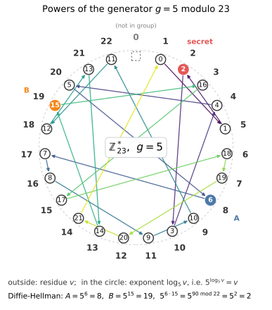
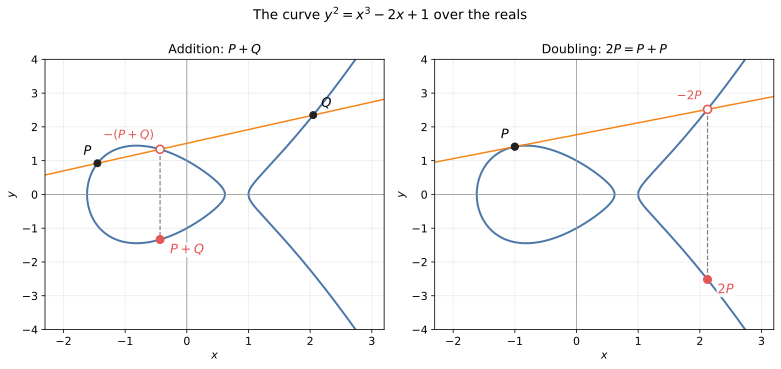
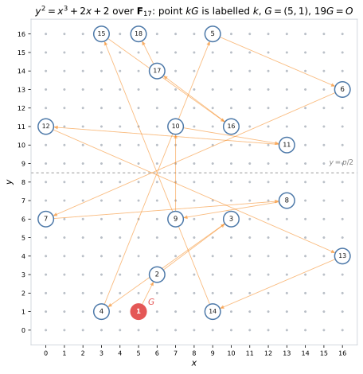
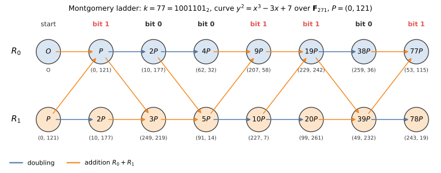
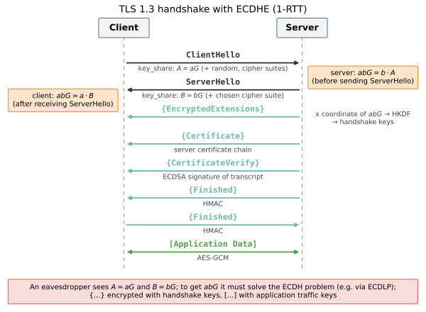
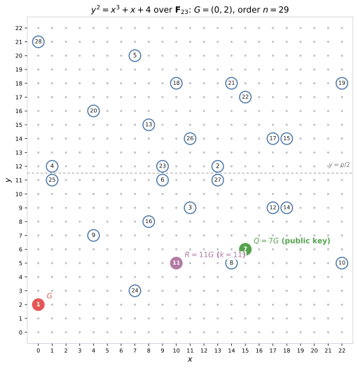
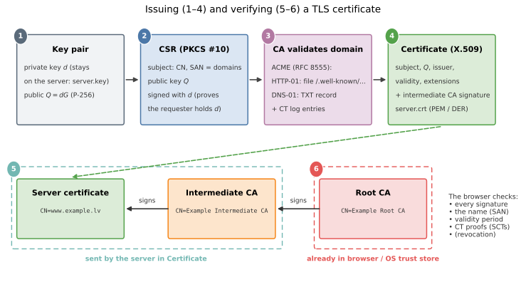
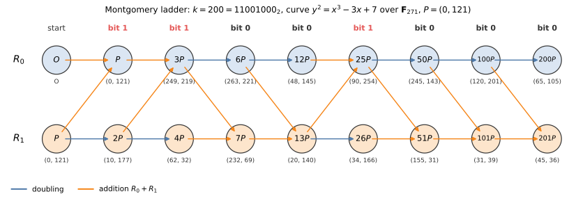

# 12. Cryptography in TLS 1.3: Elliptic Curves and Key Exchange

> Planned scope: 90 minutes in class and a few homework problems. The lecture covers the
> *asymmetric* part of TLS 1.3: key exchange (ECDHE), signatures (ECDSA) and certificates.
> The symmetric part (AES-GCM, HKDF) is in the
> [previous lecture]({{ '/lectures/cryptography_aes_and_hashing/' | relative_url }}).

**Learning outcomes:**

* Add points on an elliptic curve over a finite field $\mathbb{F}_p$ and compute
  the scalar multiple $kG$ with the double-and-add algorithm.
* Explain the idea of Diffie–Hellman key exchange and why TLS 1.3 uses only
  *ephemeral* keys (ECDHE).
* Sign and verify a message with ECDSA (on a small curve) and explain why reusing the nonce $k$
  reveals the private key.
* Understand how TLS certificate chains are built and check them with command-line tools;
  understand the sequence from a CSR to a public certificate.


## Introduction: the Key Agreement Problem

In the previous lecture AES-GCM encrypted and authenticated data with a 128-bit key known to both
sides. But how do they obtain this key? A browser and a server have usually never
"met" before, and everything they send to each other goes over a public network, where it can be read
(and possibly modified) by someone else. In symmetric cryptography, key distribution was an
organizational problem (couriers, codebooks), and $N$ participants would need $N(N-1)/2$
separate keys.

The solution came from *public-key cryptography*:

* In 1976 W. Diffie and M. Hellman, in the paper *New Directions in Cryptography*
  ([[DH76]](#DH76)), described how two parties exchanging public messages can
  agree on a shared secret that an eavesdropper cannot compute. (Later it turned out that the British
  GCHQ had found similar ideas already in 1970–1974, but they were classified.)
* In 1977 R. Rivest, A. Shamir and L. Adleman published RSA -- the first practical public-key
  encryption and signature scheme, whose security rests on the difficulty of factoring large
  numbers.
* In 1985 V. Miller and, independently, N. Koblitz (published in 1987) proposed
  implementing the same Diffie–Hellman idea not in a group of numbers but in the group of *points of an elliptic curve*
  ([[Mil85]](#Mil85), [[Kob87]](#Kob87)). This gave rise to *elliptic curve cryptography* (ECC), which
  provides the same security with much shorter keys.

TLS 1.3 ([[RFC8446]](#RFC8446)) uses all three ideas in a single handshake: ECDHE yields a shared
secret from which HKDF derives the AES-GCM keys, and an ECDSA (or RSA) signature together with a certificate
proves that the server on the other side really is the intended one.

### One-Way Functions and the Discrete Logarithm

A *one-way function* is a function $f$ whose value $f(x)$ can be
computed quickly, but for a given value $y$ finding some $x$ with $f(x) = y$ is practically
impossible (it succeeds only with negligible probability or after an unimaginably long time).
The most widely used candidate in cryptography is exponentiation modulo a prime:

$$x \mapsto g^x \bmod p.$$

* **Easy:** $g^x \bmod p$ is computed by *square-and-multiply* -- going over the
  bits of the exponent $x$, squaring in each step and, if the bit is $1$, also multiplying by $g$. This
  takes about $2\log_2 x$ multiplications, i.e., a few thousand multiplications for a 2048-bit exponent.
* **Hard:** finding $x$ from $y = g^x \bmod p$ is the *discrete logarithm problem* (DLP).
  Exhaustive search takes $p - 1$ attempts; the best known
  algorithms (index calculus, the number field sieve) are *subexponential*, but for a 2048–3072-bit
  prime $p$ they are still practically infeasible.

Here $\mathbb{Z}_p^{\ast} = \{1, 2, \ldots, p-1\}$ is the *multiplicative group* of residues modulo
the prime $p$ (see the section "Galois Fields" of the
[Reed-Solomon lecture]({{ '/lectures/lossy_reed_solomon/' | relative_url }}): the nonzero elements of $\mathbb{F}_p$).
It is always *cyclic*: there is a
*generator* (*primitive root*) $g$ whose powers $g^0, g^1, \ldots, g^{p-2}$ are all $p - 1$
elements of the group. The exponent $x$ is called the *discrete logarithm* of the element $y = g^x$ to the base $g$.

**An example of Diffie–Hellman key exchange:**

The prime $p$ and the generator $g$ are public. Alice and Bob proceed as follows:

1. Alice chooses a secret $a$ and sends $A = g^a \bmod p$.
2. Bob chooses a secret $b$ and sends $B = g^b \bmod p$.
3. Alice computes $B^a = g^{ba}$, Bob computes $A^b = g^{ab}$ -- both have the same
   shared secret $g^{ab} \bmod p$.

A numerical example in the group $\mathbb{Z}_{23}^{\ast}$ with $g = 5$ (this is a generator: its powers
modulo $23$ run through all $22$ nonzero residues):

* Alice: $a = 6$, $A = 5^6 = 15625 \equiv 8 \pmod{23}$ (because $15625 = 679 \cdot 23 + 8$).
* Bob: $b = 15$, $B = 5^{15} \equiv 19 \pmod{23}$
  (by square-and-multiply: $5^2 \equiv 2$, $5^4 \equiv 4$, $5^8 \equiv 16$, $5^{15} = 5^8 \cdot 5^4 \cdot 5^2 \cdot 5 \equiv 16 \cdot 4 \cdot 2 \cdot 5 = 640 \equiv 19$).
* Alice computes $19^6 \equiv 2$, Bob computes $8^{15} \equiv 2$; the shared secret is $2$.

An eavesdropper knows $p = 23$, $g = 5$, $A = 8$ and $B = 19$. To obtain $2$, they would have to solve
the *Diffie–Hellman problem*: from $g^a$ and $g^b$ find $g^{ab}$. The only known general
approach is to find $a$ or $b$, i.e., the discrete logarithm. In a group with $22$ elements this is done with
a table (see the figure), but in a $2048$-bit group the table would need about $2^{2048}$ rows.



*The residues $0, 1, \ldots, 22$ are at the vertices of a regular $23$-gon. The broken line goes
$1 \to 5 \to 2 \to 10 \to 4 \to \ldots$ (multiplying by $g = 5$ each time) and, having visited all
$22$ nonzero residues, returns to $1$; the circle next to the residue $v$ contains its discrete logarithm
$\log_5 v$. The residue $0$ is not in the group. The line jumps around the circle "chaotically" -- this is exactly why
$\log_5 v$ cannot easily be guessed from $v$. The figure is produced by the script [figs/dh_cycle.py](figs/dh_cycle.py).*

**Multiplying the generator by an integer:**

The Diffie–Hellman protocol only needs a *cyclic group* in which the discrete logarithm is hard; it
does not have to be multiplication of numbers modulo something. If the group operation is written as *addition*
($+$), then instead of the power $g^a = g \cdot g \cdots g$ we write the *multiple*

$$aG = \underbrace{G + G + \ldots + G}_{a \text{ times}},$$

and the Diffie–Hellman protocol becomes $A = aG$, $B = bG$, with the shared secret
$abG = aB = bA$. In this notation the discrete logarithm problem reads: given $G$ and $Q = kG$, find $k$.
The analogue of square-and-multiply is *double-and-add* (see below). Exactly this additive
notation is used for elliptic curves: points can be added, and a point can be multiplied by an
integer, but a "product" of two points is not defined.

**Man-in-the-middle:**  

The Diffie–Hellman protocol protects only against a *passive* eavesdropper. An active adversary Mallory,
who can intercept and replace messages, proceeds as follows: she intercepts Alice's $A = aG$ and
sends Bob her own $M = mG$, and when Bob replies, she intercepts $B$ and sends Alice the same $M$. Now
Alice has a shared secret $amG$ with Mallory (Alice thinks it is with Bob), and Bob has $bmG$ with
Mallory. Mallory decrypts every message, reads or modifies it and re-encrypts it for the other side;
neither side notices, because the protocol itself contains nothing that would bind $A$ and $B$ to Alice's
or Bob's identity. Therefore in TLS 1.3 the server uses its long-term private key to *sign*
the whole handshake (including both $A$ and $B$), and the client checks that the signer's public
key is in a certificate issued by a trusted authority (see the sections "ECDSA Signatures" and "TLS
Certificates"). The adversary model is the same as in the previous lecture (Dolev–Yao): the network
belongs to the adversary.


## Elliptic Curves over a Finite Field

An *elliptic curve* over the field $\mathbb{F}_p$ ($p > 3$ is a prime) in *Weierstrass form* is the
set of all points $(x, y) \in \mathbb{F}_p \times \mathbb{F}_p$ for which

$$y^2 = x^3 + ax + b \pmod{p},$$

together with one extra point $\mathcal{O}$ -- the *point at infinity*.
The coefficients $a, b \in \mathbb{F}_p$ must satisfy the condition $4a^3 + 27b^2 \not\equiv 0 \pmod{p}$:
it means that the polynomial $x^3 + ax + b$ has no multiple roots, and the curve has no "cusps" or
self-intersections at which a tangent could not be drawn.

The number of points $\#E(\mathbb{F}_p)$ of the curve (including $\mathcal{O}$) is close to $p + 1$: by
*Hasse's theorem* $\left\lvert \#E(\mathbb{F}_p) - (p + 1) \right\rvert \le 2\sqrt{p}$. Intuition: for about
half of the values $x$ the right-hand side $x^3 + ax + b$ is a square modulo $p$, and then it has two
roots $\pm y$.

Geometric intuition comes from the same curve over the real numbers $\mathbb{R}$: it is symmetric
about the $x$ axis (if $(x, y)$ is on the curve, so is $(x, -y)$), and every line that meets the curve in two
points also meets it in a third one (a tangent point is counted twice; a vertical line
meets the "third" point at infinity, $\mathcal{O}$).

**Point addition:**

The sum of points is defined by the *chord-and-tangent* construction:

* **Addition** ($P \neq \pm Q$): draw the line through $P$ and $Q$; it meets the curve in a third point
  $R'$; the sum $P + Q$ is the reflection of $R'$ about the $x$ axis.
* **Doubling** ($P = Q$): do the same with the tangent at $P$.
* **The negative point:** $-P = (x, -y)$; the line through $P$ and $-P$ is vertical, so
  $P + (-P) = \mathcal{O}$, and $P + \mathcal{O} = P$.



*The curve $y^2 = x^3 - 2x + 1$ over the real numbers. Left: the line through $P$ and $Q$ meets
the curve at the point $-(P+Q)$; reflecting it about the $x$ axis gives $P + Q$. Right: doubling
uses the tangent at $P$. Script: [figs/ec_real.py](figs/ec_real.py).*

If $P = (x_1, y_1)$ and $Q = (x_2, y_2)$, the slope of the line is

$$\lambda = \frac{y_2 - y_1}{x_2 - x_1} \quad (P \neq Q), \qquad
\lambda = \frac{3x_1^2 + a}{2y_1} \quad (P = Q),$$

(the second formula is the derivative $dy/dx$, obtained by differentiating $y^2 = x^3 + ax + b$), and the sum
$P + Q = (x_3, y_3)$ is

$$x_3 = \lambda^2 - x_1 - x_2, \qquad y_3 = \lambda(x_1 - x_3) - y_1.$$

(The formula for $x_3$ comes from substituting the line $y = y_1 + \lambda(x - x_1)$ into the curve equation: the sum of the roots
of the cubic equation is $\lambda^2 = x_1 + x_2 + x_3$.) Over $\mathbb{F}_p$ there is no geometric picture
any more, but *the same formulas* remain valid; division just means multiplication by the
inverse modulo $p$ (found with the extended Euclidean algorithm or as
$z^{-1} = z^{p-2} \bmod p$).

With this addition the points of the curve form an *abelian group* (a commutative group): the neutral element is
$\mathcal{O}$, the inverse element is $-P$, and $P + Q = Q + P$ (the line through $P$ and $Q$ is the same as the one
through $Q$ and $P$). Associativity $(P + Q) + R = P + (Q + R)$ is nontrivial, but it can be checked
with the formulas. Note that the formulas contain the coefficient $a$ but *not* $b$ -- this will
matter in the section on invalid-curve attacks. Elliptic curve arithmetic and algorithms are covered in more detail in
[[PP10]](#PP10) (Chapter 9) and [[HMV04]](#HMV04).

### A Small Example: a Curve over F_17

A classic teaching example is the curve $y^2 = x^3 + 2x + 2$ over $\mathbb{F}_{17}$ and the point
$G = (5, 1)$ (check: $5^3 + 2 \cdot 5 + 2 = 137 = 8 \cdot 17 + 1$, and $1^2 = 1$). Let us compute
$2G$:

$$\lambda = \frac{3 \cdot 5^2 + 2}{2 \cdot 1} = \frac{77}{2} \equiv 9 \cdot 2^{-1} = 9 \cdot 9 = 81 \equiv 13 \pmod{17},$$

$$x_3 = 13^2 - 5 - 5 = 159 \equiv 6, \qquad y_3 = 13 \cdot (5 - 6) - 1 = -14 \equiv 3 \pmod{17},$$

so $2G = (6, 3)$. Continuing to add $G$, we obtain all the "multiples" of the point $G$:

| $k$ | 1 | 2 | 3 | 4 | 5 | 6 | 7 | 8 | 9 |
| --- | --- | --- | --- | --- | --- | --- | --- | --- | --- |
| $kG$ | $(5,1)$ | $(6,3)$ | $(10,6)$ | $(3,1)$ | $(9,16)$ | $(16,13)$ | $(0,6)$ | $(13,7)$ | $(7,6)$ |

| $k$ | 10 | 11 | 12 | 13 | 14 | 15 | 16 | 17 | 18 | 19 |
| --- | --- | --- | --- | --- | --- | --- | --- | --- | --- | --- |
| $kG$ | $(7,11)$ | $(13,10)$ | $(0,11)$ | $(16,4)$ | $(9,1)$ | $(3,16)$ | $(10,11)$ | $(6,14)$ | $(5,16)$ | $\mathcal{O}$ |

Since $18G = (5, 16) = -G$, we get $19G = \mathcal{O}$. The curve has exactly $19$ points (18 affine points
and $\mathcal{O}$), so the order of the group is the prime $19$, the group is cyclic, and *every*
point other than $\mathcal{O}$ is a generator. Note the symmetry: $kG$ and $(19 - k)G$ are
opposite points with the same $x$.



*All points of the curve $y^2 = x^3 + 2x + 2$ in the grid $\mathbb{F}_{17} \times \mathbb{F}_{17}$; the circle
contains the $k$ for which the point is $kG$. The arrows show the path $G \to 2G \to 3G \to \ldots \to 18G$. The points are
symmetric about the line $y = p/2$, because $-y \equiv p - y$. Script:
[figs/ec_grid.py](figs/ec_grid.py) (it also draws the curve of the ECDSA example).*

In this small group ECDH can be played out by hand: if Alice's $a = 6$ and Bob's $b = 11$, then
$A = 6G = (16, 13)$, $B = 11G = (13, 10)$, and both obtain $66G = (66 \bmod 19)G = 9G = (7, 6)$
(see Problem 12.2). ECDSA in a small group is shown below on a curve over $\mathbb{F}_{23}$.

### Scalar Multiplication: Double-and-Add

To compute $kP$ we do not have to add $k$ times (for a 256-bit $k$ that would never finish).
The algorithm goes over the bits of $k$ from the most significant to the least significant, just like square-and-multiply: in each step the
result is *doubled* and, if the bit is $1$, $P$ is *added*. If $k = (k_{t-1} k_{t-2} \ldots k_0)_2$:

$\textsf{Scalar-Mult}(k, P)$
1. $R \gets \mathcal{O}$
2. **for** $i = t - 1$ **downto** $0$ $\quad$ *// from the most significant bit to the least significant*
3. $\quad R \gets 2R$ $\quad$ *// doubling*
4. $\quad$ **if** $k_i = 1$
5. $\quad\quad R \gets R + P$ $\quad$ *// addition*
6. **return** $R$

Invariant: after each iteration $R = jP$, where $j$ is the number formed by the top bits of $k$ processed so far
(doubling appends a bit $0$, addition changes it to $1$). The algorithm performs $t$
doublings and as many additions as there are ones in $k$ -- in total at most $2t = O(\log k)$
group operations. For example, $13 = 1101_2$: $G \to 2G \to 3G \to 6G \to 12G \to 13G$ (see
Problem 12.1).

### The Elliptic Curve Discrete Logarithm Problem

The *elliptic curve discrete logarithm problem* (ECDLP): given the points $P$ and $Q = kP$, find $k$.
In the small example this is easy (a table suffices), but in cryptography the group order $n$ is about
$2^{256}$.

* The best known general algorithm is *Pollard's rho method*: it
  looks for a collision $c_1 P + d_1 Q = c_2 P + d_2 Q$ (from which $k = (c_1 - c_2)(d_2 - d_1)^{-1} \bmod n$)
  and, just as in the "birthday paradox", finds a collision after about $\sqrt{\pi n / 4} \approx 0.89\sqrt{n}$
  steps. Therefore a $256$-bit curve gives about $128$ bits of security.
* The largest publicly solved ECDLP on a curve over a prime field is the $112$-bit
  curve secp112r1 (in 2009, with 200 PlayStation 3 consoles).
* Unlike $\mathbb{Z}_p^{\ast}$, *no subexponential algorithms are known* for well-chosen elliptic curves
  (index calculus does not work for them). Therefore RSA or classic DH
  needs about a $3072$-bit modulus for the same $128$-bit security ([[SP800-57]](#SP800-57)),
  while ECC needs a $256$-bit curve.

In cryptography curves are chosen so that the group order is a large prime $n$ (or $n$ times a
small *cofactor* $h$, for example, $h = 8$ for Curve25519); otherwise the problem can be split into
small subgroups (the Pohlig–Hellman method, see the section "Invalid-Curve and Small-Subgroup
Attacks").


### The Montgomery Ladder

Double-and-add performs *different* operations depending on the secret bit: a bit $1$
costs two operations, a bit $0$ one. The execution time, power consumption and cache
accesses therefore reveal the key bits (see the section "Timing Attacks on Scalar Multiplication").
The *Montgomery ladder* (P. Montgomery, 1987) performs exactly one
addition and one doubling for every bit. It keeps two points $R_0 = jP$ and $R_1 = (j+1)P$, whose
difference is always $R_1 - R_0 = P$:

$\textsf{Montgomery-Ladder}(k, P)$
1. $R_0 \gets \mathcal{O}$, $\quad R_1 \gets P$
2. **for** $i = t - 1$ **downto** $0$
3. $\quad$ **if** $k_i = 0$
4. $\quad\quad R_1 \gets R_0 + R_1$, $\quad R_0 \gets 2R_0$ $\quad$ *// $(j, j+1) \to (2j, 2j+1)$*
5. $\quad$ **else**
6. $\quad\quad R_0 \gets R_0 + R_1$, $\quad R_1 \gets 2R_1$ $\quad$ *// $(j, j+1) \to (2j+1, 2j+2)$*
7. **return** $R_0$

(In both branches the right-hand sides use the *old* values of $R_0, R_1$.) Both branches perform the same operations;
they differ only in *which* register is doubled. A constant-time implementation does this without
branching as well: before and after the step, $R_0$ and $R_1$ are swapped using bit masks (*conditional swap*), and
a single step $R_1 \gets R_0 + R_1$, $R_0 \gets 2R_0$ remains.

**Example.** The curve $y^2 = x^3 - 3x + 7$ over $\mathbb{F}_{271}$ (the number of points $269$ is
a prime; $a = -3$ as for the curve P-256), the point $P = (0, 121)$ (check:
$121^2 = 14641 = 54 \cdot 271 + 7$), $k = 77 = 1001101_2$. In the first step (bit $1$)
$R_0 = \mathcal{O} + P = P$ and $R_1 = 2P$:

$$\lambda = \frac{3 \cdot 0^2 - 3}{2 \cdot 121} = \frac{268}{242} = 268 \cdot 28 = 7504 \equiv 187, \quad
x = 187^2 - 0 - 0 \equiv 10, \quad y = 187 \cdot (0 - 10) - 121 \equiv 177 \pmod{271}$$

($242^{-1} \equiv 28$, because $242 \cdot 28 = 6776 = 25 \cdot 271 + 1$). All the steps:

| bit | $R_0$ | $R_1$ |
| --- | --- | --- |
| (start) | $\mathcal{O}$ | $P = (0, 121)$ |
| 1 | $P = (0, 121)$ | $2P = (10, 177)$ |
| 0 | $2P = (10, 177)$ | $3P = (249, 219)$ |
| 0 | $4P = (62, 32)$ | $5P = (91, 14)$ |
| 1 | $9P = (207, 58)$ | $10P = (227, 7)$ |
| 1 | $19P = (229, 242)$ | $20P = (99, 261)$ |
| 0 | $38P = (259, 36)$ | $39P = (49, 232)$ |
| 1 | $77P = (53, 115)$ | $78P = (243, 19)$ |



*The Montgomery ladder for $k = 77$: every column has one doubling (blue arrow) and one
addition $R_0 + R_1$ (orange arrows). The bit only determines which way the ladder "climbs".
Script: [figs/ladder.py](figs/ladder.py) (with `--k 200` it draws the figure for Problem 12.4); the point
arithmetic is in the file [figs/ecc.py](figs/ecc.py).*

How the ladder helps in EC computations:

* **The same sequence of operations** regardless of the key -- the basis of protection against timing and power
  attacks.
* **Only the $x$ coordinate.** Since $R_1 - R_0 = P$ is known, the $x$ coordinate of the sum $R_0 + R_1$ can be
  computed from $x(R_0)$, $x(R_1)$ and $x(P)$ alone, without $y$. On curves in *Montgomery form*
  $By^2 = x^3 + Ax^2 + x$ (Curve25519 is one) these formulas are especially short and have no exceptional
  cases. ECDH needs only the $x$ coordinate of the shared point, so an X25519 public key is
  only $32$ bytes, and $y$ is never computed.
* **The price:** $2$ operations per bit (double-and-add needs $1.5$ on average), but the $x$-only
  operations are cheaper, so overall the ladder on Montgomery curves is very fast.

(Not to be confused with *Montgomery multiplication/reduction* -- a technique for modular multiplication without division
-- or with *Montgomery curves*; all three ideas come from P. Montgomery, but they are different things.)


## The NIST P-256 Curve

The curve most widely used for signatures in TLS is *P-256* (other names: secp256r1, prime256v1),
defined in the NIST standard [[SP800-186]](#SP800-186) and in SEC 2 ([[SEC2]](#SEC2)). It is the Weierstrass
curve $y^2 = x^3 - 3x + b$ over $\mathbb{F}_p$ with the parameters (in hexadecimal):

* $p = 2^{256} - 2^{224} + 2^{192} + 2^{96} - 1$
* $a = -3$
* $b = \texttt{5ac635d8 aa3a93e7 b3ebbd55 769886bc 651d06b0 cc53b0f6 3bce3c3e 27d2604b}$
* $G_x = \texttt{6b17d1f2 e12c4247 f8bce6e5 63a440f2 77037d81 2deb33a0 f4a13945 d898c296}$
* $G_y = \texttt{4fe342e2 fe1a7f9b 8ee7eb4a 7c0f9e16 2bce3357 6b315ece cbb64068 37bf51f5}$
* $n = \texttt{ffffffff 00000000 ffffffff ffffffff bce6faad a7179e84 f3b9cac2 fc632551}$ (a prime), cofactor $h = 1$.

The script [figs/ecc.py](figs/ecc.py) checks that $G$ is on the curve and $nG = \mathcal{O}$. The cofactor $1$
means that $\#E = n$ is a prime: all points (except $\mathcal{O}$) are generators, and there are no small
subgroups.

Why exactly these parameters:

* **The prime $p$** is a *generalized Mersenne prime* (*Solinas prime*): $2^{256}$
  can be expressed through lower powers of two that lie on $32$-bit word boundaries. Therefore reducing a $512$-bit product
  modulo $p$ takes only a few $256$-bit additions and subtractions, without division.
* **$a = -3$** speeds up doubling. In practice points are stored in *Jacobian coordinates* $(X : Y : Z)$,
  $x = X/Z^2$, $y = Y/Z^3$, to avoid the expensive inversion in every step.
  The doubling formula then contains $3X^2 + aZ^4$, and for $a = -3$ this can be written as
  $3(X - Z^2)(X + Z^2)$, saving one squaring and one multiplication. (Almost every
  curve can be transformed into an isomorphic curve with $a = -3$, so this does not reduce security.)

**Point encoding:**  

The public key $Q = (x, y)$ is transmitted as a byte string according to the SEC 1 standard ([[SEC1]](#SEC1)):

* **Uncompressed form:** `04 || x || y` -- the prefix `04` and both coordinates of $32$ bytes each,
  $65$ bytes in total. TLS 1.3 allows only this form for the curves P-256/P-384/P-521.
* **Compressed form:** `02 || x` or `03 || x` ($33$ bytes), where the prefix gives the parity of $y$
  (`02` -- even, `03` -- odd). It is used, for example, in Bitcoin.

$y$ is recovered from $x$ by computing $c = x^3 + ax + b$ and taking the square root modulo $p$. If
$p \equiv 3 \pmod{4}$ (as is the case for P-256), the root is simply $y = c^{(p+1)/4} \bmod p$ (because
$y^2 = c^{(p+1)/2} = c \cdot c^{(p-1)/2} = c$ if $c$ is a square), and the other root is $p - y$; of the
two, the one with the right parity is chosen. An example on the curve $y^2 = x^3 + x + 4$ over $\mathbb{F}_{23}$
($23 \equiv 3 \pmod 4$): for the compressed point `02 || 07` we compute $c = 7^3 + 7 + 4 = 354 \equiv 9$,
$y = 9^{6} \equiv 3$, the other root is $23 - 3 = 20$; the prefix `02` requires an even $y$, so the point is $(7, 20)$.
If $c$ is not a square (check: $y^2 \neq c$), there is no such point on the curve, and the message must be rejected.

**Other TLS 1.3 groups:**  

The client offers the TLS 1.3 key exchange "groups" in the extension `supported_groups`:

* **X25519** ([[RFC7748]](#RFC7748)) -- ECDH on D. Bernstein's curve Curve25519 (2006):
  the Montgomery form $y^2 = x^3 + 486662x^2 + x$ over $\mathbb{F}_p$, $p = 2^{255} - 19$ (hence the
  name). It is the most widespread classic group in TLS 1.3 (public key $32$ bytes).
* **P-256, P-384, P-521** (secp256r1, secp384r1, secp521r1) -- the NIST curves; P-384 is used when
  $192$-bit security is needed (for example, the US government CNSA requirements).
* **X448** -- similar to X25519, for $224$-bit security.
* **ffdhe2048, ..., ffdhe8192** -- classic DH in groups $\mathbb{Z}_p^{\ast}$ with fixed
  primes ([[RFC7919]](#RFC7919)); slower and with much longer keys, rarely used in practice.
* **X25519MLKEM768** -- a hybrid post-quantum group (see the section "Post-Quantum Cryptography in TLS 1.3").

Why X25519 is easier to implement securely: (1) the Montgomery ladder with $x$-only formulas performs
the same operations for every bit, and the formulas have no exceptional cases (for example, $P = Q$ or
$\mathcal{O}$) that would require branching; (2) *any* $32$ bytes are a valid public key --
either on the curve itself or on its "twist", which was also chosen to be secure, so
there is no need to check whether a point is on the curve (see the section on invalid curves); (3) the private key
is "clamped": the top bit is fixed (a constant number of iterations), and the lowest $3$ bits
are cleared (the key is divisible by the cofactor $8$, so the small-subgroup component disappears).
The implementer has fewer places to make mistakes.


## ECDHE Key Exchange in TLS 1.3

In the TLS 1.3 handshake ECDH is performed as follows ([[RFC8446]](#RFC8446), Sections 4.2.8 and 7.4):

1. The client chooses a random private key $a$ and in the `key_share` extension of the `ClientHello` message
   sends $A = aG$ ($32$ bytes for X25519, $65$ bytes for P-256). Usually the
   client immediately sends keys for one or two groups that the server is most likely to support, to
   avoid an extra exchange.
2. The server chooses one of the groups, creates its own random $b$ and in the `ServerHello` message (also in the
   `key_share` extension) sends $B = bG$.
3. The server computes $bA$, the client computes $aB$; both obtain $abG$. The shared secret is **only
   the $x$ coordinate of the point $abG$** ($32$ bytes for P-256 or X25519).
4. This secret enters the key schedule as the "(EC)DHE" input of the `HKDF-Extract` function, which
   produces the *Handshake Secret* and from it the handshake and application traffic keys (see the section
   "HKDF and the TLS 1.3 Key Schedule" in the
   [previous lecture]({{ '/lectures/cryptography_aes_and_hashing/' | relative_url }})).

The server and the client must check that the received point is valid (on the right curve, not
$\mathcal{O}$), and for X25519 -- that the shared secret is not all zeros (which would happen if the
other side sent a point of small order).

### Ephemeral and Static Keys

Two kinds of key pairs can be used in key exchange:

* **ephemeral**: a new key pair is generated for every connection and deleted right after the
  handshake;
* **static**: a long-term key pair whose public key is usually in a
  certificate.

The NIST key agreement standard [[SP800-56A]](#SP800-56A) classifies schemes with the notation
$C(i\mathrm{e}, j\mathrm{s})$: $i$ is the number of parties contributing an ephemeral key, $j$ the number of parties
contributing a static key.

* **$C(2\mathrm{e}, 0\mathrm{s})$** -- both parties use only ephemeral keys; static keys do not
  take part in the key agreement computation. This is **TLS 1.3 ECDHE** (and also the TLS 1.2
  `ECDHE_*` cipher suites). Authentication is provided separately: the server's static key
  (from the certificate) is used only for the *signature* in the `CertificateVerify` message.
* **$C(2\mathrm{e}, 2\mathrm{s})$** -- both parties contribute both an ephemeral and a static key
  (for example, MQV or the *Full Unified Model* schemes), and authentication is "built into" the
  key agreement computation itself. TLS does not use it. A similar idea (combining several DH computations
  with long-term and ephemeral keys) is used, for example, in the X3DH protocol of Signal and in some
  Noise protocol patterns.
* TLS 1.2 also allowed schemes *without* an ephemeral server key: *static ECDH*
  (`ECDH_ECDSA`, `ECDH_RSA`; the server's static ECDH key from the certificate, the client's key ephemeral,
  i.e., $C(1\mathrm{e}, 1\mathrm{s})$) and *RSA key transport* (`TLS_RSA_*`: the client encrypts a random
  secret with the server's RSA public key). TLS 1.3 removed both.

### Handshake Overview



*The full TLS 1.3 handshake (1-RTT). The server knows the shared secret $abG$ even before sending
`ServerHello`, the client as soon as it receives it; everything after
`ServerHello` is encrypted. Script: [figs/tls13_ecdhe.py](figs/tls13_ecdhe.py).*

The sequence of messages ([[RFC8446]](#RFC8446), Section 2):

1. `ClientHello` (in the clear): a random number, the supported cipher suites, groups,
   signature schemes and `key_share` with $A = aG$.
2. `ServerHello` (in the clear): the server's random number, the chosen cipher suite and
   `key_share` with $B = bG$. After this message both sides know $abG$ and derive the
   *handshake* keys.
3. `{EncryptedExtensions}` -- the remaining server parameters (for example, the ALPN protocol `h2`).
4. `{Certificate}` -- the server's certificate chain.
5. `{CertificateVerify}` -- a signature with the certificate's private key over the whole handshake
   so far.
6. `{Finished}` (from the server and then from the client) -- an HMAC over the whole handshake with
   `finished_key`; it proves that the other side saw the same messages and knows the secret.
7. `[Application Data]` -- data protected with the application traffic keys.

Compared with TLS 1.2, where encryption started only after two full round trips (2-RTT),
a TLS 1.3 client can send data after a single round trip, and the certificate is no longer
visible to an eavesdropper.

**Forward secrecy:**  

A protocol has *forward secrecy* if a future leak of the server's *long-term* private
key does not make it possible to decrypt previously recorded connections. With ECDHE this holds:
the long-term key only signed the handshake (it proved the identity *at that time*), while the shared
secret $abG$ depended only on the ephemeral keys $a$ and $b$, which were deleted long ago.
In contrast, with TLS 1.2 RSA key transport an adversary who has stored the encrypted traffic
and later obtains the server's RSA private key (by a court order, a break-in or a bug such as
*Heartbleed* in 2014) can decrypt *all* earlier connections. This is the main reason why
TLS 1.3 abandoned static key exchanges. One caveat: session resumption with a PSK without
a new ECDHE (the mode `psk_ke`) is protected only as long as the session ticket
encryption keys remain secure, so `psk_dhe_ke` (PSK together with a new ECDHE) is normally used.


## ECDSA Signatures

The *Elliptic Curve Digital Signature Algorithm* ([[FIPS186-5]](#FIPS186-5)) is a variant of the DSA signature scheme
in an elliptic curve group. Public parameters: the curve, a generator $G$ of prime order
$n$ and a hash function $H$ (SHA-256 for P-256). The private key is a random $d \in \{1, \ldots, n-1\}$,
the public key is the point $Q = dG$. The hash $h$ of a message $m$ is obtained by taking the first $\lceil \log_2 n \rceil$
bits of $H(m)$ as an integer.

$\textsf{ECDSA-Sign}(m, d)$
1. $h \gets H(m)$ $\quad$ *// the first $\lceil \log_2 n \rceil$ bits as an integer*
2. **repeat**
3. $\quad k \gets$ a random number from $\{1, \ldots, n-1\}$ $\quad$ *// the nonce: a new one for every signature!*
4. $\quad (x_1, y_1) \gets kG$
5. $\quad r \gets x_1 \bmod n$
6. $\quad s \gets k^{-1}(h + r d) \bmod n$
7. **until** $r \neq 0$ **and** $s \neq 0$
8. **return** $(r, s)$

$\textsf{ECDSA-Verify}(m, (r, s), Q)$
1. **if** $r \notin \{1, \ldots, n-1\}$ **or** $s \notin \{1, \ldots, n-1\}$
2. $\quad$ **return** FALSE
3. $h \gets H(m)$
4. $w \gets s^{-1} \bmod n$
5. $u_1 \gets h w \bmod n$, $\quad u_2 \gets r w \bmod n$
6. $X \gets u_1 G + u_2 Q$ $\quad$ *// two scalar multiplications*
7. **if** $X = \mathcal{O}$
8. $\quad$ **return** FALSE
9. **return** $x(X) \bmod n = r$

Why verification works: $u_1 G + u_2 Q = (h w + r w d) G = w (h + r d) G$, and from $s = k^{-1}(h + rd)$
it follows that $w = s^{-1} = k (h + rd)^{-1}$, so $u_1 G + u_2 Q = kG$ -- the same point whose $x$
coordinate gave $r$. The signer "ties" $k$ and $d$ together in one equation; the verifier knows only
$Q$, not $d$, and can still convince itself that the equation holds. Without $d$, creating a valid
$(r, s)$ for a new message is as hard as solving ECDLP (more precisely, this is assumed).

### An ECDSA Example in a Small Group

Take the curve $y^2 = x^3 + x + 4$ over $\mathbb{F}_{23}$ and the generator $G = (0, 2)$. The curve has
$29$ points (including $\mathcal{O}$), and $29$ is a prime, so $n = 29$. All the points $kG$:

| $k$ | 1 | 2 | 3 | 4 | 5 | 6 | 7 | 8 | 9 | 10 | 11 | 12 | 13 | 14 |
| --- | --- | --- | --- | --- | --- | --- | --- | --- | --- | --- | --- | --- | --- | --- |
| $kG$ | $(0,2)$ | $(13,12)$ | $(11,9)$ | $(1,12)$ | $(7,20)$ | $(9,11)$ | $(15,6)$ | $(14,5)$ | $(4,7)$ | $(22,5)$ | $(10,5)$ | $(17,9)$ | $(8,15)$ | $(18,9)$ |

($15G, \ldots, 28G$ are the negatives of these points: $(29 - k)G = -kG$, for example, $28G = (0, 21)$.)



*All pairs $(x, y) \in \mathbb{F}_{23}^2$ (gray dots) and the $28$ points of the curve (circles with $k$, where the
point is $kG$). The points of the example are highlighted: $G$, the public key $Q = 7G$ and $R = 11G$.
Script: [figs/ec_grid.py](figs/ec_grid.py).*

**Signing.** The private key is $d = 7$, the public key $Q = 7G = (15, 6)$. The message hash (in this small
example simply given) is $h = 10$, the nonce $k = 11$:

1. $kG = 11G = (10, 5)$, so $r = 10 \bmod 29 = 10$.
2. $k^{-1} \bmod 29$: $11 \cdot 8 = 88 = 3 \cdot 29 + 1$, so $k^{-1} = 8$.
3. $s = 8 \cdot (10 + 10 \cdot 7) = 8 \cdot 80 = 640 \equiv 2 \pmod{29}$ ($640 = 22 \cdot 29 + 2$).

The signature is $(r, s) = (10, 2)$.

**Verification.** $w = 2^{-1} \bmod 29 = 15$; $u_1 = 10 \cdot 15 = 150 \equiv 5$; $u_2 = 10 \cdot 15 \equiv 5$;
$X = 5G + 5Q = 5G + 35G = 40G = 11G = (10, 5)$ (because $40 \bmod 29 = 11$); $x(X) = 10 = r$ -- the signature
is valid.

In a small group everything can be traced with the table, because every point is $kG$ with a known $k$ (on a real curve this is
impossible -- that is ECDLP). All the computations can be repeated with [figs/ecc.py](figs/ecc.py) or with
online tools where one can choose a curve $y^2 = x^3 + ax + b$ over $\mathbb{F}_p$ and add
or multiply points, for example,
[andrea.corbellini.name/ecc/interactive/modk-add.html](https://andrea.corbellini.name/ecc/interactive/modk-add.html)
and [.../modk-mul.html](https://andrea.corbellini.name/ecc/interactive/modk-mul.html)
(from A. Corbellini's series of introductory articles on ECC).

### Signatures in TLS 1.3

In the `CertificateVerify` message the server uses the private key of its certificate to sign a string
that consists of $64$ spaces (the byte $\texttt{0x20}$), the text `TLS 1.3, server CertificateVerify`, the byte
$\texttt{0x00}$ and the *transcript hash* -- the SHA-256 hash of all the handshake
messages so far (`ClientHello` ... `Certificate`). Its signature covers both `key_share`
values, so a man in the middle cannot replace them. The text prefix separates server and client
signatures, and the spaces prevent the signature from being reused in another context (for example, TLS 1.2).

The client lists the allowed signature schemes in the `signature_algorithms` extension, for example:

* `ecdsa_secp256r1_sha256` (`0x0403`), `ecdsa_secp384r1_sha384` -- ECDSA; the signature $(r, s)$ is
  DER-encoded, $70$–$72$ bytes for P-256;
* `rsa_pss_rsae_sha256` (`0x0804`) etc. -- RSA with PSS padding; the old RSA PKCS #1 v1.5
  is allowed only in certificate signatures, not in `CertificateVerify`;
* `ed25519` (`0x0807`), `ed448` -- EdDSA signatures on curves in Edwards form (related to
  Curve25519).

The weak spot of ECDSA is the nonce $k$: it must be random, secret and never reused (see the section
"Nonce Reuse"). Therefore a *deterministic* nonce according to RFC 6979 ([[RFC6979]](#RFC6979)) is often used:
$k$ is computed with HMAC-DRBG from the private key $d$ and the hash $h$. For one message the signature is always
the same, but for different messages the values $k$ are independent and unpredictable, and the quality of the random
number generator no longer matters. Ed25519 achieves the same by construction.


## TLS Certificates

A *certificate* (X.509 v3, [[RFC5280]](#RFC5280)) is a statement signed by a *Certificate
Authority* (CA): "the public key $Q$ belongs to the domain `www.example.lv`".
Its main fields:

* **subject** and the extension *Subject Alternative Name* (SAN) -- the domain names for which
  the certificate is valid (browsers look only at the SAN);
* **public key** (*SubjectPublicKeyInfo*) -- the algorithm (for example, `id-ecPublicKey` on P-256)
  and the key itself (the point `04 || x || y`);
* **issuer** -- the CA that signed the certificate;
* **validity period** (*notBefore*, *notAfter*) and the serial number;
* **extensions** -- `BasicConstraints` (whether this is a CA certificate), `KeyUsage`, CT
  proofs (SCTs) etc.;
* **the issuer's signature** over all the previous fields (for example, `ecdsa-with-SHA256`).

A certificate is an ASN.1 data structure encoded in DER format (binary); the PEM format is the same DER
encoded in Base64 between the lines `-----BEGIN CERTIFICATE-----` and `-----END CERTIFICATE-----`.



*The steps of issuing a certificate (1–4) and verifying the chain (5–6). Script:
[figs/cert_chain.py](figs/cert_chain.py).*

These steps can be repeated with `openssl` (version 3.x; for Windows users it is available in the Git Bash
environment). For practice we play the role of the "CA" ourselves, with a self-signed root certificate:

1. **Key pair.** The server's private key on P-256; it never leaves the server.
   ```
   openssl genpkey -algorithm EC -pkeyopt ec_paramgen_curve:P-256 -out server.key
   openssl pkey -in server.key -pubout          # the public key in PEM form
   ```
2. **Certificate Signing Request** (CSR, PKCS #10).
   It contains the subject, the domain names and the public key; it is signed with the requester's *own* private key --
   this way the requester proves that it really holds the corresponding private key.
   ```
   openssl req -new -key server.key -subj "/CN=www.example.lv" \
       -addext "subjectAltName=DNS:www.example.lv,DNS:example.lv" -out server.csr
   openssl req -in server.csr -noout -text -verify   # view the CSR and check its signature
   ```
3. **Domain control validation.** Before signing, a public CA checks that the requester
   controls the domain. This is done automatically by the ACME protocol ([[RFC8555]](#RFC8555)): the CA issues a random
   token that must be placed either on the website (`http://example.lv/.well-known/acme-challenge/...`,
   *HTTP-01*) or in a DNS TXT record (*DNS-01*). (For *organization* or *extended*
   validation certificates the CA also checks company documents.)
4. **The CA signs the certificate.** Creating a practice CA and signing:
   ```
   openssl genpkey -algorithm EC -pkeyopt ec_paramgen_curve:P-256 -out ca.key
   openssl req -x509 -new -key ca.key -sha256 -days 3650 \
       -subj "/C=LV/O=Kursa piemers/CN=Kursa saknes CA" -out ca.crt
   openssl x509 -req -in server.csr -CA ca.crt -CAkey ca.key -CAcreateserial \
       -days 90 -sha256 -copy_extensions copy -out server.crt
   ```
   Public CAs usually sign with the key of an *intermediate CA*, while the
   root CA private key is kept offline (in a security module) and used rarely.
5. **Viewing the certificate.**
   ```
   openssl x509 -in server.crt -noout -text                 # all fields
   openssl x509 -in server.crt -noout -subject -issuer -dates -ext subjectAltName
   openssl x509 -in server.crt -outform DER -out server.der # binary DER
   openssl asn1parse -in server.crt                         # ASN.1 structure
   ```
   The ASN.1 structure can also be viewed conveniently in the browser with [https://lapo.it/asn1js/](https://lapo.it/asn1js/)
   (by pasting the PEM text); there one can see that the public key is a `BIT STRING` with `04 || x || y`, and
   the signature is a `SEQUENCE` of two integers $r$ and $s$.
6. **Verifying the chain.** In the `Certificate` message the server sends its own certificate and the intermediate CA
   certificate; the client already has the root certificate in its *trust store*
   (the browser or operating system list contains about 150 root CAs). The client checks every
   signature in the chain, the domain name, the validity periods and the CT proofs.
   ```
   openssl verify -CAfile ca.crt server.crt                 # practice chain: server.crt: OK
   openssl s_client -connect lu.lv:443 -servername lu.lv -showcerts </dev/null
   ```
   The last command shows the chain of a real website, the chosen TLS version, the cipher suite, the key
   exchange group and the server's signature scheme. (In a browser the same can be seen by clicking the
   icon in the address bar and opening the certificate viewer.)

In practice, a free certificate for your own website can be obtained from *Let's Encrypt* (a nonprofit CA that
issues domain-validated certificates via ACME) with the client program *certbot*:

* **Assumptions:** you have your own domain name whose DNS `A`/`AAAA` record points to a server with a public IP
  address; the server is reachable from the Internet on port 80 (for the HTTP-01 check) and 443; you have `root`
  (sudo) access; the web server is nginx or Apache on Linux (for example, Ubuntu/Debian).
* **Installation and obtaining the certificate:**
  ```
  sudo apt install certbot python3-certbot-nginx     # or: sudo snap install --classic certbot
  sudo certbot --nginx -d example.lv -d www.example.lv
  ```
  certbot creates the key and the CSR, performs the ACME check, stores the certificate in
  `/etc/letsencrypt/live/example.lv/` and writes the paths into the nginx configuration itself.
* **Automatic renewal:** certbot installs a `systemd` timer (or a `cron` job) that runs
  `certbot renew` twice a day and renews certificates with less than
  30 days left. Let's Encrypt certificates are valid for $90$ days, so renewal happens about every
  $60$ days without human intervention. To check:
  ```
  sudo certbot renew --dry-run          # tries the renewal against a test server
  systemctl list-timers | grep certbot  # whether the timer is enabled
  ```
* **When this exact setup is not possible:** if port 80 is not available or a *wildcard* certificate
  `*.example.lv` is needed, use the DNS-01 check (certbot DNS plugins or `--manual --preferred-challenges dns`).
  Static site hosting services (for example, GitHub Pages, which also hosts this course's site) issue and renew HTTPS
  certificates automatically.

**Certificate checking and revocation:** 

* **Revocation:** if a private key has leaked, the certificate must be revoked before it
  expires. The classic mechanisms are *certificate revocation lists* (CRLs) and online queries via
  OCSP (*Online Certificate Status Protocol*), including OCSP responses "stapled" into the handshake
  (*OCSP stapling*). In practice they work poorly: if a response cannot be obtained, browsers usually
  continue (*soft-fail*), and OCSP queries reveal to the CA which sites the user visits. Therefore
  browsers use lists they compile themselves (Chrome CRLSets, Firefox CRLite), and in 2025 Let's Encrypt
  ended OCSP support, keeping only CRLs.
* **Shorter validity periods** reduce the time during which a leaked key can be used, and force
  automated renewal. In 2025 the CA/Browser Forum decided to gradually reduce the maximum validity of public TLS
  certificates: $200$ days from March 15, 2026, $100$ days from 2027
  and $47$ days from 2029.
* **Certificate Transparency** (CT, [[RFC6962]](#RFC6962)): every
  publicly issued certificate must be recorded in several public, append-only logs
  (Merkle trees), and the certificate contains proofs signed by the logs (SCTs). Therefore a wrongly
  issued certificate cannot be hidden: the domain owner can search for all certificates issued for their domain,
  for example, at [https://crt.sh/?q=lu.lv](https://crt.sh/?q=lu.lv).


### Comparing RSA and EC Certificates

The numbers were obtained with the script [figs/cert_sizes.py](figs/cert_sizes.py) (practice certificates with
minimal extensions; real certificates also contain CT proofs etc., which add a few hundred bytes
to each) and with `openssl speed` on a single processor core (a Windows laptop,
OpenSSL 3.5; the exact numbers depend on the computer, the ratios less so).

| | RSA-2048 | RSA-3072 | ECDSA P-256 |
| --- | --- | --- | --- |
| security level | $112$ bits | $128$ bits | $128$ bits |
| public key (SPKI, DER) | $294$ B | $422$ B | $91$ B |
| signature | $256$ B | $384$ B | $70$–$72$ B |
| server certificate (example) | $880$ B | $1136$ B | $484$ B |
| `Certificate` message (server + intermediate CA) | $1745$ B | $2257$ B | $952$ B |
| signatures / s | $5\,500$ | $1\,900$ | $83\,000$ |
| verifications / s | $88\,000$ | $43\,000$ | $28\,000$ |

ECDSA signs faster (and generates keys much faster), RSA verifies faster (the public exponent
$65537$ is small). For a server, which *signs* in every handshake, ECDSA is more advantageous; for a client, which
verifies a few signatures, both are fast enough.

Smaller certificates matter for handshake *latency*: at the start of a TCP connection the server may
send only about $10$ segments (about $14$ KB) before it has to wait for an acknowledgment, and a QUIC
(HTTP/3) server may send at most $3$ times as many bytes as it has received before validating the client's address
(about $3.6$ KB after a $1.2$ KB `ClientHello`). If the chain does not fit, the handshake
needs an extra round trip.


## Post-Quantum Cryptography in TLS 1.3

A quantum computer stores its state in *qubits*, which can be in superposition, and through
interference it can "amplify" the probability of the right answers. Two algorithms matter for
cryptography:

* **Shor's algorithm** (P. Shor, 1994, [[Sho97]](#Sho97)) efficiently (in polynomial time) finds the
  *period* of a function $f(x)$ whose values repeat. Factoring reduces to finding the period of the
  function $x \mapsto a^x \bmod N$, and the discrete logarithm to the period of the two-argument
  function $f(u, v) = uG + vQ$ (if $Q = kG$, then $f(u + k, v - 1) = f(u, v)$).
  The quantum Fourier transform turns the period into a peak of a "spectrum" that can be measured. Thus Shor's
  algorithm breaks **RSA, classic DH, ECDH and ECDSA**. The resources needed are large: P-256
  ECDLP requires about $2\,300$ *logical* (error-corrected) qubits and about $10^{11}$ quantum gates
  ([[RNSL17]](#RNSL17)), while for factoring RSA-2048 the latest estimates are "fewer than a million
  noisy physical qubits, less than a week" ([[Gid25]](#Gid25)). Today's (2026) quantum
  computers have hundreds to a few thousand physical qubits, and error correction has been demonstrated only for
  a few logical qubits -- there is still a long way to a cryptographically relevant quantum computer,
  but nobody can say reliably how long.
* **Grover's algorithm** (L. Grover, 1996) finds one "correct" input among $N$ possibilities with
  about $\sqrt{N}$ function evaluations (classically $N/2$). For an AES-128 key search this
  would mean $2^{64}$ quantum AES evaluations, but they must be performed *sequentially* (parallelizing over $M$ machines
  gains only a factor of $\sqrt{M}$), and each one is a large quantum circuit. Therefore for symmetric
  cryptography a longer key or output suffices: AES-256 and SHA-256/SHA-384
  remain secure (NIST considers AES-128 to remain practically secure as well).

**Harvest now, decrypt later:** 

Even if a quantum computer becomes available only in 10–20 years, an adversary can record
encrypted traffic *today* (*harvest now, decrypt later*): the ECDHE public values $aG$ and $bG$ are visible
in the clear, and in the future Shor's algorithm will allow finding $a$ from them, computing $abG$ and all the keys.
This threatens data that must remain secret for a long time (medical, government, commercial information).
Therefore key exchange must be protected already now; forward secrecy does not help here.

**ML-KEM and hybrid key exchange:** 

*ML-KEM* (*Module-Lattice-Based Key-Encapsulation Mechanism*, FIPS 203 [[FIPS203]](#FIPS203),
formerly CRYSTALS-Kyber) is a *key encapsulation mechanism* (KEM). Unlike DH, where both sides
do the same thing, a KEM consists of three asymmetric functions:

1. $\textsf{KeyGen}() \to (ek, dk)$ -- the client creates an encapsulation (public) key $ek$ and
   a decapsulation (private) key $dk$;
2. $\textsf{Encaps}(ek) \to (K, c)$ -- the server creates a random $32$-byte secret $K$ and its
   "capsule" $c$;
3. $\textsf{Decaps}(dk, c) \to K$ -- the client recovers the same $K$ from the capsule.

The security of ML-KEM rests on the *Module-LWE* problem: solving a system of linear equations modulo
$q = 3329$ with polynomial coefficients when a small random error ("noise") has been added to each
equation. Without the noise it could be solved by Gaussian elimination; with the noise it is a hard lattice
problem for which no efficient classical or quantum algorithm is known. (There is an analogy with error
correction: decoding a "noisy" linear code without its secret structure is hard.)

TLS 1.3 uses it in the *hybrid* group `X25519MLKEM768` (code `0x11EC`): the client's `key_share` contains
an ML-KEM-768 key $ek$ ($1184$ bytes) and an X25519 public key ($32$ bytes); the server's
reply contains the capsule $c$ ($1088$ bytes) and its own X25519 key. The shared secret fed into HKDF is the
concatenation of both secrets $K_{\text{ML-KEM}} \,\|\, K_{\text{X25519}}$ ($64$ bytes), so an adversary
has to break *both* algorithms: if ML-KEM turned out to be weak (it is a new algorithm), X25519 still
protects, and against a quantum computer ML-KEM does. The price: `ClientHello` becomes about $1.2$ KB longer (sometimes
it no longer fits into one TCP segment). Since 2024–2025 the hybrid group has been used by default by
Chrome, Firefox, Cloudflare and OpenSSL 3.5; this can be checked with
`openssl s_client -connect www.google.com:443 -groups X25519MLKEM768` (it prints
`Negotiated TLS1.3 group: X25519MLKEM768`).

**Post-quantum signatures:**  

NIST has also standardized post-quantum signatures: *ML-DSA* (FIPS 204 [[FIPS204]](#FIPS204), formerly
CRYSTALS-Dilithium; also lattice-based) and *SLH-DSA* (FIPS 205 [[FIPS205]](#FIPS205), formerly
SPHINCS+; based only on the security of hash functions). They are being adopted in TLS more slowly than key exchange:

* **Size:** an ML-DSA-44 public key is $1312$ bytes and a signature $2420$ bytes; an SLH-DSA-128s
  signature is $7856$ bytes (for comparison, ECDSA P-256: $65$ and $72$ bytes). The chain has two
  certificates (each with a key and a signature), CT proofs and `CertificateVerify` -- together
  several tens of KB, which do not fit into the initial TCP and QUIC limits (see the previous section).
* **No urgency:** "harvest now, decrypt later" does not apply to signatures. A signature
  must be verified *at the time* of the handshake; a future quantum computer cannot retroactively
  forge an authentication that has already taken place. Only long-term keys (for example, root CA keys) must be replaced
  urgently, before a quantum computer becomes real.
* **Infrastructure:** the whole CA hierarchy, HSMs, browser root stores and CT logs have to be replaced;
  new approaches to shrinking the chain are also being studied (for example, *Merkle Tree Certificates*).


## Risks of Asymmetric Cryptography

Most real-world attacks on ECC are not "solving ECDLP". The mathematics remains secure, but
the implementation or the parameters allow a mistake: unchecked input, bad random numbers,
key-dependent execution time or questionable constants. The main cases follow.

### Invalid-Curve and Small-Subgroup Attacks

The point addition formulas (see the section "Elliptic Curves over a Finite Field") use $a$ but
**do not use $b$**. If an implementation does not check whether a received point $Q' = (x, y)$ satisfies
$y^2 = x^3 + ax + b$, it "unknowingly" computes on another curve $y^2 = x^3 + ax + b'$ with
$b' = y^2 - x^3 - ax$. The adversary can choose $b'$ so that this curve contains a point $Q'$ of
*small* order $q$. This is an *invalid-curve attack*, described in 2000 by
Biehl, Meyer and Müller ([[BMM00]](#BMM00)).

If the victim uses a *static* ECDH key $d$ (for example, TLS 1.2 `ECDH_*` or a server that reuses its
"ephemeral" key), then:

1. The adversary sends $Q'$ of small order $q$. The victim computes $dQ'$ -- this is one of only
   $q$ points $\mathcal{O}, Q', 2Q', \ldots, (q-1)Q'$.
2. The adversary tries all $q$ possibilities (for example, by trying to decrypt the victim's `Finished` message
   with each derived key) and learns $d \bmod q$.
3. Repeating this with different small prime orders $q_1, q_2, \ldots$ whose product exceeds
   $n$, the adversary finds $d$ with the *Chinese remainder theorem* (CRT).

The same idea -- splitting the discrete logarithm over the prime factors of the group order and combining with the CRT --
is the *Pohlig–Hellman algorithm*: if the group order $n = \prod q_i^{e_i}$ is
"smooth" (all $q_i$ are small), the discrete logarithm can be found quickly. Therefore for cryptographic curves
the order must be a large prime, and the invalid-curve attack "smuggles in" small orders.

**A small example.** The victim uses the curve $y^2 = x^3 + 2x + 2$ over $\mathbb{F}_{17}$ ($n = 19$) and
the secret $d = 11$. The adversary finds:

* $Q'_1 = (8, 1)$ is on the curve $y^2 = x^3 + 2x + 0$ and has order $5$ (but it is not on the real curve:
  $8^3 + 2 \cdot 8 + 2 = 530 \equiv 3 \neq 1$). The victim computes $11 Q'_1 = Q'_1 = (8, 1)$, so $d \equiv 1 \pmod 5$.
* $Q'_2 = (6, 7)$ is on the curve $y^2 = x^3 + 2x + 8$ with order $7$; $11 Q'_2 = 4Q'_2 = (10, 5)$, so
  $d \equiv 4 \pmod 7$.
* CRT: $d \equiv 1 \pmod 5$ and $d \equiv 4 \pmod 7$ give $d \equiv 11 \pmod{35}$, and since $d < 19$,
  $d = 11$.

(If the adversary sees only the $x$ coordinate of the shared point, they learn $d$ only up to sign:
$d \equiv \pm 1 \pmod 5$, $d \equiv \pm 4 \pmod 7$; then $4$ candidates modulo $35$ remain, of
which $4$ and $11$ satisfy $d < 19$, and the right one is chosen by checking $dG = Q$.)

Protection: (1) **always check** that the received point is on the curve and is not $\mathcal{O}$
(and, if the cofactor $h > 1$, that it is not in a small subgroup); (2) **ephemeral keys**: if every
$d$ is used only once, the adversary gains nothing from a single residue $d \bmod q$;
(3) curves where the check is not needed (X25519, see above). In 2015 Jager, Schwenk and
Somorovsky ([[JSS15]](#JSS15)) found several TLS libraries that did not check points, and with
a few thousand queries recovered the servers' static ECDH keys. A related bug was the
Windows *CurveBall* (CVE-2020-0601): CryptoAPI accepted certificates with *explicitly specified* curve
parameters and did not check that the generator was the standard $G$ -- so a certificate for any
public key could be forged.

**Weak curves:**

For some classes of curves the discrete logarithm is easy, so the standards exclude them:

* **Smooth group order** -- the Pohlig–Hellman method (see above); $n$ must be a large
  prime.
* **Anomalous curves** ($\#E(\mathbb{F}_p) = p$): ECDLP can be solved in polynomial time (the attack of Smart,
  Satoh–Araki and Semaev, 1998–1999).
* **Small embedding degree** (for example, supersingular curves): the MOV attack
  (Menezes, Okamoto, Vanstone, 1993) uses the *Weil pairing* to transfer ECDLP to the
  ordinary DLP in the field $\mathbb{F}_{p^k}$, where subexponential algorithms work.

There is also the question of *trust*: NIST/NSA obtained the P-256 coefficient $b$ as a SHA-1 hash of the
"seed" `c49d3608 86e70493 6a6678e1 139d26b7 819f7e90`, but it has never been explained where this
seed comes from. No attack is known, but this process does not meet the idea of "*nothing up my
sleeve*" -- constants should be chosen so that they could not have been tuned to a hidden weakness.
Brainpool curve constants are derived from the digits of $\pi$ and $e$, while Curve25519 chooses
the *smallest* parameter $A$ that satisfies publicly known security criteria (D. Bernstein's and
T. Lange's *SafeCurves* project).

That these are not merely theoretical concerns is shown by the case of **Dual_EC_DRBG**. It was a
pseudorandom number generator standardized by NIST (SP 800-90A, 2006) on the P-256 curve with two fixed points
$P$ and $Q$. Whoever knows a secret $e$ with $P = eQ$ can recover the generator's internal state from $30$ output bytes
and predict all subsequent "random" values -- including TLS ephemeral keys.
Cryptographers had warned about this possible *backdoor* as early as 2007, the 2013 documents of
E. Snowden pointed to NSA involvement, NIST withdrew the standard in 2014, and in 2015 it turned
out that in *Juniper* firewalls someone had replaced the point $Q$ with their own
([[CNE+14]](#CNE14)).

### Nonce Reuse and Biased Nonces in ECDSA

If two ECDSA signatures for message hashes $h_1 \neq h_2$ were created with the same $k$, they have
the same $r$ (because $r = x(kG) \bmod n$), and

$$s_1 = k^{-1}(h_1 + r d), \quad s_2 = k^{-1}(h_2 + r d) \pmod n.$$

Subtracting: $s_1 - s_2 = k^{-1}(h_1 - h_2)$, from which

$$k = \frac{h_1 - h_2}{s_1 - s_2} \bmod n, \qquad d = \frac{s_1 k - h_1}{r} \bmod n.$$

Two public signatures reveal the private key! This is exactly how in 2010 the group *fail0verflow*
recovered the Sony PlayStation 3 software signing key: Sony used the same constant $k$
for all signatures. Similarly, in 2013 a bug in the Android `SecureRandom` class made Bitcoin
wallets reuse $k$, and private keys were computed from the signatures public on the blockchain
and funds were stolen.

Even if $k$ is not repeated but is *biased* -- for example, a few top bits
are always $0$ or are known from a side channel -- then with sufficiently many signatures
$d$ can be found with lattice methods (the *Hidden Number Problem*, Boneh–Venkatesan 1996;
the attack of Howgrave-Graham and Smart, 2001). Every signature gives a linear relation
$k_i \equiv s_i^{-1} h_i + s_i^{-1} r_i d \pmod n$ with a "small" unknown $k_i$; the LLL algorithm finds
the short vector that corresponds to $d$. With a bias of a few bits a few hundred signatures suffice, and with
very many signatures even a leak of less than one bit is enough (*Minerva* and *TPM-Fail*
in 2019–2020 found such leaks in smart cards and TPM chips).

Solution: a deterministic $k$ according to RFC 6979, or EdDSA (Ed25519), where $k$ is a function of a secret key and
the message hash -- then it never repeats for different messages and does not depend on the
random number generator. (Deterministic signatures have to beware of hardware fault
attacks, so some implementations mix additional randomness into the deterministic $k$.)

### A Broken Random Number Generator

Asymmetric cryptography is only as secure as its random numbers. If an adversary can
predict or "fix" the generator's output (weak initial entropy, a bug in the code, malicious
standards), the following becomes available to them:

* **The ECDSA private key from a single signature.** If $k$ is known, then from $s = k^{-1}(h + rd)$
  immediately $d = (sk - h) r^{-1} \bmod n$. If $k$ is one of a few possible values (for example,
  $2^{15}$), the adversary tries all candidates, comparing $dG$ with the public key $Q$.
* **The contents of all ECDHE sessions.** If the ephemeral $a$ of the client or the server can be predicted, an
  eavesdropper computes $abG = aB$ and all the keys from the recorded traffic. Forward
  secrecy disappears, and this happens *passively*, without leaving any traces (exactly what the Dual_EC_DRBG
  "backdoor" would provide).
* **The long-term keys themselves.** If the random numbers were weak at the time the keys were generated, the
  private key can be found by enumerating the possible generator seeds.

Historical examples: the Debian OpenSSL bug (2006–2008, CVE-2008-0166) -- after a code "cleanup"
the only source of entropy was the process ID (up to $32\,768$ values), so all SSH and TLS keys created on Debian/Ubuntu
machines could be enumerated, and even secure DSA keys were compromised by
signatures made with weak $k$ on these machines; the 2012 study "Mining your Ps and Qs"
found thousands of embedded devices (routers) that, lacking entropy at boot time,
generated repeated or related key pairs and repeated nonces in DSA signatures. Protection:
the operating system's cryptographically secure generator (`getrandom()`, `BCryptGenRandom`), checking entropy
after boot, deterministic signatures and HSMs for key storage.

### Timing Attacks on Scalar Multiplication

The algorithm $\textsf{Scalar-Mult}$ with the line **if** $k_i = 1$ performs an extra addition only for the bits
$1$. The total time depends on the number of ones, but by observing every iteration (through power
consumption, electromagnetic radiation, or the state of the cache and the branch predictor, which can be
influenced by another process on the same processor) all the bits can be read one after another: the sequence
"doubling, doubling, addition, ..." is exactly the binary representation of $k$. Timing dependencies in the field
arithmetic itself also matter (for example, a modular reduction with an extra subtraction only sometimes),
as do the exceptional cases of the formulas ($R = \mathcal{O}$, $R = P$), which require branching.

The protection is a *constant-time* implementation: the same operations, the same memory
addresses and the same number of iterations regardless of the secret data. The Montgomery ladder
(or similar "regular" algorithms with fixed-window tables from which all entries are read)
gives the same sequence of operations, the conditional swap is performed with bit masks instead of **if**, and
"complete" addition formulas also work in the exceptional cases. The loop length matters too:
in 2011 Brumley and Tuveri ([[BT11]](#BT11)) showed that the OpenSSL ladder performed as many
iterations as the number $k$ had bits -- for shorter $k$ (with zeros in the top bits) the computation was
faster. By measuring the signing time of a TLS server remotely (over the network), they selected signatures with
short $k$ and recovered the private key with a lattice method. The fix: always process exactly as many bits as
$n$ has (for example, by computing with $k + n$ or $k + 2n$, which has a fixed number of bits).

### Other Aspects of TLS 1.3

**Trusted certificate authorities and TLS interception.** A browser trusts any certificate
signed by one of the hundreds of root certificate authorities (CAs) in the operating system's or browser's list. In companies,
administrators often add their own root CA to all computers (for example, via Active Directory group policies),
so that a network proxy can "intercept" TLS: it creates a fake certificate for each website, decrypts
the traffic and inspects it. This is a legitimate *man in the middle*, but it becomes dangerous if
the CA private key leaks or if the proxy itself checks the real certificates poorly or chooses weak
algorithms. The most dangerous cases: in 2011 the compromised CA DigiNotar issued fake `*.google.com` certificates
that were used to eavesdrop on users in Iran; in 2015 the adware Superfish, preinstalled on Lenovo laptops,
added a root CA with **the same** private key on all computers. Protection: *Certificate
Transparency* (all publicly issued certificates must be recorded in public logs), key pinning in applications
(*pinning*), strict management of corporate root CAs.

**Client certificates and bypassing the checks.** In mutual TLS (mTLS) the client also presents a certificate
and signs CertificateVerify -- this is used, for example, in microservices, banking APIs and IoT devices. To avoid
performing a full CA chain and revocation check every time, systems tend to bypass it: session resumption with a PSK inherits
the client identity of the previous handshake (a ticket can be valid for up to $7$ days), the server can cache the result
of the check or "pin" the SHA-256 fingerprint of the client's public key and accept a self-signed certificate
(this is done, for example, by Syncthing and many IoT platforms). This is fast, but a revoked certificate or a stolen
device key can remain valid until the cache or the ticket expires, so these periods must be chosen
deliberately and it must be possible to invalidate them forcibly.

**Downgrade protection.** An active adversary could remove TLS 1.3 support from `ClientHello`
so that the two sides agree on the older, weaker TLS 1.2. Two things prevent this: the `CertificateVerify`
signature covers the whole handshake (including the client's offer), and a TLS 1.3 server that
negotiates TLS 1.2 or an older version writes
`44 4F 57 4E 47 52 44 01` (ASCII "DOWNGRD" and $\texttt{01}$; for versions up to TLS 1.1 -- $\texttt{00}$)
into the last $8$ bytes of `ServerHello.random`.
A TLS 1.3 client that sees this aborts the connection. Since a TLS 1.2 server also signs its
`random`, the adversary cannot remove this marker.

**0-RTT data.** When resuming a session with a PSK, the client can send data already in its first message (*early data*,
0-RTT), encrypted with a key derived only from the PSK. This data has no forward
secrecy, and an adversary can *replay* it -- send the same `ClientHello` with the data
again, to another server instance. Therefore 0-RTT may only be used for *idempotent* requests
(for example, `GET` without side effects), not for a payment.

**Encrypted Client Hello (ECH).** Even in TLS 1.3 the `ClientHello` is in the clear, and its
*Server Name Indication* (SNI) extension shows the name of the visited website -- this is used by network filters and
censorship. ECH encrypts the "inner" `ClientHello` with a server public key published in DNS
(the HPKE scheme: again ECDH + HKDF + AEAD); the cleartext "outer" `ClientHello` shows only the shared
name of a front-end server (for example, a CDN).


## Problems

All problems can be checked with the script [figs/ecc.py](figs/ecc.py) (the class `Curve`, the methods
`add`, `mul`, `mul_trace`, `ladder_trace`, the functions `ecdsa_sign` and `ecdsa_verify`).

**Problem 12.1:**  
On the curve $y^2 = x^3 + 2x + 2$ over $\mathbb{F}_{17}$ compute $5G$ and $13G$
with the double-and-add algorithm. Here $G = (5, 1)$ is the *generator* (base
point) of the curve: the group order is the prime $19$, and the points $G, 2G, \ldots, 18G, 19G = \mathcal{O}$ are all the
points of the curve. For every step write down the slope $\lambda$ and the resulting point.

**Answer:** Addition uses $\lambda = (y_2 - y_1)(x_2 - x_1)^{-1}$, doubling
$\lambda = (3x_1^2 + 2)(2y_1)^{-1}$ (modulo $17$).

$5 = 101_2$:

| step | operation | $\lambda$ | result |
| --- | --- | --- | --- |
| bit 1 | $R = G$ | -- | $(5, 1)$ |
| bit 0 | $R = 2R$ | $13$ | $2G = (6, 3)$ |
| bit 1 | $R = 2R$ | $7$ | $4G = (3, 1)$ |
| | $R = R + G$ | $0$ | $5G = (9, 16)$ |

For example, in the last step $\lambda = (1 - 1)/(5 - 3) = 0$, $x_3 = 0 - 3 - 5 = -8 \equiv 9$,
$y_3 = 0 \cdot (3 - 9) - 1 \equiv 16$.

$13 = 1101_2$:

| step | operation | $\lambda$ | result |
| --- | --- | --- | --- |
| bit 1 | $R = G$ | -- | $(5, 1)$ |
| bit 1 | $R = 2R$ | $13$ | $2G = (6, 3)$ |
| | $R = R + G$ | $2$ | $3G = (10, 6)$ |
| bit 0 | $R = 2R$ | $11$ | $6G = (16, 13)$ |
| bit 1 | $R = 2R$ | $10$ | $12G = (0, 11)$ |
| | $R = R + G$ | $15$ | $13G = (16, 4)$ |

Check: $13G = -6G$ (because $13 + 6 = 19$), and indeed $(16, 4) = (16, -13)$. The results can be
compared with the figure `ec-f17-multiples.en.svg` in the section "A Small Example: a Curve over F_17", where
every point is labeled with its $k$. $\square$

**Problem 12.2:**  
For the curve above, perform an ECDH key exchange with the secret numbers $a = 6$ and $b = 11$.
Check that both sides obtain the same point. What is the shared secret that would be fed into HKDF?

**Answer:** $A = 6G = (16, 13)$ ($6 = 110_2$: $G \to 2G \to 3G \to 6G$), $B = 11G = (13, 10)$
($11 = 1011_2$: $G \to 2G \to 4G \to 5G \to 10G \to 11G$). Alice computes $6B = 6 \cdot 11 G = 66G$,
Bob computes $11A = 66G$; since $19G = \mathcal{O}$, $66G = (66 \bmod 19)G = 9G = (7, 6)$. With
double-and-add Alice computes $B \to 2B = 22G = 3G = (10, 6) \to 3B = 33G = 14G = (9, 1)
\to 6B = 28G = 9G = (7, 6)$. The shared secret is the $x$ coordinate $7$. $\square$

**Problem 12.3:**  
On the curve $y^2 = x^3 + x + 4$ over $\mathbb{F}_{23}$ with $G = (0, 2)$, $n = 29$ and the private key
$d = 7$ (public key $Q = 7G = (15, 6)$), sign the message hash $h = 17$ with the nonce $k = 5$ and
verify the signature. The points $kG$ can be taken from the table in the section "An ECDSA Example in a Small Group".

**Answer:** $kG = 5G = (7, 20)$, so $r = 7$. $k^{-1} \bmod 29 = 6$ ($5 \cdot 6 = 30 \equiv 1$).
$s = 6 \cdot (17 + 7 \cdot 7) = 6 \cdot 66 = 396 \equiv 19 \pmod{29}$ ($396 = 13 \cdot 29 + 19$).
Signature: $(r, s) = (7, 19)$.

Verification: $w = 19^{-1} \bmod 29 = 26$ ($19 \cdot 26 = 494 = 17 \cdot 29 + 1$); $u_1 = 17 \cdot 26 = 442 \equiv 7$;
$u_2 = 7 \cdot 26 = 182 \equiv 8$; $u_1 G + u_2 Q = 7G + 8 \cdot 7G = 63G = 5G = (7, 20)$ ($63 \bmod 29 = 5$);
$x = 7 = r$, the signature is valid. $\square$

**Problem 12.4:**  
Trace the Montgomery ladder on the curve $y^2 = x^3 - 3x + 7$ over $\mathbb{F}_{271}$ (number of points
$269$), $P = (0, 121)$, $k = 200$. (a) For every bit write down $R_0$, $R_1$ (as $jP$ and with
coordinates) and check the invariant $R_1 - R_0 = P$. (b) Compare the result and the number of group operations
with the double-and-add algorithm. (c) Explain why the ladder performs more
operations but is nevertheless better against timing attacks.

**Answer:** (a) $200 = 11001000_2$:

| bit | $R_0$ | $R_1$ |
| --- | --- | --- |
| (start) | $\mathcal{O}$ | $P = (0, 121)$ |
| 1 | $P = (0, 121)$ | $2P = (10, 177)$ |
| 1 | $3P = (249, 219)$ | $4P = (62, 32)$ |
| 0 | $6P = (263, 221)$ | $7P = (232, 69)$ |
| 0 | $12P = (48, 145)$ | $13P = (20, 140)$ |
| 1 | $25P = (90, 254)$ | $26P = (34, 166)$ |
| 0 | $50P = (245, 143)$ | $51P = (155, 31)$ |
| 0 | $100P = (120, 201)$ | $101P = (31, 39)$ |
| 0 | $200P = (65, 105)$ | $201P = (45, 36)$ |

In every row $R_1 = R_0 + P$, for example, $(62, 32) - (249, 219) = 4P - 3P = P$. The result:
$200P = (65, 105)$.



(b) Double-and-add goes $P \to 2P \to 3P \to 6P \to 12P \to 24P \to 25P \to 50P \to 100P \to 200P$
and obtains the same $(65, 105)$ (the intermediate results $3P$, $25P$, $50P$, $100P$ coincide with the $R_0$ column):
$7$ doublings and $2$ additions, $9$ operations in total. The ladder performs $2$ operations for each of the
$8$ bits, $16$ in total (in the first step two of them are trivial: $\mathcal{O} + P$ and $2P$).

(c) The sequence of operations of double-and-add (D, D+A, D, D, ...) reproduces the bits of $k$, whereas
in the ladder every step is "D+A" regardless of the bit -- an observer sees only the number of bits, which is the same for all
keys. Moreover, knowing $R_1 - R_0 = P$, one can use $x$-only formulas, which are cheaper
than the full ones, so the practical cost is lower than the operation count suggests. $\square$

**Problem 12.5:**  
Two ECDSA signatures made with the same $k$ are given -- find the private key $d$. The curve and $G$ are
the same as in Problem 12.3 ($n = 29$), the public key is $Q = (22, 18)$. For the message with hash $h_1 = 9$
the signature is $(r, s_1) = (8, 28)$, for the message with hash $h_2 = 24$ it is $(r, s_2) = (8, 18)$.

**Answer:** The equal $r = 8$ indicates an equal $k$.
$s_1 - s_2 = 10$, $10^{-1} \bmod 29 = 3$ ($10 \cdot 3 = 30 \equiv 1$);
$k = (h_1 - h_2)(s_1 - s_2)^{-1} = (-15) \cdot 3 = -45 \equiv 13 \pmod{29}$. Check: $13G = (8, 15)$,
$r = 8$. Then $r^{-1} = 8^{-1} \bmod 29 = 11$ ($8 \cdot 11 = 88 \equiv 1$) and
$d = (s_1 k - h_1) r^{-1} = (28 \cdot 13 - 9) \cdot 11 = 355 \cdot 11$; $355 \equiv 7$, $7 \cdot 11 = 77 \equiv 19 \pmod{29}$.
Check: $19G = (22, 18) = Q$. The private key is $d = 19$. $\square$

**Problem 12.6:**  
Compare the size in bytes of a TLS 1.3 handshake with an RSA-2048 and with an ECDSA P-256 certificate chain.
Assume: the chain contains the server certificate and the intermediate CA certificate (the root certificate is not sent), all keys
and signatures in the chain use the same algorithm, the key exchange uses X25519 in both cases,
and CT proofs and other extensions are ignored. Obtain the certificate sizes with
[figs/cert_sizes.py](figs/cert_sizes.py) or with `openssl x509 -outform DER` and `wc -c`.
Which messages are affected by the choice of algorithm and which are not?

**Answer:** The algorithm does not affect `ClientHello`, `ServerHello` (both have a `key_share` with a $32$-byte
X25519 key), `EncryptedExtensions` and `Finished` (a $32$-byte HMAC). It affects:

| message | RSA-2048 | ECDSA P-256 |
| --- | --- | --- |
| `Certificate` (server $\approx 880$ B + intermediate CA $\approx 850$ B + headers) | $\approx 1745$ B | $\approx 952$ B |
| `CertificateVerify` ($4$ B header + $2$ B scheme + $2$ B length + signature) | $264$ B | $\approx 79$ B |
| total | $\approx 2010$ B | $\approx 1030$ B |

The ECDSA chain saves about $1$ KB (with RSA-3072 about $1.6$ KB). In the certificates the difference comes
both from the public key ($294$ vs. $91$ bytes) and from the issuer's signature ($256$ vs. $\approx 71$ bytes);
the length of an ECDSA signature varies by $1$–$2$ bytes depending on the DER encoding of $r$ and $s$. $\square$


## References

<a id="DH76"></a>**[DH76]** W. Diffie, M. Hellman, *New Directions in Cryptography*, IEEE Transactions on Information
Theory 22(6), 1976. [https://doi.org/10.1109/TIT.1976.1055638](https://doi.org/10.1109/TIT.1976.1055638).

<a id="Mil85"></a>**[Mil85]** V. Miller, *Use of Elliptic Curves in Cryptography*, CRYPTO '85, LNCS 218, Springer, 1986.
[https://doi.org/10.1007/3-540-39799-X_31](https://doi.org/10.1007/3-540-39799-X_31).

<a id="Kob87"></a>**[Kob87]** N. Koblitz, *Elliptic Curve Cryptosystems*, Mathematics of Computation 48(177), 1987.
[https://doi.org/10.1090/S0025-5718-1987-0866109-5](https://doi.org/10.1090/S0025-5718-1987-0866109-5).

<a id="RFC8446"></a>**[RFC8446]** E. Rescorla, *The Transport Layer Security (TLS) Protocol Version 1.3*, RFC 8446, 2018.
[https://www.rfc-editor.org/rfc/rfc8446](https://www.rfc-editor.org/rfc/rfc8446).

<a id="FIPS186-5"></a>**[FIPS186-5]** NIST, *FIPS 186-5: Digital Signature Standard (DSS)*, 2023.
[https://doi.org/10.6028/NIST.FIPS.186-5](https://doi.org/10.6028/NIST.FIPS.186-5).

<a id="SP800-186"></a>**[SP800-186]** NIST, *SP 800-186: Recommendations for Discrete Logarithm-based Cryptography:
Elliptic Curve Domain Parameters*, 2023. [https://doi.org/10.6028/NIST.SP.800-186](https://doi.org/10.6028/NIST.SP.800-186).

<a id="SP800-56A"></a>**[SP800-56A]** NIST, *SP 800-56A Rev. 3: Recommendation for Pair-Wise Key-Establishment Schemes
Using Discrete Logarithm Cryptography*, 2018. [https://doi.org/10.6028/NIST.SP.800-56Ar3](https://doi.org/10.6028/NIST.SP.800-56Ar3).

<a id="SP800-57"></a>**[SP800-57]** NIST, *SP 800-57 Part 1 Rev. 5: Recommendation for Key Management*, 2020
(Section 5.6.1, comparable security strengths). [https://doi.org/10.6028/NIST.SP.800-57pt1r5](https://doi.org/10.6028/NIST.SP.800-57pt1r5).

<a id="SEC1"></a>**[SEC1]** Certicom Research, *SEC 1: Elliptic Curve Cryptography*, version 2.0, 2009.
[https://www.secg.org/sec1-v2.pdf](https://www.secg.org/sec1-v2.pdf).

<a id="SEC2"></a>**[SEC2]** Certicom Research, *SEC 2: Recommended Elliptic Curve Domain Parameters*, version 2.0, 2010.
[https://www.secg.org/sec2-v2.pdf](https://www.secg.org/sec2-v2.pdf).

<a id="RFC7748"></a>**[RFC7748]** A. Langley, M. Hamburg, S. Turner, *Elliptic Curves for Security* (X25519, X448), RFC 7748, 2016.
[https://www.rfc-editor.org/rfc/rfc7748](https://www.rfc-editor.org/rfc/rfc7748).

<a id="RFC7919"></a>**[RFC7919]** D. Gillmor, *Negotiated Finite Field Diffie-Hellman Ephemeral Parameters for TLS*, RFC 7919, 2016.
[https://www.rfc-editor.org/rfc/rfc7919](https://www.rfc-editor.org/rfc/rfc7919).

<a id="RFC6979"></a>**[RFC6979]** T. Pornin, *Deterministic Usage of the Digital Signature Algorithm (DSA) and Elliptic Curve
Digital Signature Algorithm (ECDSA)*, RFC 6979, 2013. [https://www.rfc-editor.org/rfc/rfc6979](https://www.rfc-editor.org/rfc/rfc6979).

<a id="RFC5280"></a>**[RFC5280]** D. Cooper et al., *Internet X.509 Public Key Infrastructure Certificate and Certificate
Revocation List (CRL) Profile*, RFC 5280, 2008. [https://www.rfc-editor.org/rfc/rfc5280](https://www.rfc-editor.org/rfc/rfc5280).

<a id="RFC8555"></a>**[RFC8555]** R. Barnes et al., *Automatic Certificate Management Environment (ACME)*, RFC 8555, 2019.
[https://www.rfc-editor.org/rfc/rfc8555](https://www.rfc-editor.org/rfc/rfc8555).

<a id="RFC6962"></a>**[RFC6962]** B. Laurie, A. Langley, E. Kasper, *Certificate Transparency*, RFC 6962, 2013.
[https://www.rfc-editor.org/rfc/rfc6962](https://www.rfc-editor.org/rfc/rfc6962).

<a id="FIPS203"></a>**[FIPS203]** NIST, *FIPS 203: Module-Lattice-Based Key-Encapsulation Mechanism Standard*, 2024.
[https://doi.org/10.6028/NIST.FIPS.203](https://doi.org/10.6028/NIST.FIPS.203).

<a id="FIPS204"></a>**[FIPS204]** NIST, *FIPS 204: Module-Lattice-Based Digital Signature Standard*, 2024.
[https://doi.org/10.6028/NIST.FIPS.204](https://doi.org/10.6028/NIST.FIPS.204).

<a id="FIPS205"></a>**[FIPS205]** NIST, *FIPS 205: Stateless Hash-Based Digital Signature Standard*, 2024.
[https://doi.org/10.6028/NIST.FIPS.205](https://doi.org/10.6028/NIST.FIPS.205).

<a id="Sho97"></a>**[Sho97]** P. Shor, *Polynomial-Time Algorithms for Prime Factorization and Discrete Logarithms on a
Quantum Computer*, SIAM Journal on Computing 26(5), 1997 (conference version 1994).
[https://doi.org/10.1137/S0097539795293172](https://doi.org/10.1137/S0097539795293172).

<a id="RNSL17"></a>**[RNSL17]** M. Roetteler, M. Naehrig, K. Svore, K. Lauter, *Quantum Resource Estimates for Computing
Elliptic Curve Discrete Logarithms*, ASIACRYPT 2017. [https://eprint.iacr.org/2017/598](https://eprint.iacr.org/2017/598).

<a id="Gid25"></a>**[Gid25]** C. Gidney, *How to factor 2048 bit RSA integers with less than a million noisy qubits*, 2025.
[https://arxiv.org/abs/2505.15917](https://arxiv.org/abs/2505.15917).

<a id="BMM00"></a>**[BMM00]** I. Biehl, B. Meyer, V. Müller, *Differential Fault Attacks on Elliptic Curve Cryptosystems*,
CRYPTO 2000, LNCS 1880, Springer. [https://doi.org/10.1007/3-540-44598-6_8](https://doi.org/10.1007/3-540-44598-6_8).

<a id="JSS15"></a>**[JSS15]** T. Jager, J. Schwenk, J. Somorovsky, *Practical Invalid Curve Attacks on TLS-ECDH*,
ESORICS 2015. [https://doi.org/10.1007/978-3-319-24174-6_21](https://doi.org/10.1007/978-3-319-24174-6_21).

<a id="CNE14"></a>**[CNE+14]** S. Checkoway et al., *On the Practical Exploitability of Dual EC in TLS Implementations*,
USENIX Security 2014. [https://www.usenix.org/conference/usenixsecurity14/technical-sessions/presentation/checkoway](https://www.usenix.org/conference/usenixsecurity14/technical-sessions/presentation/checkoway).

<a id="BT11"></a>**[BT11]** B. Brumley, N. Tuveri, *Remote Timing Attacks Are Still Practical*, ESORICS 2011.
[https://eprint.iacr.org/2011/232](https://eprint.iacr.org/2011/232).

<a id="PP10"></a>**[PP10]** C. Paar, J. Pelzl, *Understanding Cryptography*, Springer, 2010 (Chapters 8–10: DH, ECC, signatures).
[https://doi.org/10.1007/978-3-642-04101-3](https://doi.org/10.1007/978-3-642-04101-3).

<a id="HMV04"></a>**[HMV04]** D. Hankerson, A. Menezes, S. Vanstone, *Guide to Elliptic Curve Cryptography*, Springer, 2004.
[https://doi.org/10.1007/b97644](https://doi.org/10.1007/b97644).
