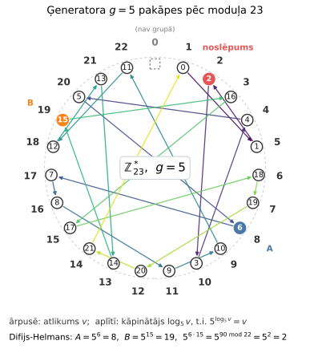
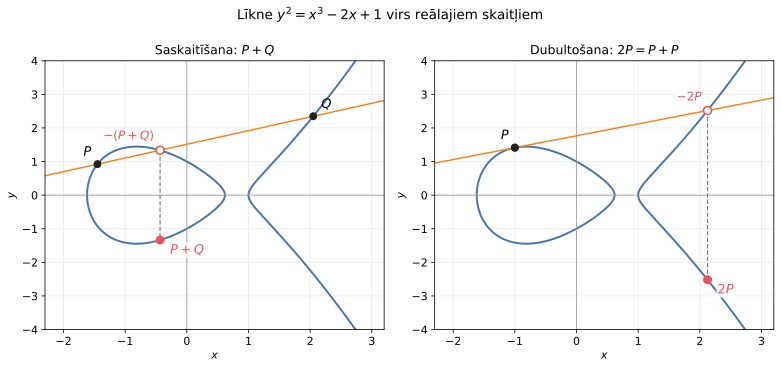
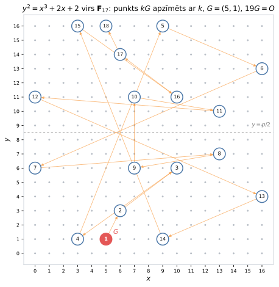
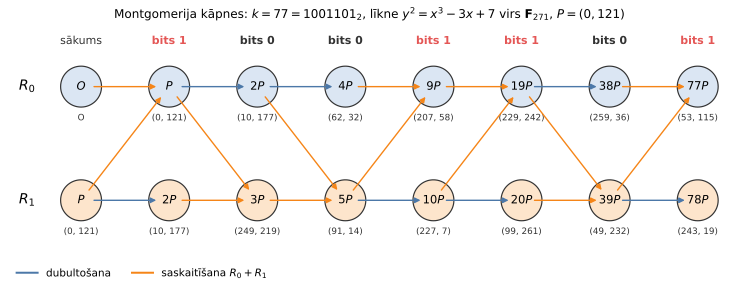
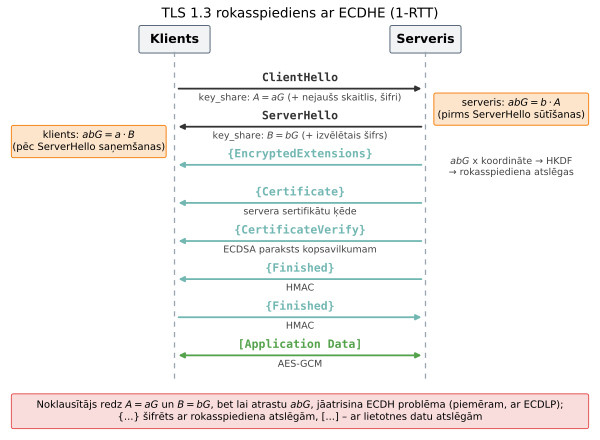
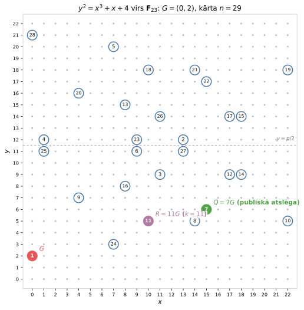
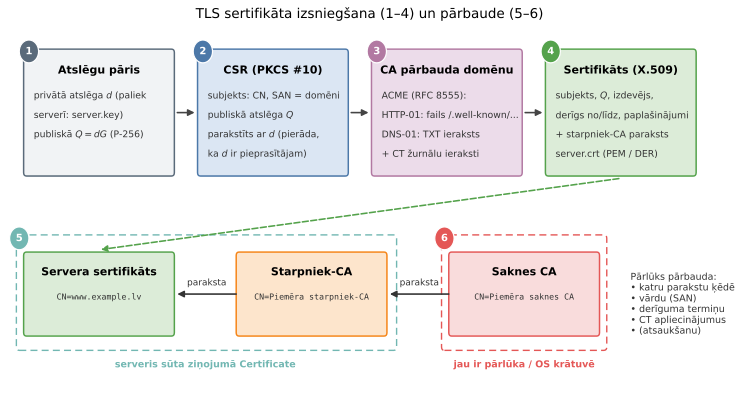
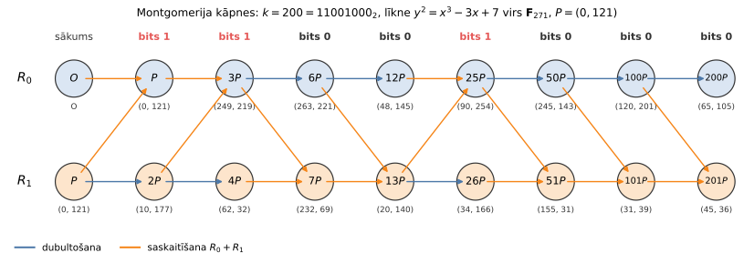

# 12. Kriptogrāfija TLS 1.3: eliptiskās līknes un atslēgu apmaiņa

> Paredzētais apjoms: 90 minūtes auditorijā un daži mājas uzdevumi. Lekcija aplūko
> TLS 1.3 *asimetrisko* daļu: atslēgu apmaiņu (ECDHE), parakstus (ECDSA) un sertifikātus.
> Simetriskā daļa (AES-GCM, HKDF) ir
> [iepriekšējā lekcijā]({{ '/lectures/cryptography_aes_and_hashing/' | relative_url }}).

**Mācīšanās rezultāti:**

* Saskaitīt punktus uz eliptiskās līknes virs galīga lauka $\mathbb{F}_p$ un aprēķināt
  skalāro reizinājumu $kG$ ar dubultošanas un saskaitīšanas algoritmu.
* Paskaidrot Difija-Helmana atslēgu apmaiņas ideju un to, kāpēc TLS 1.3 lieto tikai
  īslaicīgās (*ephemeral*) atslēgas (ECDHE).
* Parakstīt un pārbaudīt ziņojumu ar ECDSA (uz mazas līknes) un paskaidrot, kāpēc nonce $k$
  atkārtošana atklāj privāto atslēgu.
* Saprast un ar komandrindas rīkiem pārbaudīt, kā veidotas TLS sertifikātu ķēdes; 
  saprast secību no CSR līdz publiskam sertifikātam.


## Ievads: atslēgu apmaiņas (key agreement) uzdevums

Iepriekšējā lekcijā AES-GCM šifrēja un autentificēja datus ar 128 bitu atslēgu, ko zina abas
puses. Bet kā šo atslēgu iegūt? Pārlūkprogramma un serveris parasti nekad agrāk nav
"tikušies", un viss, ko tās viena otrai sūta, iet pa publisku tīklu, kur to var lasīt
(un, iespējams, mainīt) kāds cits. Simetriskajā kriptogrāfijā atslēgas izplatīšana bija
organizatoriska problēma (kurjeri, kodu grāmatas), un pie $N$ dalībniekiem vajadzētu $N(N-1)/2$
atsevišķu atslēgu.

Risinājumu deva *publiskās atslēgas kriptogrāfija*:

* 1976. gadā W.Difijs un M.Helmans (*Diffie, Hellman*) rakstā *New Directions in Cryptography*
  ([[DH76]](#DH76)) aprakstīja, kā divas puses, apmainoties ar publiskiem ziņojumiem, var
  vienoties par kopīgu noslēpumu, ko noklausītājs nevar aprēķināt. (Vēlāk atklājās, ka Lielbritānijas
  GCHQ līdzīgas idejas bija atradusi jau 1970.-1974. gadā, bet tās bija slepenas.)
* 1977. gadā R.Rivests, A.Šamīrs un L.Adlemans publicēja RSA -- pirmo praktisko publiskās
  atslēgas šifrēšanas un parakstu shēmu, kuras drošība balstās uz lielu skaitļu sadalīšanas
  reizinātājos grūtību.
* 1985. gadā V.Millers (*Miller*) un neatkarīgi N.Koblics (*Koblitz*, publicēts 1987) ierosināja
  to pašu Difija-Helmana ideju īstenot nevis skaitļu, bet *eliptiskās līknes punktu* grupā
  ([[Mil85]](#Mil85), [[Kob87]](#Kob87)). Tā rodas *eliptisko līkņu kriptogrāfija* (ECC), kas
  tādu pašu drošību dod ar daudz īsākām atslēgām.

TLS 1.3 ([[RFC8446]](#RFC8446)) visas trīs idejas izmanto vienā rokasspiedienā: ECDHE dod kopīgu
noslēpumu, no kura HKDF atvasina AES-GCM atslēgas, bet ECDSA (vai RSA) paraksts un sertifikāts
pierāda, ka otrā pusē tiešām ir vajadzīgais serveris.

### Vienvirziena funkcijas un diskrētais logaritms

*Vienvirziena funkcija* (*one-way function*) ir funkcija $f$, kuras vērtību $f(x)$ var
aprēķināt ātri, bet pēc dotas vērtības $y$ atrast kādu $x$, kuram $f(x) = y$, praktiski nav
iespējams (to var izdarīt tikai ar niecīgu varbūtību vai neiedomājami ilgā laikā).
Kriptogrāfijā visbiežāk lietotais kandidāts ir kāpināšana pēc pirmskaitļa moduļa:

$$x \mapsto g^x \bmod p.$$

* **Viegli:** $g^x \bmod p$ aprēķina ar *ātro kāpināšanu* (*square-and-multiply*) -- iet pa
  kāpinātāja $x$ bitiem, katrā solī kāpinot kvadrātā un, ja bits ir $1$, vēl reizinot ar $g$. Tas
  prasa ap $2\log_2 x$ reizināšanu, t.i., 2048 bitu kāpinātājam dažus tūkstošus reizināšanu.
* **Grūti:** atrast $x$ no $y = g^x \bmod p$ ir *diskrētā logaritma problēma* (*discrete
  logarithm problem*, DLP). Pilnā pārlase prasa $p - 1$ mēģinājumus; labākie zināmie
  algoritmi (indeksu metode, skaitļu lauka siets) ir *subeksponenciāli*, bet 2048-3072 bitu
  pirmskaitlim $p$ joprojām praktiski neizpildāmi.

Šeit $\mathbb{Z}_p^{\ast} = \{1, 2, \ldots, p-1\}$ ir *multiplikatīvā grupa* atlikumiem pēc
pirmskaitļa $p$ (sk. [Rīda-Solomona lekcijas]({{ '/lectures/lossy_reed_solomon/' | relative_url }})
nodaļu "Galuā lauki": $\mathbb{F}_p$ nenulles elementi). Tā vienmēr ir *cikliska*: eksistē
*ģenerators* (*primitīvā sakne*) $g$, kura pakāpes $g^0, g^1, \ldots, g^{p-2}$ ir visi $p - 1$
grupas elementi. Kāpinātāju $x$ sauc par elementa $y = g^x$ *diskrēto logaritmu* pie bāzes $g$.

**Difija-Helmana atslēgu apmaiņas piemērs:**

Publiski zināmi ir pirmskaitlis $p$ un ģenerators $g$. Alise un Bobs rīkojas šādi:

1. Alise izvēlas slepenu $a$ un nosūta $A = g^a \bmod p$.
2. Bobs izvēlas slepenu $b$ un nosūta $B = g^b \bmod p$.
3. Alise aprēķina $B^a = g^{ba}$, Bobs aprēķina $A^b = g^{ab}$ -- abiem ir viens un tas pats
   kopīgais noslēpums $g^{ab} \bmod p$.

Skaitlisks piemērs grupā $\mathbb{Z}_{23}^{\ast}$ ar $g = 5$ (tas ir ģenerators: tā pakāpes
pēc moduļa $23$ izstaigā visus $22$ nenulles atlikumus):

* Alise: $a = 6$, $A = 5^6 = 15625 \equiv 8 \pmod{23}$ (jo $15625 = 679 \cdot 23 + 8$).
* Bobs: $b = 15$, $B = 5^{15} \equiv 19 \pmod{23}$
  (ar ātro kāpināšanu: $5^2 \equiv 2$, $5^4 \equiv 4$, $5^8 \equiv 16$, $5^{15} = 5^8 \cdot 5^4 \cdot 5^2 \cdot 5 \equiv 16 \cdot 4 \cdot 2 \cdot 5 = 640 \equiv 19$).
* Alise aprēķina $19^6 \equiv 2$, Bobs aprēķina $8^{15} \equiv 2$; kopīgais noslēpums ir $2$.

Noklausītājs zina $p = 23$, $g = 5$, $A = 8$ un $B = 19$. Lai iegūtu $2$, viņam būtu jāatrisina
*Difija-Helmana problēma*: no $g^a$ un $g^b$ atrast $g^{ab}$. Vienīgais zināmais vispārīgais
ceļš ir atrast $a$ vai $b$, t.i., diskrēto logaritmu. Grupā ar $22$ elementiem to izdara ar
tabulu (sk. attēlu), bet $2048$ bitu grupā tabulai vajadzētu ap $2^{2048}$ rindu.



*Atlikumi $0, 1, \ldots, 22$ ir regulāra $23$-stūra virsotnēs. Lauztā līnija iet
$1 \to 5 \to 2 \to 10 \to 4 \to \ldots$ (katru reizi reizinot ar $g = 5$) un, apstaigājusi visus
$22$ nenulles atlikumus, atgriežas $1$; aplītī pie atlikuma $v$ ir tā diskrētais logaritms
$\log_5 v$. Atlikums $0$ grupā neietilpst. Līnija lēkā pa apli "haotiski" -- tieši tāpēc no $v$
nevar viegli uzminēt $\log_5 v$. Attēlu veido skripts [figs/dh_cycle.py](figs/dh_cycle.py).*

**Ģeneratora reizināšana ar veselu skaitli:**

Difija-Helmana protokolam vajag tikai *ciklisku grupu*, kurā diskrētais logaritms ir grūts; tai
nav jābūt skaitļu reizināšanai pēc moduļa. Ja grupas operāciju pieraksta kā *saskaitīšanu*
($+$), tad pakāpes $g^a = g \cdot g \cdots g$ vietā raksta *reizinājumu ar veselu skaitli*

$$aG = \underbrace{G + G + \ldots + G}_{a \text{ reizes}},$$

un Difija-Helmana protokols kļūst par $A = aG$, $B = bG$, kopīgais noslēpums
$abG = aB = bA$. Diskrētā logaritma problēma šajā pierakstā ir: no $G$ un $Q = kG$ atrast $k$.
Ātrās kāpināšanas analogs ir *dubultošana un saskaitīšana* (sk. zemāk). Tieši šādu aditīvu
pierakstu lieto eliptiskajām līknēm: punktus var saskaitīt, un punktu var reizināt ar veselu
skaitli, bet divu punktu "reizinājums" nav definēts.

**Cilvēks pa vidu (man-in-the-middle):**  

Difija-Helmana protokols aizsargā tikai pret *pasīvu* noklausītāju. Aktīvs uzbrucējs Malorija
(*Mallory*), kas var pārtvert un aizstāt ziņojumus, rīkojas šādi: viņa pārtver Alises $A = aG$ un
Bobam nosūta savu $M = mG$, bet Bobam atbildot -- pārtver $B$ un Alisei nosūta to pašu $M$. Tagad
Alisei ir kopīgs noslēpums $amG$ ar Maloriju (Alise domā, ka ar Bobu), bet Bobam -- $bmG$ ar
Maloriju. Malorija atšifrē katru ziņojumu, izlasa vai pamaina to un šifrē no jauna otrai pusei;
neviena no pusēm to nepamana, jo pats protokols nesatur nekā, kas sasaistītu $A$ un $B$ ar Alises
vai Boba identitāti. Tāpēc TLS 1.3 serveris ar savu ilgtermiņa privāto atslēgu *paraksta*
visu rokasspiedienu (arī abas $A$ un $B$), bet klients pārbauda, ka parakstītāja publiskā
atslēga ir sertifikātā, ko izdevusi uzticama iestāde (sk. nodaļas "ECDSA paraksti" un "TLS
sertifikāti"). Uzbrucēja modelis ir tāds pats kā iepriekšējā lekcijā (Dolevs-Jao): tīkls
pieder uzbrucējam.


## Eliptiskās līknes virs galīga lauka

*Eliptiskā līkne* virs lauka $\mathbb{F}_p$ ($p > 3$ ir pirmskaitlis) *Veierštrāsa formā* ir
visu punktu $(x, y) \in \mathbb{F}_p \times \mathbb{F}_p$ kopa, kuriem

$$y^2 = x^3 + ax + b \pmod{p},$$

kopā ar vienu papildu punktu $\mathcal{O}$ -- *bezgalīgi tālo punktu* (*point at infinity*).
Koeficientiem $a, b \in \mathbb{F}_p$ jāapmierina nosacījums $4a^3 + 27b^2 \not\equiv 0 \pmod{p}$:
tas nozīmē, ka polinomam $x^3 + ax + b$ nav vairākkārtēju sakņu, un līknei nav "asu stūru" vai
pašķrustpunktu, kuros nevarētu novilkt pieskari.

Līknes punktu skaits $\#E(\mathbb{F}_p)$ (ieskaitot $\mathcal{O}$) ir tuvs $p + 1$: pēc
*Hasses teorēmas* $\left\lvert \#E(\mathbb{F}_p) - (p + 1) \right\rvert \le 2\sqrt{p}$. Intuīcija: apmēram
pusei $x$ vērtību labā puse $x^3 + ax + b$ ir kvadrāts pēc moduļa $p$, un tad tai ir divas
saknes $\pm y$.

Ģeometrisko intuīciju dod tā pati līkne virs reālajiem skaitļiem $\mathbb{R}$: tā ir simetriska
pret $x$ asi (ja $(x, y)$ ir uz līknes, tad arī $(x, -y)$), un katra taisne, kas krusto līkni divos
punktos, krusto to arī trešajā (ja pieskaras, punktu skaita divreiz; vertikāla taisne
"trešo" punktu satiek bezgalībā, $\mathcal{O}$).

**Punktu saskaitīšana:**

Punktu summu definē ar *hordas un pieskares* (*chord-and-tangent*) konstrukciju:

* **Saskaitīšana** ($P \neq \pm Q$): novelk taisni caur $P$ un $Q$; tā krusto līkni trešajā punktā
  $R'$; summa $P + Q$ ir $R'$ atspoguļojums pret $x$ asi.
* **Dubultošana** ($P = Q$): to pašu dara ar pieskari punktā $P$.
* **Pretējais punkts:** $-P = (x, -y)$; taisne caur $P$ un $-P$ ir vertikāla, tāpēc
  $P + (-P) = \mathcal{O}$, un $P + \mathcal{O} = P$.



*Līkne $y^2 = x^3 - 2x + 1$ virs reālajiem skaitļiem. Pa kreisi: taisne caur $P$ un $Q$ krusto
līkni punktā $-(P+Q)$; atspoguļojot to pret $x$ asi, iegūst $P + Q$. Pa labi: dubultošanai
lieto pieskari punktā $P$. Skripts: [figs/ec_real.py](figs/ec_real.py).*

Ja $P = (x_1, y_1)$ un $Q = (x_2, y_2)$, tad taisnes slīpums ir

$$\lambda = \frac{y_2 - y_1}{x_2 - x_1} \quad (P \neq Q), \qquad
\lambda = \frac{3x_1^2 + a}{2y_1} \quad (P = Q),$$

(otrā formula ir atvasinājums $dy/dx$, ko iegūst, diferencējot $y^2 = x^3 + ax + b$), un summa
$P + Q = (x_3, y_3)$ ir

$$x_3 = \lambda^2 - x_1 - x_2, \qquad y_3 = \lambda(x_1 - x_3) - y_1.$$

($x_3$ formula rodas, ievietojot taisni $y = y_1 + \lambda(x - x_1)$ līknes vienādojumā: kubiskā
vienādojuma sakņu summa ir $\lambda^2 = x_1 + x_2 + x_3$.) Virs $\mathbb{F}_p$ ģeometriskā attēla
vairs nav, bet *tās pašas formulas* paliek spēkā, tikai dalīšana nozīmē reizināšanu ar
apgriezto elementu pēc moduļa $p$ (to atrod ar paplašināto Eiklīda algoritmu vai kā
$z^{-1} = z^{p-2} \bmod p$).

Ar šo saskaitīšanu līknes punkti veido *Ābela grupu* (komutatīvu grupu): neitrālais elements ir
$\mathcal{O}$, pretējais elements ir $-P$, $P + Q = Q + P$ (taisne caur $P$ un $Q$ ir tā pati, kas
caur $Q$ un $P$). Asociativitāte $(P + Q) + R = P + (Q + R)$ ir netriviāla, bet to var pārbaudīt
ar formulām. Ievērojiet, ka formulās parādās koeficients $a$, bet *neparādās* $b$ -- tam būs
nozīme nodaļā par nederīgu līkņu uzbrukumiem. Plašāk eliptisko līkņu aritmētika un algoritmi izklāstīti
[[PP10]](#PP10) (9. nodaļa) un [[HMV04]](#HMV04).

### Mazs piemērs: līkne virs F_17

Klasisks mācību piemērs ir līkne $y^2 = x^3 + 2x + 2$ virs $\mathbb{F}_{17}$ un punkts
$G = (5, 1)$ (pārbaude: $5^3 + 2 \cdot 5 + 2 = 137 = 8 \cdot 17 + 1$, un $1^2 = 1$). Aprēķināsim
$2G$:

$$\lambda = \frac{3 \cdot 5^2 + 2}{2 \cdot 1} = \frac{77}{2} \equiv 9 \cdot 2^{-1} = 9 \cdot 9 = 81 \equiv 13 \pmod{17},$$

$$x_3 = 13^2 - 5 - 5 = 159 \equiv 6, \qquad y_3 = 13 \cdot (5 - 6) - 1 = -14 \equiv 3 \pmod{17},$$

tātad $2G = (6, 3)$. Turpinot pieskaitīt $G$, iegūst visus punktu $G$ "daudzkārtņus":

| $k$ | 1 | 2 | 3 | 4 | 5 | 6 | 7 | 8 | 9 |
| --- | --- | --- | --- | --- | --- | --- | --- | --- | --- |
| $kG$ | $(5,1)$ | $(6,3)$ | $(10,6)$ | $(3,1)$ | $(9,16)$ | $(16,13)$ | $(0,6)$ | $(13,7)$ | $(7,6)$ |

| $k$ | 10 | 11 | 12 | 13 | 14 | 15 | 16 | 17 | 18 | 19 |
| --- | --- | --- | --- | --- | --- | --- | --- | --- | --- | --- |
| $kG$ | $(7,11)$ | $(13,10)$ | $(0,11)$ | $(16,4)$ | $(9,1)$ | $(3,16)$ | $(10,11)$ | $(6,14)$ | $(5,16)$ | $\mathcal{O}$ |

Tā kā $18G = (5, 16) = -G$, tad $19G = \mathcal{O}$. Līknei ir tieši $19$ punkti (18 afīni punkti
un $\mathcal{O}$), tātad grupas kārta ir pirmskaitlis $19$, grupa ir cikliska, un *jebkurš*
punkts, kas nav $\mathcal{O}$, ir ģenerators. Ievērojiet simetriju: $kG$ un $(19 - k)G$ ir
pretēji punkti ar vienādu $x$.



*Visi līknes $y^2 = x^3 + 2x + 2$ punkti režģī $\mathbb{F}_{17} \times \mathbb{F}_{17}$; aplītī
ir $k$, kuram punkts ir $kG$. Bultas rāda ceļu $G \to 2G \to 3G \to \ldots \to 18G$. Punkti ir
simetriski pret taisni $y = p/2$, jo $-y \equiv p - y$. Skripts:
[figs/ec_grid.py](figs/ec_grid.py) (tas zīmē arī ECDSA piemēra līkni).*

Šajā mazajā grupā ECDH var izspēlēt ar rokām: ja Alises $a = 6$ un Boba $b = 11$, tad
$A = 6G = (16, 13)$, $B = 11G = (13, 10)$, un abi iegūst $66G = (66 \bmod 19)G = 9G = (7, 6)$
(sk. 12.2. uzdevumu). ECDSA mazā grupā ir parādīts zemāk uz līknes virs $\mathbb{F}_{23}$.

### Skalārā reizināšana: dubultošana un saskaitīšana

Lai aprēķinātu $kP$, nav jāsaskaita $k$ reizes (256 bitu $k$ gadījumā tas nekad nebeigtos).
Algoritms iet pa $k$ bitiem no augstākā uz zemāko, tāpat kā ātrā kāpināšana: katrā solī
rezultātu *dubulto* un, ja bits ir $1$, *pieskaita* $P$. Ja $k = (k_{t-1} k_{t-2} \ldots k_0)_2$:

$\textsf{Scalar-Mult}(k, P)$
1. $R \gets \mathcal{O}$
2. **for** $i = t - 1$ **downto** $0$ $\quad$ *// no augstākā bita uz zemāko*
3. $\quad R \gets 2R$ $\quad$ *// dubultošana*
4. $\quad$ **if** $k_i = 1$
5. $\quad\quad R \gets R + P$ $\quad$ *// saskaitīšana*
6. **return** $R$

Invariants: pēc katras iterācijas $R = jP$, kur $j$ ir jau apstrādāto $k$ augstāko bitu skaitlis
(dubultošana pieraksta bitu $0$ galā, saskaitīšana to nomaina uz $1$). Algoritms izpilda $t$
dubultošanas un tik saskaitīšanu, cik vieninieku ir $k$ -- kopā ne vairāk kā $2t = O(\log k)$
grupas operāciju. Piemēram, $13 = 1101_2$: $G \to 2G \to 3G \to 6G \to 12G \to 13G$ (sk.
12.1. uzdevumu).

### Eliptisko līkņu diskrētā logaritma problēma

*Eliptisko līkņu diskrētā logaritma problēma* (ECDLP): doti punkti $P$ un $Q = kP$, atrast $k$.
Mazajā piemērā tas ir viegli (pietiek ar tabulu), bet kriptogrāfijā grupas kārta $n$ ir ap
$2^{256}$.

* Labākais zināmais vispārīgais algoritms ir *Polarda $\rho$ metode* (*Pollard's rho*): tā
  meklē divas sakritības $c_1 P + d_1 Q = c_2 P + d_2 Q$ (no kā $k = (c_1 - c_2)(d_2 - d_1)^{-1} \bmod n$)
  un tāpat kā "dzimšanas dienu paradoksā" sakritību atrod pēc apmēram $\sqrt{\pi n / 4} \approx 0{,}89\sqrt{n}$
  soļiem. Tāpēc $256$ bitu līkne dod apmēram $128$ bitu drošību.
* Lielākā publiski atrisinātā ECDLP problēma uz līknes virs pirmskaitļa lauka ir $112$ bitu
  līkne secp112r1 (2009. gadā, ar 200 PlayStation 3 konsolēm).
* Atšķirībā no $\mathbb{Z}_p^{\ast}$ uz labi izvēlētām eliptiskajām līknēm *nav zināmi
  subeksponenciāli algoritmi* (indeksu metode tām nedarbojas). Tāpēc RSA vai klasiskajam DH
  tādai pašai $128$ bitu drošībai vajag apmēram $3072$ bitu moduli ([[SP800-57]](#SP800-57)),
  bet ECC -- $256$ bitu līkni.

Kriptogrāfijā līknes izvēlas tā, lai grupas kārta būtu liels pirmskaitlis $n$ (vai $n$ reizināts ar
mazu *kofaktoru* $h$, piemēram, $h = 8$ līknei Curve25519); pretējā gadījumā problēmu var sadalīt
mazās apakšgrupās (Poliga-Helmana metode, sk. nodaļu "Nederīgas līknes un mazas apakšgrupas
uzbrukumi").


### Montgomerija kāpnes

Dubultošana un saskaitīšana izpilda *atšķirīgas* darbības atkarībā no slepenā bita: bits $1$
maksā divas operācijas, bits $0$ -- vienu. Izpildes laiks, strāvas patēriņš un kešatmiņas
piekļuves tāpēc atklāj atslēgas bitus (sk. nodaļu "Laika uzbrukumi skalārajai reizināšanai").
*Montgomerija kāpnes* (*Montgomery ladder*, P.Montgomery, 1987) katram bitam izpilda tieši vienu
saskaitīšanu un vienu dubultošanu. Tās glabā divus punktus $R_0 = jP$ un $R_1 = (j+1)P$, kuru
starpība vienmēr ir $R_1 - R_0 = P$:

$\textsf{Montgomery-Ladder}(k, P)$
1. $R_0 \gets \mathcal{O}$, $\quad R_1 \gets P$
2. **for** $i = t - 1$ **downto** $0$
3. $\quad$ **if** $k_i = 0$
4. $\quad\quad R_1 \gets R_0 + R_1$, $\quad R_0 \gets 2R_0$ $\quad$ *// $(j, j+1) \to (2j, 2j+1)$*
5. $\quad$ **else**
6. $\quad\quad R_0 \gets R_0 + R_1$, $\quad R_1 \gets 2R_1$ $\quad$ *// $(j, j+1) \to (2j+1, 2j+2)$*
7. **return** $R_0$

(Abos zaros labajā pusē lieto *vecās* $R_0, R_1$ vērtības.) Abi zari izpilda vienādas operācijas,
atšķiras tikai tas, *kuru* reģistru dubulto. Konstanta laika implementācijā arī to dara bez
zarošanās: pirms un pēc soļa $R_0$ un $R_1$ apmaina vietām ar bitu maskām (*conditional swap*), un
paliek viens vienīgs solis $R_1 \gets R_0 + R_1$, $R_0 \gets 2R_0$.

**Piemērs.** Līkne $y^2 = x^3 - 3x + 7$ virs $\mathbb{F}_{271}$ (punktu skaits $269$ ir
pirmskaitlis; $a = -3$ kā līknei P-256), punkts $P = (0, 121)$ (pārbaude:
$121^2 = 14641 = 54 \cdot 271 + 7$), $k = 77 = 1001101_2$. Pirmajā solī (bits $1$)
$R_0 = \mathcal{O} + P = P$ un $R_1 = 2P$:

$$\lambda = \frac{3 \cdot 0^2 - 3}{2 \cdot 121} = \frac{268}{242} = 268 \cdot 28 = 7504 \equiv 187, \quad
x = 187^2 - 0 - 0 \equiv 10, \quad y = 187 \cdot (0 - 10) - 121 \equiv 177 \pmod{271}$$

($242^{-1} \equiv 28$, jo $242 \cdot 28 = 6776 = 25 \cdot 271 + 1$). Visi soļi:

| bits | $R_0$ | $R_1$ |
| --- | --- | --- |
| (sākums) | $\mathcal{O}$ | $P = (0, 121)$ |
| 1 | $P = (0, 121)$ | $2P = (10, 177)$ |
| 0 | $2P = (10, 177)$ | $3P = (249, 219)$ |
| 0 | $4P = (62, 32)$ | $5P = (91, 14)$ |
| 1 | $9P = (207, 58)$ | $10P = (227, 7)$ |
| 1 | $19P = (229, 242)$ | $20P = (99, 261)$ |
| 0 | $38P = (259, 36)$ | $39P = (49, 232)$ |
| 1 | $77P = (53, 115)$ | $78P = (243, 19)$ |



*Montgomerija kāpnes $k = 77$: katrā kolonnā ir viena dubultošana (zilā bulta) un viena
saskaitīšana $R_0 + R_1$ (oranžās bultas). Bits nosaka tikai to, uz kuru pusi "kāpj" kāpnes.
Skripts: [figs/ladder.py](figs/ladder.py) (ar `--k 200` zīmē 12.4. uzdevuma attēlu); punktu
aritmētika ir failā [figs/ecc.py](figs/ecc.py).*

Kā kāpnes palīdz EC aprēķinos:

* **Vienāda operāciju secība** neatkarīgi no atslēgas -- pamats aizsardzībai pret laika un jaudas
  uzbrukumiem.
* **Tikai $x$ koordināte.** Tā kā $R_1 - R_0 = P$ ir zināms, summas $R_0 + R_1$ koordināti $x$ var
  aprēķināt tikai no $x(R_0)$, $x(R_1)$ un $x(P)$, bez $y$. Uz *Montgomerija formas* līknēm
  $By^2 = x^3 + Ax^2 + x$ (tāda ir Curve25519) šīs formulas ir īpaši īsas un bez izņēmuma
  gadījumiem. ECDH vajag tikai kopīgā punkta $x$ koordināti, tāpēc X25519 publiskā atslēga ir
  tikai $32$ baiti, un $y$ nekad nerēķina.
* **Cena:** $2$ operācijas katram bitam (dubultošana un saskaitīšana vidēji $1{,}5$), bet $x$-only
  operācijas ir lētākas, tāpēc kopumā kāpnes uz Montgomerija līknēm ir ļoti ātras.

(Nejaukt ar *Montgomerija reizināšanu/redukciju* -- modulārās reizināšanas paņēmienu bez dalīšanas
-- un *Montgomerija līknēm*; visas trīs idejas ir no P.Montgomerija, bet tās ir dažādas lietas.)


## NIST P-256 līkne

TLS visplašāk lietotā līkne parakstiem ir *P-256* (citi nosaukumi: secp256r1, prime256v1), kas
definēta NIST standartā [[SP800-186]](#SP800-186) un SEC 2 ([[SEC2]](#SEC2)). Tā ir Veierštrāsa
līkne $y^2 = x^3 - 3x + b$ virs $\mathbb{F}_p$ ar parametriem (heksadecimāli):

* $p = 2^{256} - 2^{224} + 2^{192} + 2^{96} - 1$
* $a = -3$
* $b = \texttt{5ac635d8 aa3a93e7 b3ebbd55 769886bc 651d06b0 cc53b0f6 3bce3c3e 27d2604b}$
* $G_x = \texttt{6b17d1f2 e12c4247 f8bce6e5 63a440f2 77037d81 2deb33a0 f4a13945 d898c296}$
* $G_y = \texttt{4fe342e2 fe1a7f9b 8ee7eb4a 7c0f9e16 2bce3357 6b315ece cbb64068 37bf51f5}$
* $n = \texttt{ffffffff 00000000 ffffffff ffffffff bce6faad a7179e84 f3b9cac2 fc632551}$ (pirmskaitlis), kofaktors $h = 1$.

Skripts [figs/ecc.py](figs/ecc.py) pārbauda, ka $G$ ir uz līknes un $nG = \mathcal{O}$. Kofaktors $1$
nozīmē, ka $\#E = n$ ir pirmskaitlis: visi punkti (izņemot $\mathcal{O}$) ir ģeneratori, un mazu
apakšgrupu nav.

Kāpēc tieši šādi parametri:

* **Pirmskaitlis $p$** ir *vispārinātais Mersena pirmskaitlis* (*Solinas prime*): $2^{256}$
  izsakās ar zemākām divnieka pakāpēm, kas ir $32$ bitu vārdu robežās. Tāpēc $512$ bitu reizinājuma
  redukcija pēc moduļa $p$ prasa tikai dažas $256$ bitu saskaitīšanas un atņemšanas, bez dalīšanas.
* **$a = -3$** paātrina dubultošanu. Praksē punktus glabā *Jakobi koordinātēs* $(X : Y : Z)$,
  $x = X/Z^2$, $y = Y/Z^3$, lai izvairītos no dārgās apgrieztā elementa aprēķināšanas katrā solī.
  Tad dubultošanas formulā parādās $3X^2 + aZ^4$, un pie $a = -3$ to var izteikt kā
  $3(X - Z^2)(X + Z^2)$, ietaupot vienu kāpināšanu kvadrātā un vienu reizināšanu. (Gandrīz katru
  līkni var pārveidot par izomorfu līkni ar $a = -3$, tāpēc tas drošību nemazina.)

**Punktu kodēšana:**  

Publisko atslēgu $Q = (x, y)$ pārraida kā baitu virkni pēc SEC 1 standarta ([[SEC1]](#SEC1)):

* **Nesaspiestā forma:** `04 || x || y` -- prefikss `04` un abas koordinātes pa $32$ baitiem,
  kopā $65$ baiti. TLS 1.3 līknēm P-256/P-384/P-521 atļauj tikai šo formu.
* **Saspiestā forma:** `02 || x` vai `03 || x` ($33$ baiti), kur prefikss norāda $y$ paritāti
  (`02` -- pāra, `03` -- nepāra). To lieto, piemēram, Bitcoin.

No $x$ atjauno $y$, aprēķinot $c = x^3 + ax + b$ un izvelkot kvadrātsakni pēc moduļa $p$. Ja
$p \equiv 3 \pmod{4}$ (tā ir arī P-256 gadījumā), sakne ir vienkārši $y = c^{(p+1)/4} \bmod p$ (jo
$y^2 = c^{(p+1)/2} = c \cdot c^{(p-1)/2} = c$, ja $c$ ir kvadrāts), bet otra sakne ir $p - y$; no
abām izvēlas to ar pareizo paritāti. Piemērs uz līknes $y^2 = x^3 + x + 4$ virs $\mathbb{F}_{23}$
($23 \equiv 3 \pmod 4$): saspiestam punktam `02 || 07` aprēķina $c = 7^3 + 7 + 4 = 354 \equiv 9$,
$y = 9^{6} \equiv 3$, otra sakne ir $23 - 3 = 20$; prefikss `02` prasa pāra $y$, tātad punkts ir $(7, 20)$.
Ja $c$ nav kvadrāts (pārbaude: $y^2 \neq c$), tad tāda punkta uz līknes nav, un ziņojums jānoraida.

**Citas TLS 1.3 grupas:**  

TLS 1.3 atslēgu apmaiņas "grupas" klients piedāvā paplašinājumā `supported_groups`:

* **X25519** ([[RFC7748]](#RFC7748)) -- ECDH uz D.Bernšteina līknes Curve25519 (2006):
  Montgomerija forma $y^2 = x^3 + 486662x^2 + x$ virs $\mathbb{F}_p$, $p = 2^{255} - 19$ (no šejienes
  nosaukums). Tā ir izplatītākā klasiskā grupa TLS 1.3 (publiskā atslēga $32$ baiti).
* **P-256, P-384, P-521** (secp256r1, secp384r1, secp521r1) -- NIST līknes; P-384 lieto, ja vajag
  $192$ bitu drošību (piemēram, ASV valdības CNSA prasības).
* **X448** -- līdzīga X25519, $224$ bitu drošībai.
* **ffdhe2048, ..., ffdhe8192** -- klasiskais DH grupās $\mathbb{Z}_p^{\ast}$ ar fiksētiem
  pirmskaitļiem ([[RFC7919]](#RFC7919)); lēnāki un ar daudz garākām atslēgām, praksē lieto reti.
* **X25519MLKEM768** -- hibrīdā postkvantu grupa (sk. nodaļu "Postkvantu kriptogrāfija TLS 1.3").

Kāpēc X25519 ir vieglāk implementēt droši: (1) Montgomerija kāpnes ar $x$-only formulām izpilda
vienādas operācijas katram bitam, un formulām nav izņēmuma gadījumu (piemēram, $P = Q$ vai
$\mathcal{O}$), kuros vajadzētu zaroties; (2) *jebkuri* $32$ baiti ir derīga publiskā atslēga --
vai nu uz pašas līknes, vai uz tās "pagrieztās" līknes (*twist*), kas arī ir izvēlēta droša, tāpēc
nevajag pārbaudīt, vai punkts ir uz līknes (sk. nodaļu par nederīgām līknēm); (3) privāto atslēgu
"apgriež" (*clamping*): augstāko bitu fiksē (konstants iterāciju skaits) un zemākos $3$ bitus
nodzēš (atslēga dalās ar kofaktoru $8$, tāpēc mazās apakšgrupas komponente pazūd).
Implementētājam ir mazāk vietu, kur kļūdīties.


## ECDHE atslēgu apmaiņa TLS 1.3

TLS 1.3 rokasspiedienā ECDH izpilda šādi ([[RFC8446]](#RFC8446), 4.2.8. un 7.4. nodaļa):

1. Klients izvēlas nejaušu privāto atslēgu $a$ un ziņojuma `ClientHello` paplašinājumā
   `key_share` nosūta $A = aG$ (X25519 gadījumā $32$ baiti, P-256 gadījumā $65$ baiti). Parasti
   klients uzreiz nosūta atslēgas vienai vai divām grupām, ko serveris visticamāk atbalsta, lai
   nevajadzētu papildu apmaiņas.
2. Serveris izvēlas vienu no grupām, izveido savu nejaušo $b$ un ziņojumā `ServerHello` (arī
   paplašinājumā `key_share`) nosūta $B = bG$.
3. Serveris aprēķina $bA$, klients -- $aB$; abi iegūst $abG$. Kopīgais noslēpums ir **tikai
   punkta $abG$ $x$ koordināte** ($32$ baiti P-256 vai X25519 gadījumā).
4. Šo noslēpumu atslēgu grafikā ievada kā "(EC)DHE" ievadi `HKDF-Extract` funkcijai, no kā
   rodas *Handshake Secret* un no tā -- rokasspiediena un lietotnes datu atslēgas (sk.
   [iepriekšējās lekcijas]({{ '/lectures/cryptography_aes_and_hashing/' | relative_url }}) nodaļu
   "HKDF un TLS 1.3 atslēgu grafiks").

Serverim un klientam jāpārbauda, ka saņemtais punkts ir derīgs (uz pareizās līknes, nav
$\mathcal{O}$), un X25519 gadījumā -- ka kopīgais noslēpums nav vienāds ar nulli (tā būtu, ja
otra puse atsūtītu punktu ar mazu kārtu).

### Īslaicīgās un statiskās atslēgas

Atslēgu apmaiņā var izmantot divu veidu atslēgu pārus:

* **īslaicīgos** (*ephemeral*): jaunu atslēgu pāri ģenerē katram savienojumam un uzreiz pēc
  rokasspiediena izdzēš;
* **statiskos** (*static*): ilgtermiņa atslēgu pāris, kura publiskā atslēga parasti ir
  sertifikātā.

NIST atslēgu apmaiņas standartā [[SP800-56A]](#SP800-56A) shēmas klasificē ar pierakstu
$C(i\mathrm{e}, j\mathrm{s})$: $i$ -- cik puses ieguldā īslaicīgu atslēgu, $j$ -- cik puses
ieguldā statisku atslēgu.

* **$C(2\mathrm{e}, 0\mathrm{s})$** -- abas puses lieto tikai īslaicīgās atslēgas, statiskās
  atslēgas atslēgu apmaiņas aprēķinā nepiedalās. Tā ir **TLS 1.3 ECDHE** (un arī TLS 1.2
  `ECDHE_*` šifru komplekti). Autentifikāciju nodrošina atsevišķi: servera statiskā atslēga
  (no sertifikāta) tiek lietota tikai *parakstam* ziņojumā `CertificateVerify`.
* **$C(2\mathrm{e}, 2\mathrm{s})$** -- abas puses lieto gan īslaicīgo, gan statisko atslēgu
  (piemēram, MQV vai *Full Unified Model* shēmas), un autentifikācija ir "iebūvēta" pašā
  atslēgu apmaiņas aprēķinā. TLS to nelieto. Līdzīgu ideju (vairāku DH aprēķinu kombināciju
  ar ilgtermiņa un īslaicīgām atslēgām) izmanto, piemēram, Signal protokola X3DH un daži
  Noise protokola šabloni.
* TLS 1.2 atļāva arī shēmas *bez* servera īslaicīgās atslēgas: *statisko ECDH*
  (`ECDH_ECDSA`, `ECDH_RSA`; servera statiskā ECDH atslēga no sertifikāta, klienta -- īslaicīga,
  t.i., $C(1\mathrm{e}, 1\mathrm{s})$) un *RSA atslēgu transportu* (`TLS_RSA_*`: klients nejaušu
  noslēpumu šifrē ar servera RSA publisko atslēgu). TLS 1.3 abus izņēma.

### Rokasspiediena pārskats



*Pilnais TLS 1.3 rokasspiediens (1-RTT). Serveris zina kopīgo noslēpumu $abG$ jau pirms
`ServerHello` nosūtīšanas, klients -- tiklīdz to saņēmis; viss, kas seko `ServerHello`, ir
šifrēts. Skripts: [figs/tls13_ecdhe.py](figs/tls13_ecdhe.py).*

Ziņojumu secība ([[RFC8446]](#RFC8446), 2. nodaļa):

1. `ClientHello` (atklātā tekstā): nejaušs skaitlis, atbalstītie šifru komplekti, grupas,
   paraksta shēmas un `key_share` ar $A = aG$.
2. `ServerHello` (atklātā tekstā): servera nejaušs skaitlis, izvēlētais šifru komplekts un
   `key_share` ar $B = bG$. Pēc šī ziņojuma abas puses zina $abG$ un atvasina
   *rokasspiediena* atslēgas.
3. `{EncryptedExtensions}` -- pārējie servera parametri (piemēram, ALPN protokols `h2`).
4. `{Certificate}` -- servera sertifikātu ķēde.
5. `{CertificateVerify}` -- paraksts ar sertifikāta privāto atslēgu visam līdzšinējam
   rokasspiedienam.
6. `{Finished}` (no servera un pēc tam no klienta) -- HMAC visam rokasspiedienam ar
   `finished_key`; pierāda, ka otra puse redzēja tos pašus ziņojumus un zina noslēpumu.
7. `[Application Data]` -- dati ar lietotnes atslēgām.

Salīdzinot ar TLS 1.2, kur šifrēšana sākās tikai pēc diviem pilniem apgriezieniem (2-RTT),
TLS 1.3 klients var sūtīt datus jau pēc viena apgrieziena, un sertifikāts noklausītājam vairs
nav redzams.

**Uz priekšu vērstā slepenība:**  

Protokolam ir *uz priekšu vērstā slepenība* (*forward secrecy*), ja servera *ilgtermiņa* privātās
atslēgas noplūde nākotnē neļauj atšifrēt iepriekš ierakstītus savienojumus. Ar ECDHE tas tā ir:
ilgtermiņa atslēga tikai parakstīja rokasspiedienu (tā pierādīja identitāti *toreiz*), bet kopīgais
noslēpums $abG$ bija atkarīgs tikai no īslaicīgajām atslēgām $a$ un $b$, kas jau sen izdzēstas.
Turpretī TLS 1.2 RSA atslēgu transporta gadījumā uzbrucējs, kurš ir saglabājis šifrēto datplūsmu
un vēlāk iegūst servera RSA privāto atslēgu (ar tiesas rīkojumu, uzlaušanu vai kļūdu kā
*Heartbleed* 2014. gadā), var atšifrēt *visus* agrākos savienojumus. Tas ir galvenais iemesls, kāpēc
TLS 1.3 atteicās no statiskajām atslēgu apmaiņām. Viena atruna: sesiju atsākšana ar PSK bez
jauna ECDHE (režīms `psk_ke`) ir aizsargāta tikai tik ilgi, kamēr ir drošas sesiju biļešu
šifrēšanas atslēgas, tāpēc parasti lieto `psk_dhe_ke` (PSK kopā ar jaunu ECDHE).


## ECDSA paraksti

*Elliptic Curve Digital Signature Algorithm* ([[FIPS186-5]](#FIPS186-5)) ir DSA paraksta shēmas
variants eliptiskās līknes grupā. Publiski parametri: līkne, ģenerators $G$ ar pirmskaitļa kārtu
$n$ un hešfunkcija $H$ (P-256 gadījumā SHA-256). Privātā atslēga ir nejaušs $d \in \{1, \ldots, n-1\}$,
publiskā -- punkts $Q = dG$. Ziņojuma $m$ hešu $h$ iegūst, ņemot $H(m)$ pirmos $\lceil \log_2 n \rceil$
bitus kā veselu skaitli.

$\textsf{ECDSA-Sign}(m, d)$
1. $h \gets H(m)$ $\quad$ *// pirmie $\lceil \log_2 n \rceil$ biti kā vesels skaitlis*
2. **repeat**
3. $\quad k \gets$ nejaušs skaitlis no $\{1, \ldots, n-1\}$ $\quad$ *// nonce: jauns katram parakstam!*
4. $\quad (x_1, y_1) \gets kG$
5. $\quad r \gets x_1 \bmod n$
6. $\quad s \gets k^{-1}(h + r d) \bmod n$
7. **until** $r \neq 0$ **and** $s \neq 0$
8. **return** $(r, s)$

$\textsf{ECDSA-Verify}(m, (r, s), Q)$
1. **if** $r \notin \{1, \ldots, n-1\}$ **or** $s \notin \{1, \ldots, n-1\}$
2. $\quad$ **return** FALSE
3. $h \gets H(m)$
4. $w \gets s^{-1} \bmod n$
5. $u_1 \gets h w \bmod n$, $\quad u_2 \gets r w \bmod n$
6. $X \gets u_1 G + u_2 Q$ $\quad$ *// divi skalārie reizinājumi*
7. **if** $X = \mathcal{O}$
8. $\quad$ **return** FALSE
9. **return** $x(X) \bmod n = r$

Kāpēc pārbaude strādā: $u_1 G + u_2 Q = (h w + r w d) G = w (h + r d) G$, un no $s = k^{-1}(h + rd)$
seko $w = s^{-1} = k (h + rd)^{-1}$, tātad $u_1 G + u_2 Q = kG$ -- tas pats punkts, kura $x$
koordināte deva $r$. Parakstītājs $k$ un $d$ "sasien" vienā vienādojumā; pārbaudītājs zina tikai
$Q$, nevis $d$, un tomēr var pārliecināties, ka vienādojums ir izpildīts. Bez $d$ izveidot derīgu
$(r, s)$ jaunam ziņojumam ir tikpat grūti kā atrisināt ECDLP (precīzāk -- tā tiek pieņemts).

### ECDSA piemērs mazā grupā

Ņemsim līkni $y^2 = x^3 + x + 4$ virs $\mathbb{F}_{23}$ un ģeneratoru $G = (0, 2)$. Līknei ir
$29$ punkti (ieskaitot $\mathcal{O}$), un $29$ ir pirmskaitlis, tātad $n = 29$. Visi punkti $kG$:

| $k$ | 1 | 2 | 3 | 4 | 5 | 6 | 7 | 8 | 9 | 10 | 11 | 12 | 13 | 14 |
| --- | --- | --- | --- | --- | --- | --- | --- | --- | --- | --- | --- | --- | --- | --- |
| $kG$ | $(0,2)$ | $(13,12)$ | $(11,9)$ | $(1,12)$ | $(7,20)$ | $(9,11)$ | $(15,6)$ | $(14,5)$ | $(4,7)$ | $(22,5)$ | $(10,5)$ | $(17,9)$ | $(8,15)$ | $(18,9)$ |

($15G, \ldots, 28G$ ir šo punktu pretējie: $(29 - k)G = -kG$, piemēram, $28G = (0, 21)$.)



*Visi pāri $(x, y) \in \mathbb{F}_{23}^2$ (pelēki punkti) un $28$ līknes punkti (aplīši ar $k$, kur
punkts ir $kG$). Izcelti piemēra punkti: $G$, publiskā atslēga $Q = 7G$ un $R = 11G$.
Skripts: [figs/ec_grid.py](figs/ec_grid.py).*

**Parakstīšana.** Privātā atslēga $d = 7$, publiskā $Q = 7G = (15, 6)$. Ziņojuma hešs (mazajā
piemērā vienkārši dots) $h = 10$, nonce $k = 11$:

1. $kG = 11G = (10, 5)$, tātad $r = 10 \bmod 29 = 10$.
2. $k^{-1} \bmod 29$: $11 \cdot 8 = 88 = 3 \cdot 29 + 1$, tātad $k^{-1} = 8$.
3. $s = 8 \cdot (10 + 10 \cdot 7) = 8 \cdot 80 = 640 \equiv 2 \pmod{29}$ ($640 = 22 \cdot 29 + 2$).

Paraksts ir $(r, s) = (10, 2)$.

**Pārbaude.** $w = 2^{-1} \bmod 29 = 15$; $u_1 = 10 \cdot 15 = 150 \equiv 5$; $u_2 = 10 \cdot 15 \equiv 5$;
$X = 5G + 5Q = 5G + 35G = 40G = 11G = (10, 5)$ (jo $40 \bmod 29 = 11$); $x(X) = 10 = r$ -- paraksts
derīgs.

Mazajā grupā visu var izsekot ar tabulu, jo katrs punkts ir $kG$ ar zināmu $k$ (reālā līknē to
nevar -- tā ir ECDLP). Visus aprēķinus var atkārtot ar [figs/ecc.py](figs/ecc.py) vai
tiešsaistes rīkiem, kur var izvēlēties līkni $y^2 = x^3 + ax + b$ virs $\mathbb{F}_p$ un saskaitīt
vai reizināt punktus, piemēram,
[andrea.corbellini.name/ecc/interactive/modk-add.html](https://andrea.corbellini.name/ecc/interactive/modk-add.html)
un [.../modk-mul.html](https://andrea.corbellini.name/ecc/interactive/modk-mul.html)
(no A.Korbellīni ievada rakstu sērijas par ECC).

### Paraksti TLS 1.3

Ziņojumā `CertificateVerify` serveris paraksta ar sava sertifikāta privāto atslēgu virkni, kas
sastāv no $64$ atstarpēm (baits $\texttt{0x20}$), teksta `TLS 1.3, server CertificateVerify`, baita
$\texttt{0x00}$ un *ziņojumu kopsavilkuma* (*transcript hash*) -- visu līdzšinējo rokasspiediena
ziņojumu (`ClientHello` ... `Certificate`) SHA-256 heša. Tā paraksts aptver abas `key_share`
vērtības, tātad cilvēks pa vidu nevar tās nomainīt. Teksta prefikss nošķir servera un klienta
parakstus, bet atstarpes neļauj parakstu izmantot citā kontekstā (piemēram, TLS 1.2).

Atļautās paraksta shēmas klients norāda paplašinājumā `signature_algorithms`, piemēram:

* `ecdsa_secp256r1_sha256` (`0x0403`), `ecdsa_secp384r1_sha384` -- ECDSA; paraksts $(r, s)$ ir
  DER kodēts, $70$-$72$ baiti P-256 gadījumā;
* `rsa_pss_rsae_sha256` (`0x0804`) u.c. -- RSA ar PSS papildināšanu; vecais RSA PKCS #1 v1.5
  ir atļauts tikai sertifikātu parakstos, ne `CertificateVerify`;
* `ed25519` (`0x0807`), `ed448` -- EdDSA paraksti uz Edvardsa formas līknēm (radniecīgas
  Curve25519).

ECDSA vājā vieta ir nonce $k$: tam jābūt nejaušam, slepenam un nekad neatkārtotam (sk. nodaļu
"Nonce atkārtošana"). Tāpēc bieži lieto *deterministisku* nonce pēc RFC 6979 ([[RFC6979]](#RFC6979)):
$k$ aprēķina ar HMAC-DRBG no privātās atslēgas $d$ un heša $h$. Vienam ziņojumam paraksts ir vienmēr
vienāds, bet dažādiem ziņojumiem $k$ ir neatkarīgi un neparedzami, un nejaušo skaitļu ģeneratora
kvalitātei vairs nav nozīmes. Ed25519 to pašu panāk pēc konstrukcijas.


## TLS sertifikāti

*Sertifikāts* (X.509 v3, [[RFC5280]](#RFC5280)) ir *sertificēšanas iestādes* (*Certificate
Authority*, CA) parakstīts apliecinājums "publiskā atslēga $Q$ pieder domēnam `www.example.lv`".
Tā galvenie lauki:

* **subjekts** (*subject*) un paplašinājums *Subject Alternative Name* (SAN) -- domēnu vārdi, kam
  sertifikāts derīgs (pārlūki skatās tikai SAN);
* **publiskā atslēga** (*SubjectPublicKeyInfo*) -- algoritms (piemēram, `id-ecPublicKey` uz P-256)
  un pati atslēga (punkts `04 || x || y`);
* **izdevējs** (*issuer*) -- CA, kas sertifikātu parakstīja;
* **derīguma termiņš** (*notBefore*, *notAfter*) un sērijas numurs;
* **paplašinājumi** -- `BasicConstraints` (vai tas ir CA sertifikāts), `KeyUsage`, CT
  apliecinājumi (SCT) u.c.;
* **izdevēja paraksts** visiem iepriekšējiem laukiem (piemēram, `ecdsa-with-SHA256`).

Sertifikāts ir ASN.1 datu struktūra, kodēta DER formātā (binārs); PEM formāts ir tas pats DER,
kodēts Base64 starp rindām `-----BEGIN CERTIFICATE-----` un `-----END CERTIFICATE-----`.



*Sertifikāta izsniegšanas soļi (1-4) un ķēdes pārbaude (5-6). Skripts:
[figs/cert_chain.py](figs/cert_chain.py).*

Šos soļus var atkārtot ar `openssl` (versija 3.x; Windows lietotājiem tas ir pieejams Git Bash
vidē). Mācībām lomu "CA" spēlē paši, ar pašparakstītu saknes sertifikātu:

1. **Atslēgu pāris.** Servera privātā atslēga uz P-256; tā nekad neatstāj serveri.
   ```
   openssl genpkey -algorithm EC -pkeyopt ec_paramgen_curve:P-256 -out server.key
   openssl pkey -in server.key -pubout          # publiskā atslēga PEM formā
   ```
2. **Sertifikāta parakstīšanas pieprasījums** (*Certificate Signing Request*, CSR, PKCS #10).
   Tajā ir subjekts, domēnu vārdi un publiskā atslēga; to paraksta ar *paša* privāto atslēgu --
   tā pieprasītājs pierāda, ka tam tiešām ir atbilstošā privātā atslēga.
   ```
   openssl req -new -key server.key -subj "/CN=www.example.lv" \
       -addext "subjectAltName=DNS:www.example.lv,DNS:example.lv" -out server.csr
   openssl req -in server.csr -noout -text -verify   # apskatīt un pārbaudīt CSR parakstu
   ```
3. **Domēna kontroles pārbaude.** Publiska CA pirms parakstīšanas pārbauda, ka pieprasītājs
   kontrolē domēnu. Automātiski to dara ACME protokols ([[RFC8555]](#RFC8555)): CA dod nejaušu
   marķieri, kas jānovieto vai nu tīmekļa vietnē (`http://example.lv/.well-known/acme-challenge/...`,
   *HTTP-01*), vai DNS TXT ierakstā (*DNS-01*). (*Organizācijas* vai *paplašinātās* validācijas
   sertifikātiem CA pārbauda arī uzņēmuma dokumentus.)
4. **CA paraksta sertifikātu.** Mācību CA izveide un parakstīšana:
   ```
   openssl genpkey -algorithm EC -pkeyopt ec_paramgen_curve:P-256 -out ca.key
   openssl req -x509 -new -key ca.key -sha256 -days 3650 \
       -subj "/C=LV/O=Kursa piemers/CN=Kursa saknes CA" -out ca.crt
   openssl x509 -req -in server.csr -CA ca.crt -CAkey ca.key -CAcreateserial \
       -days 90 -sha256 -copy_extensions copy -out server.crt
   ```
   Publiskas CA parasti parakstīšanai lieto *starpniek-CA* (*intermediate CA*) atslēgu, bet
   saknes CA privāto atslēgu glabā bezsaistē (drošības modulī) un lieto reti.
5. **Sertifikāta apskate.**
   ```
   openssl x509 -in server.crt -noout -text                 # visi lauki
   openssl x509 -in server.crt -noout -subject -issuer -dates -ext subjectAltName
   openssl x509 -in server.crt -outform DER -out server.der # binārais DER
   openssl asn1parse -in server.crt                         # ASN.1 struktūra
   ```
   ASN.1 struktūru ērti var aplūkot arī pārlūkā ar [https://lapo.it/asn1js/](https://lapo.it/asn1js/)
   (ielīmējot PEM tekstu); tur redzams, ka publiskā atslēga ir `BIT STRING` ar `04 || x || y`, bet
   paraksts -- `SEQUENCE` ar diviem veseliem skaitļiem $r$ un $s$.
6. **Ķēdes pārbaude.** Serveris ziņojumā `Certificate` sūta savu sertifikātu un starpniek-CA
   sertifikātu; saknes sertifikāts klientam jau ir *uzticamo sertifikātu krātuvē*
   (pārlūkprogrammas vai operētājsistēmas sarakstā ir ap 150 saknes CA). Klients pārbauda katru
   parakstu ķēdē, domēna vārdu, derīguma termiņus un CT apliecinājumus.
   ```
   openssl verify -CAfile ca.crt server.crt                 # mācību ķēde: server.crt: OK
   openssl s_client -connect lu.lv:443 -servername lu.lv -showcerts </dev/null
   ```
   Pēdējā komanda parāda īstas vietnes ķēdi, izvēlēto TLS versiju, šifru komplektu, atslēgu
   apmaiņas grupu un servera paraksta shēmu. (Pārlūkā to pašu var redzēt, noklikšķinot uz
   ikonas adreses joslā un atverot sertifikāta skatītāju.)

Praktiski uzlikt bezmaksas sertifikātu savai vietnei var ar *Let's Encrypt* (bezpeļņas CA, kas
izsniedz domēna validācijas sertifikātus ar ACME) un klientu programmu *certbot*:

* **Pieņēmumi:** ir savs domēna vārds, kura DNS `A`/`AAAA` ieraksts norāda uz serveri ar publisku IP
  adresi; serveris ir sasniedzams no interneta pa portu 80 (HTTP-01 pārbaudei) un 443; ir `root`
  (sudo) piekļuve; tīmekļa serveris ir nginx vai Apache uz Linux (piemēram, Ubuntu/Debian).
* **Uzstādīšana un sertifikāta saņemšana:**
  ```
  sudo apt install certbot python3-certbot-nginx     # vai: sudo snap install --classic certbot
  sudo certbot --nginx -d example.lv -d www.example.lv
  ```
  certbot izveido atslēgu un CSR, izpilda ACME pārbaudi, saglabā sertifikātu
  `/etc/letsencrypt/live/example.lv/` un pats ieraksta ceļus nginx konfigurācijā.
* **Automātiskā atjaunošana:** certbot uzstāda `systemd` taimeri (vai `cron` uzdevumu), kas divreiz
  dienā izpilda `certbot renew` un atjauno sertifikātus, kuriem līdz beigām palikušas mazāk nekā
  30 dienas. Let's Encrypt sertifikāti der $90$ dienas, tātad atjaunošana notiek ik pēc apmēram
  $60$ dienām bez cilvēka iejaukšanās. Pārbaudīt:
  ```
  sudo certbot renew --dry-run          # izmēģina atjaunošanu ar testa serveri
  systemctl list-timers | grep certbot  # vai taimeris ir ieslēgts
  ```
* **Kad tas nav iespējams tieši tā:** ja ports 80 nav pieejams vai vajag *wildcard* sertifikātu
  `*.example.lv`, lieto DNS-01 pārbaudi (certbot DNS spraudņi vai `--manual --preferred-challenges dns`).
  Statisko vietņu hostingi (piemēram, GitHub Pages, kur atrodas arī šī kursa lapa) HTTPS
  sertifikātus izsniedz un atjauno automātiski.

**Sertifikātu pārbaude un atsaukšana:** 

* **Atsaukšana** (*revocation*): ja privātā atslēga noplūdusi, sertifikātu jāatsauc pirms derīguma
  beigām. Klasiskie mehānismi ir *atsaukto sertifikātu saraksti* (CRL) un tiešsaistes vaicājumi
  OCSP (*Online Certificate Status Protocol*), arī "piespraustas" OCSP atbildes rokasspiedienā
  (*OCSP stapling*). Praksē tie strādā vāji: ja atbildi neizdodas saņemt, pārlūki parasti
  turpina (*soft-fail*), bet OCSP vaicājumi atklāj CA, kuras vietnes lietotājs apmeklē. Tāpēc
  pārlūki lieto pašu apkopotus sarakstus (Chrome CRLSets, Firefox CRLite), un Let's Encrypt 2025.
  gadā pārtrauca OCSP atbalstu, atstājot tikai CRL.
* **Īsāki derīguma termiņi** samazina laiku, cik ilgi var izmantot noplūdušu atslēgu, un piespiež
  automatizēt atjaunošanu. CA/Browser forums 2025. gadā nolēma pakāpeniski samazināt publisku TLS
  sertifikātu maksimālo derīgumu: $200$ dienas no 2026. gada 15. marta, $100$ dienas no 2027. gada
  un $47$ dienas no 2029. gada.
* **Sertifikātu caurspīdīgums** (*Certificate Transparency*, CT, [[RFC6962]](#RFC6962)): katrs
  publiski izdotais sertifikāts jāieraksta vairākos publiskos, tikai papildināmos žurnālos
  (Merkla koki), un sertifikātā ir žurnālu parakstīti apliecinājumi (SCT). Tāpēc nepareizi
  izdotu sertifikātu nevar noslēpt: domēna īpašnieks var meklēt visus savam domēnam izdotos
  sertifikātus, piemēram, [https://crt.sh/?q=lu.lv](https://crt.sh/?q=lu.lv).


### RSA un EC sertifikātu salīdzinājums

Skaitļi iegūti ar skriptu [figs/cert_sizes.py](figs/cert_sizes.py) (mācību sertifikāti ar
minimāliem paplašinājumiem; īstos sertifikātos ir vēl CT apliecinājumi u.c., kas katram
pieliek dažus simtus baitu) un `openssl speed` uz viena procesora kodola (Windows klēpjdators,
OpenSSL 3.5; precīzi skaitļi ir atkarīgi no datora, attiecības -- mazāk).

| | RSA-2048 | RSA-3072 | ECDSA P-256 |
| --- | --- | --- | --- |
| drošības līmenis | $112$ biti | $128$ biti | $128$ biti |
| publiskā atslēga (SPKI, DER) | $294$ B | $422$ B | $91$ B |
| paraksts | $256$ B | $384$ B | $70$-$72$ B |
| servera sertifikāts (piemērs) | $880$ B | $1136$ B | $484$ B |
| ziņojums `Certificate` (servera + starpniek-CA) | $1745$ B | $2257$ B | $952$ B |
| parakstīšanas / s | $5\,500$ | $1\,900$ | $83\,000$ |
| pārbaudes / s | $88\,000$ | $43\,000$ | $28\,000$ |

ECDSA paraksta ātrāk (un daudz ātrāk ģenerē atslēgas), RSA ātrāk pārbauda (publiskais kāpinātājs
$65537$ ir mazs). Serverim, kas katrā rokasspiedienā *paraksta*, ECDSA ir izdevīgāks; klientam, kas
pārbauda dažus parakstus, abi ir pietiekami ātri.

Mazāki sertifikāti ir svarīgi rokasspiediena *latentumam*: TCP savienojuma sākumā serveris drīkst
nosūtīt tikai ap $10$ segmentiem (apmēram $14$ KB), pirms jāgaida apstiprinājums, bet QUIC
(HTTP/3) serveris pirms klienta adreses pārbaudes drīkst nosūtīt ne vairāk kā $3$ reizes tik daudz
baitu, cik saņēmis (ap $3{,}6$ KB pēc $1{,}2$ KB `ClientHello`). Ja ķēde neietilpst, rokasspiediens
prasa papildu apgriezienu.


## Postkvantu kriptogrāfija TLS 1.3

Kvantu dators glabā stāvokli *kubitos* (*qubit*), kas var būt superpozīcijā, un ar
interferenci var "pastiprināt" pareizo atbilžu varbūtību. Kriptogrāfijai svarīgi ir divi
algoritmi:

* **Šora algoritms** (P.Shor, 1994, [[Sho97]](#Sho97)) efektīvi (polinomiālā laikā) atrod
  *periodu* funkcijai $f(x)$, kuras vērtības atkārtojas. Sadalīšana reizinātājos reducējas uz
  funkcijas $x \mapsto a^x \bmod N$ perioda meklēšanu, bet diskrētais logaritms -- uz divu
  argumentu funkcijas $f(u, v) = uG + vQ$ periodu (ja $Q = kG$, tad $f(u + k, v - 1) = f(u, v)$).
  Kvantu Furjē transformācija pārvērš periodu "spektra" maksimumā, ko var nomērīt. Tātad Šora
  algoritms salauž **RSA, klasisko DH, ECDH un ECDSA**. Vajadzīgie resursi ir lieli: P-256
  ECDLP prasa ap $2\,300$ *loģisko* (kļūdu laboto) kubitu un ap $10^{11}$ kvantu vārtu
  ([[RNSL17]](#RNSL17)), bet RSA-2048 sadalīšanai jaunākie novērtējumi ir "mazāk nekā miljons
  fizisko kubitu ar trokšņiem, mazāk nekā nedēļa" ([[Gid25]](#Gid25)). Šodienas (2026) kvantu
  datoriem ir simti līdz daži tūkstoši fizisko kubitu, un kļūdu korekcija ir demonstrēta tikai
  dažiem loģiskajiem kubitiem -- līdz kriptogrāfiski nozīmīgam kvantu datoram vēl ir tāls ceļš,
  bet neviens nevar droši pateikt, cik tāls.
* **Grovera algoritms** (L.Grover, 1996) atrod vienu "pareizo" ievadi starp $N$ iespējām ar
  apmēram $\sqrt{N}$ funkcijas izsaukumiem (klasiski -- $N/2$). AES-128 atslēgas pārlasei tas
  dotu $2^{64}$ kvantu AES izsaukumus, bet tie jāizpilda *secīgi* (paralelizējot $M$ datoros,
  ieguvums ir tikai $\sqrt{M}$), un katrs ir liela kvantu shēma. Tāpēc simetriskajai
  kriptogrāfijai pietiek ar lielāku atslēgas vai izvades garumu: AES-256 un SHA-256/SHA-384
  paliek droši (NIST uzskata, ka arī AES-128 praktiski paliek drošs).

**Saglabā tagad, atšifrē vēlāk:** 

Pat ja kvantu dators būs pieejams tikai pēc 10-20 gadiem, uzbrucējs jau *šodien* var ierakstīt
šifrētu datplūsmu (*harvest now, decrypt later*): ECDHE publiskās vērtības $aG$ un $bG$ ir redzamas
atklātā tekstā, un nākotnē ar Šora algoritmu no tām varēs atrast $a$, aprēķināt $abG$ un visas
atslēgas. Tas apdraud datus, kuriem jāpaliek slepeniem ilgi (medicīniskā, valsts, komercinformācija).
Tāpēc atslēgu apmaiņu ir jāaizsargā jau tagad; uz priekšu vērstā slepenība šeit nepalīdz.

**ML-KEM un hibrīdā atslēgu apmaiņa:** 

*ML-KEM* (*Module-Lattice-Based Key-Encapsulation Mechanism*, FIPS 203 [[FIPS203]](#FIPS203),
agrāk CRYSTALS-Kyber) ir *atslēgu iekapsulēšanas mehānisms* (KEM). Atšķirībā no DH, kur abas puses
dara vienu un to pašu, KEM ir trīs asimetriskas funkcijas:

1. $\textsf{KeyGen}() \to (ek, dk)$ -- klients izveido iekapsulēšanas (publisko) atslēgu $ek$ un
   atvēršanas (privāto) atslēgu $dk$;
2. $\textsf{Encaps}(ek) \to (K, c)$ -- serveris izveido nejaušu $32$ baitu noslēpumu $K$ un tā
   "kapsulu" $c$;
3. $\textsf{Decaps}(dk, c) \to K$ -- klients no kapsulas atgūst to pašu $K$.

ML-KEM drošība balstās uz *Module-LWE* problēmu: atrisināt lineāru vienādojumu sistēmu pēc
moduļa $q = 3329$ ar polinomu koeficientiem, ja katram vienādojumam pieskaitīta neliela nejauša
kļūda ("troksnis"). Bez trokšņa to atrisinātu ar Gausa metodi, ar troksni -- tā ir grūta režģu
problēma, kurai nav zināms efektīvs ne klasisks, ne kvantu algoritms. (Pastāv līdzība ar kļūdu
labošanu: dekodēt "trokšņainu" lineāru kodu bez slepenās struktūras ir grūti.)

TLS 1.3 to lieto *hibrīdā* grupā `X25519MLKEM768` (kods `0x11EC`): klienta `key_share` satur
ML-KEM-768 atslēgu $ek$ ($1184$ baiti) un X25519 publisko atslēgu ($32$ baiti), servera
atbilde -- kapsulu $c$ ($1088$ baiti) un savu X25519 atslēgu. Kopīgais noslēpums HKDF ievadei ir abu
noslēpumu salikums $K_{\text{ML-KEM}} \,\|\, K_{\text{X25519}}$ ($64$ baiti), tātad uzbrucējam
jāsalauž *abi* algoritmi: ja ML-KEM izrādītos vājš (tas ir jauns algoritms), joprojām aizsargā
X25519, bet pret kvantu datoru -- ML-KEM. Cena: `ClientHello` kļūst par apmēram $1{,}2$ KB garāks (dažreiz
vairs neietilpst vienā TCP segmentā). Kopš 2024.-2025. gada hibrīdo grupu pēc noklusējuma lieto
Chrome, Firefox, Cloudflare un OpenSSL 3.5; to var pārbaudīt ar
`openssl s_client -connect www.google.com:443 -groups X25519MLKEM768` (izdrukā
`Negotiated TLS1.3 group: X25519MLKEM768`).

**Postkvantu paraksti:**  

NIST standartizēja arī postkvantu parakstus: *ML-DSA* (FIPS 204 [[FIPS204]](#FIPS204), agrāk
CRYSTALS-Dilithium; arī uz režģiem) un *SLH-DSA* (FIPS 205 [[FIPS205]](#FIPS205), agrāk
SPHINCS+; balstās tikai uz hešfunkciju drošību). Tie TLS ieviešas lēnāk nekā atslēgu apmaiņa:

* **Izmērs:** ML-DSA-44 publiskā atslēga ir $1312$ baiti, paraksts $2420$ baiti; SLH-DSA-128s
  paraksts -- $7856$ baiti (salīdzinājumam ECDSA P-256: $65$ un $72$ baiti). Ķēdē ir divi
  sertifikāti (katrā atslēga un paraksts), CT apliecinājumi un `CertificateVerify` -- kopā
  vairāki desmiti KB, kas neietilpst TCP un QUIC sākuma limitos (sk. iepriekšējo nodaļu).
* **Nav steidzamības:** "saglabā tagad, atšifrē vēlāk" uz parakstiem neattiecas. Paraksts
  jāpārbauda rokasspiediena *brīdī*; nākotnes kvantu dators nevar ar atpakaļejošu datumu
  viltot jau notikušu autentifikāciju. Steidzami jāaizstāj tikai ilgtermiņa (piemēram, saknes CA)
  atslēgas, pirms kvantu dators kļūst reāls.
* **Infrastruktūra:** jānomaina visa CA hierarhija, HSM, pārlūku saknes krātuves un CT žurnāli;
  tiek pētītas arī jaunas pieejas, kā samazināt ķēdi (piemēram, *Merkle Tree Certificates*).


## Asimetriskās kriptogrāfijas riski

Lielākā daļa reālo uzbrukumu ECC nav "ECDLP atrisināšana". Matemātika paliek droša, bet
implementācija vai parametri pieļauj kļūdu: nepārbaudīta ievade, slikti nejaušie skaitļi, no
atslēgas atkarīgs izpildes laiks vai apšaubāmas konstantes. Tālāk -- galvenie gadījumi.

### Nederīgas līknes un mazas apakšgrupas uzbrukumi

Punktu saskaitīšanas formulas (sk. nodaļu "Eliptiskās līknes virs galīga lauka") lieto $a$, bet
**nelieto $b$**. Ja implementācija nepārbauda, vai saņemtais punkts $Q' = (x, y)$ apmierina
$y^2 = x^3 + ax + b$, tad tā "nemanot" rēķina uz citas līknes $y^2 = x^3 + ax + b'$, kurai
$b' = y^2 - x^3 - ax$. Uzbrucējs var izvēlēties $b'$ tā, lai uz šīs līknes būtu punkts $Q'$ ar
*mazu* kārtu $q$. Tas ir *nederīgas līknes uzbrukums* (*invalid-curve attack*), ko 2000. gadā
aprakstīja Bīls, Meijers un Millers ([[BMM00]](#BMM00)).

Ja upuris lieto *statisku* ECDH atslēgu $d$ (piemēram, TLS 1.2 `ECDH_*` vai serveris, kas atkārtoti
izmanto savu "īslaicīgo" atslēgu), tad:

1. Uzbrucējs nosūta $Q'$ ar mazu kārtu $q$. Upuris aprēķina $dQ'$ -- tas ir viens no tikai
   $q$ punktiem $\mathcal{O}, Q', 2Q', \ldots, (q-1)Q'$.
2. Uzbrucējs pārbauda visus $q$ variantus (piemēram, mēģinot atšifrēt upura `Finished` ziņojumu
   ar katru atvasināto atslēgu) un uzzina $d \bmod q$.
3. Atkārtojot ar dažādām mazām pirmskaitļu kārtām $q_1, q_2, \ldots$, kuru reizinājums pārsniedz
   $n$, uzbrucējs ar *Ķīniešu atlikumu teorēmu* (KAT) atrod $d$.

Šī pati ideja -- sadalīt diskrēto logaritmu pa grupas kārtas pirmreizinātājiem un salikt ar KAT --
ir *Poliga-Helmana algoritms* (*Pohlig-Hellman*): ja grupas kārta $n = \prod q_i^{e_i}$ ir
"gluda" (visi $q_i$ mazi), tad diskrēto logaritmu var atrast ātri. Tāpēc kriptogrāfiskām līknēm
kārtai jābūt lielam pirmskaitlim, un nederīgas līknes uzbrukums "izkrāpj" mazas kārtas.

**Mazs piemērs.** Upuris lieto līkni $y^2 = x^3 + 2x + 2$ virs $\mathbb{F}_{17}$ ($n = 19$) un
slepeno $d = 11$. Uzbrucējs atrod:

* $Q'_1 = (8, 1)$ ir uz līknes $y^2 = x^3 + 2x + 0$ un tā kārta ir $5$ (bet uz īstās līknes tas nav:
  $8^3 + 2 \cdot 8 + 2 = 530 \equiv 3 \neq 1$). Upuris aprēķina $11 Q'_1 = Q'_1 = (8, 1)$, tātad $d \equiv 1 \pmod 5$.
* $Q'_2 = (6, 7)$ ir uz līknes $y^2 = x^3 + 2x + 8$ ar kārtu $7$; $11 Q'_2 = 4Q'_2 = (10, 5)$, tātad
  $d \equiv 4 \pmod 7$.
* KAT: $d \equiv 1 \pmod 5$ un $d \equiv 4 \pmod 7$ dod $d \equiv 11 \pmod{35}$, un tā kā $d < 19$,
  tad $d = 11$.

(Ja uzbrucējs redz tikai kopīgā punkta $x$ koordināti, tad viņš uzzina $d$ tikai līdz zīmei:
$d \equiv \pm 1 \pmod 5$, $d \equiv \pm 4 \pmod 7$; tad paliek $4$ kandidāti pēc moduļa $35$, no
kuriem $d < 19$ apmierina $4$ un $11$, un pareizo izvēlas, pārbaudot $dG = Q$.)

Aizsardzība: (1) **vienmēr pārbaudīt**, ka saņemtais punkts ir uz līknes un nav $\mathcal{O}$
(un, ja kofaktors $h > 1$, ka tas nav mazā apakšgrupā); (2) **īslaicīgās atslēgas**: ja katrs
$d$ tiek lietots tikai vienreiz, uzbrucējs no viena atlikuma $d \bmod q$ neko neiegūst;
(3) līknes, kur pārbaude nav vajadzīga (X25519, sk. iepriekš). 2015. gadā Jēgers, Švenks un
Somorovskis ([[JSS15]](#JSS15)) atrada vairākas TLS bibliotēkas, kas punktus nepārbaudīja, un ar
dažiem tūkstošiem vaicājumu atguva serveru statiskās ECDH atslēgas. Radniecīga kļūda bija
Windows *CurveBall* (CVE-2020-0601): CryptoAPI pieņēma sertifikātus ar *pašu norādītiem* līknes
parametriem un nepārbaudīja, ka ģenerators ir standarta $G$ -- tā varēja viltot jebkuras
publiskās atslēgas sertifikātu.

**Vājas līknes:**

Dažām līkņu klasēm diskrētais logaritms ir viegls, tāpēc standarti tās izslēdz:

* **Gluda grupas kārta** -- Poliga-Helmana metode (sk. iepriekš); jāprasa, lai $n$ būtu liels
  pirmskaitlis.
* **Anomālās līknes** ($\#E(\mathbb{F}_p) = p$): ECDLP atrisināms polinomiālā laikā (Smarta,
  Satoh-Araki, Semajeva uzbrukums, 1998.-1999.).
* **Maza iegulšanas pakāpe** (*embedding degree*, piemēram, supersingulāras līknes): MOV uzbrukums
  (Menezes, Okamoto, Vanstone, 1993) ar Veila sapārošanu (*Weil pairing*) pārnes ECDLP uz
  parasto DLP laukā $\mathbb{F}_{p^k}$, kur darbojas subeksponenciālie algoritmi.

Jautājums ir arī par *uzticēšanos*: P-256 koeficientu $b$ NIST/NSA ieguva kā SHA-1 hešu no
"sēklas" `c49d3608 86e70493 6a6678e1 139d26b7 819f7e90`, bet nav paskaidrots, no kurienes šī
sēkla nāk. Nav zināms neviens uzbrukums, bet idejai "*nekas piedurknē*" (*nothing up my
sleeve*) -- konstantes jāizvēlas tā, lai tās nevarētu pielāgot slēptai vājībai -- šis process
neatbilst. Brainpool līknes konstantes atvasina no $\pi$ un $e$ cipariem, bet Curve25519 izvēlas
*mazāko* parametru $A$, kas apmierina publiski zināmus drošības kritērijus (D.Bernšteina un
T.Langes *SafeCurves* projekts).

Ka tās nav tikai teorētiskas bažas, rāda **Dual_EC_DRBG** gadījums. Tas bija NIST standartizēts
(SP 800-90A, 2006) pseidogadījuma skaitļu ģenerators uz P-256 līknes ar diviem fiksētiem punktiem
$P$ un $Q$. Kas zina slepenu $e$, kuram $P = eQ$, var no $30$ izvades baitiem atjaunot ģeneratora
iekšējo stāvokli un paredzēt visas nākamās "nejaušās" vērtības -- arī TLS īslaicīgās atslēgas.
Kriptogrāfi par šo iespējamo "sētas durvju" (*backdoor*) jau 2007. gadā brīdināja, 2013. gada
E.Snoudena dokumenti norādīja uz NSA iesaisti, NIST standartu atsauca 2014. gadā, bet 2015. gadā
izrādījās, ka *Juniper* ugunsmūros kāds bija nomainījis punktu $Q$ pret savu
([[CNE+14]](#CNE14)).

### Nonce atkārtošana un novirzīti nonce ECDSA

Ja divi ECDSA paraksti ziņojumu hešiem $h_1 \neq h_2$ izveidoti ar vienu un to pašu $k$, tad tiem ir
vienāds $r$ (jo $r = x(kG) \bmod n$), un

$$s_1 = k^{-1}(h_1 + r d), \quad s_2 = k^{-1}(h_2 + r d) \pmod n.$$

Atņemot: $s_1 - s_2 = k^{-1}(h_1 - h_2)$, no kurienes

$$k = \frac{h_1 - h_2}{s_1 - s_2} \bmod n, \qquad d = \frac{s_1 k - h_1}{r} \bmod n.$$

Divi publiski paraksti atklāj privāto atslēgu! Tieši tā 2010. gadā grupa *fail0verflow*
atguva Sony PlayStation 3 programmatūras parakstīšanas atslēgu: Sony visiem parakstiem lietoja
vienu un to pašu konstantu $k$. Līdzīgi 2013. gadā Android kļūda `SecureRandom` klasē lika Bitcoin
makiem atkārtot $k$, un no blokķēdē publiskajiem parakstiem tika aprēķinātas privātās atslēgas
un nozagti līdzekļi.

Pat ja $k$ neatkārtojas, bet ir *novirzīts* (*biased*) -- piemēram, dažiem augstākajiem bitiem
vienmēr ir $0$ vai tie ir zināmi no sānu kanāla -- tad no pietiekami daudziem parakstiem
$d$ var atrast ar režģu metodēm (*Hidden Number Problem*, Bonē-Venkatesana 1996;
Hovgreiva-Grehema un Smarta uzbrukums 2001). Katrs paraksts dod lineāru sakarību
$k_i \equiv s_i^{-1} h_i + s_i^{-1} r_i d \pmod n$ ar "mazu" nezināmo $k_i$; LLL algoritms atrod
īso vektoru, kas atbilst $d$. Ar dažu bitu novirzi pietiek ar dažiem simtiem parakstu, bet ar
ļoti daudziem parakstiem pietiek pat ar mazāk nekā viena bita noplūdi (*Minerva*, *TPM-Fail*
2019.-2020. gadā atrada šādas noplūdes viedkartēs un TPM mikroshēmās).

Risinājums: deterministisks $k$ pēc RFC 6979 vai EdDSA (Ed25519), kur $k$ ir slepenas atslēgas un
ziņojuma heša funkcija -- tad tas nekad neatkārtojas dažādiem ziņojumiem un nav atkarīgs no
nejaušo skaitļu ģeneratora. (Deterministiskiem parakstiem jāuzmanās no aparatūras kļūdu
uzbrukumiem, tāpēc daļa implementāciju sajauc deterministisko $k$ ar papildu nejaušību.)

### Sabojāts gadījumskaitļu ģenerators

Asimetriskā kriptogrāfija ir tik droša, cik droši ir tās nejaušie skaitļi. Ja uzbrucējs var
paredzēt vai "nofiksēt" ģeneratora izvadi (vāja sākuma entropija, kļūda kodā, ļaunprātīgi
standarti), tad viņam kļūst pieejams:

* **ECDSA privātā atslēga no viena paraksta.** Ja $k$ ir zināms, tad no $s = k^{-1}(h + rd)$
  uzreiz $d = (sk - h) r^{-1} \bmod n$. Ja $k$ ir viens no nedaudziem iespējamiem (piemēram,
  $2^{15}$), uzbrucējs pārbauda visus kandidātus, salīdzinot $dG$ ar publisko atslēgu $Q$.
* **Visu ECDHE sesiju saturs.** Ja klienta vai servera īslaicīgo $a$ var paredzēt, tad
  noklausītājs no ierakstītās datplūsmas aprēķina $abG = aB$ un visas atslēgas. Uz priekšu vērstā
  slepenība pazūd, un tas notiek *pasīvi*, bez jebkādām pēdām (tieši to nodrošinātu Dual_EC_DRBG
  "sētas durvis").
* **Pašas ilgtermiņa atslēgas.** Ja vāji bija nejaušie skaitļi atslēgu ģenerēšanas brīdī, tad
  privāto atslēgu var atrast, pārlasot iespējamās ģeneratora sēklas.

Vēsturiski piemēri: Debian OpenSSL kļūda (2006.-2008., CVE-2008-0166) -- pēc koda "uzlabošanas"
vienīgais entropijas avots bija procesa numurs (līdz $32\,768$ vērtībām), tāpēc visas Debian/Ubuntu
datoros radītās SSH un TLS atslēgas varēja pārlasīt, un pat drošas DSA atslēgas kompromitēja
paraksti, kas izveidoti ar vājiem $k$ uz šiem datoriem; 2012. gada pētījums "Mining your Ps and Qs"
atrada tūkstošiem iegultu ierīču (maršrutētāju), kas sāknēšanas brīdī ar nepietiekamu entropiju
ģenerēja atkārtotus vai radniecīgus atslēgu pārus un DSA parakstos atkārtoja nonce. Aizsardzība:
operētājsistēmas kriptogrāfiski drošais ģenerators (`getrandom()`, `BCryptGenRandom`), entropijas
pārbaude pēc sāknēšanas, deterministiski paraksti un HSM atslēgu glabāšanai.

### Laika uzbrukumi skalārajai reizināšanai

Algoritms $\textsf{Scalar-Mult}$ ar rindu **if** $k_i = 1$ izpilda papildu saskaitīšanu tikai bitiem
$1$. Kopējais laiks ir atkarīgs no vieninieku skaita, bet, novērojot katru iterāciju (ar jaudas
patēriņu, elektromagnētisko starojumu vai kešatmiņas un zarošanās prognozētāja stāvokli, ko
ietekmē cits process tajā pašā procesorā), var nolasīt *visus* bitus pēc kārtas: secība
"dubultošana, dubultošana, saskaitīšana, ..." ir tieši $k$ binārais pieraksts. Ietekmē arī laika
atkarība pašos lauka aprēķinos (piemēram, modulārā redukcija ar papildu atņemšanu tikai dažreiz)
un formulu izņēmuma gadījumi ($R = \mathcal{O}$, $R = P$), kas prasa zarošanos.

Aizsardzība ir *konstanta laika* implementācija: tās pašas operācijas, tās pašas atmiņas
adreses un tas pats iterāciju skaits neatkarīgi no slepenajiem datiem. Montgomerija kāpnes
(vai līdzīgi "regulāri" algoritmi ar fiksētu logu tabulām, no kurām nolasa visus ierakstus)
dod vienādu operāciju secību, nosacīto apmaiņu izpilda ar bitu maskām, nevis **if**, un
"pilnās" saskaitīšanas formulas strādā arī izņēmuma gadījumos. Svarīgs ir arī cikla garums:
2011. gadā Bramlijs un Tuveri ([[BT11]](#BT11)) parādīja, ka OpenSSL kāpnes izpildīja tik
iterāciju, cik bitu ir skaitlim $k$ -- īsākiem $k$ (ar nullēm augstākajos bitos) aprēķins bija
ātrāks. No attāluma (pa tīklu) nomērot TLS servera parakstīšanas laiku, viņi atlasīja parakstus ar
īsiem $k$ un ar režģu metodi atguva privāto atslēgu. Aizsardzība: vienmēr apstrādāt tieši tik bitu, cik
ir $n$ (piemēram, aprēķinot ar $k + n$ vai $k + 2n$, kam ir fiksēts bitu skaits).

### Citi TLS 1.3 aspekti

**Uzticamās sertifikātu iestādes un TLS pārtveršana.** Pārlūkprogramma uzticas jebkuram sertifikātam, ko
parakstījusi kāda no simtiem saknes sertifikātu iestāžu (CA) operētājsistēmas vai pārlūka sarakstā. Uzņēmumos
administratori bieži pievieno savu saknes CA visiem datoriem (piemēram, ar Active Directory grupu politikām),
lai tīkla starpniekserveris varētu "pārtvert" TLS: tas izveido viltotu sertifikātu katrai vietnei, atšifrē
satiksmi un pārbauda to. Tas ir likumīgs *cilvēks pa vidu* (*man in the middle*), bet tas kļūst bīstams, ja
CA privātā atslēga noplūst vai ja starpniekserveris pats slikti pārbauda īstos sertifikātus vai izvēlas vājus
algoritmus. Bīstamākie gadījumi: 2011.gadā uzlauztā CA DigiNotar izdeva viltotus `*.google.com` sertifikātus,
ar kuriem noklausījās lietotājus Irānā; 2015.gadā Lenovo klēpjdatoros iepriekš instalētā reklāmu programma
Superfish visos datoros pievienoja saknes CA ar **vienu un to pašu** privāto atslēgu. Aizsardzība: *Certificate
Transparency* (visi publiski izdotie sertifikāti jāieraksta publiskos žurnālos), atslēgu piespraušana lietotnēs
(*pinning*), stingra korporatīvo saknes CA pārvaldība.

**Klientu sertifikāti un pārbaudes apiešana.** Abpusējā TLS (*mutual TLS*, mTLS) arī klients uzrāda sertifikātu
un paraksta CertificateVerify -- to lieto, piemēram, mikroservisos, bankas API un IoT ierīcēs. Lai katru reizi
neveiktu pilnu CA ķēdes un atsaukšanas pārbaudi, sistēmas mēdz to apiet: sesijas atjaunošana ar PSK pārmanto
iepriekšējā rokasspiediena klienta identitāti (biļete var būt derīga līdz $7$ dienām), serveris var kešot pārbaudes
rezultātu vai "piespraust" klienta publiskās atslēgas SHA-256 nospiedumu un pieņemt pašparakstītu sertifikātu
(tā dara, piemēram, Syncthing un daudzas IoT platformas). Tas ir ātri, bet atsaukts sertifikāts vai nozagta
ierīces atslēga var palikt derīga līdz kešatmiņas vai biļetes derīguma beigām, tāpēc šie termiņi jāizvēlas
apzināti un jāļauj tos piespiedu kārtā anulēt.

**Pazemināšanas aizsardzība.** Aktīvs uzbrucējs varētu izdzēst no `ClientHello` TLS 1.3 atbalstu,
lai abas puses vienotos par vecāku, vājāku TLS 1.2. To novērš divas lietas: `CertificateVerify`
paraksts aptver visu rokasspiedienu (arī klienta piedāvājumu), un TLS 1.3 serveris, kas
vienojas par TLS 1.2 vai vecāku versiju, `ServerHello.random` pēdējos $8$ baitos ieraksta
`44 4F 57 4E 47 52 44 01` (ASCII "DOWNGRD" un $\texttt{01}$; versijām līdz TLS 1.1 -- $\texttt{00}$).
TLS 1.3 klients, kas to ierauga, pārtrauc savienojumu. Tā kā TLS 1.2 serveris paraksta arī savu
`random`, uzbrucējs šo zīmi nevar izdzēst.

**0-RTT dati.** Atsākot sesiju ar PSK, klients var sūtīt datus jau pirmajā ziņojumā (*early data*,
0-RTT), šifrētus ar atslēgu, kas atvasināta tikai no PSK. Šiem datiem nav uz priekšu vērstās
slepenības, un uzbrucējs tos var *atkārtot* (*replay*) -- nosūtīt to pašu `ClientHello` ar datiem
vēlreiz, citam servera eksemplāram. Tāpēc 0-RTT drīkst lietot tikai *idempotentiem* pieprasījumiem
(piemēram, `GET` bez blakusefektiem), nevis maksājumam.

**Encrypted Client Hello (ECH).** Pat TLS 1.3 `ClientHello` ir atklātā tekstā, un tā paplašinājumā
*Server Name Indication* (SNI) redzams apmeklētās vietnes vārds -- to izmanto tīkla filtri un
cenzūra. ECH šifrē "iekšējo" `ClientHello` ar servera publisko atslēgu, kas publicēta DNS
(HPKE shēma: arī ECDH + HKDF + AEAD); atklātā "ārējā" `ClientHello` redzams tikai kopīgs
priekšējā servera (piemēram, CDN) vārds.


## Uzdevumi

Visus uzdevumus var pārbaudīt ar skriptu [figs/ecc.py](figs/ecc.py) (klase `Curve`, metodes
`add`, `mul`, `mul_trace`, `ladder_trace`, funkcijas `ecdsa_sign` un `ecdsa_verify`).

**12.1. uzdevums:**  
Uz līknes $y^2 = x^3 + 2x + 2$ virs $\mathbb{F}_{17}$ aprēķināt $5G$ un $13G$ 
ar dubultošanas un saskaitīšanas algoritmu. Šeit $G = (5, 1)$ ir līknes *ģenerators* (bāzes
punkts): grupas kārta ir pirmskaitlis $19$, un punkti $G, 2G, \ldots, 18G, 19G = \mathcal{O}$ ir visi
līknes punkti. Katram solim pierakstīt slīpumu $\lambda$ un iegūto punktu.

**Atbilde:** Saskaitīšanai lieto $\lambda = (y_2 - y_1)(x_2 - x_1)^{-1}$, dubultošanai
$\lambda = (3x_1^2 + 2)(2y_1)^{-1}$ (pēc moduļa $17$).

$5 = 101_2$:

| solis | darbība | $\lambda$ | rezultāts |
| --- | --- | --- | --- |
| bits 1 | $R = G$ | -- | $(5, 1)$ |
| bits 0 | $R = 2R$ | $13$ | $2G = (6, 3)$ |
| bits 1 | $R = 2R$ | $7$ | $4G = (3, 1)$ |
| | $R = R + G$ | $0$ | $5G = (9, 16)$ |

Piemēram, pēdējā solī $\lambda = (1 - 1)/(5 - 3) = 0$, $x_3 = 0 - 3 - 5 = -8 \equiv 9$,
$y_3 = 0 \cdot (3 - 9) - 1 \equiv 16$.

$13 = 1101_2$:

| solis | darbība | $\lambda$ | rezultāts |
| --- | --- | --- | --- |
| bits 1 | $R = G$ | -- | $(5, 1)$ |
| bits 1 | $R = 2R$ | $13$ | $2G = (6, 3)$ |
| | $R = R + G$ | $2$ | $3G = (10, 6)$ |
| bits 0 | $R = 2R$ | $11$ | $6G = (16, 13)$ |
| bits 1 | $R = 2R$ | $10$ | $12G = (0, 11)$ |
| | $R = R + G$ | $15$ | $13G = (16, 4)$ |

Pārbaude: $13G = -6G$ (jo $13 + 6 = 19$), un tiešām $(16, 4) = (16, -13)$. Rezultātus var
salīdzināt ar attēlu `ec-f17-multiples.svg` nodaļā "Mazs piemērs: līkne virs F_17", kur
katrs punkts apzīmēts ar savu $k$. $\square$

**12.2. uzdevums:**  
Augšminētajai līknei veikt ECDH atslēgu apmaiņu slepenajiem skaitļiem $a = 6$ un $b = 11$.
Pārbaudīt, ka abām pusēm sanāk tas pats punkts. Kas ir kopīgais noslēpums, ko ievadītu HKDF?

**Atbilde:** $A = 6G = (16, 13)$ ($6 = 110_2$: $G \to 2G \to 3G \to 6G$), $B = 11G = (13, 10)$
($11 = 1011_2$: $G \to 2G \to 4G \to 5G \to 10G \to 11G$). Alise aprēķina $6B = 6 \cdot 11 G = 66G$,
Bobs -- $11A = 66G$; tā kā $19G = \mathcal{O}$, tad $66G = (66 \bmod 19)G = 9G = (7, 6)$. Ar
dubultošanu un saskaitīšanu Alise rēķina $B \to 2B = 22G = 3G = (10, 6) \to 3B = 33G = 14G = (9, 1)
\to 6B = 28G = 9G = (7, 6)$. Kopīgais noslēpums ir $x$ koordināte $7$. $\square$

**12.3. uzdevums:**  
Uz līknes $y^2 = x^3 + x + 4$ virs $\mathbb{F}_{23}$ ar $G = (0, 2)$, $n = 29$ un privāto atslēgu
$d = 7$ (publiskā $Q = 7G = (15, 6)$) parakstīt ziņojuma hešu $h = 17$ ar nonce $k = 5$ un
pārbaudīt parakstu. Punktus $kG$ var ņemt no tabulas nodaļā "ECDSA piemērs mazā grupā".

**Atbilde:** $kG = 5G = (7, 20)$, tātad $r = 7$. $k^{-1} \bmod 29 = 6$ ($5 \cdot 6 = 30 \equiv 1$).
$s = 6 \cdot (17 + 7 \cdot 7) = 6 \cdot 66 = 396 \equiv 19 \pmod{29}$ ($396 = 13 \cdot 29 + 19$).
Paraksts: $(r, s) = (7, 19)$.

Pārbaude: $w = 19^{-1} \bmod 29 = 26$ ($19 \cdot 26 = 494 = 17 \cdot 29 + 1$); $u_1 = 17 \cdot 26 = 442 \equiv 7$;
$u_2 = 7 \cdot 26 = 182 \equiv 8$; $u_1 G + u_2 Q = 7G + 8 \cdot 7G = 63G = 5G = (7, 20)$ ($63 \bmod 29 = 5$);
$x = 7 = r$, paraksts derīgs. $\square$

**12.4. uzdevums:**  
Izsekot Montgomerija kāpnēm uz līknes $y^2 = x^3 - 3x + 7$ virs $\mathbb{F}_{271}$ (punktu skaits
$269$), $P = (0, 121)$, $k = 200$. (a) Katram bitam pierakstīt $R_0$, $R_1$ (kā $jP$ un ar
koordinātēm) un pārbaudīt invariantu $R_1 - R_0 = P$. (b) Salīdzināt rezultātu un grupas operāciju
skaitu ar dubultošanas un saskaitīšanas algoritmu. (c) Paskaidrot, kāpēc kāpnes izpilda vairāk
operāciju, bet tomēr ir labākas pret laika uzbrukumiem.

**Atbilde:** (a) $200 = 11001000_2$:

| bits | $R_0$ | $R_1$ |
| --- | --- | --- |
| (sākums) | $\mathcal{O}$ | $P = (0, 121)$ |
| 1 | $P = (0, 121)$ | $2P = (10, 177)$ |
| 1 | $3P = (249, 219)$ | $4P = (62, 32)$ |
| 0 | $6P = (263, 221)$ | $7P = (232, 69)$ |
| 0 | $12P = (48, 145)$ | $13P = (20, 140)$ |
| 1 | $25P = (90, 254)$ | $26P = (34, 166)$ |
| 0 | $50P = (245, 143)$ | $51P = (155, 31)$ |
| 0 | $100P = (120, 201)$ | $101P = (31, 39)$ |
| 0 | $200P = (65, 105)$ | $201P = (45, 36)$ |

Katrā rindā $R_1 = R_0 + P$, piemēram, $(62, 32) - (249, 219) = 4P - 3P = P$. Rezultāts:
$200P = (65, 105)$.



(b) Dubultošana un saskaitīšana iet $P \to 2P \to 3P \to 6P \to 12P \to 24P \to 25P \to 50P \to 100P \to 200P$
un iegūst to pašu $(65, 105)$ (starprezultāti $3P$, $25P$, $50P$, $100P$ sakrīt ar $R_0$ kolonnu):
$7$ dubultošanas un $2$ saskaitīšanas, kopā $9$ operācijas. Kāpnes izpilda $2$ operācijas katram no
$8$ bitiem, kopā $16$ (pirmajā solī divas no tām ir triviālas: $\mathcal{O} + P$ un $2P$).

(c) Dubultošanas un saskaitīšanas operāciju secība (D, D+S, D, D, ...) atkārto $k$ bitus, bet
kāpnēs katrs solis ir "D+S" neatkarīgi no bita -- novērotājs redz tikai bitu skaitu, kas visām
atslēgām ir vienāds. Turklāt, zinot $R_1 - R_0 = P$, var lietot $x$-only formulas, kas ir lētākas
par pilnajām, tāpēc praktiskā cena ir mazāka, nekā rāda operāciju skaits. $\square$

**12.5. uzdevums:**  
Doti divi ECDSA paraksti ar vienu un to pašu $k$ -- atrast privāto atslēgu $d$. Līkne un $G$ ir
tādi paši kā 12.3. uzdevumā ($n = 29$), publiskā atslēga $Q = (22, 18)$. Ziņojumam ar hešu $h_1 = 9$
paraksts ir $(r, s_1) = (8, 28)$, ziņojumam ar hešu $h_2 = 24$ -- $(r, s_2) = (8, 18)$.

**Atbilde:** Vienādais $r = 8$ liecina par vienādu $k$.
$s_1 - s_2 = 10$, $10^{-1} \bmod 29 = 3$ ($10 \cdot 3 = 30 \equiv 1$);
$k = (h_1 - h_2)(s_1 - s_2)^{-1} = (-15) \cdot 3 = -45 \equiv 13 \pmod{29}$. Pārbaude: $13G = (8, 15)$,
$r = 8$. Tad $r^{-1} = 8^{-1} \bmod 29 = 11$ ($8 \cdot 11 = 88 \equiv 1$) un
$d = (s_1 k - h_1) r^{-1} = (28 \cdot 13 - 9) \cdot 11 = 355 \cdot 11$; $355 \equiv 7$, $7 \cdot 11 = 77 \equiv 19 \pmod{29}$.
Pārbaude: $19G = (22, 18) = Q$. Privātā atslēga ir $d = 19$. $\square$

**12.6. uzdevums:**  
Salīdzināt TLS 1.3 rokasspiediena apjomu baitos ar RSA-2048 un ar ECDSA P-256 sertifikātu ķēdi.
Pieņemt: ķēdē ir servera un starpniek-CA sertifikāts (saknes sertifikātu nesūta), visas atslēgas
un paraksti ķēdē lieto vienu un to pašu algoritmu, atslēgu apmaiņai abos gadījumos lieto X25519,
CT apliecinājumus un citus paplašinājumus neņem vērā. Sertifikātu izmērus iegūt ar
[figs/cert_sizes.py](figs/cert_sizes.py) vai `openssl x509 -outform DER` un `wc -c`.
Kurus ziņojumus algoritma izvēle ietekmē un kurus ne?

**Atbilde:** Algoritms neietekmē `ClientHello`, `ServerHello` (abos `key_share` ar $32$ baitu
X25519 atslēgu), `EncryptedExtensions` un `Finished` ($32$ baitu HMAC). Ietekmē:

| ziņojums | RSA-2048 | ECDSA P-256 |
| --- | --- | --- |
| `Certificate` (servera $\approx 880$ B + starpniek-CA $\approx 850$ B + galvenes) | $\approx 1745$ B | $\approx 952$ B |
| `CertificateVerify` ($4$ B galvene + $2$ B shēma + $2$ B garums + paraksts) | $264$ B | $\approx 79$ B |
| kopā | $\approx 2010$ B | $\approx 1030$ B |

ECDSA ķēde ietaupa apmēram $1$ KB (RSA-3072 gadījumā -- ap $1{,}6$ KB). Sertifikātos atšķirība rodas
gan no publiskās atslēgas ($294$ pret $91$ baitu), gan no izdevēja paraksta ($256$ pret $\approx 71$ baitu);
ECDSA paraksta garums svārstās par $1$-$2$ baitiem atkarībā no $r$ un $s$ DER kodējuma. $\square$


## Izmantotā literatūra

<a id="DH76"></a>**[DH76]** W.Diffie, M.Hellman, *New Directions in Cryptography*, IEEE Transactions on Information
Theory 22(6), 1976. [https://doi.org/10.1109/TIT.1976.1055638](https://doi.org/10.1109/TIT.1976.1055638).

<a id="Mil85"></a>**[Mil85]** V.Miller, *Use of Elliptic Curves in Cryptography*, CRYPTO '85, LNCS 218, Springer, 1986.
[https://doi.org/10.1007/3-540-39799-X_31](https://doi.org/10.1007/3-540-39799-X_31).

<a id="Kob87"></a>**[Kob87]** N.Koblitz, *Elliptic Curve Cryptosystems*, Mathematics of Computation 48(177), 1987.
[https://doi.org/10.1090/S0025-5718-1987-0866109-5](https://doi.org/10.1090/S0025-5718-1987-0866109-5).

<a id="RFC8446"></a>**[RFC8446]** E.Rescorla, *The Transport Layer Security (TLS) Protocol Version 1.3*, RFC 8446, 2018.
[https://www.rfc-editor.org/rfc/rfc8446](https://www.rfc-editor.org/rfc/rfc8446).

<a id="FIPS186-5"></a>**[FIPS186-5]** NIST, *FIPS 186-5: Digital Signature Standard (DSS)*, 2023.
[https://doi.org/10.6028/NIST.FIPS.186-5](https://doi.org/10.6028/NIST.FIPS.186-5).

<a id="SP800-186"></a>**[SP800-186]** NIST, *SP 800-186: Recommendations for Discrete Logarithm-based Cryptography:
Elliptic Curve Domain Parameters*, 2023. [https://doi.org/10.6028/NIST.SP.800-186](https://doi.org/10.6028/NIST.SP.800-186).

<a id="SP800-56A"></a>**[SP800-56A]** NIST, *SP 800-56A Rev. 3: Recommendation for Pair-Wise Key-Establishment Schemes
Using Discrete Logarithm Cryptography*, 2018. [https://doi.org/10.6028/NIST.SP.800-56Ar3](https://doi.org/10.6028/NIST.SP.800-56Ar3).

<a id="SP800-57"></a>**[SP800-57]** NIST, *SP 800-57 Part 1 Rev. 5: Recommendation for Key Management*, 2020
(5.6.1. nodaļa, drošības līmeņu salīdzinājums). [https://doi.org/10.6028/NIST.SP.800-57pt1r5](https://doi.org/10.6028/NIST.SP.800-57pt1r5).

<a id="SEC1"></a>**[SEC1]** Certicom Research, *SEC 1: Elliptic Curve Cryptography*, versija 2.0, 2009.
[https://www.secg.org/sec1-v2.pdf](https://www.secg.org/sec1-v2.pdf).

<a id="SEC2"></a>**[SEC2]** Certicom Research, *SEC 2: Recommended Elliptic Curve Domain Parameters*, versija 2.0, 2010.
[https://www.secg.org/sec2-v2.pdf](https://www.secg.org/sec2-v2.pdf).

<a id="RFC7748"></a>**[RFC7748]** A.Langley, M.Hamburg, S.Turner, *Elliptic Curves for Security* (X25519, X448), RFC 7748, 2016.
[https://www.rfc-editor.org/rfc/rfc7748](https://www.rfc-editor.org/rfc/rfc7748).

<a id="RFC7919"></a>**[RFC7919]** D.Gillmor, *Negotiated Finite Field Diffie-Hellman Ephemeral Parameters for TLS*, RFC 7919, 2016.
[https://www.rfc-editor.org/rfc/rfc7919](https://www.rfc-editor.org/rfc/rfc7919).

<a id="RFC6979"></a>**[RFC6979]** T.Pornin, *Deterministic Usage of the Digital Signature Algorithm (DSA) and Elliptic Curve
Digital Signature Algorithm (ECDSA)*, RFC 6979, 2013. [https://www.rfc-editor.org/rfc/rfc6979](https://www.rfc-editor.org/rfc/rfc6979).

<a id="RFC5280"></a>**[RFC5280]** D.Cooper et al., *Internet X.509 Public Key Infrastructure Certificate and Certificate
Revocation List (CRL) Profile*, RFC 5280, 2008. [https://www.rfc-editor.org/rfc/rfc5280](https://www.rfc-editor.org/rfc/rfc5280).

<a id="RFC8555"></a>**[RFC8555]** R.Barnes et al., *Automatic Certificate Management Environment (ACME)*, RFC 8555, 2019.
[https://www.rfc-editor.org/rfc/rfc8555](https://www.rfc-editor.org/rfc/rfc8555).

<a id="RFC6962"></a>**[RFC6962]** B.Laurie, A.Langley, E.Kasper, *Certificate Transparency*, RFC 6962, 2013.
[https://www.rfc-editor.org/rfc/rfc6962](https://www.rfc-editor.org/rfc/rfc6962).

<a id="FIPS203"></a>**[FIPS203]** NIST, *FIPS 203: Module-Lattice-Based Key-Encapsulation Mechanism Standard*, 2024.
[https://doi.org/10.6028/NIST.FIPS.203](https://doi.org/10.6028/NIST.FIPS.203).

<a id="FIPS204"></a>**[FIPS204]** NIST, *FIPS 204: Module-Lattice-Based Digital Signature Standard*, 2024.
[https://doi.org/10.6028/NIST.FIPS.204](https://doi.org/10.6028/NIST.FIPS.204).

<a id="FIPS205"></a>**[FIPS205]** NIST, *FIPS 205: Stateless Hash-Based Digital Signature Standard*, 2024.
[https://doi.org/10.6028/NIST.FIPS.205](https://doi.org/10.6028/NIST.FIPS.205).

<a id="Sho97"></a>**[Sho97]** P.Shor, *Polynomial-Time Algorithms for Prime Factorization and Discrete Logarithms on a
Quantum Computer*, SIAM Journal on Computing 26(5), 1997 (konferences versija 1994).
[https://doi.org/10.1137/S0097539795293172](https://doi.org/10.1137/S0097539795293172).

<a id="RNSL17"></a>**[RNSL17]** M.Roetteler, M.Naehrig, K.Svore, K.Lauter, *Quantum Resource Estimates for Computing
Elliptic Curve Discrete Logarithms*, ASIACRYPT 2017. [https://eprint.iacr.org/2017/598](https://eprint.iacr.org/2017/598).

<a id="Gid25"></a>**[Gid25]** C.Gidney, *How to factor 2048 bit RSA integers with less than a million noisy qubits*, 2025.
[https://arxiv.org/abs/2505.15917](https://arxiv.org/abs/2505.15917).

<a id="BMM00"></a>**[BMM00]** I.Biehl, B.Meyer, V.Müller, *Differential Fault Attacks on Elliptic Curve Cryptosystems*,
CRYPTO 2000, LNCS 1880, Springer. [https://doi.org/10.1007/3-540-44598-6_8](https://doi.org/10.1007/3-540-44598-6_8).

<a id="JSS15"></a>**[JSS15]** T.Jager, J.Schwenk, J.Somorovsky, *Practical Invalid Curve Attacks on TLS-ECDH*,
ESORICS 2015. [https://doi.org/10.1007/978-3-319-24174-6_21](https://doi.org/10.1007/978-3-319-24174-6_21).

<a id="CNE14"></a>**[CNE+14]** S.Checkoway et al., *On the Practical Exploitability of Dual EC in TLS Implementations*,
USENIX Security 2014. [https://www.usenix.org/conference/usenixsecurity14/technical-sessions/presentation/checkoway](https://www.usenix.org/conference/usenixsecurity14/technical-sessions/presentation/checkoway).

<a id="BT11"></a>**[BT11]** B.Brumley, N.Tuveri, *Remote Timing Attacks Are Still Practical*, ESORICS 2011.
[https://eprint.iacr.org/2011/232](https://eprint.iacr.org/2011/232).

<a id="PP10"></a>**[PP10]** C.Paar, J.Pelzl, *Understanding Cryptography*, Springer, 2010 (8.-10. nodaļa: DH, ECC, paraksti).
[https://doi.org/10.1007/978-3-642-04101-3](https://doi.org/10.1007/978-3-642-04101-3).

<a id="HMV04"></a>**[HMV04]** D.Hankerson, A.Menezes, S.Vanstone, *Guide to Elliptic Curve Cryptography*, Springer, 2004.
[https://doi.org/10.1007/b97644](https://doi.org/10.1007/b97644).
