# 10. Lineārās programmēšanas algoritmi

## Simpleksa algoritms

Simpleksalgoritma pamatideja:

1. Sāk ar kādu pieļaujamā apgabala stūri $v$.
2. Ja stūrim $v$ ir blakus stūris $u$, kurā mērķa funkcijas $c_1x_1+\ldots+c_nx_n$
   vērtība ir lielāka, tad aizstāj $v$ ar $u$ un atkārto šo soli.

Ja neviens blakus stūris nedod lielāku vērtību, tad mērķa funkcija jau sasniegusi maksimumu
visā pieļaujamajā apgabalā (tā kā apgabals ir izliekts un mērķa funkcija lineāra,
lokāls maksimums ir arī globāls).

### Uzdevuma pārveidojums standartformā

Par uzdevuma *standartformu* sauc tādu pierakstu, kurā visi nosacījumi ir vienādības,
izņemot nenegativitātes nosacījumus $x_i \geq 0$.
Nevienādību $\leq$ pārvērš vienādībā, ieviešot papildmainīgo
(*slack variable*), kas ir nenegatīvs. Piemēram:

$$
x_1-2x_2 \leq 4\;\; \Leftrightarrow \;\; x_1-2x_2+x_3=4,\;x_3 \geq 0.
$$

Katrai nevienādībai vajag savu papildmainīgo.

**Piemērs:** $\textcolor{blue}{\max \left( 2x_1 + 3x_2 \right)}$, kur

$$
\left\{ \begin{array}{l}
x_1-2x_2 \leq 4,\\
x_1+x_2 \leq 18,\\
x_2 \leq 10,\\
x_1,x_2 \geq 0.
\end{array} \right.
$$

Standartformā: $\textcolor{blue}{\max \left( 2x_1 + 3x_2 \right)}$, kur

$$
\left\{ \begin{array}{l}
x_1-2x_2+x_3=4,\\
x_1+x_2+x_4=18,\\
x_2+x_5=10,\\
x_1,x_2,x_3,x_4,x_5 \geq 0.
\end{array} \right.
$$

### Nosacījumiem atbilstošais apgabals

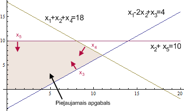

Katra pieļaujamā apgabala mala atrodas uz taisnes, kur viens no mainīgajiem
$x_1,\ldots,x_5$ ir $0$ (piemēram, uz taisnes $x_2+x_5=10$ ir $x_5=0$).
Stūris ir divu malu krustpunkts, t.i., punkts, kurā divi no mainīgajiem ir vienādi ar $0$:

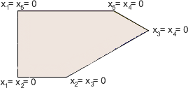

Vairāku dimensiju gadījumā ir līdzīgi. Ja sākotnējā uzdevumā ir $k$ mainīgie un $m$
nevienādības, tad standartformā ir $n = k+m$ mainīgie, un stūris ir punkts, kurā
krustojas $k$ hiperplaknes, t.i., $k$ no $n$ mainīgajiem ir vienādi ar $0$.

### Simpleksalgoritma tabula

Simpleksalgoritma soļus ērti pierakstīt tabulā. Tabulas rindiņās ieraksta
vienādību koeficientus un labās puses $b_i$, bet pēdējā rindiņā -- mērķa funkcijas koeficientus.
Pēdējās rindiņas ailē $b_i$ glabā pašreizējo mērķa funkcijas vērtību ar mīnusa zīmi
(sākumā tā ir $0$).

<table>
<thead>
<tr><th style="background-color:#e6e6e6;">$x_1$</th><th style="background-color:#e6e6e6;">$x_2$</th><th>$x_3$</th><th>$x_4$</th><th>$x_5$</th><th>$b_i$</th><th>Atbilstošā izteiksme</th></tr>
</thead>
<tbody>
<tr><td style="background-color:#e6e6e6;">$1$</td><td style="background-color:#e6e6e6;">$-2$</td><td>$1$</td><td>$0$</td><td>$0$</td><td>$4$</td><td>$x_1 - 2x_2 + x_3 = 4$</td></tr>
<tr><td style="background-color:#e6e6e6;">$1$</td><td style="background-color:#e6e6e6;">$1$</td><td>$0$</td><td>$1$</td><td>$0$</td><td>$18$</td><td>$x_1 + x_2 + x_4 = 18$</td></tr>
<tr><td style="background-color:#e6e6e6;">$0$</td><td style="background-color:#e6e6e6;">$1$</td><td>$0$</td><td>$0$</td><td>$1$</td><td>$10$</td><td>$x_2 + x_5 = 10$</td></tr>
<tr><td style="background-color:#e6e6e6;"><b>2</b></td><td style="background-color:#e6e6e6;"><b>3</b></td><td><b>0</b></td><td><b>0</b></td><td><b>0</b></td><td><b>0</b></td><td>$z = 2x_1+3x_2$</td></tr>
</tbody>
</table>

Tabula atbilst stūrim $(x_1,x_2) = (0,0)$:

* Pelēkās kolonnas ir *brīvie mainīgie* (*non-basic variables*, *tight variables*);
  stūrī tie ir vienādi ar $0$.
* Pārējās kolonnas ir *pamatmainīgie* (*basic variables*, *loose variables*). To kolonnas veido
  vienības matricu, tāpēc to vērtības var nolasīt ailē $b_i$: $x_3 = 4$, $x_4 = 18$, $x_5 = 10$.
  Pēdējā rindiņā zem pamatmainīgajiem ir nulles, tāpēc mērķa funkcija ir izteikta tikai ar
  brīvajiem mainīgajiem.

Šādu tabulu sauksim par *kanonisku*. Simpleksalgoritma solī viens brīvais mainīgais kļūst par
pamatmainīgo un viens pamatmainīgais -- par brīvo; pēc tam tabulu atkal pārveido kanoniskā formā.

> *Piezīme:* Sākumstūrī $(x_1, x_2) = (0,0)$ brīvie mainīgie ir uzdevuma sākotnējie mainīgie
> $x_1, x_2$, bet pamatmainīgie -- papildmainīgie $x_3,x_4,x_5$. Turpmākajos soļos
> brīvie un pamatmainīgie mainās vietām; tie ir atkarīgi no stūra, kurā atrodamies.

### Pirmais simpleksalgoritma solis

Simpleksalgoritma solis sastāv no trim daļām:

1. **Ieejošais mainīgais.** Izvēlas brīvo mainīgo ar pozitīvu koeficientu pēdējā rindiņā;
   to palielinot, mērķa funkcija pieaug. Parasti ņem lielāko koeficientu (*Danciga likums*), bet
   der jebkurš pozitīvs. Ja pozitīvu koeficientu nav, stūris ir optimāls.
2. **Izejošais mainīgais.** Palielina izvēlēto mainīgo par $d$, pārējos brīvos atstājot $0$,
   un pamatmainīgos maina tā, lai vienādības paliktu spēkā. Palielināšanu aptur, kad kāds
   pamatmainīgais kļūst $0$; tas kļūst par brīvo mainīgo.
3. **Pārveidojums.** Apmaina abu mainīgo kolonnas un ar rindu pārveidojumiem atjauno
   kanonisko formu.

Mērķa funkcijā $2x_1+3x_2$ lielākais koeficients ir pie $x_2$, tāpēc palielina $x_2$
(der arī $x_1$). Ja $x_2 = d$ un $x_1 = 0$, tad no vienādībām:

$$
x_3 = 4 + 2d \geq 0,\quad x_4 = 18 - d \geq 0,\quad x_5 = 10 - d \geq 0.
$$

Pirmais nosacījums izpildās jebkuram $d \geq 0$, otrais prasa $d \leq 18$, trešais -- $d \leq 10$.
Tātad lielākais iespējamais $d = 10$ (mazākā no attiecībām $b_i/a_{i2}$ rindās, kur
$a_{i2} > 0$), un pie tā $x_5 = 0$. Pārejam no stūra $x_1 = x_2 = 0$ uz stūri $x_1 = x_5 = 0$:
$x_2$ kļūst par pamatmainīgo, $x_5$ -- par brīvo. Apmainām vietām kolonnas $x_2$ un $x_5$.
Atslēgas elements (*pivot*) ir $x_2$ koeficients 3. rindā (dzeltenā šūna); zilās šūnas
jāpadara par nullēm:

<table>
<thead>
<tr><th style="background-color:#e6e6e6;">$x_1$</th><th style="background-color:#e6e6e6;">$x_5$</th><th>$x_3$</th><th>$x_4$</th><th>$x_2$</th><th>$b_i$</th><th>Atbilstošā izteiksme</th></tr>
</thead>
<tbody>
<tr><td style="background-color:#e6e6e6;">$1$</td><td style="background-color:#e6e6e6;">$0$</td><td>$1$</td><td>$0$</td><td style="background-color:#b3ccff;">$-2$</td><td>$4$</td><td>$x_1 + x_3 - 2x_2 = 4$</td></tr>
<tr><td style="background-color:#e6e6e6;">$1$</td><td style="background-color:#e6e6e6;">$0$</td><td>$0$</td><td>$1$</td><td style="background-color:#b3ccff;">$1$</td><td>$18$</td><td>$x_1 + x_4 + x_2 = 18$</td></tr>
<tr><td style="background-color:#e6e6e6;">$0$</td><td style="background-color:#e6e6e6;">$1$</td><td>$0$</td><td>$0$</td><td style="background-color:#ffe08a;">$1$</td><td>$10$</td><td>$x_5 + x_2 = 10$</td></tr>
<tr><td style="background-color:#e6e6e6;"><b>2</b></td><td style="background-color:#e6e6e6;"><b>0</b></td><td><b>0</b></td><td><b>0</b></td><td style="background-color:#b3ccff;"><b>3</b></td><td><b>0</b></td><td>$z = 2x_1+3x_2$</td></tr>
</tbody>
</table>

Rindu pārveidojumi (atslēgas elements jau ir $1$, tāpēc 3. rindu nedala):

* 1. rindai pieskaita divkāršotu 3. rindu: $(x_1 + x_3 - 2x_2) + 2(x_5 + x_2) = 4 + 2 \cdot 10$.
* No 2. rindas atņem 3. rindu: $(x_1 + x_4 + x_2) - (x_5 + x_2) = 18 - 10$.
* No pēdējās rindas atņem trīskāršotu 3. rindu: $z = 2x_1 + 3(10 - x_5) = 30 + 2x_1 - 3x_5$.

<table>
<thead>
<tr><th style="background-color:#e6e6e6;">$x_1$</th><th style="background-color:#e6e6e6;">$x_5$</th><th>$x_3$</th><th>$x_4$</th><th>$x_2$</th><th>$b_i$</th><th>Atbilstošā izteiksme</th></tr>
</thead>
<tbody>
<tr><td style="background-color:#e6e6e6;">$1$</td><td style="background-color:#e6e6e6;">$2$</td><td>$1$</td><td>$0$</td><td>$0$</td><td>$24$</td><td>$x_1 + 2x_5 + x_3 = 24$</td></tr>
<tr><td style="background-color:#e6e6e6;">$1$</td><td style="background-color:#e6e6e6;">$-1$</td><td>$0$</td><td>$1$</td><td>$0$</td><td>$8$</td><td>$x_1 - x_5 + x_4 = 8$</td></tr>
<tr><td style="background-color:#e6e6e6;">$0$</td><td style="background-color:#e6e6e6;">$1$</td><td>$0$</td><td>$0$</td><td>$1$</td><td>$10$</td><td>$x_5 + x_2 = 10$</td></tr>
<tr><td style="background-color:#e6e6e6;"><b>2</b></td><td style="background-color:#e6e6e6;"><b>-3</b></td><td><b>0</b></td><td><b>0</b></td><td><b>0</b></td><td><b>-30</b></td><td>$z = 30 + 2x_1-3x_5$</td></tr>
</tbody>
</table>

Tabula atkal ir kanoniska. Tā atbilst stūrim $(x_1, x_2) = (0, 10)$, kurā
$x_3 = 24$, $x_4 = 8$, $x_2 = 10$ un $z = 30$.

### Otrais simpleksalgoritma solis

Pēdējā rindiņā pozitīvs koeficients ir tikai pie $x_1$ (palielinot $x_5$, mērķa funkcija
samazinātos), tāpēc palielina $x_1$. Ja $x_1 = d$ un $x_5 = 0$, tad

$$
x_3 = 24 - d \geq 0,\quad x_4 = 8 - d \geq 0,\quad x_2 = 10 \geq 0.
$$

Lielākais iespējamais $d = \min(24/1,\, 8/1) = 8$, un pie tā $x_4 = 0$. Apmainām vietām
kolonnas $x_1$ un $x_4$; atslēgas elements ir $x_1$ koeficients 2. rindā:

<table>
<thead>
<tr><th style="background-color:#e6e6e6;">$x_4$</th><th style="background-color:#e6e6e6;">$x_5$</th><th>$x_3$</th><th>$x_1$</th><th>$x_2$</th><th>$b_i$</th><th>Atbilstošā izteiksme</th></tr>
</thead>
<tbody>
<tr><td style="background-color:#e6e6e6;">$0$</td><td style="background-color:#e6e6e6;">$2$</td><td>$1$</td><td style="background-color:#b3ccff;">$1$</td><td>$0$</td><td>$24$</td><td>$x_1 + 2x_5 + x_3 = 24$</td></tr>
<tr><td style="background-color:#e6e6e6;">$1$</td><td style="background-color:#e6e6e6;">$-1$</td><td>$0$</td><td style="background-color:#ffe08a;">$1$</td><td>$0$</td><td>$8$</td><td>$x_1 - x_5 + x_4 = 8$</td></tr>
<tr><td style="background-color:#e6e6e6;">$0$</td><td style="background-color:#e6e6e6;">$1$</td><td>$0$</td><td>$0$</td><td>$1$</td><td>$10$</td><td>$x_5 + x_2 = 10$</td></tr>
<tr><td style="background-color:#e6e6e6;"><b>0</b></td><td style="background-color:#e6e6e6;"><b>-3</b></td><td><b>0</b></td><td style="background-color:#b3ccff;"><b>2</b></td><td><b>0</b></td><td><b>-30</b></td><td>$z = 30 + 2x_1-3x_5$</td></tr>
</tbody>
</table>

Rindu pārveidojumi:

* No 1. rindas atņem 2. rindu: $(x_1 + 2x_5 + x_3) - (x_1 - x_5 + x_4) = 24 - 8$.
* No pēdējās rindas atņem divkāršotu 2. rindu: $z = 30 + 2(8 + x_5 - x_4) - 3x_5 = 46 - 2x_4 - x_5$.

<table>
<thead>
<tr><th style="background-color:#e6e6e6;">$x_4$</th><th style="background-color:#e6e6e6;">$x_5$</th><th>$x_3$</th><th>$x_1$</th><th>$x_2$</th><th>$b_i$</th><th>Atbilstošā izteiksme</th></tr>
</thead>
<tbody>
<tr><td style="background-color:#e6e6e6;">$-1$</td><td style="background-color:#e6e6e6;">$3$</td><td>$1$</td><td>$0$</td><td>$0$</td><td>$16$</td><td>$-x_4 + 3x_5 + x_3 = 16$</td></tr>
<tr><td style="background-color:#e6e6e6;">$1$</td><td style="background-color:#e6e6e6;">$-1$</td><td>$0$</td><td>$1$</td><td>$0$</td><td>$8$</td><td>$x_4 - x_5 + x_1 = 8$</td></tr>
<tr><td style="background-color:#e6e6e6;">$0$</td><td style="background-color:#e6e6e6;">$1$</td><td>$0$</td><td>$0$</td><td>$1$</td><td>$10$</td><td>$x_5 + x_2 = 10$</td></tr>
<tr><td style="background-color:#e6e6e6;"><b>-2</b></td><td style="background-color:#e6e6e6;"><b>-1</b></td><td><b>0</b></td><td><b>0</b></td><td><b>0</b></td><td><b>-46</b></td><td>$z = 46 - 2x_4 - x_5$</td></tr>
</tbody>
</table>

Visi pēdējās rindiņas koeficienti pie brīvajiem mainīgajiem ir negatīvi. Tā kā $x_4, x_5 \geq 0$,
no $z = 46 - 2x_4 - x_5$ izriet $z \leq 46$ visā pieļaujamajā apgabalā. Sasniegts maksimums.

### Atrisinājuma iegūšana

Pēdējā tabulā brīvie mainīgie ir $x_4 = x_5 = 0$, bet pamatmainīgo vērtības nolasa ailē $b_i$:

$$
x_3 = 16,\quad x_1 = 8,\quad x_2 = 10.
$$

Tātad $(x_1,x_2) = (8, 10)$ un $(x_3,x_4,x_5) = (16,0,0)$. Pārbaude sākotnējos nosacījumos:
$8 - 2 \cdot 10 + 16 = 4$, $8 + 10 + 0 = 18$, $10 + 0 = 10$. Mērķa funkcijas vērtība:

$$
2x_1 + 3x_2 = 2 \cdot 8 + 3 \cdot 10 = 46,
$$

kas sakrīt ar pēdējās tabulas ailē $b_i$ ierakstīto $-46$ (ar pretēju zīmi). Tātad $2x_1 + 3x_2$ lielākā vērtība pie dotajiem
nosacījumiem ir $46$, un to sasniedz punktā $(x_1, x_2) = (8, 10)$. Simpleksalgoritms gāja pa
daudzstūra stūriem $(0,0) \to (0,10) \to (8,10)$.

## Simpleksalgoritms vispārīgajā formā

**LP uzdevums standartformā:** atrast $\textcolor{blue}{\max(c_1x_1 + \ldots + c_nx_n)}$, ja izpildās
$k$ vienādības un $n$ nenegativitātes nosacījumi:

$$
\left\{
\begin{array}{l}
a_{11}x_1 + a_{12}x_2 + \ldots + a_{1n}x_n = b_1\\
\ldots\\
a_{k1}x_1 + a_{k2}x_2 + \ldots + a_{kn}x_n = b_k\\
x_1,x_2,\ldots,x_n \geq 0
\end{array} \right.
$$

Matricu pierakstā: $\max \mathbf{c}^T\mathbf{x}$, kur $A\mathbf{x} = \mathbf{b}$, $\mathbf{x} \geq \mathbf{0}$,
un $A$ ir $k \times n$ matrica ($k < n$). Pieņemam, ka vienādības ir lineāri neatkarīgas
(citādi liekās var izmest).

Ar *simpleksalgoritma tabulu* (*simplex tableau*) sauc $(k+1) \times (n+1)$ matricu, kuras
pirmajās $k$ rindās ir vienādību koeficienti un labās puses, bet pēdējā rindā --
mērķa funkcijas koeficienti un pašreizējā mērķa funkcijas vērtība ar mīnusa zīmi:

| $x_1$ | $x_2$ | $\ldots$ | $x_n$ | $b_i$ |
| --- | --- | --- | --- | --- |
| $a_{11}$ | $a_{12}$ | $\ldots$ | $a_{1n}$ | $b_1$ |
| $\ldots$ | $\ldots$ | $\ldots$ | $\ldots$ | $\ldots$ |
| $a_{k1}$ | $a_{k2}$ | $\ldots$ | $a_{kn}$ | $b_k$ |
| $c_1$ | $c_2$ | $\ldots$ | $c_n$ | $0$ |

Rindu pārveidojumi (rindas reizināšana ar skaitli $\neq 0$ un citas rindas daudzkārtņa
pieskaitīšana) nemaina ne pieļaujamo apgabalu, ne mērķa funkciju; mainās tikai pieraksts.

### Kanoniskā tabula

Simpleksalgoritms visu laiku atrodas kādā stūrī. Stūrim atbilst $k$ *pamatmainīgie*; pārējie
$n-k$ ir *brīvie mainīgie*, un stūrī tie ir vienādi ar $0$. Pārnumurēsim mainīgos tā, lai
pamatmainīgie būtu pēdējie: $x_{n-k+1},\ldots,x_n$. Tabula ir *kanoniska*, ja

* pamatmainīgo kolonnas veido vienības matricu;
* pēdējā rindā zem pamatmainīgajiem ir nulles;
* labās puses ir nenegatīvas: $\bar{b}_1,\ldots,\bar{b}_k \geq 0$.

| $x_1$ | $\ldots$ | $x_{n-k}$ | $x_{n-k+1}$ | $x_{n-k+2}$ | $\ldots$ | $x_n$ | $b_i$ |
| --- | --- | --- | --- | --- | --- | --- | --- |
| $\bar{a}_{11}$ | $\ldots$ | $\bar{a}_{1,n-k}$ | $1$ | $0$ | $\ldots$ | $0$ | $\bar{b}_1$ |
| $\bar{a}_{21}$ | $\ldots$ | $\bar{a}_{2,n-k}$ | $0$ | $1$ | $\ldots$ | $0$ | $\bar{b}_2$ |
| $\ldots$ | $\ldots$ | $\ldots$ | $\ldots$ | $\ldots$ | $\ldots$ | $\ldots$ | $\ldots$ |
| $\bar{a}_{k1}$ | $\ldots$ | $\bar{a}_{k,n-k}$ | $0$ | $0$ | $\ldots$ | $1$ | $\bar{b}_k$ |
| $\bar{c}_1$ | $\ldots$ | $\bar{c}_{n-k}$ | $0$ | $0$ | $\ldots$ | $0$ | $-z_0$ |

No kanoniskās tabulas uzreiz nolasa:

* **stūri:** $x_1 = \ldots = x_{n-k} = 0$ (brīvie) un $x_{n-k+i} = \bar{b}_i$ (pamatmainīgie);
* **mērķa funkciju**, izteiktu ar brīvajiem mainīgajiem:
  $z = z_0 + \bar{c}_1x_1 + \ldots + \bar{c}_{n-k}x_{n-k}$; stūrī tās vērtība ir $z_0$.

Koeficientus $\bar{c}_j$ sauc par *reducētajām izmaksām* (*reduced costs*): tie parāda, cik
mainās $z$, ja brīvo mainīgo $x_j$ palielina par $1$.

### Simpleksalgoritma solis

Vispārīgā gadījumā viens solis kanoniskajā tabulā izskatās tā:

1. **Optimalitātes pārbaude.** Ja visi $\bar{c}_j \leq 0$, tad $z \leq z_0$ visā pieļaujamajā
   apgabalā, un pašreizējais stūris ir optimāls.
2. **Ieejošais mainīgais.** Izvēlas brīvo mainīgo $x_j$ ar $\bar{c}_j > 0$ (piemēram, ar
   lielāko $\bar{c}_j$).
3. **Izejošais mainīgais.** Ja $x_j = d$, tad $i$-tā pamatmainīgā vērtība ir $\bar{b}_i - \bar{a}_{ij}d$.
   Rindas ar $\bar{a}_{ij} \leq 0$ palielināšanu neierobežo. Ja visi $\bar{a}_{ij} \leq 0$, tad
   $x_j$ var palielināt bezgalīgi, un mērķa funkcija ir neierobežota. Citādi izvēlas rindu $r$
   ar mazāko attiecību (*minimum ratio test*):
   $$
   d = \frac{\bar{b}_r}{\bar{a}_{rj}} = \min_{i:\;\bar{a}_{ij} > 0} \frac{\bar{b}_i}{\bar{a}_{ij}}.
   $$
   Rindas $r$ pamatmainīgais kļūst $0$ un iziet no pamatmainīgo kopas.
4. **Pārveidojums (*pivot*).** Rindu $r$ izdala ar atslēgas elementu $\bar{a}_{rj}$, tad no
   katras citas rindas (arī no pēdējās) atņem tādu rindas $r$ daudzkārtni, lai kolonnā $j$
   paliktu $0$. Tabula atkal ir kanoniska, $x_j$ ir pamatmainīgais, un $z_0$ pieaug par
   $\bar{c}_j d \geq 0$.

Pseidokodā (tabula $T$, kopā $B$ -- pamatmainīgo indeksi):

$\textsf{Simplex}(T, B)$
1. **while** pēdējā rindā ir $\bar{c}_j > 0$ kādam $j \notin B$ $\quad$ *// pretējā gadījumā stūris ir optimāls*
2. $\quad$ izvēlas $j \notin B$ ar $\bar{c}_j > 0$ $\quad$ *// ieejošais mainīgais*
3. $\quad$ **if** visi $\bar{a}_{ij} \leq 0$
4. $\quad\quad$ **return** "neierobežots"
5. $\quad$ izvēlas $r$ ar mazāko $\bar{b}_r / \bar{a}_{rj}$ starp $\bar{a}_{rj} > 0$ $\quad$ *// izejošais mainīgais*
6. $\quad \textsf{Pivot}(T, r, j)$ $\quad$ *// rindu pārveidojumi, kolonnā $j$ vienības vektors*
7. $\quad$ rindas $r$ pamatmainīgo kopā $B$ aizstāj ar $j$
8. **return** stūris $x_{B} = \bar{\mathbf{b}}$, pārējie $x_j = 0$

Iepriekšējā piemērā abi soļi notika tieši tā; tur kolonnas vēl tika apmainītas vietām, lai
pamatmainīgie vienmēr stāvētu pēdējās kolonnās.

### Sākuma stūris un deģenerācija

* **Sākuma stūris.** Ja visi sākotnējie nosacījumi ir $\leq$ ar $b_i \geq 0$, tad kanoniska ir
  jau pirmā tabula: pamatmainīgie ir papildmainīgie, un stūris ir $\mathbf{x} = \mathbf{0}$
  (kā piemērā). Citādi sākuma stūri atrod ar *divu fāžu metodi*: vispirms ar simpleksalgoritmu
  minimizē mākslīgu palīgmainīgo summu; ja tā sasniedz $0$, iegūts pieļaujams stūris, ja nē --
  uzdevumam nav pieļaujamu atrisinājumu.
* **Deģenerācija.** Ja kāds $\bar{b}_r = 0$, tad solis var notikt ar $d = 0$: mainās
  pamatmainīgo kopa, bet ne stūris un ne $z_0$. Neveiksmīgi izvēloties ieejošos mainīgos,
  algoritms var cikliski atgriezties pie tās pašas tabulas. Ciklošanos novērš, piemēram,
  *Blenda likums* (*Bland's rule*): par ieejošo un izejošo mainīgo ņem derīgo ar mazāko indeksu.
  Tad simpleksalgoritms vienmēr beidzas, jo stūru skaits ir galīgs (ne lielāks par
  $\binom{n}{k}$).

## LP risināšanas algoritmi

* (Reālo skaitļu) LP ir pirmais solis, lai risinātu veselo skaitļu problēmas (*Integer Programming, IP*) un jauktās LP problēmas (*Mixed Integer Linear Programs, MIP*).
* Kā optimāli izvēlēties komplektu (izejvielas, akciju portfeļus), kā vislabāk sadalīt kādu resursu.
* Plūsmas maksimizēšana grafā (sk. iepriekšējo lekciju).

Veselie skaitļi kā nezināmie (*Integer Programming*) labāk modelē Yes/No lēmumu pieņemšanu (0 un 1 vērtības), bet šādus uzdevumus ir grūtāk risināt.

Ir pazīstami šādi algoritmi:

* Simpleksalgoritms (Kantorovičs, 1939; Dantzig, 1947).
* Elipsoīda algoritms (Khachian, 1979); pirmais pierādāmi efektīvais algoritms.
* Iekšējo punktu metodes (*Interior Point methods*).
  - Projektīvā metode (Karmarkar, 1984).
  - Afīnā metode (Dikin, 1967).
  - Log Barrier Method.
  - Primāli duālā centrālā ceļa metode (Kojima, Mizuno, Yoshise, 1989; Mehrotra, 1992).

Simpleksalgoritms parasti ir efektīvs, bet īpaši uzkonstruēti piemēri var būt ļoti lēni. Matricām var būt ap 100 tūkstošiem rindiņu/kolonnu; ap miljons skaitļu šajās matricās nav nulles.

### Simpleksa algoritma pretpiemērs

Maksimizēt izteiksmi ar $D$ mainīgajiem: $2^{D-1}x_1+2^{D-2}x_2+ \dots + 2x_{D-1}+x_D$

Nevienādības ir sekojošas:

$$
\left\{ \begin{array}{l}
x_1 \leq 5\\
4x_1+x_2 \leq 25\\
8x_1+4x_2+x_3 \leq 125 \\
\vdots\\
2^Dx_1+2^{D-1}x_2+ \dots +4x_{D-1}+x_D \leq 5^D \\
x_1 \geq 0, \, \, \dots , \, \, x_D \geq 0.
\end{array} \right.
$$

**Klee-Minty saspiestais hiperkubs:**

* Deterministisks simpleksa algoritms apciemo visas $2^D$ hiperkuba virsotnes pirms atrod optimālo risinājumu $x_D = 5^D$ (visas citas ir nulles).
* Ja simpleksa algoritms izvēlas nākamo soli ar varbūtisku (nevis deterministisku) metodi, pietiek ar polinomiālu laiku.
* Piemērs ir nestabils; reālo skaitļu aritmētika un noapaļošana arī parasti noved pie tā, ka algoritms beidzas pēc polinomiāli daudziem soļiem.

[Reālo LP algoritmu ātrdarbība](https://cstheory.stackexchange.com/questions/2373/complexity-of-the-simplex-algorithm)

### Elipsoīda algoritms

Šo algoritmu izgudroja Hačijans (Khachiyan) 1979. gadā. Elipsoīda algoritms pazīstams kā 
pirmais lineārās programmēšanas algoritms, kuram tika pierādīts, ka tas atrod atrisinājumu 
polinomiālā laikā ($O(n^4L)$), kur $n$ - dimensiju skaits, $L$ -- ar cik bitu precizitāti 
jāatrod atrisinājums.

Lai gan teorētiski darbības laiks ir polinomiāls, praksē algoritms ir lēns un netiek lietots. 
Tāpēc šajā kursā mēs ierobežosimies ar īsu šī algoritma aprakstu.

**Elipsoīda algoritma kopsavilkums:** Dualitātes teorēmas (un redukcijas uz primāro+duālo) 
dēļ pietiek ar algoritmu, kas atrod punktu, kur izpildās visi nosacījumi. To meklē šādi:

Sāk ar elipsoīdu $E_0$, kas noteikti ietver LP pieļaujamo apgabalu. Pilda sekojošus soļus 
līdzkamēr sasniegta vajadzīgā precizitāte:

1. Ņem iepriekšējā elipsoīda $E_i$ centru $c_i$.
2. Ja $c_i$ neapmierina visus LP nosacījumus, tad atrod nosacījumu $a_k$, kas tiek pārkāpts 
   visvairāk.
3. Ar plakni, kas sastāv no visiem punktiem, kur nosacījuma $a_k$ izteiksmei ir vienāda vērtība 
   $c$ (kur $c$ ir pa vidu starp vērtību punktā $c_i$ un pieļaujamajām izteiksmes vērtībām) 
   pārdala telpu divās daļās. Ar $R_1$ apzīmējam daļu, kur nonāk $c_i$ un ar $R_2$ apzīmējam 
   daļu, kur nonāk pieļaujamais apgabals.
4. Uzkonstruē jaunu elipsoīdu $E_{i+1}$, tā lai izpildītos $E_i \cap R_2 \subseteq E_{i+1}$.

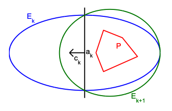

Meklē punktu izliektā $n$ dimensiju telpas apgabalā. Hačjana konstrukcijā 
(*barycentric coordinate descent*) veido elipsoīdu virkni, kurai

$$
\frac{\text{Volume}(E_{k+1})}{\text{Volume}(E_{k})} = e^{-\frac{1}{2n+1}}
$$

jeb tilpumu attiecība ir stingri mazāka par $1$ (atkarīga tikai no dimensiju skaita $n$).

Sal. [Elipsoīda algoritma lekcija 6-854J.L12](https://ocw.mit.edu/courses/electrical-engineering-and-computer-science/6-854j-advanced-algorithms-fall-2008/lecture-notes/lec12.pdf).

### Iekšējā punkta metožu pārskats

Iekšējā punkta metožu kopīgās idejas:

* Apgabalu, kurā meklē atrisinājumu var aizstāt ar **barjerfunkciju** (*barrier function*), kas strauji aug tad, ja tuvojas atļautā apgabala robežai.
* Atšķirībā no simpleksmetodes, kas pārmeklē pieļaujamā apgabala stūrus, iekšējā punkta metodes meklē arvien labākus atrisinājumus pieļaujamā apgabala iekšienē. Algoritma soļi tuvojas stūrim tikai algoritma beigās.

Iterācijas iekšējā apgabalā mēdz realizēt šādos divos veidos:

**Iekšējā punkta metožu 1.veids:** Modificē mērķfunkciju tā, lai tās vērtība kļūtu sliktāka pieļaujamā apgabala malās. Piemēram, mērķfunkciju $\max (c_1 x_1 + c_2 x_2 + \ldots + c_n x_n)$ var aizstāt ar

$$
\max \left( c_1 x_1 + c_2 x_2 + \ldots + c_n x_n + \ln x_1 + \ldots + \ln x_n \right).
$$

Tad, tuvojoties $x_i=0$ plaknēm, kas ierobežo pieļaujamo apgabalu, $\ln x_i$ tiecas uz $-\infty$ un mērķfunkcija arī tieksies uz $-\infty$.

**Iekšējā punkta metožu 2.veids:** Ievieš papildus nosacījumus, kas attur no pieļaujamā apgabala malām. Ar katru soli, papildus nosacījumi tiek vājināti, ļaujot algoritmam pietuvoties stūrim, kur ir sākotnējas mērķfunkcijas maksimālā vērtība. Mērķis ir panākt, lai algoritms sākumā atrod optimālo vērtību pieļaujamā apgabala iekšienē un tad nonāk optimālajā stūrī.

### Afīnās mērogošanas metode

Šo metodi 1967. gadā publicēja I.Dikins (Dikin), bet plaši pazīstama tā kļuva tikai pēc 1984. gada, 
kad pēc Karmarkara projektīvās metodes vairāki autori (E.Barnes; R.Vanderbei, M.Meketon, B.Freedman) 
to atklāja no jauna kā vienkāršāku alternatīvu. Tā ir vienkāršākā iekšējā punkta metode: tā izmanto tikai 
primāro uzdevumu un neizmanto barjerfunkciju. Polinomiāls darbības laiks šai metodei nav pierādīts, 
un praksē to ir aizstājušas primāli duālās metodes (sk. nākamo nodaļu). Tāpēc šajā kursā ierobežosimies 
ar īsu aprakstu.

**Uzdevums:** $\max \mathbf{c}^T\mathbf{x}$, kur $A\mathbf{x} = \mathbf{b}$, $\mathbf{x} \geq \mathbf{0}$. 
Zināms sākumpunkts $\mathbf{x} > \mathbf{0}$ ar $A\mathbf{x} = \mathbf{b}$ (pieļaujamā apgabala iekšpusē).

**Afīnās mērogošanas kopsavilkums:** Ja $\mathbf{x}$ atrodas tuvu kādai robežai $x_j = 0$, tad pa 
gradienta virzienu var paiet tikai mazu soli. Tāpēc katrā iterācijā koordinātes vispirms *mērogo* tā, 
lai tekošais punkts būtu vienādā attālumā no visām robežām:

1. Ar $X = \operatorname{diag}(x_1, \ldots, x_n)$ apzīmē diagonālmatricu. Koordinātēs $\tilde{\mathbf{x}} = X^{-1}\mathbf{x}$ 
   tekošais punkts ir $\mathbf{e} = (1, \ldots, 1)$, un vienības lode ap to atrodas apgabalā $\tilde{\mathbf{x}} \geq \mathbf{0}$. 
   Sākotnējās koordinātēs šai lodei atbilst elipsoīds $\sum_j (\Delta x_j / x_j)^2 \leq 1$ (*Dikina elipsoīds*), 
   kas pieskaras plaknēm $x_j = 0$.
2. Mērogotajās koordinātēs mērķfunkcijas gradientu $X\mathbf{c}$ projicē uz apakštelpu, kurā $AX\tilde{\mathbf{x}} = \mathbf{b}$ 
   paliek spēkā. Atgriežoties sākotnējās koordinātēs, iegūst virzienu
   
   $$
   \mathbf{y} = (A X^2 A^T)^{-1} A X^2 \mathbf{c},\qquad
   \mathbf{r} = \mathbf{c} - A^T\mathbf{y},\qquad
   \Delta\mathbf{x} = X^2 \mathbf{r}.
   $$
   
   Tad $A\Delta\mathbf{x} = \mathbf{0}$, un $\mathbf{c}^T\Delta\mathbf{x} = \lVert X\mathbf{r} \rVert^2 \geq 0$.
3. Atrod lielāko soli $\alpha_{\max} = \min_{j:\, \Delta x_j < 0} x_j / (-\Delta x_j)$, ar kuru vēl $\mathbf{x} + \alpha\Delta\mathbf{x} \geq \mathbf{0}$, 
   un pārvietojas tikai daļu no tā: $\mathbf{x} \leftarrow \mathbf{x} + \beta\,\alpha_{\max}\Delta\mathbf{x}$, kur, piemēram, $\beta = 0.96$. 
   (Ja $\Delta\mathbf{x} \geq \mathbf{0}$ un $\Delta\mathbf{x} \neq \mathbf{0}$, tad uzdevums ir neierobežots.)
4. Vektors $\mathbf{y}$ ir duālā atrisinājuma novērtējums. Kad $\mathbf{r} \leq \mathbf{0}$ (t.i., $\mathbf{y}$ ir duāli pieļaujams) 
   un dualitātes atstarpe $\mathbf{b}^T\mathbf{y} - \mathbf{c}^T\mathbf{x} = -\mathbf{x}^T\mathbf{r}$ ir pietiekami maza, algoritms apstājas.

**Piemērs:** Uzdevumam $\max \left( -\frac{x_1}{3} + x_2 \right)$, kur $x_1 + x_2 \leq 4$, $2x_1 - x_2 \leq 3$, $x_1, x_2 \geq 0$ 
(standartformā ar papildmainīgajiem $x_3, x_4$), no sākumpunkta $\mathbf{x} = (1, 1, 2, 2)$ viena iterācija ar $\beta = 0.96$ 
dod $\mathbf{x} = (0.74957;\ 3.17043;\ 0.08000;\ 4.67130)$. Šo soli ierobežo papildmainīgais $x_3$, kas ir tuvu nullei, 
t.i., punkts jau ir tuvu robežai $x_1 + x_2 = 4$. Optimums ir $(x_1, x_2) = (0, 4)$.

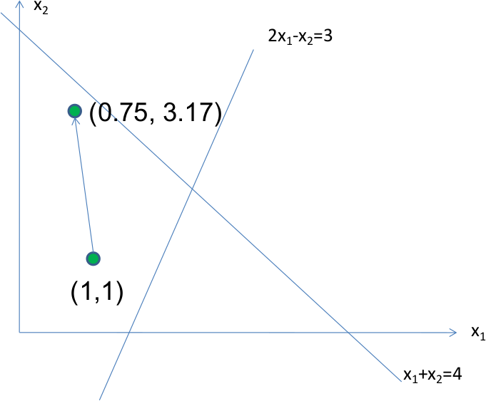

*Afīnās mērogošanas pirmā iterācija no punkta $(1,1)$.*

**Trūkumi:** Garā solī ($\beta$ tuvu $1$) iterācijas pietuvojas robežai, un tad nākamie soļi kļūst ļoti īsi, jo 
Dikina elipsoīds ir šaurs. Konverģence uz optimumu ir pierādīta, ja $\beta \leq 2/3$, bet zināmi pretpiemēri, 
kuros ar $\beta = 0.999$ metode konverģē uz neoptimālu punktu. Primāli duālajā metodē (sk. tālāk) 
šo problēmu risina, turot iterācijas tuvu *centrālajam ceļam*; tur matricas $X^2$ vietā parādās $X S^{-1}$.

### Primāli duālā centrālā ceļa metode

Primāli duālās centrālā ceļa sekošanas metodes (*primal-dual path-following methods*) ir mūsdienās 
visvairāk lietotās iekšējā punkta metodes. Centrālo ceļu aprakstīja N.Megido (Megiddo, 1989), 
primāli duālo algoritmu ar polinomiālu laiku -- M.Kojima, S.Mizuno un A.Jošise (Yoshise, 1989), 
bet praktisko *prediktora-korektora* variantu -- S.Mehrotra (1992). Šīs metodes ir lielākās daļas 
komerciālo un atvērtā koda LP risinātāju iekšējā punkta (*barrier*) algoritmu pamatā; tās parasti 
atrod atrisinājumu pēc dažiem desmitiem iterāciju gandrīz neatkarīgi no uzdevuma izmēra.

Metode izmanto dualitātes rezultātus no [iepriekšējās lekcijas]({{ '/lectures/linear_introduction/' | relative_url }}) 
(nodaļa "Dualitātes teorēmas: kopsavilkums algoritmiem"). Plašāks izklāsts ir grāmatā [[Wri97]](#Wri97).

**Uzdevums:** Primārais un duālais uzdevums standartformā, kur $A$ ir $m \times n$ matrica:

$$
(P): \textcolor{blue}{\min \left( \mathbf{c}^T \mathbf{x} \right)},\;\;\text{kur}\;\;
A\mathbf{x} = \mathbf{b},\;\; \mathbf{x} \geq \mathbf{0};
\qquad
(D): \textcolor{blue}{\max \left( \mathbf{b}^T \mathbf{y} \right)},\;\;\text{kur}\;\;
A^T\mathbf{y} + \mathbf{s} = \mathbf{c},\;\; \mathbf{s} \geq \mathbf{0}.
$$

Apzīmējam $X = \operatorname{diag}(\mathbf{x})$, $S = \operatorname{diag}(\mathbf{s})$, $\mathbf{e} = (1, \ldots, 1)^T$.

**Pamatideja:** Optimālie $\mathbf{x}$ un $(\mathbf{y}, \mathbf{s})$ ir sistēmas

$$
A\mathbf{x} = \mathbf{b},\;\;
A^T\mathbf{y} + \mathbf{s} = \mathbf{c},\;\;
X S \mathbf{e} = \mathbf{0},\;\;
\mathbf{x} \geq \mathbf{0},\;\; \mathbf{s} \geq \mathbf{0}
$$

atrisinājums. Šo sistēmu ir grūti risināt tieši, jo $x_j s_j = 0$ nozīmē kombinatorisku izvēli -- kuri 
$x_j$ būs nulle. Tāpēc algoritms uztur stingri pozitīvus $\mathbf{x} > \mathbf{0}$ un $\mathbf{s} > \mathbf{0}$ un katrā iterācijā:

* aprēķina $\mu = \mathbf{x}^T\mathbf{s} / n$ -- vidējo reizinājumu $x_j s_j$ (dualitātes atstarpe ir $n\mu$);
* izvēlas mērķi uz centrālā ceļa ar mazāku parametru $\sigma\mu$, kur $0 < \sigma < 1$ (*centrēšanas parametrs*);
* izdara vienu *Ņūtona metodes* soli sistēmai $A\mathbf{x} = \mathbf{b}$, $A^T\mathbf{y} + \mathbf{s} = \mathbf{c}$, $X S \mathbf{e} = \sigma\mu\mathbf{e}$;
* soli saīsina tā, lai $\mathbf{x}$ un $\mathbf{s}$ paliktu pozitīvi.

Tā iterācijas seko centrālajam ceļam, un dualitātes atstarpe katrā iterācijā samazinās apmēram $1/\sigma$ reizes.

**Ņūtona solis:** Pirmie divi vienādojumi ir lineāri, bet trešajā $(x_j + \Delta x_j)(s_j + \Delta s_j) = \sigma\mu$ 
atmet mazo saskaitāmo $\Delta x_j \Delta s_j$. Iegūst lineāru sistēmu virzienam $(\Delta\mathbf{x}, \Delta\mathbf{y}, \Delta\mathbf{s})$:

$$
\left( \begin{array}{ccc}
A & 0 & 0\\
0 & A^T & I\\
S & 0 & X
\end{array} \right)
\left( \begin{array}{c}
\Delta\mathbf{x}\\
\Delta\mathbf{y}\\
\Delta\mathbf{s}
\end{array} \right)
=
\left( \begin{array}{c}
\mathbf{r}_P\\
\mathbf{r}_D\\
\mathbf{r}_C
\end{array} \right),
\;\;\text{kur}\;\;
\left\{ \begin{array}{l}
\mathbf{r}_P = \mathbf{b} - A\mathbf{x},\\
\mathbf{r}_D = \mathbf{c} - A^T\mathbf{y} - \mathbf{s},\\
\mathbf{r}_C = \sigma\mu\mathbf{e} - X S\mathbf{e}.
\end{array} \right.
$$

Izslēdzot $\Delta\mathbf{s}$ un $\Delta\mathbf{x}$, paliek tikai $m \times m$ sistēma (*normālvienādojumi*) ar simetrisku 
pozitīvi definītu matricu $A D A^T$, kur $D = X S^{-1}$:

$$
(A D A^T)\,\Delta\mathbf{y} = \mathbf{r}_P + A S^{-1}(X\mathbf{r}_D - \mathbf{r}_C),\qquad
\Delta\mathbf{s} = \mathbf{r}_D - A^T\Delta\mathbf{y},\qquad
\Delta\mathbf{x} = S^{-1}(\mathbf{r}_C - X\Delta\mathbf{s}).
$$

Ja sākumpunkts ir pieļaujams ($\mathbf{r}_P = \mathbf{0}$, $\mathbf{r}_D = \mathbf{0}$), tad tādi tie paliek arī turpmāk, 
jo $A\Delta\mathbf{x} = \mathbf{0}$ un $A^T\Delta\mathbf{y} + \Delta\mathbf{s} = \mathbf{0}$.

**Primāli duālās metodes pseidokods**

*Ievade:* Matrica $A$, vektori $\mathbf{b}$, $\mathbf{c}$; sākumpunkts $\mathbf{x} > \mathbf{0}$, $\mathbf{y}$, $\mathbf{s} > \mathbf{0}$; 
precizitāte $\varepsilon > 0$; parametri $\sigma \in (0;1)$ (piemēram, $0.1$) un $\eta \in (0;1)$ (piemēram, $0.9$--$0.99$).  
*Izvade:* Tuvināti optimālie $\mathbf{x}$ un $(\mathbf{y}, \mathbf{s})$.

$\textsf{Primal-Dual-Path-Following}(A, \mathbf{b}, \mathbf{c}, \mathbf{x}, \mathbf{y}, \mathbf{s})$
1. **while** $\mathbf{x}^T\mathbf{s} > \varepsilon$ **or** $\lVert \mathbf{b} - A\mathbf{x} \rVert > \varepsilon$ **or** $\lVert \mathbf{c} - A^T\mathbf{y} - \mathbf{s} \rVert > \varepsilon$
2. $\quad \mu = \mathbf{x}^T\mathbf{s} / n$ $\quad$ *// dualitātes atstarpe ir $n\mu$*
3. $\quad \mathbf{r}_P = \mathbf{b} - A\mathbf{x}$; $\;\;\mathbf{r}_D = \mathbf{c} - A^T\mathbf{y} - \mathbf{s}$; $\;\;\mathbf{r}_C = \sigma\mu\mathbf{e} - X S\mathbf{e}$
4. $\quad D = X S^{-1}$
5. $\quad \Delta\mathbf{y} = \textsf{Solve}\left(A D A^T,\; \mathbf{r}_P + A S^{-1}(X\mathbf{r}_D - \mathbf{r}_C)\right)$ $\quad$ *// normālvienādojumi*
6. $\quad \Delta\mathbf{s} = \mathbf{r}_D - A^T\Delta\mathbf{y}$
7. $\quad \Delta\mathbf{x} = S^{-1}(\mathbf{r}_C - X\Delta\mathbf{s})$
8. $\quad \alpha_P = \min\left(1,\; \eta \cdot \min_{j:\, \Delta x_j < 0} x_j / (-\Delta x_j)\right)$ $\quad$ *// $\mathbf{x}$ paliek pozitīvs*
9. $\quad \alpha_D = \min\left(1,\; \eta \cdot \min_{j:\, \Delta s_j < 0} s_j / (-\Delta s_j)\right)$ $\quad$ *// $\mathbf{s}$ paliek pozitīvs*
10. $\quad \mathbf{x} = \mathbf{x} + \alpha_P \Delta\mathbf{x}$
11. $\quad \mathbf{y} = \mathbf{y} + \alpha_D \Delta\mathbf{y}$; $\;\;\mathbf{s} = \mathbf{s} + \alpha_D \Delta\mathbf{s}$
12. **return** $(\mathbf{x}, \mathbf{y}, \mathbf{s})$

Galvenais darbs katrā iterācijā ir 5.rindiņa: $m \times m$ sistēmas atrisināšana (lielos uzdevumos -- ar retināto 
matricu Holecka sadalījumu). Matrica $A D A^T$ katrā iterācijā mainās, bet tās nenulles elementu izvietojums paliek 
tas pats, tāpēc sadalījuma struktūru var aprēķināt vienreiz.

**Darbības laiks:** Ja iterācijas tur pietiekami tuvu centrālajam ceļam (*short-step* variants ar $\sigma = 1 - 0.4/\sqrt{n}$ 
un pilnu soli), tad pietiek ar $O(\sqrt{n}\, L)$ iterācijām, kur $L$ ir ievades bitu skaits; tas ir labākais zināmais 
iterāciju skaita novērtējums iekšējā punkta metodēm. Praksē lieto lielākus soļus ($\sigma \approx 0.1$ vai adaptīvu $\sigma$) 
un Mehrotras prediktora-korektora shēmu: vispirms aprēķina virzienu ar $\sigma = 0$ (*prediktors*), pēc tā izvēlas $\sigma$ 
un pieskaita korekciju, kas ņem vērā atmesto $\Delta x_j \Delta s_j$ (*korektors*). Abiem virzieniem izmanto vienu un to pašu 
matricas $A D A^T$ sadalījumu.

#### Primāli duālās metodes piemērs

Atrisināsim to pašu uzdevumu, kas afīnās mērogošanas metodei: $\max \left( -\frac{x_1}{3} + x_2 \right)$, kur 
$x_1 + x_2 \leq 4$, $2x_1 - x_2 \leq 3$, $x_1, x_2 \geq 0$. Ar papildmainīgajiem $x_3, x_4$ un pārejot uz minimizāciju:

$$
\textcolor{blue}{\min \left( \frac{x_1}{3} - x_2 \right)},\;\;\text{kur}\;\;
A = \left( \begin{array}{cccc}
1 & 1 & 1 & 0\\
2 & -1 & 0 & 1
\end{array} \right),\;\;
\mathbf{b} = \left( \begin{array}{c}
4\\
3
\end{array} \right),\;\;
\mathbf{c} = \left( \begin{array}{c}
1/3\\
-1\\
0\\
0
\end{array} \right),\;\;
\mathbf{x} \geq \mathbf{0}.
$$

Duālais uzdevums: $\max (4y_1 + 3y_2)$, kur $y_1 + 2y_2 + s_1 = 1/3$, $y_1 - y_2 + s_2 = -1$, $y_1 + s_3 = 0$, $y_2 + s_4 = 0$, 
$\mathbf{s} \geq \mathbf{0}$.

**Sākumpunkts:** $\mathbf{x}^{(0)} = (1, 1, 2, 2)$ (primāli pieļaujams) un $\mathbf{y}^{(0)} = (-2, -1/2)$, no kā 
$\mathbf{s}^{(0)} = \mathbf{c} - A^T\mathbf{y}^{(0)} = (10/3,\ 1/2,\ 2,\ 1/2) > \mathbf{0}$ (duāli pieļaujams). 
Dualitātes atstarpe $\mathbf{x}^T\mathbf{s} = 10/3 + 1/2 + 4 + 1 = 8.8333$, tātad $\mu = 8.8333/4 = 2.2083$. 
Parametri: $\sigma = 0.1$, $\eta = 0.9$.

**Pirmā iterācija:**

* Mērķis uz centrālā ceļa: $\sigma\mu = 0.22083$. Tā kā sākumpunkts ir pieļaujams, $\mathbf{r}_P = \mathbf{0}$ un $\mathbf{r}_D = \mathbf{0}$, bet 
  $\mathbf{r}_C = \sigma\mu\mathbf{e} - X S\mathbf{e} = 0.22083 - (3.33333,\ 0.5,\ 4,\ 1) = (-3.11250,\ -0.27917,\ -3.77917,\ -0.77917)$.
* $D = X S^{-1} = \operatorname{diag}(0.3,\ 2,\ 1,\ 4)$, un normālvienādojumu matrica

  $$
  A D A^T = \left( \begin{array}{cc}
  0.3 + 2 + 1 & 0.6 - 2\\
  0.6 - 2 & 1.2 + 2 + 4
  \end{array} \right)
  = \left( \begin{array}{cc}
  3.3 & -1.4\\
  -1.4 & 7.2
  \end{array} \right).
  $$

* Labā puse $-A S^{-1}\mathbf{r}_C = (3.38167,\ 2.86750)$; atrisinot sistēmu, $\Delta\mathbf{y} = (1.30103,\ 0.65124)$.
* $\Delta\mathbf{s} = -A^T\Delta\mathbf{y} = (-2.60352,\ -0.64979,\ -1.30103,\ -0.65124)$ un 
  $\Delta\mathbf{x} = S^{-1}(\mathbf{r}_C - X\Delta\mathbf{s}) = (-0.15269,\ 0.74125,\ -0.58855,\ 1.04664)$.
* Soļa garumi: primārajam $\alpha_P = \min(1;\ 0.9 \cdot 1/0.15269;\ 0.9 \cdot 2/0.58855) = 1$; duālajam 
  $\alpha_D = 0.9 \cdot 0.5 / 0.65124 = 0.69099$ (to ierobežo $s_4$).
* Jaunais punkts: $\mathbf{x}^{(1)} = (0.84731,\ 1.74125,\ 1.41145,\ 3.04664)$, $\mathbf{y}^{(1)} = (-1.10100,\ -0.05000)$, 
  dualitātes atstarpe $\mathbf{x}^T\mathbf{s} = 3.09520$.

**Turpmākās iterācijas** (aprēķinātas ar programmu [figs/primal-dual-path.py](figs/primal-dual-path.py)):

| $k$ | $x_1$ | $x_2$ | $\mu = \mathbf{x}^T\mathbf{s}/4$ | Atstarpe $\mathbf{x}^T\mathbf{s}$ | $\alpha_P$ | $\alpha_D$ |
| --- | --- | --- | --- | --- | --- | --- |
| 0 | 1.00000 | 1.00000 | 2.20833 | 8.83333 | -- | -- |
| 1 | 0.84731 | 1.74125 | 0.77380 | 3.09520 | 1.0000 | 0.6910 |
| 2 | 0.20797 | 3.54898 | 0.15425 | 0.61701 | 1.0000 | 0.5980 |
| 3 | 0.02080 | 3.95321 | 0.01922 | 0.07687 | 0.9685 | 1.0000 |
| 4 | 0.00208 | 3.99524 | 0.00227 | 0.00908 | 0.9719 | 1.0000 |
| 5 | 0.00021 | 3.99952 | 0.00025 | 0.00100 | 0.9810 | 1.0000 |
| 6 | 0.00002 | 3.99995 | 0.00003 | 0.00011 | 0.9896 | 1.0000 |

Kad soļi ir gandrīz pilni, atstarpe katrā iterācijā samazinās apmēram $1/\sigma = 10$ reizes. Iterācijas tuvojas 
$\mathbf{x}^{\ast} = (0, 4, 0, 7)$, $\mathbf{y}^{\ast} = (-1, 0)$, $\mathbf{s}^{\ast} = (4/3, 0, 1, 0)$ -- visi reizinājumi $x_j s_j$ tiecas uz $0$, 
un mērķfunkcijas maksimums ir $-0/3 + 4 = 4$. Sākotnējam maksimizācijas uzdevumam ēnu cenas ir $-\mathbf{y}^{\ast} = (1, 0)$: 
aktīvs ir tikai ierobežojums $x_1 + x_2 \leq 4$.

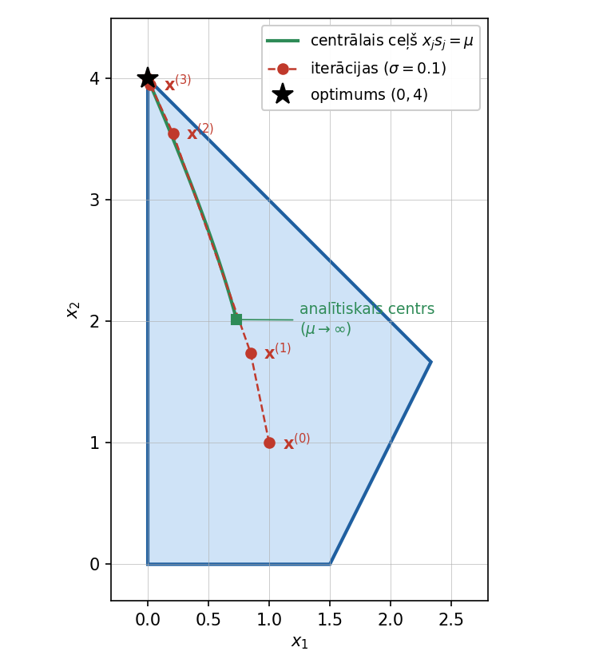

*Centrālais ceļš (zaļš) sākas pieļaujamā apgabala analītiskajā centrā un beidzas optimumā $(0,4)$. Sākumpunkts $\mathbf{x}^{(0)}$ nav uz centrālā ceļa, bet jau pirmās iterācijas tam pietuvojas un pēc tam seko tam līdz optimumam.*

## Veselo skaitļu programmēšana

**Apgalvojums:** Veselo skaitļu programmēšanas uzdevums ir NP-pilns: tas pieder labi pazīstamai 
uzdevumu saimei, kurus var visus citu uz citu reducēt. Efektīvs algoritms NP-pilnajiem uzdevumiem nav zināms. 
Ja kādam no uzdevumiem šādu algoritmu atrastu, tad varētu efektīvi atrisināt arī 
visus citus NP-pilnos uzdevumus no slavenā [Ričarda Karpa saraksta](https://en.wikipedia.org/wiki/Karp%27s_21_NP-complete_problems) un vēl simtiem citu uzdevumu, kas arī ir NP-pilni (jeb algoritmiskās sarežģītības ziņā efektīvi reducējami 
cits uz citu). 

Lineārām programmām reālos skaitļos efektīvi polinomiāli algoritmi ir, bet 
veselo skaitļu programmēšanas uzdevumam (izņemot dažus speciālgadījumus) efektīva algoritma nav. 

**Izlemšanas problēma:**  
Ja dota matrica ar veseliem skaitļiem $A$, veselu skaitļu vektori $\mathbf{b}$ un $\mathbf{c}$ un 
arī vesels skaitlis $K$, noskaidrot, vai eksistē $\mathbf{x} \in \mathbb{Z}_{\geq 0}^n$, kuram 
$$A\mathbf{x}\leq \mathbf{b}\;\;\mbox{un}\;\;\mathbf{c}^\top \mathbf{x}\leq K?$$

Izlemšanas problēma ir NP-pilna: 

* Izlemšanas problēma ir NP-grūta pat ja atļautās mainīgo vērtības ir $x_i \in \{0,1\}$. 
  Uz šo problēmu var reducēt virsotņu pārklāšanos, 3SAT un vairākas citas NP-grūtas problēmas.
* Izlemšanas problēma pieder NP: ja atbilde ir "jā", to apliecinošu $\mathbf{x}$ var pārbaudīt
  polinomiālā laikā (lai gan atrast to, iespējams, nevar).

**Optimizācijas problēma:**  
$$\min \lbrace \mathbf{c}^\top \mathbf{x} : A\mathbf{x}\le \mathbf{b},\ \mathbf{x}\in\mathbb Z_{\ge0}^n \rbrace$$

Optimizācijas problēma veseliem skaitļiem ir NP-grūta (uz to var reducēt citas NP-grūtas problēmas). 
To nevar uzskatīt par NP-pilnu, jo tā nav izlemšanas problēma.

### Virsotņu pārklājums

**Definīcija:** Neorientētā grafā $G = (V,E)$ par *pārklājumu* sauc virsotņu apakškopu $V' \subseteq V$, 
kura katrai šķautnei $(v_i,v_j) \in E$ satur vismaz vienu tās galapunktu ($v_i$ vai $v_j$). 

Ričards Karps parādīja, ka ir NP-pilns uzdevums noskaidrot, vai dotam grafam $G = (V,E)$ eksistē pārklājums $V'$ ar ne vairāk kā $\lvert V' \rvert = k$ virsotnēm. Tas ir izlemšanas uzdevums (*decision problem*).

Ir arī radniecīgs *optimizācijas uzdevums*: dotajam grafam atrast mazāko $k$, kuram eksistē virsotņu pārklājums $\lvert V' \rvert=k$.

Abos gadījumos var papildus vēlēties ne tikai atrast atbildi Jā/Nē (vai skaitli $k$), bet arī uzkonstruēt pašu virsotņu pārklājumu.

**Virsotņu pārklājuma redukcija uz veselo skaitļu programmēšanu**

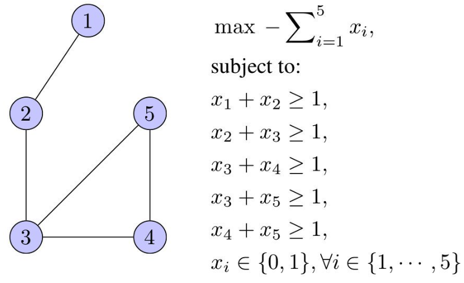

Virsotņu skaits atbilst mainīgo skaitam, ierobežojumu skaits atbilst šķautņu skaitam. Ja virsotni $v_i$ liek pārklājumā, tad attiecīgais mainīgais $x_i = 1$; pretējā gadījumā $x_i = 0$.

Šis piemērs parāda, ka veselo skaitļu programmēšanai, visticamāk, nav vienkārša algoritma, kas to atrisina polinomiālā laikā, jo pretējā gadījumā varētu polinomiālā laikā atrisināt arī virsotņu pārklājuma problēmu (vienu no NP-pilniem uzdevumiem).

### Mugursomas uzdevums

Doti $N$ objekti. Katram no tiem dota cena $c_i$ un svars $w_i$.

| $i$ | 1 | 2 | 3 | 4 | 5 | 6 | 7 | 8 |
| --- | --- | --- | --- | --- | --- | --- | --- | --- |
| $c_i$ | 19 | 17 | 30 | 13 | 25 | 29 | 23 | 10 |
| $w_i$ | 4 | 2 | 8 | 3 | 7 | 5 | 9 | 6 |

Mugursomā var ielikt objektus ar kopējo svaru, kas nepārsniedz 17 kilogramus. 
Kādu lielāko vērtību var ielikt mugursomā?

**Mainīgie:**
$$
1 \ge b_1,b_2,b_3,b_4,b_5,b_6,b_7,b_8 \ge 0,
\qquad b_i\in\mathbb{Z}.
$$

**Ierobežojums:**
$$
4b_1+2b_2+8b_3+3b_4+7b_5+5b_6+9b_7+6b_8\le17.
$$

**Mērķfunkcija:**
$$
\max\; 19b_1+17b_2+30b_3+13b_4+25b_5+29b_6+23b_7+10b_8.
$$

Pārveidot mugursomas uzdevumu par lineārās/veselo skaitļu programmēšanas uzdevumu. 
Atrisināt to Python valodā, izmantojot bibliotēku `pulp`.

<!-- https://youtu.be/E72DWgKP_1Y?si=hcea7o5EMqtuY0OS -->

### Hamiltona cikls

**Definīcija:** Neorientētā grafā $G = (V,E)$ par *Hamiltona ciklu* sauc ciklu, kas iet caur 
katru grafa virsotni tieši vienu reizi. Grafu, kurā eksistē Hamiltona cikls, sauc par *Hamiltona grafu*.

Uzdevums noskaidrot, vai dotajā grafā eksistē Hamiltona cikls, arī ir NP-pilns (tas ir Ričarda Karpa sarakstā).

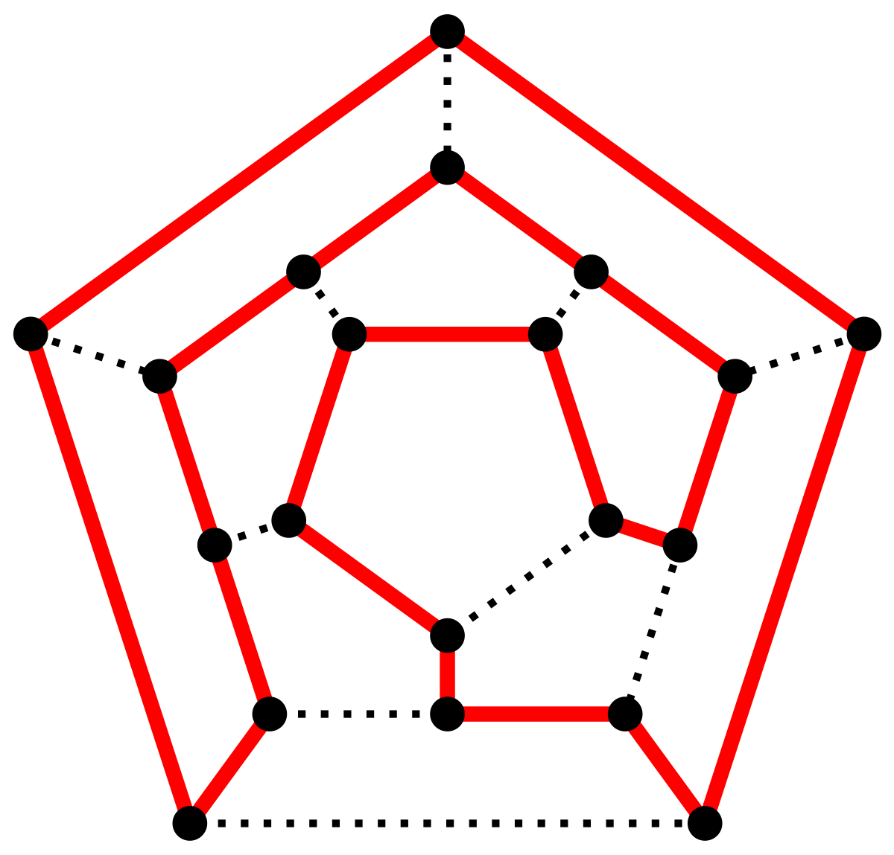

*Dodekaedra grafa Hamiltona cikls: cikla šķautnes ir sarkanas, pārējās grafa šķautnes -- punktētas.*

**Hamiltona cikla redukcija uz veselo skaitļu programmēšanu**

Katrai šķautnei $e \in E$ piekārto mainīgo $x_e \in \lbrace 0,1 \rbrace$: $x_e = 1$, ja šķautne $e$ ietilpst Hamiltona ciklā, un $x_e = 0$ pretējā gadījumā. Virsotņu apakškopai $S \subseteq V$ ar $\delta(S)$ apzīmē to šķautņu kopu, kurām viens galapunkts pieder $S$, bet otrs nepieder $S$. Virsotnei $v$ raksta $\delta(v) = \delta(\lbrace v \rbrace)$ -- tās ir visas šķautnes, kuru galapunkts ir $v$.

*Virsotņu ierobežojumi:* Hamiltona ciklā katrai virsotnei ir piesaistītas tieši divas cikla šķautnes (pa vienu cikls virsotnē ienāk, pa otru -- iziet):

$$
\sum_{e\in\delta(v)}x_e=2
\qquad \forall v\in V.
$$

Ar šiem ierobežojumiem vien nepietiek: tos izpilda arī vairāki savstarpēji nesaistīti cikli (*apakšcikli*, *subtours*), kas kopā satur visas virsotnes.

*Griezuma ierobežojumi:* Katram virsotņu kopas $V$ sadalījumam divās netukšās apakškopās $S$ un $V \setminus S$ Hamiltona cikls šķērso robežu starp tām vismaz divas reizes (ja cikls no $S$ iziet, tam jāatgriežas):

$$
\sum_{e\in\delta(S)}x_e\ge2
\qquad
\forall\,\varnothing\ne S\subsetneq V.
$$

Ja $\mathbf{x}$ apraksta vairākus apakšciklus, tad, par $S$ izvēloties viena apakšcikla virsotnes, iegūst $\sum_{e\in\delta(S)}x_e = 0$, tātad šo ierobežojumu pārkāpj. Tāpēc veselo skaitļu atrisinājumi, kas izpilda abu veidu ierobežojumus, ir tieši Hamiltona cikli. Mērķfunkcija šajā izlemšanas uzdevumā nav vajadzīga; ja šķautnēm piekārto garumus $c_e$ un minimizē $\sum_{e \in E} c_e x_e$, iegūst ceļojošā tirgotāja uzdevumu.

### Branch and Bound metode

**Mugursomas uzdevums (*0-1 Knapsack Problem*):** Dotas $n$ lietas; katrai zināms 
svars $w_i$ un vērtība $c_i$. Jāatrod, kuras no tām ielikt kolekcijā 
("mugursomā") tā, lai kopējais svars nepārsniegtu doto limitu $W$ un kopējā vērtība 
būtu iespējami liela. (Piemēram, resursu piešķiršanas uzdevumi, kur jāizvēlas no 
daudziem nedalāmiem projektiem pie fiksēta budžeta vai laika ierobežojuma.)

$$
\textcolor{blue}{\max \left( \sum\limits_{i=1}^n c_i x_i \right)},\;\;\text{kur}\;\;
\left\{ \begin{array}{l}
\sum\limits_{i=1}^n w_i x_i \leq W,\\
x_i \in \{0,1\}.\\
\end{array} \right.
$$

Ir arī citi šī uzdevuma varianti: *Bounded knapsack problem* atļauj ņemt vairākas 
identiskas lietas (katru lietu līdz $d$ eksemplāriem), bet *Unbounded knapsack problem* 
atļauj ņemt katras lietas jebkuru veselu skaitu eksemplāru.

Risinājumu var meklēt ar pilno pārlasi. Rodas lēmumu koks (*decision tree*) 
mainīgajiem $x_1,x_2,x_3,\ldots$: katrā līmenī viens mainīgais tiek fiksēts kā $0$ vai $1$.

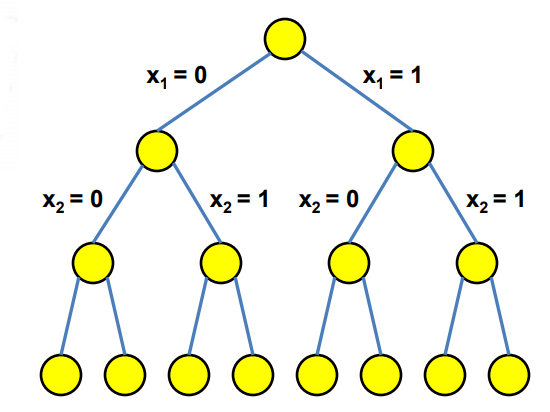

* Mainīgie ir veseli skaitļi, kas izpilda nevienādības $0 \leq x_i \leq 1$ visiem 
  $i = 1,\ldots,n$, t.i., $x_i \in \lbrace 0,1 \rbrace$. Kokam ir $2^n$ lapas.
* Pilnā pārlase vienmēr atrod optimumu, un mazos uzdevumos (piemēram, $4$ mainīgajiem 
  ir tikai $2^4 = 16$ gadījumi) tā ir pilnīgi pietiekama, bet lielākiem uzdevumiem 
  pilnās pārlases ilgums pieaug eksponenciāli.

**Branch and Bound algoritma pamatideja:**

* *Zarošana* (*branch*): uzdevumu sadala apakšuzdevumos, fiksējot kāda mainīgā vērtību 
  ($x_k = 0$ vai $x_k = 1$); tie ir lēmumu koka mezgla bērni.
* *Novērtējums* (*bound*): katrā mezglā atrisina *LP relaksāciju* -- to pašu uzdevumu, 
  bet ar reāliem $x_i \in [0;1]$. Relaksētajam uzdevumam ir vairāk pieļaujamo atrisinājumu, 
  tāpēc tā maksimums ir augšējais novērtējums visiem veselo skaitļu atrisinājumiem 
  šī mezgla apakškokā.
* Labāko līdz šim atrasto veselo skaitļu atrisinājumu sauc par *pašreizējo atrisinājumu* 
  (*incumbent solution*). Ja relaksētā LP maksimums nav lielāks par pašreizējo 
  atrisinājumu, tad šajā apakškokā labāka atrisinājuma nav, un visu zaru *nogriež* (*prune*).
* Zaru nogriež arī tad, ja relaksētā LP atrisinājums jau ir veselos skaitļos (tas ir 
  labākais šajā apakškokā), vai arī LP nav izpildāms.

Praktiskos uzdevumos šādi parasti izdodas nogriezt lielāko daļu lēmumu koka virsotņu 
(lai gan sliktākajā gadījumā darba apjoms joprojām aug eksponenciāli). Iespēja 
ievērojami samazināt pilno pārlasi dod ietaupījumu -- pat ja katrā mezglā ir papildus 
jārisina relaksētais LP apakšuzdevums.

**Apzīmējumi:**

* Lēmumu koka *mezglus* (*nodes*) numurē to izveidošanas secībā $v_1, v_2, \ldots$. 
  Katrs mezgls atbilst apakšuzdevumam, kurā daļa mainīgo ir fiksēti kā $0$ vai $1$:
  - saknē $v_1$ neviens mainīgais nav fiksēts;
  - $v_1$ bērnos ir fiksēts zarošanas mainīgais, piemēram, $v_2$: $x_1 = 0$ un $v_3$: $x_1 = 1$ 
    (pārējie mainīgie nav fiksēti);
  - nākamie numuri tiek piešķirti tikai tiem mezgliem, kurus algoritms tiešām izveido 
    (nogriezto mezglu bērnus neveido).
* $\mathbf{x}_{LP}(j)$ -- relaksētā LP optimālās reālās vērtības $x_i \in [0;1]$ mezglā $v_j$; 
  $z_{LP}(j)$ -- atbilstošais mērķfunkcijas maksimums.
* $\mathbf{x}^{\ast}$ un $z^{\ast}$ -- pašreizējais atrisinājums un tā mērķfunkcijas vērtība.

**Branch and Bound pseidokods**

*Ievade:* Veselo skaitļu programmēšanas uzdevums $\max \mathbf{c}^T \mathbf{x}$, kur 
$A\mathbf{x} \leq \mathbf{b}$, $x_i \in \lbrace 0,1 \rbrace$ (mērķfunkcijas koeficienti 
$\mathbf{c}$, ierobežojumu matrica $A$ un labās puses $\mathbf{b}$).  
*Izvade:* Optimālais atrisinājums $\mathbf{x}^{\ast} \in \lbrace 0,1 \rbrace^n$.

$\textsf{Branch-And-Bound}(\mathbf{c}, A, \mathbf{b})$
1. $Q = \lbrace v_1 \rbrace$ $\quad$ *// aktīvie mezgli; saknē $v_1$ neviens $x_i$ nav fiksēts*
2. $\mathbf{x}^{\ast} = (0,\ldots,0)$; $\;\;z^{\ast} = 0$ $\quad$ *// pašreizējais atrisinājums (der, ja $\mathbf{b} \geq \mathbf{0}$)*
3. **while** $Q \neq \varnothing$
4. $\quad$ izņem no $Q$ kādu mezglu $v_j$
5. $\quad (\mathbf{x}_{LP}(j), z_{LP}(j)) = \textsf{Solve-LP-Relaxation}(\mathbf{c}, A, \mathbf{b}, v_j)$ $\quad$ *// ja LP nav izpildāms, $z_{LP}(j) = -\infty$*
6. $\quad$ **if** $z_{LP}(j) \leq z^{\ast}$ $\quad$ *// pat relaksētais LP nav labāks par pašreizējo*
7. $\quad\quad$ nogriež $v_j$
8. $\quad$ **elseif** visas $\mathbf{x}_{LP}(j)$ koordinātes ir veseli skaitļi $\quad$ *// labāks par pašreizējo atrisinājumu*
9. $\quad\quad \mathbf{x}^{\ast} = \mathbf{x}_{LP}(j)$; $\;\;z^{\ast} = z_{LP}(j)$
10. $\quad\quad$ nogriež $v_j$
11. $\quad$ **else** $\quad$ *// varbūt apakškokā var uzlabot pašreizējo?*
12. $\quad\quad$ izvēlas mainīgo $x_k$, kura vērtība $\mathbf{x}_{LP}(j)$ nav vesela
13. $\quad\quad$ ievieto $Q$ divus $v_j$ bērnus: ar papildu ierobežojumu $x_k = 0$ un ar $x_k = 1$
14. **return** $\mathbf{x}^{\ast}$

Rindiņā 4 mezglu var izvēlēties dažādi. Ja $Q$ ir rinda (FIFO), koku apstaigā platumā (BFS) -- tā darīts arī piemērā zemāk; ja $Q$ ir steks, koku apstaigā dziļumā (DFS), un tad ātrāk atrod pirmo veselo skaitļu atrisinājumu. Rindiņā 2 sākuma atrisinājums $\mathbf{x}^{\ast} = \mathbf{0}$ ir pieļaujams, ja $\mathbf{b} \geq \mathbf{0}$ (piemēram, mugursomas uzdevumā); vispārīgā gadījumā sāk ar $z^{\ast} = -\infty$.

### Veselu skaitļu uzdevuma piemērs

Meklēsim mainīgos $x_i \in \lbrace 0,1 \rbrace$. Veselo skaitļu programmēšanas uzdevums:

$$
\textcolor{blue}{\max \left( 15x_1 + 12x_2 + 4x_3 + 2x_4 \right)},\;\;\text{kur}\;\;
\left\{ \begin{array}{l}
8x_1 + 5x_2 + 3x_3 + 2x_4 \leq 10,\\
x_k \in \{0,1\}\;\;\text{pie}\;\;k=1,2,3,4.\\
\end{array} \right.
$$

Tas ir mugursomas uzdevums ar $4$ lietām un svara limitu $W = 10$. (Bibliotēkā `pulp` šādus 
mainīgos definē ar `cat=LpBinary`; risinātājs tos parasti atrod ātri, lai gan vispārīgajā 
gadījumā veselo skaitļu programmēšana ir NP-grūta.)

Tas pats uzdevums matricu pierakstā:

$$
\textcolor{blue}{\max \left( \mathbf{c}^T \cdot \mathbf{x} \right)},\;\;\text{kur}\;\;
\left\{ \begin{array}{l}
A\mathbf{x} \leq \mathbf{b},\\
x_i \in \{ 0, 1 \}.
\end{array} \right.
$$

$$
\mathbf{x} = \left(
\begin{array}{c}
x_1 \\
x_2 \\
x_3 \\
x_4 \\
\end{array} \right),\;\;\mathbf{c} = \left(
\begin{array}{c}
15 \\
12 \\
4 \\
2 \\
\end{array} \right),
$$

$$
A = \left(
\begin{array}{cccc}
8 & 5 & 3 & 2 \\
\end{array} \right),\;\;\;\mathbf{b} = \left(
\begin{array}{c}
10 \\
\end{array} \right)
$$

Relaksēto LP šajā uzdevumā var atrisināt arī bez simpleksa algoritma: lietas sakārto pēc 
vērtības attiecības pret svaru ($c_2/w_2 = 12/5 = 2.4$; $c_1/w_1 = 15/8 = 1.875$; 
$c_3/w_3 = 4/3 \approx 1.33$; $c_4/w_4 = 2/2 = 1$) un rijīgi ņem tās šajā secībā, kamēr 
pietiek vietas; pēdējo lietu, kas pilnībā vairs neietilpst, ņem daļēji. 
Mezglus apstrādājam to izveidošanas secībā (BFS).

#### Pirmais solis

Mezglā $v_1$ (neviens no $x_i$ nav fiksēts) relaksētais LP uzdevums:

$$
\textcolor{blue}{\max \left( 15x_1 + 12x_2 + 4x_3 + 2x_4 \right)},\;\;\text{kur}\;\;
\left\{ \begin{array}{l}
8x_1 + 5x_2 + 3x_3 + 2x_4 \leq 10,\\
x_k \leq 1,\;\;k=1,2,3,4,\\
x_k \geq 0,\;\;k=1,2,3,4.\\
\end{array} \right.
$$

Pašreizējais atrisinājums: $\mathbf{x}^{\ast} = (0, 0, 0, 0)$, $z^{\ast} = 0$.

Relaksētā LP atrisinājums: $\mathbf{x}_{LP}(1) = (5/8, 1, 0, 0)$, $z_{LP}(1) = 12 + 15 \cdot 5/8 = 21\frac{3}{8}$.

Tā kā $z_{LP}(1) = 21\frac{3}{8} > z^{\ast} = 0$, bet $x_1 = 5/8$ nav vesels skaitlis, tad zarojam pēc $x_1$: kokam pievieno abus $v_1$ bērnus -- $v_2$ ($x_1 = 0$) un $v_3$ ($x_1 = 1$).

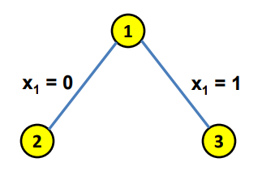

#### Otrais solis

Mezglā $v_2$ (fiksēts $x_1 = 0$) relaksētais LP uzdevums:

$$
\textcolor{blue}{\max \left( 15x_1 + 12x_2 + 4x_3 + 2x_4 \right)},\;\;\text{kur}\;\;
\left\{ \begin{array}{l}
8x_1 + 5x_2 + 3x_3 + 2x_4 \leq 10,\\
x_1 = 0,\\
x_k \leq 1,\;\;k=1,2,3,4,\\
x_k \geq 0,\;\;k=1,2,3,4.\\
\end{array} \right.
$$

Pašreizējais atrisinājums: $\mathbf{x}^{\ast} = (0, 0, 0, 0)$, $z^{\ast} = 0$.

Relaksētā LP atrisinājums: $\mathbf{x}_{LP}(2) = (0, 1, 1, 1)$, $z_{LP}(2) = 12 + 4 + 2 = 18$ (visas trīs lietas ietilpst: $5 + 3 + 2 = 10$).

Tā kā $z_{LP}(2) = 18 > z^{\ast} = 0$ un visas $\mathbf{x}_{LP}(2)$ koordinātes ir veseli skaitļi, tad tas kļūst par jauno pašreizējo atrisinājumu: $\mathbf{x}^{\ast} = (0, 1, 1, 1)$, $z^{\ast} = 18$. Mezglu $v_2$ nogriež (labāka atrisinājuma tā apakškokā nav).

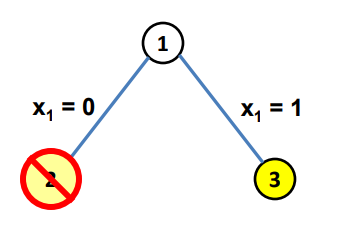

#### Trešais solis

Mezglā $v_3$ (fiksēts $x_1 = 1$) relaksētais LP uzdevums:

$$
\textcolor{blue}{\max \left( 15x_1 + 12x_2 + 4x_3 + 2x_4 \right)},\;\;\text{kur}\;\;
\left\{ \begin{array}{l}
8x_1 + 5x_2 + 3x_3 + 2x_4 \leq 10,\\
x_1 = 1,\\
x_k \leq 1,\;\;k=1,2,3,4,\\
x_k \geq 0,\;\;k=1,2,3,4.\\
\end{array} \right.
$$

Pašreizējais atrisinājums: $\mathbf{x}^{\ast} = (0, 1, 1, 1)$, $z^{\ast} = 18$.

Relaksētā LP atrisinājums: $\mathbf{x}_{LP}(3) = (1, 2/5, 0, 0)$, $z_{LP}(3) = 15 + 12 \cdot 2/5 = 19\frac{4}{5}$ (pēc $x_1$ atlikušajā vietā $10 - 8 = 2$ ietilpst $2/5$ no otrās lietas).

Tā kā $z_{LP}(3) = 19\frac{4}{5} > z^{\ast} = 18$, bet $x_2 = 2/5$ nav vesels skaitlis, tad zarojam pēc $x_2$: kokam pievieno abus $v_3$ bērnus -- $v_4$ ($x_1 = 1$, $x_2 = 0$) un $v_5$ ($x_1 = 1$, $x_2 = 1$).

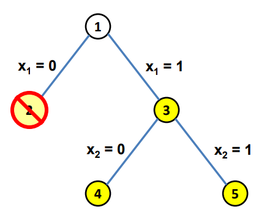

#### Ceturtais solis

Mezglā $v_4$ (fiksēts $x_1 = 1$ un $x_2 = 0$) relaksētais LP uzdevums:

$$
\textcolor{blue}{\max \left( 15x_1 + 12x_2 + 4x_3 + 2x_4 \right)},\;\;\text{kur}\;\;
\left\{ \begin{array}{l}
8x_1 + 5x_2 + 3x_3 + 2x_4 \leq 10,\\
x_1 = 1,\;\;x_2 = 0,\\
x_k \leq 1,\;\;k=1,2,3,4,\\
x_k \geq 0,\;\;k=1,2,3,4.\\
\end{array} \right.
$$

Pašreizējais atrisinājums: $\mathbf{x}^{\ast} = (0, 1, 1, 1)$, $z^{\ast} = 18$.

Relaksētā LP atrisinājums: $\mathbf{x}_{LP}(4) = (1, 0, 2/3, 0)$, $z_{LP}(4) = 15 + 4 \cdot 2/3 = 17\frac{2}{3}$.

Tā kā $z_{LP}(4) = 17\frac{2}{3} \leq z^{\ast} = 18$, tad pat relaksētais LP nav labāks par pašreizējo atrisinājumu. Mezglu $v_4$ nogriež (lai gan $x_3 = 2/3$ nav vesels skaitlis).

#### Piektais solis

Mezglā $v_5$ (fiksēts $x_1 = 1$ un $x_2 = 1$) relaksētais LP uzdevums:

$$
\textcolor{blue}{\max \left( 15x_1 + 12x_2 + 4x_3 + 2x_4 \right)},\;\;\text{kur}\;\;
\left\{ \begin{array}{l}
8x_1 + 5x_2 + 3x_3 + 2x_4 \leq 10,\\
x_1 = 1,\;\;x_2 = 1,\\
x_k \leq 1,\;\;k=1,2,3,4,\\
x_k \geq 0,\;\;k=1,2,3,4.\\
\end{array} \right.
$$

Pašreizējais atrisinājums: $\mathbf{x}^{\ast} = (0, 1, 1, 1)$, $z^{\ast} = 18$.

Relaksētais LP nav izpildāms: jau $8 \cdot 1 + 5 \cdot 1 = 13 > 10$. Tātad $z_{LP}(5) = -\infty \leq z^{\ast}$, un mezglu $v_5$ nogriež.

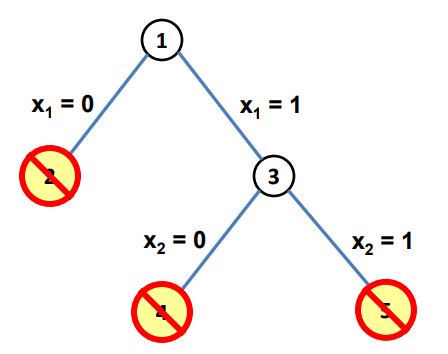

#### Rezultāts

Aktīvo mezglu vairs nav, tāpēc pašreizējais atrisinājums ir optimāls: $\mathbf{x}^{\ast} = (0, 1, 1, 1)$, $z^{\ast} = 18$ -- jāņem 2., 3. un 4. lieta (kopējais svars $10$). Algoritms atrisināja $5$ relaksētos LP uzdevumus, bet pilnajā pārlasē būtu jāpārbauda $2^4 = 16$ gadījumi.

## Uzdevumi

**10.1. uzdevums:** Hamiltona cikla meklēšanu dodekaedra grafā (sk. attēlu sadaļā "Hamiltona cikls") pieraksta kā veselo skaitļu programmēšanas uzdevumu ar virsotņu ierobežojumiem un griezuma ierobežojumiem. Cik šajā uzdevumā ir mainīgo, cik vienādību un cik nevienādību?

**Atbilde:** Dodekaedram ir $12$ piecstūra skaldnes, katrā virsotnē satiekas $3$ skaldnes, tāpēc virsotņu ir $\lvert V \rvert = 12 \cdot 5/3 = 20$. Katras virsotnes pakāpe ir $3$, tāpēc šķautņu ir $\lvert E \rvert = 20 \cdot 3/2 = 30$.

* *Mainīgie:* pa vienam katrai šķautnei, tātad $30$ mainīgie $x_e \in \lbrace 0,1 \rbrace$.
* *Vienādības:* pa vienai katrai virsotnei, tātad $20$ vienādības $\sum_{e\in\delta(v)}x_e=2$.
* *Nevienādības:* netukšo apakškopu $S \subsetneq V$ ir $2^{20}-2 = 1\,048\,574$. Taču $S$ un $V \setminus S$ ir viens un tas pats sadalījums, un $\delta(S) = \delta(V \setminus S)$, tāpēc dažādu nevienādību ir $(2^{20}-2)/2 = 2^{19}-1 = 524\,287$.

Kopā $20 + 524\,287 = 524\,307$ ierobežojumi (neskaitot $0 \leq x_e \leq 1$).

*Piezīme:* Daudzi griezuma ierobežojumi izriet no virsotņu ierobežojumiem. Saskaitot virsotņu vienādības visām $v \in S$, iegūst $2\lvert S \rvert = 2 k + \sum_{e\in\delta(S)}x_e$, kur $k$ ir izvēlēto šķautņu skaits ar abiem galapunktiem kopā $S$. Dodekaedrā īsākais cikls ir piecstūris, tāpēc pie $\lvert S \rvert \leq 4$ šķautnes kopas $S$ iekšpusē ciklu neveido un $k \leq \lvert S \rvert - 1$, tātad $\sum_{e\in\delta(S)}x_e \geq 2$ izpildās automātiski. Jāpārbauda tikai sadalījumi ar $5 \leq \lvert S \rvert \leq 15$; to skaits ir ${\displaystyle \frac{1}{2}\sum_{k=5}^{15} \binom{20}{k} = 518\,092}$. Praksē šādus ierobežojumus visus uzreiz nepieraksta, bet pievieno tikai tad, kad kārtējais atrisinājums kādu no tiem pārkāpj. $\square$

## Izmantotā literatūra

**[Ber2009]** D.Bertsimas, *Introduction to Mathematical Programming*, MIT OpenCourseWare, Massachusetts Institute of Technology, Fall 2009. Available at [https://bit.ly/493SnRh](https://bit.ly/493SnRh), [Archived](https://web.archive.org/web/20221007151158/https://ocw.mit.edu/courses/6-251j-introduction-to-mathematical-programming-fall-2009/).

**[Cam16]** O.A.Camarena, *Math 340: Linear Programming*, National Autonomous University of Mexico, Fall 2016. Available at [https://bit.ly/4fmrfzp](https://bit.ly/4fmrfzp), [Archived:Cam16](https://web.archive.org/web/20201022041337/https://www.matem.unam.mx/~omar/math340/index.html).

**[Goe08]** M. Goemans, *Advanced Algorithms*, MIT OpenCourseWare, Massachusetts Institute of Technology, Spring 2008. Available at [https://bit.ly/40IoKmh](https://bit.ly/40IoKmh), [Archived:Goe08](https://web.archive.org/web/20220531183759/https://ocw.mit.edu/courses/6-854j-advanced-algorithms-fall-2008/).

**[Lee2023]** J.Lee, *A First Course in Linear Optimization*, 4th ed., Ann Arbor, Michigan, 2024. Available at [https://github.com/jon77lee/JLee_LinearOptimizationBook](https://github.com/jon77lee/JLee_LinearOptimizationBook).

**[Str18]** G.Strang, *MIT 18.065 Matrix Methods in Data Analysis*, MIT OpenCourseWare, Massachusetts Institute of Technology, Spring 2018. Available at [https://bit.ly/40H8H8z](https://bit.ly/40H8H8z), [YouTube](https://youtu.be/feb9j65Iz4w?si=mtQZZxM6jex8zCAp).

**[Wri97]** S.J.Wright, *Primal-Dual Interior-Point Methods*, SIAM, Philadelphia, 1997.

<!--
[https://ocw.mit.edu/courses/mathematics/18-086-mathematical-methods-for-engineers-ii-spring-2006/video-lectures/lecture-28-linear-programming-and-duality/](https://ocw.mit.edu/courses/mathematics/18-086-mathematical-methods-for-engineers-ii-spring-2006/video-lectures/lecture-28-linear-programming-and-duality/) -- MIT lekcija
[Max Flow to Linear Programming](http://www.cs.cmu.edu/~odonnell/toolkit13/lecture14.pdf) -- Dualitāte grafu uzdevumos, tsk. maksimālajai plūsmai.
[Shadow Price](https://economics.stackexchange.com/questions/21796/linear-programming-shadow-price-range) -- Skaidrojums par to, kas ir "shadow price".
-->
