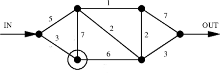

# 10. Lineārās programmēšanas algoritmi


## Kāpostu-burkānu uzdevums un tā duālais

**Piemērs:** Aplūkojam LP uzdevumu sējumu platībai, kas ierobežota ar $5$ hektāriem:

$$
\textcolor{blue}{\max \left( 1200x_k + 1700x_b \right)},\;\;\text{kur}\;\;
\left\{ \begin{array}{l}
x_k \leq 3,\\
x_b \leq 4\\
x_k + x_b \leq 5,\\
x_k,x_b \geq 0.
\end{array} \right.
$$

Atrisinājums: $(x_k, x_b) = (1,4)$. Mērķa funkcija: $8000$.

**Duālais uzdevums:** Kā pārliecināties, vai tas, ko atrada programma, ir īstais atrisinājums (un nevar labāk)? Visas trīs nevienādības var piereizināt ar nenegatīviem skaitļiem $y_1, y_2, y_3$ un saskaitīt.

$$
\textcolor{blue}{\min \left( 3y_1 + 4y_2 + 5y_3 \right)},\;\;\text{kur}\;\;
\left\{ \begin{array}{l}
y_1 + y_3 \geq 1200,\\
y_2 + y_3 \geq 1700,\\
y_1,y_2,y_3 \geq 0.
\end{array} \right.
$$


Atrisinājums: $(y_1, y_2, y_3)= (0.0, 500.0, 1200.0)$. Mērķa funkcija: $8000$.

**Primārais un duālais LP uzdevumi matricu pierakstā:**

$$
(P): \textcolor{blue}{\max \left( 1200x_k + 1700x_b \right)},\;\;\text{kur}\;\;
A = \left( \begin{array}{cc}
1 & 0 \\
0 & 1 \\
1 & 1 \\
\end{array} \right) \cdot \left( \begin{array}{c}
x_k \\
x_b \\
\end{array} \right) \leq \left( \begin{array}{c}
3 \\
4 \\
5 \\
\end{array} \right),\;\; x_k,x_b \geq 0.
$$

$$
(D):  \textcolor{blue}{\min \left( 3y_1 + 4y_2 + 5y_3 \right)},\;\;\text{kur}\;\;
A = \left( \begin{array}{ccc}
1 & 0 & 1 \\
0 & 1 & 1 \\
\end{array} \right) \cdot \left( \begin{array}{c}
y_1 \\
y_2 \\
y_3 \\
\end{array} \right) \geq \left( \begin{array}{c}
1200 \\
1700 \\
\end{array} \right),\;\; y_1, y_2, y_3 \geq 0.
$$

### Duālās problēmas interpretācijas

**Ēnu cenas (Shadow prices):** Peļņas maksimizēšanas uzdevumos duālais atrisinājums $(y_1, y_2, y_3)= (0.0, 500.0, 1200.0)$ parāda, kādā ātrumā pieaugtu peļņa, ja (kādā īsā intervālā) nedaudz atvieglotu kādu ierobežojumu. Ir pavisam trīs ierobežojumi jeb trīs *ēnu cenas*: kāpostiem, burkāniem un zemes hektāram (gada nomas maksa).

* $y_1 = 0$. Atvieglojot ierobežojumu uz kāpostu sējas platību nav ietekmes uz peļņu, jo arī pašlaik visas kāpostu sēklas netiek izmantotas.
* $y_2 = 500$. Ja burkānu sēklu būtu nedaudz vairāk, peļņa pieaugtu ar ātrumu $500$ par burkānu sēklu vienību. Ievērosim, ka $1700 - 1200$ ir peļņas starpība starp burkāniem un kāpostiem: varētu kāpostus aizstāt ar burkāniem.
* $y_3 = 1200$. Papildus zemes hektārs atnestu $1200$ papildus peļņu, jo mums ir neizmantotas kāpostu sēklas.

*Ēnu cenas* ir augšējais novērtējums tam, par cik būtu ekonomiski pamatoti iegādāties vienu vai otru resursu. Turklāt ēnu cenas paliek spēkā, vienīgi runājot par nelieliem iepirkšanas apjomiem, lai neizmainītos LP uzdevuma pieļaujamā apgabala forma, kad optimālais risinājums pārvietojas uz kādu citu stūri ar citiem būtiskajiem ierobežojumiem. Piemēram, būtiski palielinot pieejamo zemes platību virs 5 ha, varētu panākt, lai zemei ēnu cena kļūtu 0, bet parādītos pozitīva ēnu cena kāpostu sēklām. Ēnu cenām nav sakara ar faktiskajām cenām, ja tādas arī parādās LP uzdevumā.

**Gravitācijas un normālās reakcijas modelis:** Var uzzīmēt pieļaujamo apgabalu primārajam uzdevumam un primārā uzdevuma atrisinājums ir neliela lodīte, kas nonākusi (sekojot gravitācijas gradientam) vietā ar viszemāko potenciālu. Tad duālā uzdevuma atrisinājums ir normālās reakcijas, ko dod tie balsti, uz kuriem balstās lodīte, kas līdzsvaro gravitācijas spēku.

**Interpretācija ar nevienādību novērtējumiem:** Duālo uzdevumu var interpretēt šādi: katrs pieļaujams punkts $(y_1, y_2, y_3)$, kas apmierina visus ierobežojumus (bet varbūt neoptimizē mērķa funkciju), dod novērtējumu no augšas primārās programmas atrisinājumam.

Kāpostu-burkānu uzdevumam ir vairāki pieļaujami atrisinājumi, arī iegūtie novērtējumi no augšas būs dažādi:

* $(y_1, y_2, y_3) = (1200, 1700, 0)$. Tad ir spēkā novērtējums:

  $$
  1200 x_k + 1700 x_b \leq 1200 \cdot (x_k) + 1700 \cdot (x_b) \leq 1200 \cdot 3 + 1700 \cdot 4 = 10400.
  $$

* $(y_1, y_2, y_3) = (200, 700, 1000)$. Tad ir spēkā novērtējums:

  $$
  1200 x_k + 1700 x_b \leq 200 \cdot (x_k) + 700 \cdot (x_b) + 1000 \cdot (x_k + x_b)
  \leq 200 \cdot 3 + 700 \cdot 4 + 1000 \cdot 5 = 8400.
  $$

* $(\mathbf{y}^{\ast})^T = (y_1, y_2, y_3) = (0, 500, 1200)$. Tad ir spēkā novērtējums:

  $$
  1200 x_k + 1700 x_b \leq 0 \cdot (x_k) + 500 \cdot (x_b) + 1200 \cdot (x_k + x_b)
  \leq 0 + 500 \cdot 4 + 1200 \cdot 5 = 8000.
  $$

Pēdējais no novērtējumiem, ko rada duālā uzdevuma optimālais atrisinājums $(\mathbf{y}^{\ast})^T$ ir $8000$, kuru tālāk uzlabot nevar.

Ja primārais LP uzdevums prasīja maksimizēt kaut ko, tad duālais LP uzdevums prasa minimizēt. Un katrs duālā uzdevuma pieļaujamais punkts (ja vien tas nav pats minimums) dos duālajai mērķfunkcijai $3y_1 + 4y_2 + 5y_3$ lielāku vērtību nekā ir primārās problēmas mērķfunkcija $1200x_k + 1700x_b$ katrā pieļaujamā punktā $(x_k,x_b)$.

**Piemērs:** Aplūkojam standartformas LP uzdevumu, kur jāmeklē minimums, visas nevienādības sistēmā ir $\leq$, bet visi mainīgie $x_i$ -- nenegatīvi skaitļi. Primārais (P) un duālais (D) doti ar matricu izteiksmēm:

$$
(P): \textcolor{blue}{\min\left( \mathbf{c}^T \cdot \mathbf{x} \right)},\;\;\text{kur}
A \mathbf{x} \leq \mathbf{b},\;\; \mathbf{x} \geq 0.
$$

$$
(D): \textcolor{blue}{\max\left( \mathbf{b}^T \cdot \mathbf{y} \right)},\;\;\text{kur}
A^T \mathbf{y} \leq \mathbf{c},\;\; \mathbf{y} \geq 0.
$$


## Vispārīga LP uzdevuma duālais

Duālos mēdz pierakstīt arī tādiem LP uzdevumiem, kuri nav standartformā. Mērķa funkcija primārajā uzdevumā var būt gan jāminimizē, gan jāmaksimizē, nevienādības vai vienādības ierobežojumos var būt uz jebkuru pusi, dažreiz mainīgie $x_i$ nevar būt negatīvi, citreiz tie netiek ierobežoti. Visi šādi uzdevumi pārveidojas par duālajiem.

**Primārā lineārā programma:** Definēsim lineāru programmu $(P)$, ko sauksim par *primāro LP*:

$$
(P): \textcolor{blue}{\min \left( c_1 x_1 + c_2 x_2 + \ldots + c_n x_n \right)},\;\;\text{kur}\;\;
\left\{ \begin{array}{l}
a_{11} x_1 + a_{12} x_2 + \ldots + a_{1n} x_n  \;\;\textcolor{red}{?}\;\; b_1,\\
\ldots\\
a_{k1} x_1 + a_{k2} x_2 + \ldots + a_{kn} x_n \;\;\textcolor{red}{?}\;\; b_k,\\
x_1 \textcolor{red}{?} 0,\; x_2 \textcolor{red}{?} 0,\;\ldots\;  x_n \textcolor{red}{?} 0.\\
\end{array} \right.
$$

Šeit LP var nebūt standartformā:

* Nosacījumiem $a_{i1} x_1 + a_{i2} x_2 + \ldots + a_{in} x_n \;\;\textcolor{red}{?}\;\; b_i$, jautājuma zīmes vietā var būt jebkura zīme ($\geq$, $\leq$, $=$).
* Mainīgajiem $x_i$ var būt nosacījumi $x_i \geq 0$, $x_i \leq 0$, vai arī var nebūt nosacījuma uz $x_i$.

**Definīcija:** Par *duālo programmu* sauc lineāro programmu:

$$
(D): \textcolor{blue}{\max \left( b_1 y_1 + b_2 y_2 + \ldots + b_k y_k \right)},\;\;\text{kur}\;\;
\left\{ \begin{array}{l}
a_{11} y_1 + a_{21} y_2 + \ldots + a_{k1} y_k  \;\;\textcolor{red}{?}\;\; c_1,\\
a_{12} y_1 + a_{22} y_2 + \ldots + a_{k2} y_k  \;\;\textcolor{red}{?}\;\; c_2,\\
\ldots\\
a_{1n} y_1 + a_{2n} y_2 + \ldots + a_{kn} y_k \;\;\textcolor{red}{?}\;\; c_n,\\
y_1 \textcolor{blue}{?} 0,\; y_2 \textcolor{blue}{?} 0,\;\ldots\; y_k \textcolor{blue}{?} 0 \\
\end{array} \right.
$$

Simbolus zilo jautājuma zīmju $\textcolor{blue}{?}$ vietā nosaka šādi:

| Primārais nosacījums $i$ | Atbilstošais duālais mainīgais |
| --- | --- |
| ${\displaystyle \sum_{j=1}^n a_{ij}x_j \textcolor{blue}{\geq} b_i}$ |	$y_i \textcolor{blue}{\geq} 0$ |
| ${\displaystyle \sum_{j=1}^n a_{ij}x_j \textcolor{blue}{\leq} b_i}$ |	$y_i \textcolor{blue}{\leq} 0$ |
| ${\displaystyle \sum_{j=1}^n a_{ij}x_j \textcolor{blue}{=} b_i}$ | $y_i\;\;\textcolor{blue}{\text{bez ierobežojuma}}$ |

Simbolus sarkano jautājuma zīmju $\textcolor{red}{?}$ vietā nosaka šādi:

| Primārais mainīgais $x_j$ | Atbilstošais duālais nosacījums |
| --- | --- |
| $x_j \textcolor{red}{\geq} 0$ | ${\displaystyle \sum_{i=1}^k  a_{ij} y_i \;\;\textcolor{red}{\leq}\;\; c_j}$ |
| $x_j \textcolor{red}{\leq} 0$ | ${\displaystyle \sum_{i=1}^k  a_{ij} y_i \;\;\textcolor{red}{\geq}\;\; c_j}$ |
| $x_j\;\;\textcolor{red}{\text{bez ierobežojuma}}$ | ${\displaystyle \sum_{i=1}^k a_{ij} y_i \;\;\textcolor{red}{=}\;\; c_j}$ |


**Piemērs:** Aplūkojam primāro LP uzdevumu, kura ierobežojumos saliktas visādu veidu nevienādības:

$$
\textcolor{blue}{\max \left( 4x_1 + 2x_2 - x_3 \right)},\;\; \text{kur}\;\;
\left\{
\begin{array}{l}
x_1 + x_2 + x_3 = 20\\
2x_1 - x_2 \geq 6\\
3x_1 + 2x_2 + x_3 \leq 40\\
x_1,x_2 \geq 0
\end{array} \right.
$$

Tas pats matricu pierakstā, kur $\mathbf{x}$ ir kolonnas vektors ar 3 koordinātēm $x_1,x_2,x_3$:

$$
(P): \textcolor{blue}{\max \left( (4, 2, -1) \cdot \mathbf{x} \right)},\;\;\text{kur}\;\;
\left(
\begin{array}{ccc}
1 & 1 & 1\\
2 & -1 & 0\\
3 & 2 & 1
\end{array} \right) \left(
\begin{array}{c}
x_1\\
x_2\\
x_3 \end{array} \right)
\begin{array}{c}
=^{\textcolor{blue}{(a)}}\\
\geq^{\textcolor{blue}{(b)}} \\
\leq^{\textcolor{blue}{(c)}}
\end{array}
\left(
\begin{array}{c}
20\\
6 \\
40
\end{array} \right)\;\;\text{un}
$$

$$
x_1 \geq^{\textcolor{blue}{(d)}} 0,\; x_2 \geq^{\textcolor{blue}{(e)}} 0,
x_3\;\text{bez nosac.}^{\textcolor{blue}{(f)}}
$$

**Atbilstošais duālais LP uzdevums:** Apzīmējam $\mathbf{y}$ kolonnas vektoru ar 3 koordinātēm: $y_1, y_2, y_3$. Tad

$$
(D): \textcolor{blue}{ \min \left(  (20,6,-40) \cdot \mathbf{y}  \right) },\;\;\text{kur}\;\;
\left(
\begin{array}{ccc}
1 & 2 & 3\\
1 & -1 & 2\\
1 & 0 & 1
\end{array} \right) \left(
\begin{array}{c}
y_1\\
y_2\\
y_3 \end{array} \right)
\begin{array}{c}
\geq^{\textcolor{blue}{(d)}}\\
\geq^{\textcolor{blue}{(e)}} \\
=^{\textcolor{blue}{(f)}}
\end{array}
\left(
\begin{array}{c}
4\\
2 \\
-1
\end{array} \right)\;\;\text{un}
$$

$$
y_1\;\text{bez nosac.}^{\textcolor{blue}{(a)}},\;
y_2 \leq^{\textcolor{blue}{(b)}} 0,\;
y_3 \geq^{\textcolor{blue}{(c)}} 0.
$$

Duālajā uzdevumā koeficientus iegūst, transponējot matricu $A$. ienādību un nevienādību tipus nosaka atbilstoši augšminētajiem noteikumiem: Piemēram, ja $x_1 \geq 0$ primārajā problēmā, tad $x_1$ mainīgajam atbilstošais duālais vienādojums $y_1 + 2y_2 + 3y_3 \geq 4$ (arī nevienādība $\geq$).


## Dualitātes teorēmas

**Definīcija:** Vektoru $\mathbf{x}$ sauc par *iespējamu* (*feasible*) (arī (neoptimālu) LP uzdevuma *risinājumu*), ja tas apmierina visus ierobežojumus (vienādības, nevienādības).

**Definīcija:** LP uzdevumu sauc par *iespējamu* (*feasible*), ja tam ir iespējams risinājums $\mathbf{x}$.

**Definīcija:** LP uzdevums ir *neiespējams* (*infeasible*), ja tam šāds $\mathbf{x}$ neeksistē.

**Definīcija:** LP minimuma uzdevums ($\min\lbrace \mathbf{c}^T \mathbf{x}\;:\;A\mathbf{x}=\mathbf{b},\mathbf{x}\geq\mathbf{0}\rbrace$) ir *neierobežots* (*unbounded*), ja katram $\lambda \in \mathbb{R}$ eksistē $\mathbf{x} \in \mathbb{R}^n$, ka visi LP ierobežojumi izpildās un $\mathbf{c}^T \mathbf{x} \leq \lambda$.

Lineāru programmu var pārveidot, ieviešot *nokares mainīgos* (*slack variables*). Šajā gadījumā visas nevienādības var pārrakstīt par vienādībām, papildus prasot, lai mainīgie (ieskaitot nokares mainīgos) būtu nenegatīvi skaitļi.

$$
\begin{array}{ccc}
\max\{ \mathbf{c}^T \mathbf{x}\} & \rightarrow  & \min\{ -\mathbf{c}^T \mathbf{x}\}\\
\mathbf{a}_i^T \mathbf{x} = b_i & \rightarrow  &  (\mathbf{a}_i^T \mathbf{x} \leq b_i)
\wedge (\mathbf{a}_i^T \mathbf{x} \geq b_i)  \\
\mathbf{a}_i^T \mathbf{x} \leq b_i & \rightarrow  &  (\mathbf{a}_i^T \mathbf{x} + s_i = b_i)
\wedge (s_i \geq 0)  \\
\end{array}
$$

**Primārās un duālās LP apvienošana:** Ja dotas primārā LP un duālā LP, varam uzrakstīt jaunu LP, kas satur visus mainīgos (gan $x_1, x_2, \ldots, x_n$, gan $y_1, y_2, \ldots, y_k$), gan visus nosacījumus no abām programmām un pievienot tai vēl vienu nosacījumu:

$$
c_1 x_1 + c_2 x_2 + \ldots + c_n x_n = b_1 y_1 + b_2 y_2 + \ldots + b_k y_k.
$$

Vienīgais gadījums, kad izpildās visi nosacījumi ir, ja $x_1, x_2, \ldots, x_n$ sasniedz primārās LP maksimums, bet $y_1, y_2, \ldots, y_k$ sasniedz duālās LP minimumu.

**Secinājums:** Ja mums ir algoritms, kas prot patvaļīgai LP atrast vienu punktu, kas apmierina visus nosacījumus, tad šo algoritmu var izmantot arī maksimuma atrašanai.

### Vājā dualitāte

**Farkaša lemma:** Ja $A$ ir $m \times n$ matrica, tad izpildās tieši viens no apgalvojumiem: **(1)** $\exists\mathbf{x} \in \mathbb{R}^n\;:\;A\mathbf{x}=\mathbf{b}$, kur $\mathbf{x} \geq \mathbf{0}$, **(2)** $\exists\mathbf{y} \in \mathbb{R}^m\;:\;A^T \mathbf{y} \geq \mathbf{0}$, kur $\mathbf{b}^T \mathbf{y} < 0$.

Atsevišķs gadījums ir lineārajā algebrā, kur vai nu $A\mathbf{x} = \mathbf{b}$ eksistē atrisinājums, vai arī sistēmai $A^T \mathbf{y} = 0$ (kur $\mathbf{b}^T \mathbf{y} \neq 0$) eksistē atrisinājums.

**Pierādījums:** Abi nosacījumi nevar vienlaicīgi izpildīties, jo šādu $\mathbf{x}$ un $\mathbf{y}$ pastāvēšana nozīmētu

$$
\begin{array}{l}
\mathbf{y}^T A \mathbf{x} = \mathbf{y}^T (A \mathbf{x}) = \mathbf{y} \mathbf{b} < 0 \\
\mathbf{y}^T A \mathbf{x} = (A^T \mathbf{y})^T \mathbf{x} \geq 0 \\
\end{array}
$$

jo divu nenegatīvu vektoru skalārais reizinājums ir nenegatīvs.

**Vājās dualitātes teorēma:** Primārā $P$: $\min \mathbf{c}^T \cdot \mathbf{x}$, kur $A\mathbf{x} = \mathbf{b}$, $\mathbf{x} \geq 0$.

Duālā $D$: $\max \mathbf{b}^T \cdot \mathbf{y}$, kur $A^T\mathbf{y} \leq \mathbf{c}$.

**Teorēma:** Zināms, ka $P$ atrisinājums ir $\mathbf{x} = \mathbf{x}_{\text{opt}}$ un $D$ atrisinājums ir $\mathbf{y} = \mathbf{y}_{\text{opt}}$. Apzīmējam optimālās vērtības ar $z_{\text{opt}} = \mathbf{c}^T \cdot \mathbf{x}_{\text{opt}}$ un $w_{\text{opt}} = \mathbf{b}^T \cdot \mathbf{y}_{\text{opt}}$.

Tad $z_{\text{opt}} \geq w_{\text{opt}}$.

**Pretrunīgi/neierobežoti nosacījumi:** Vājās dualitātes teorēma spēkā pat tad, ja primārā $P$ vai duālā $D$ ir pretrunīgas vai neierobežotas. Apzīmējam:

* Ja primārais/minimuma uzdevums $P$ ir pretrunīgs, tad optimums $z_{\text{opt}} = +\infty$.
* Ja primārais/minimuma uzdevums $P$ ir neierobežots, tad optimums $z_{\text{opt}} = -\infty$.
* Ja duālais/maksimuma uzdevums $D$ ir pretrunīgs, tad optimums $w_{\text{opt}} = -\infty$.
* Ja duālais/maksimuma uzdevums $D$ ir neierobežots, tad optimums $w_{\text{opt}} = +\infty$.

**Vājās dualitātes teorēmas pierādījums:** Duālā LP veidota tā, lai vājā dualitāte būtu spēkā. Iedomāsimies, ka ir kaut kāds vektors $\mathbf{y}$, kam $A^T\mathbf{y} \leq \mathbf{c}$. Pārrakstām:

$$
\mathbf{y}^T \mathbf{b} = \mathbf{y}^T A \mathbf{x} \leq \mathbf{c}^T \mathbf{x},
$$

kur $\mathbf{x}$ ir jebkurš (arī neoptimāls) risinājums, kas apmierina $P$ nosacījumus. Tādēļ $\mathbf{y}^T \mathbf{b}$ ir apakšējais novērtējums optimālajam risinājumam. Tas ir spēkā visiem $\mathbf{y}$, kas apmierina $A^T \mathbf{y} \leq \mathbf{c}$, tādēļ vislabāko apakšējo novērtējumu iegūsim, maksimizējot $\mathbf{y}^T \mathbf{b}$ pie nosacījuma $A^T \mathbf{y} \leq \mathbf{c}$. $\square$

### Stiprā dualitāte

**Duālais uzdevums, tikai nevienādības**

**Primārais LP uzdevums:** Maksimizēt skalāro reizinājumu $z = \mathbf{c} \cdot \mathbf{x}$, kur

$$
\left\{
\begin{array}{l}
A\mathbf{x} \leq \mathbf{b}\\
\mathbf{x} \geq \mathbf{0}
\end{array}
\right.
$$

**Duālais LP uzdevums:** Minimizēt skalāro reizinājumu $Z = \mathbf{y} \cdot \mathbf{b}$, kur

$$
\left\{
\begin{array}{l}
A^{T}\mathbf{y} \geq \mathbf{c}\\
\mathbf{y} \geq \mathbf{0}
\end{array}
\right.
$$

**Dualitātes teorēma:**

* **(1)** Ja $\mathbf{x}^{\ast}$ ir pieļaujams vektors primārajai problēmai (apmierina nevienādības $A\mathbf{x}^{\ast} \leq \mathbf{b}$ un $\mathbf{x}^{\ast} \geq \mathbf{0}$),
* **(2)** Un ja $\mathbf{y}^{\ast}$ ir pieļaujams risinājums duālajai problēmai (apmierina nevienādības $A^{T}\mathbf{y} \geq \mathbf{c}$ un $\mathbf{y} \geq \mathbf{0}$), TAD $\mathbf{c}\cdot \mathbf{x}^{\ast} \leq \mathbf{b} \cdot \mathbf{y}^{\ast}$.

Ja turklāt $\mathbf{x}^{\ast}$ un $\mathbf{y}^{\ast}$ ir optimālie atrisinājumi attiecīgi primārajai un duālajai lineārajām programmām, tad

$$
\mathbf{c}\cdot \mathbf{x}^{\ast} = \mathbf{b} \cdot \mathbf{y}^{\ast}
$$

**Definīcija:** Atšķirību $\mathbf{b} \cdot \mathbf{y}^{\ast} - \mathbf{c} \cdot \mathbf{x}^{\ast}$ sauc par *dualitātes atstarpi* (*duality gap*). Šīs atstarpes lielums palīdz noteikt, cik tālu pašreizējais atrisinājums (neoptimāls, bet pieļaujams vektors $\mathbf{x}$ vai attiecīgi $\mathbf{y}$) ir no optimālā.

## Dualitāte grafu uzdevumos

**Maksimālās plūsmas atrašana grafā**



*Maksimālās plūsmas grafs.*

Aplūkotajā grafā katrai šķautnei ir pierakstīta skaitliska vērtība - maksimālā atļautā plūsma, kuru pa šo šķautni var sūtīt (vai nu vienā, vai otrā virzienā). Var sūtīt arī mazāku plūsmu.

**Lineārā programma plūsmai:** Katrai (neorientētai) šķautnei ieviešam divus mainīgos, piemēram, $x_1$ un $x'_1$ (nenegatīvas plūsmas katrā no iespējamajiem virzieniem).

1. Katrai virsotnei grafā rakstām "plūsmas saglabāšanās" ("flow preservation") vienādojumus. Piemēram,

   $$
   x_1 + x_2 + x'_3 = x'_1 + x'_2 + x_3.
   $$

2. Katrai šķautnei grafā rakstām divas nevienādības caurlaidībai ("edge capacity"). Piemēram,

   $$
   x_1 \leq 3,\;\;x'_1 \leq 3.
   $$

   (Ja šķautne, kas atbilst $x_1$ un $x'_1$ ir ar caurlaidību $3$.)

3. Visas plūsmas ir nenegatīvas. Piemēram,

   $$
   x_1 \geq 0,\;\;x'_1 \geq 0.
   $$

**Maksimizējamā funkcija:** Var maksimizēt plūsmu summu visām no "IN" izejošajām virsotnēm. Biežāk izmanto triku: pievieno fiktīvu šķautni no "OUT" atpakaļ uz "IN" un maksimizē plūsmu uz šīs vienas šķautnes.


## LP risināšanas algoritmi

* (Reālo skaitļu) LP ir pirmais solis, lai risinātu veselo skaitļu problēmas (*Integer Programming, IP*) un jauktās LP problēmas (*Mixed Integer Linear Programs, MIP*).
* Kā optimāli izvēlēties komplektu (izejvielas, akciju portfeļus), kā vislabāk sadalīt kādu resursu.
* Plūsmas maksimizēšana grafā (skatīsimies šajā lekcijā).

Veselie skaitļi kā nezināmie (*Integer Programming*) labāk modelē Yes/No lēmumu pieņemšanu (0 un 1 vērtības), bet šādus uzdevumus ir grūtāk risināt.

Ir pazīstami šādi algoritmi:

* Simpleksalgoritms (Kantorovičs, 1939; Dantzig, 1947).
* Elipsoīda algoritms (Khachian, 1979); pirmais pierādāmi efektīvais algoritms.
* Iekšējo punktu metodes (*Interior Point methods*).
  - Projektīvā metode (Karmarkar, 1984).
  - Afīnā metode (Dikin, 1967).
  - Log Barrier Method.

Simpleksalgoritms parasti ir efektīvs, bet īpaši uzkonstruēti piemēri var būt ļoti lēni. Matricām var būt ap 100 tūkstošiem rindiņu/kolonnu; ap miljons skaitļu šajās matricās nav nulles.


### Simpleksa algoritma pretpiemērs

Maksimizēt izteiksmi ar $D$ mainīgajiem: $2^{D-1}x_1+2^{D-2}x_2+ \dots + 2x_{D-1}+x_D$

Nevienādības ir sekojošas:

$$
\left\{ \begin{array}{l}
x_1 \leq 5\\
4x_1+x_2 \leq 25\\
8x_1+4x_2+x_3 \leq 125 \\
\vdots\\
2^Dx_1+2^{D-1}x_2+ \dots +4x_{D-1}+x_D \leq 5^D \\
x_1 \geq 0, \, \, \dots , \, \, x_D \geq 0.
\end{array} \right.
$$

**Klee-Minty saspiestais hiperkubs:**

* Deterministisks simpleksa algoritms apciemo visas $2^D$ hiperkuba virsotnes pirms atrod optimālo risinājumu $x_D = 5^D$ (visas citas ir nulles).
* Ja simpleksu algoritms izvēlas nākamo soli ar varbūtisku (nevis deterministisku) metodi, pietiek ar polinomiālu laiku.
* Piemērs ir nestabils; reālo skaitļu aritmētika un noapaļošana arī parasti noved pie tā, ka algoritms beidzas pēc polinomiāli daudziem soļiem.

[Reālo LP algoritmu ātrdarbība](https://cstheory.stackexchange.com/questions/2373/complexity-of-the-simplex-algorithm)

### Elipsoīda algoritms

Šo algoritmu izgudroja Hačijans (Khachiyan) 1979. gadā. Elipsoīda algoritms pazīstams kā pirmais lineārās programmēšanas algoritms, kuram tika pierādīts, ka tas atrod atrisinājumu polinomiālā laikā ($O(n^4L)$), kur $n$ - dimensiju skaits, $L$ -- ar cik bitu precizitāti jāatrod atrisinājums.

Lai gan teorētiski darbības laiks ir polinomiāls, praksē algoritms ir lēns un netiek lietots. Tāpēc šajā kursā mēs ierobežosimies ar īsu šī algoritma aprakstu.

**Elipsoīda algoritma kopsavilkums:** Dualitātes teorēmas (un redukcijas uz primāro+duālo) dēļ pietiek ar algoritmu, kas atrod punktu, kur izpildās visi nosacījumi. To meklē šādi:

Sāk ar elipsoīdu $E_0$, kas noteikti ietver LP pieļaujamo apgabalu. Pilda sekojošus soļus līdzkamēr sasniegta vajadzīgā precizitāte:

1. Ņem iepriekšējā elipsoīda $E_i$ centru $c_i$.
2. Ja $c_i$ neapmierina visus LP nosacījumus, tad atrod nosacījumu $a_k$, kas tiek pārkāpts visvairāk.
3. Ar plakni, kas sastāv no visiem punktiem, kur nosacījuma $a_k$ izteiksmei ir vienāda vērtība $c$ (kur $c$ ir pa vidu starp vērtību punktā $c_i$ un pieļaujamajām izteiksmes vērtībām) pārdala telpu divās daļās. Ar $R_1$ apzīmējam daļu, kur nonāk $c_i$ un ar $R_2$ apzīmējam daļu, kur nonāk pieļaujamais apgabals.
4. Uzkonstruē jaunu elipsoīdu $E_{i+1}$, tā lai izpildītos $E_i \cap R_2 \subseteq E_{i+1}$.


Meklē punktu izliektā $n$ dimensiju telpas apgabalā. Hačjana konstrukcijā (*barycentric coordinate descent*) veido elipsoīdu virkni, kurai

$$
\frac{\text{Volume}(E_{k+1})}{\text{Volume}(E_{k})} = e^{-\frac{1}{2n+1}}
$$

jeb tilpumu attiecība ir stingri mazāka par $1$ (atkarīga tikai no dimensiju skaita $n$).

Sal. [Elipsoīda algoritma lekcija 6-854J.L12](https://ocw.mit.edu/courses/electrical-engineering-and-computer-science/6-854j-advanced-algorithms-fall-2008/lecture-notes/lec12.pdf).

## Iekšējā punkta metodes piemērs

Iekšējā punkta metožu kopīgās idejas:

* Apgabalu, kurā meklē atrisinājumu var aizstāt ar **barjerfunkciju** (*barrier function*), kas strauji aug tad, ja tuvojas atļautā apgabala robežai.
* Atšķirībā no simpleksmetodes, kas pārmeklē pieļaujamā apgabala stūrus, iekšējā punkta metodes meklē arvien labākus atrisinājumus pieļaujamā apgabala iekšienē. Algoritma soļi tuvojas stūrim tikai algoritma beigās.

Iterācijas iekšējā apgabalā mēdz realizēt šādos divos veidos:

**Iekšējā punkta metožu 1.veids:** Modificē mērķfunkciju tā, lai tās vērtība kļūtu sliktāka pieļaujamā apgabala malās. Piemēram, mērķfunkciju $\max (c_1 x_1 + c_2 x_2 + \ldots + c_n x_n)$ var aizstāt ar

$$
\max \left( c_1 x_1 + c_2 x_2 + \ldots + c_n x_n + \ln x_1 + \ldots + \ln x_n \right).
$$

Tad, tuvojoties $x_i=0$ plaknēm, kas ierobežo pieļaujamo apgabalu, $\ln x_i$ tiecas uz $-\infty$ un mērķfunkcija arī tieksies uz $-\infty$.

**Iekšējā punkta metožu 2.veids:** Ievieš papildus nosacījumus, kas attur no pieļaujamā apgabala malām. Ar katru soli, papildus nosacījumi tiek vājināti, ļaujot algoritmam pietuvoties stūrim, kur ir sākotnējas mērķfunkcijas maksimālā vērtība. Mērķis ir panākt, lai algoritms sākumā atrod optimālo vērtību pieļaujamā apgabala iekšienē un tad nonāk optimālajā stūrī.

### Afīnās mērogošanas metode

Afīnā mērogošana ir atsevišķs gadījums iekšējā punkta metodēm.

**Uzdevums:**

$$
\mathbf{x} = \left(
\begin{array}{c}
x_1\\
x_2\\
\ldots\\
x_n
\end{array} \right),\;\;
A=\left(
\begin{array}{cccc}
a_{11} & a_{12} & \ldots & a_{1n}\\
\ldots & \ldots & \ldots & \ldots\\
a_{m1} & a_{m2} & \ldots & a_{mn}
\end{array} \right),\;\;
\mathbf{b}=\left(
\begin{array}{c}
b_1\\
\ldots\\
b_m
\end{array} \right).
$$

$$
\textcolor{blue}{\max(c_1 x_1 + c_2 x_2 + \ldots + c_n x_n)},\;\;\text{kur}\;\;
\left\{ \begin{array}{l}
A\mathbf{x} = \mathbf{b},\\
x_1 \geq 0,\, x_2 \geq 0,\, \ldots,\, x_n \geq 0.\\
\end{array} \right.
$$

**Afīnās mērogošanas metodes soļi:** Sākam ar kaut kādu lineārās programmas atrisinājumu $\mathbf{x} = (x_1, x_2, \ldots, x_n)$. Atkārto šādu darbību virkni:

1. Novelk elipsoīdu ap tekošo atrisinājumu $\mathbf{x} = (x_1, x_2, \ldots, x_n)$, kas pieskaras visām plaknēm $x_i=0$.
2. Atrod, kurā elipsoīda punktā mērķfunkcija ir maksimāla. (Maksimumu meklē visos elipsoīda punktos, arī kur $A\mathbf{x}=\mathbf{b}$ neizpildās.) Atrasto maksimumu apzīmē ar $\mathbf{x}' = (x'_1, x'_2, \ldots, x'_n)$.
3. Projicē vektoru $\mathbf{x}' - \mathbf{x}$ uz plakni $Ax=0$. Iegūto projekciju apzīmē ar $\mathbf{z} = (z_1, z_2, \ldots, z_n)$.
4. Jebkuram $a \in \mathbb{R}$, vektors $\mathbf{x} + a \mathbf{z}$ apmierina nosacījumus $A\mathbf{x} = b$. Aprēķinām maksimālo $a$, pie kura $x_i + az_i \geq 0$ (t.i. joprojām $x_i \geq 0$).
5. Jaunais atrisinājums būs $\mathbf{x}' = (x'_1, x'_2, \ldots, x'_n)$, kur $x'_i = x_i + 0.96 \cdot a \cdot z_i$.

Šeit $\beta = 0.96$ ir *soļa garums* (*step size*), ko bieži izmanto praksē. Atkarībā no situācijas var izvēlēties arī citas vērtības $\beta \in \left[ \frac{2}{3};1 \right)$.

### Afīnās mērogošanas metodes piemērs

**LP uzdevums:**

$$
\textcolor{blue}{\max \left( -\frac{x_1}{3} + x_2 \right)},\;\;\text{kur}\;\;
\left\{
\begin{array}{l}
x_1 + x_2 \leq 4,\\
2x_1 - x_2 \leq 3,\\
x_1 \geq 0, x_2 \geq 0.
\end{array} \right.
$$

**Sākumpunkts:** $x_1=1$, $x_2=1$.


**Pārveidošana standartformā:** Pārveido LP formā, kur ir tikai vienādības.

$$
\max \left( -\frac{x_1}{3} + x_2 \right),\;\;\text{kur}\;\;
\left\{
\begin{array}{l}
x_1 + x_2 + x_3 = 4,\\
2x_1 - x_2 + x_4 = 3,\\
x_1 \geq 0, x_2 \geq 0, x_3 \geq 0, x_4 \geq 0.
\end{array} \right.
$$

**Sākumpunkts:** $x_1=1$, $x_2=1$, $x_3=2$, $x_4=2$.

**1.solis**

* Koordinātu transformācija. $x_1=1+y_1$, $x_2=1+y_2$, $x_3=2+y_3$, $x_4=2+y_4$. Koordinātu pārveidojums: $(1, 1, 2, 2) \rightarrow (0, 0, 0, 0)$.
* Jaunā programma.

  $$
  \textcolor{blue}{\max \left( -\frac{y_1 + 1}{3} + (y_2+1) = -\frac{y_1}{3} + y_2 + \frac{2}{3} \right)}\;\;\text{jeb}\;\;
  \textcolor{blue}{\max \left( -\frac{y_1}{3} + y_2 \right) },\;\;\text{kur}
  $$

  $$
  \left\{
  \begin{array}{l}
  y_1 + y_2 + y_3 = 0,\\
  2y_1 - y_2 + y_4 = 0,\\
  y_1 \geq -1,\; y_2 \geq -1,\; y_3 \geq -2,\; y_4 \geq -2.
  \end{array} \right.
  $$

**2.solis**

* Koordinātu "saspiešana". $y_1=z_1$, $y_2=z_2$, $y_3=2z_3$, $y_4=2z_4$.
* Jaunā programma:

  $$
  \textcolor{blue}{\max \left( -\frac{z_1}{3} + z_2 \right)},\;\;\text{kur}\;\;
  \left\{
  \begin{array}{l}
  z_1 + z_2 + 2z_3 = 0,\\
  2z_1 - z_2 + 2z_4 = 0,\\
  z_1 \geq -1, z_2 \geq -1, z_3 \geq -1, z_4 \geq -1.
  \end{array} \right.
  $$

Tekošais punkts -- vienādā apkārtnē no visiem ierobežojumiem.

**3.solis**

$$
\textcolor{blue}{\max \left( -\frac{z_1}{3} + z_2 \right)},\;\;\text{kur}\;\;
\left\{
\begin{array}{l}
2z_1-z_2 + 2z_3 = 0,\\
z_1+z_2 + 2z_4 = 0,\\
z_1 \geq -1, z_2 \geq -1, z_3 \geq -1, z_4 \geq -1.
\end{array} \right.
$$

Sfēra, kas pieskaras visiem ierobežojumiem:

$$
z_1^2 + z_2^2 + z_3^2 + z_4^2 = 1.
$$

**4.solis:** Ievērojam, ka izteiksmes $a_1z_1 + a_2z_2 +\ldots + a_nz_n$ maksimums uz sfēras

$$
z_1^2 + z_2^2 + \ldots + z_n^2 = 1
$$

tiek sasniegts virzienā

$$
z_1 = a_1,\;z_2=a_2,\,\ldots,\;z_n = a_n.
$$

Mūsu gadījumā izteiksmei $\displaystyle -\frac{z_1}{3} + z_2$ maksimums ir uz tā vektora, kas rāda virzienā $z_{\max} = (z_1,z_2,z_3,z_4) = (-1/3,1,0,0)$.

**5.solis:** Vēlamies projicēt $z_{\max} = (-1/3, 1, 0, 0)$ uz divdimensiju hipertelpu (divu trīsdimensiju hipertelpu šķēlumu), kur izpildās nosacījumi:

$$
\left\{
\begin{array}{l}
z_1 + z_2 + 2z_3 = 0,\\
2z_1 - z_2 + 2z_4 = 0.
\end{array} \right.
$$

Koeficientu matrica ir

$$
B = \left(
\begin{array}{cccc}
1 & 1 & 2 & 0 \\
2 & -1 & 0 & 2
\end{array} \right)
$$

Aprēķinām $B \cdot B^T$ un $B \cdot z_{\max}$

$$
B \cdot B^T =
\left(
\begin{array}{cccc}
1 & 1 & 2 & 0 \\
2 & -1 & 0 & 2
\end{array} \right) \cdot
\left(
\begin{array}{cc}
1 & 2 \\
1 & -1 \\
2 & 0 \\
0 & 2
\end{array} \right)
=
\left(
\begin{array}{cc}
6 & 1\\
1 & 9
\end{array} \right)
$$

$$
B \cdot z_{\max} = B \cdot \left( \begin{array}{c}
-1/3\\
1\\
0\\
0 \end{array} \right) = \left(
\begin{array}{c}
2/3\\
-5/3
\end{array} \right)
$$

**6.solis:** Risinām sistēmu $B \cdot B^T \cdot w = B \cdot z_{max}$.

$$
\left\{ \begin{array}{l}
6w_1 + w_2 = \frac{2}{3}\\
w_1 + 9w_2 = -\frac{5}{3}
\end{array} \right.
$$

Vienādojumu sistēmas atrisinājums ir

$$
w_1 = \frac{23}{159},\;\;w_2 = -\frac{32}{159}.
$$

**7.solis:** Projekcijas vektora virziens:

$$
p = z - B^T \cdot w =
\left( \begin{array}{c}
-\frac{1}{3}\\
1\\
0\\
0 \end{array} \right) -
\left( \begin{array}{cc}
1 & 2\\
1 & -1\\
2 & 0\\
0 & 2 \end{array} \right) \cdot
\left( \begin{array}{c}
\frac{23}{159}\\
-\frac{32}{159} \end{array} \right) =
\left( \begin{array}{c}
-\frac{12}{159}\\
\frac{104}{159}\\
-\frac{46}{159}\\
\frac{64}{159}
\end{array} \right).
$$

**8.solis:** Novelkam taisni virzienā $p$. Šo taisni var uzdot parametriski:

$$
\left\{ \begin{array}{l}
z_1 = -12t,\\
z_2 = 104t,\\
z_3 = -46t,\\
z_4 = 64t,
\end{array} \right.
$$

kur $t$ ir parametrs.

Tagad jānosaka pirmais krustpunkts starp šo taisni un plaknēm $z_i \geq -1$ (virzienā $t \geq 0$). Tas ir $t = 1/46$, kur mūsu taisne krusto $z_3 \geq -1$.

**9.solis:** Tātad jaunais atrisinājums būs

$$
\left\{ \begin{array}{l}
z_1 = -0.96 \cdot 12 \cdot \frac{1}{46} = -0.25043,\\
z_2 = 0.96 \cdot 104 \cdot \frac{1}{46} = 2.17044,\\
z_3 = -0.96 \cdot 46 \cdot \frac{1}{46} = 0.96000,\\
z_4 = 0.96 \cdot 64 \cdot \frac{1}{46} = 1.33565.
\end{array} \right.
$$

Pārveidojam atpakaļ uz sākotnējās koordinātēm:

$$
\left\{ \begin{array}{l}
y_1 = z_1 = -0.25043\\
y_2 = z_2 = 2.17044\\
y_3 = 2z_3 = 1.92000\\
y_4 = 2z_4 = 2.67130
\end{array} \right.;\;\;
\left\{ \begin{array}{l}
x_1 = 1 + y_1 = 0.74957\\
x_2 = 1 + y_2 = 3.17044\\
x_3 = 2 + y_3 = 3.92000\\
x_4 = 2 + y_4 = 4.67130
\end{array} \right.
$$


*Afīnās mērogošanas galarezultāts.*

Maksimizēt $\displaystyle -\frac{x_1}{3} + x_2$ pie nosacījumiem:

$$
\left\{
\begin{array}{l}
x_1 + x_2 \leq 4,\\
2x_1 - x_2 \leq 3,\\
x_1 \geq 0, x_2 \geq 0.
\end{array} \right.
$$

No punkta $(x_1,x_2) = (1,1)$ pēc 1.iterācijas ieguvām $(0.74957;3.17044)$


## Veselo skaitļu programmēšana

**Apgalvojums:** Veselo skaitļu programmēšanas uzdevums ir NP-pilns: tas pieder labi pazīstamai 
uzdevumu saimei, kurus var visus citu uz citu reducēt. (Efektīvs algoritms NP-pilnajiem uzdevumiem nav zināms. 
Ja kādam no uzdevumiem šādu algoritmu atrastu, tad varētu efektīvi atrisināt arī 
visus citus NP-pilnos uzdevumus no slavenā [Ričarda Karpa saraksta](https://en.wikipedia.org/wiki/Karp%27s_21_NP-complete_problems) un vēl simtiem citu uzdevumu, kas arī ir NP-pilni (jeb algoritmiskās sarežģītības ziņā efektīvi reducējami 
cits uz citu). 

Lineārām programmām reālos skaitļos efektīvi polinomiāli algoritmi ir, bet 
veselo skaitļu programmēšanas uzdevumam (izņemot dažus speciālgadījumus) efektīva algoritma nav. 

**Izlemšanas problēma:**  
Ja dota matrica ar veseliem skaitļiem $A$, veselu skaitļu vektori $\mathbf{b}$ un $\mathbf{c}$ un 
arī vesels skaitlis $K$, noskaidrot, vai eksistē $\mathbf{x} \in \mathbb{Z}_{\geq 0}^n$, kuram 
$$A\mathbf{x}\leq \mathbf{b}\;\;\mbox{un}\;\;\mathbf{c}^\top \mathbf{x}\leq K?$$

Izlemšanas problēma ir NP-pilna: 

* Izlemšanas problēma ir NP-grūta pat ja atļautās mainīgo vērtības ir $x_i \in \{0,1\}$. 
  Uz šo problēmu var reducēt virsotņu pārklāšanos, 3SAT un vairākas citas NP-grūtas problēmas.
* Izlemšanas problēma pieder NP (tās atrisinājumu var pārbaudīt (lai gan nevar atrast)  
  polinomiālā laikā.

**Optimizācijas problēma:**  
$$\min{c^\top x:Ax\le b,\ x\in\mathbb Z_{\ge0}^n}$$

Optimizācijas problēma veseliem skaitļiem ir NP-grūta (uz to var reducēt citas NP-grūtas problēmas). 
To nevar uzskatīt par NP-pilnu, jo tā nav izlemšanas problēma.


### Virsotņu pārklājums

**Definīcija:** Neorientētā grafā $G = (V,E)$ par *pārklājumu* sauc virsotņu apakškopu $V' \subseteq V$, 
kura katrai šķautnei $(v_i,v_j) \in E$ satur vismaz vienu tās galapunktu ($v_i$ vai $v_j$). 

Ričards Karps parādīja, ka ir NP-pilns uzdevums noskaidrot, vai dotam grafam $G = (V,E)$ eksistē pārklājums $V'$ ar ne vairāk kā $\lvert V' \rvert = k$ virsotnēm. Tas ir izlemšanas uzdevums (*decision problem*).

Ir arī radniecīgs *optimizācijas uzdevums*: dotajam grafam atrast mazāko $k$, kuram eksistē virsotņu pārklājums $\lvert V' \rvert=k$.

Abos gadījumos var papildus vēlēties ne tikai atrast atbildi Jā/Nē (vai skaitli $k$), bet arī uzkonstruēt pašu virsotņu pārklājumu.

**Virsotņu pārklājuma redukcija uz veselo skaitļu programmēšanu**


Virsotņu skaits atbilst mainīgo skaitam, ierobežojumu skaits atbilst šķautņu skaitam. Ja virsotni $v_i$ liek pārklājumā, tad attiecīgais mainīgais $x_i = 1$; pretējā gadījumā $x_i = 0$.

Šis piemērs parāda, ka veselo skaitļu programmēšanai, visticamāk, nav vienkārša algoritma, kas to atrisina polinomiālā laikā, jo pretējā gadījumā varētu polinomiālā laikā atrisināt arī virsotņu pārklājuma problēmu (vienu no NP-pilniem uzdevumiem).


### Mugursomas uzdevums

Doti $N$ objekti. Katram no tiem dota cena $c_i$ un svars $w_i$.

| $i$ | 1 | 2 | 3 | 4 | 5 | 6 | 7 | 8 |
| --- | --- | --- | --- | --- | --- | --- | --- | --- |
| $c_i$ | 19 | 17 | 30 | 13 | 25 | 29 | 23 | 10 |
| $w_i$ | 4 | 2 | 8 | 3 | 7 | 5 | 9 | 6 |

Mugursomā var ielikt objektus ar kopējo svaru, kas nepārsniedz 17 kilogramus. 
Kādu lielāko vērtību var ielikt mugursomā?


**Mainīgie:**
$$
1 \ge b_1,b_2,b_3,b_4,b_5,b_6,b_7,b_8 \ge 0,
\qquad b_i\in\mathbb{Z}.
$$

**Ierobežojums:**
$$
4b_1+2b_2+8b_3+3b_4+7b_5+5b_6+9b_7+6b_8\le17.
$$

**Mērķfunkcija:**
$$
\max\; 19b_1+17b_2+30b_3+13b_4+25b_5+29b_6+23b_7+10b_8.
$$


Pārveidot mugursomas uzdevumu par lineārās/veselo skaitļu programmēšanas uzdevumu. 
Atrisināt to Python valodā, izmantojot bibliotēku `pulp`.

<!-- https://youtu.be/E72DWgKP_1Y?si=hcea7o5EMqtuY0OS -->


### Hamiltona cikls

**Definīcija:** Neorientētā grafā $G = (V,E)$ par *Hamiltona ciklu* sauc ciklu, kas iet caur 
katru grafa virsotni tieši vienu reizi. Grafu, kurā eksistē Hamiltona cikls, sauc par *Hamiltona grafu*.

Uzdevums noskaidrot, vai dotajā grafā eksistē Hamiltona cikls, arī ir NP-pilns (tas ir Ričarda Karpa sarakstā).


*Dodekaedra grafa Hamiltona cikls: cikla šķautnes ir sarkanas, pārējās grafa šķautnes -- punktētas.*

**Hamiltona cikla redukcija uz veselo skaitļu programmēšanu**

Katrai šķautnei $e \in E$ piekārto mainīgo $x_e \in \lbrace 0,1 \rbrace$: $x_e = 1$, ja šķautne $e$ ietilpst Hamiltona ciklā, un $x_e = 0$ pretējā gadījumā. Virsotņu apakškopai $S \subseteq V$ ar $\delta(S)$ apzīmē to šķautņu kopu, kurām viens galapunkts pieder $S$, bet otrs nepieder $S$. Virsotnei $v$ raksta $\delta(v) = \delta(\lbrace v \rbrace)$ -- tās ir visas šķautnes, kuru galapunkts ir $v$.

*Virsotņu ierobežojumi:* Hamiltona ciklā katrai virsotnei ir piesaistītas tieši divas cikla šķautnes (pa vienu cikls virsotnē ienāk, pa otru -- iziet):

$$
\sum_{e\in\delta(v)}x_e=2
\qquad \forall v\in V.
$$

Ar šiem ierobežojumiem vien nepietiek: tos izpilda arī vairāki savstarpēji nesaistīti cikli (*apakšcikli*, *subtours*), kas kopā satur visas virsotnes.

*Griezuma ierobežojumi:* Katram virsotņu kopas $V$ sadalījumam divās netukšās apakškopās $S$ un $V \setminus S$ Hamiltona cikls šķērso robežu starp tām vismaz divas reizes (ja cikls no $S$ iziet, tam jāatgriežas):

$$
\sum_{e\in\delta(S)}x_e\ge2
\qquad
\forall\,\varnothing\ne S\subsetneq V.
$$

Ja $\mathbf{x}$ apraksta vairākus apakšciklus, tad, par $S$ izvēloties viena apakšcikla virsotnes, iegūst $\sum_{e\in\delta(S)}x_e = 0$, tātad šo ierobežojumu pārkāpj. Tāpēc veselo skaitļu atrisinājumi, kas izpilda abu veidu ierobežojumus, ir tieši Hamiltona cikli. Mērķfunkcija šajā izlemšanas uzdevumā nav vajadzīga; ja šķautnēm piekārto garumus $c_e$ un minimizē $\sum_{e \in E} c_e x_e$, iegūst ceļojošā tirgotāja uzdevumu.


### Branch and Bound metode

**Mugursomas uzdevums (0-1 Knapsack Problem):** Kombinatoriskās optimizācijas uzdevums: Dotas vairākas lietas (katrai zināms gan svars $w_i$, gan vērtība $c_i$), atrast kuras no tām pievienot kolekcijai ("mugursomai") tā, lai kopīgais svars nepārsniedz doto limitu un kopīgā vērtība ir iespējami liela. (Piemēram, resursu piešķiršanas uzdevumi, kur jāizvēlas no daudziem nedalāmiem projektiem pie fiksēta budžeta vai laika ierobežojuma.)

$$
\textcolor{blue}{\max \left( \sum\limits_{i=1}^n v_i x_i \right)},\;\;\text{kur}\;\;
\left\{ \begin{array}{l}
\sum\limits_{i=1}^n w_i x_i \leq W,\\
x_i \in \{0,1\}\\
\end{array} \right.
$$

Cits šī uzdevuma variants *Bounded knapsack problem* atļauj ņemt vairākas identiskas lietas (katru lietu līdz skaitam $d$). Vai arī *Unbounded knapsack problem*, kas atļauj paņemt jebkuru veselu skaitu kopiju.

Var meklēt risinājumu ar pilno pārlasi. Rodas lēmumu koks (*decision tree*) mainīgajiem $x_1,x_2,x_3,\ldots$.


* Jau zināms, ka LP uzdevuma mainīgie ir veseli skaitļi, kas izpilda nevienādības: $0 \leq x_i \leq 1$ visiem $i = 1,\ldots,m$.
* Pilnā pārlase vienmēr strādās ($4$ mainīgajiem un $16$ gadījumiem tā ir efektīvākā metode), bet lielākām problēmām pilnās pārlases ilgums pieaugs eksponenciāli.

**Branch and Bound algoritma pamatideja:**

* "Branch and bound" izmanto *LP relaksāciju* (atļauj reālus $x_i \in [0;1]$), lai risinātu sākotnējo veselo skaitļu uzdevumu.
* Ja arī relaksētā LP uzdevuma atrisinājums ir mazāks, nekā līdz šim atrastais veselo skaitļu risinājums - *pašreizējais risinājums* (*incumbent solution*), tad attiecīgo zaru *nogriež* (*prune*).

Atskaitot mazus vai īpaši uzkonstruētus (praksē maz sastopamus) piemērus, šādai pieejai var atmest $>99.99999\%$ utml. no lēmumu koka virsotnēm. Iespēja ievērojami samazināt pilno pārlasi dod ietaupījumu -- pat ja ir papildus jārisina relaksētie LP apakšuzdevumi.

* Ieviesīsim numurētus *mezglus* (*nodes*) lēmumu kokā (atkarībā no tā, cik mainīgos esam fiksējuši par $0$ vai $1$). Tos saliek BFS apstaigāšanas secībā:
  - Mezglā $v_1$ nekas nav fiksēts (visus mainīgos var izvēlēties patvaļīgi);
  - Mezglā $v_2$ ir zināms, ka $x_1 = 0$ (visi citi ir patvaļīgi);
  - Mezglā $v_3$ ir zināms, ka $x_1 = 1$ (visi citi ir patvaļīgi);
  - Mezglā $v_4$ ir zināms, ka $x_1 = 0$ un $x_2 = 0$ (visi citi ir patvaļīgi).
* Ar $\mathbf{x}(j)$ apzīmējam (relaksētā) LP uzdevuma optimālās reālās vērtības $x_i \in [0;1]$ mezglā $v_j$ un $z_{LP}(j)$ apzīmē iegūto mērķfunkcijas maksimumu mezglā $v_j$.

**"Branch and Bound" pseidokods:**

*Ievade:* Veselo skaitļu programmēšanas uzdevums (mainīgo vērtības $x_i \in \lbrace 0,1 \rbrace$) ar mērķa funkcijas koeficientiem $\mathbf{c}$, ar ierobežojumu nevienādību labajām pusēm $\mathbf{b}$ un matricu $A$.

*Izvade:* Optimālās mainīgo vērtības $x_i \in \lbrace 0,1 \rbrace$.

$\textsf{BranchAndBound}(\mathbf{c},A,\mathbf{b})$
1. Aktīvie mezgli $= \lbrace v_1 \rbrace$ $\quad$ *// neviens $x(i)$ nav fiksēts*
2. Pašreizējais (*incumbent*) risinājums $\mathbf{x} = (0,\ldots,0)$, $z^{\ast} = 0$.
3. **while** aktīvo mezglu kopa $\neq \varnothing$
4. $\quad$ Izvēlas aktīvu mezglu $j$ un atzīmē to kā neaktīvu
5. $\quad$ Ar $\mathbf{x}(j)$ apzīmē relaksētā LP atrisinājumu un $z_{LP}(j) = \mathbf{c}^T \cdot \mathbf{x}(j)$.
6. $\quad$ **if** $z^{\ast} \geq z_{LP}(j)$: $\quad$ *// Pat relaksētais LP nav labāks par pašreizējo*
7. $\quad\quad$ Nogriež $j$
8. $\quad$ **else if** $z^{\ast} < z_{LP}(j)$ **and** visas $\mathbf{x}(j)$ koordinātes ir veseli skaitļi: $\quad$ *// Labāks nekā pašreizējais/incumbent atrisinājums*
9. $\quad\quad$ Pašreizējais risinājums kļūst $\mathbf{x}(j)$
10. $\quad\quad$ Nogriež $j$
11. $\quad$ **else if** $z^{\ast} < z_{LP}(j)$ **and** ne visas $\mathbf{x}(j)$ koordinātes ir veseli skaitļi: $\quad$ *// Varbūt var uzlabot pašreizējo?*
12. $\quad\quad$ Atzīmē mezgla $j$ pēctečus kā aktīvus

### Veselu skaitļu uzdevuma piemērs

Meklēsim mainīgos $x_i \in \lbrace 0,1 \rbrace$. Veselo skaitļu programmēšanas uzdevums:

$$
\textcolor{blue}{\max \left( 15x_1 + 12x_2 + 4x_3 + 2x_4 \right)},\;\;\text{kur}\;\;
\left\{ \begin{array}{l}
8x_1 + 5x_2 + 3x_3 + 2x_4 \leq 10,\\
x_k \in \{0,1\}\;\;\text{pie}\;\;k=1,2,3,4.\\
\end{array} \right.
$$

```python
from pulp import *

n = 4
weights = [8, 5, 3, 2]
prices = [15, 12, 4, 2]
carry_weight = 10

model = LpProblem(sense=LpMaximize)
variables = [LpVariable(name=f"x_{i}", cat=LpBinary) for i in range(n)]
model += lpDot(weights, variables) <= carry_weight
model += lpDot(prices, variables)

status = model.solve(PULP_CBC_CMD(msg=False))
print("price:", model.objective.value())
print("take:", [variables[i].value() for i in range(n)])
```

Šajā programmā (`cat=LpBinary`) aprakstīts veselo skaitļu programmēšanas uzdevums -- parasti atrisinājumu atrod ātri, bet vispārīgajā gadījumā tas ir NP pilns.

Tas pats uzdevums matricu pierakstā:

$$
\textcolor{blue}{\max \left( \mathbf{c}^T \cdot \mathbf{x} \right)},\;\;\text{kur}\;\;
\left\{ \begin{array}{l}
A\mathbf{x} \leq \mathbf{b},\\
x_i \in \{ 0, 1 \}.
\end{array} \right.
$$

$$
\mathbf{x} = \left(
\begin{array}{c}
x_1 \\
x_2 \\
x_3 \\
x_4 \\
\end{array} \right),\;\;\mathbf{c} = \left(
\begin{array}{c}
15 \\
12 \\
4 \\
2 \\
\end{array} \right),
$$

$$
A = \left(
\begin{array}{cccc}
8 & 5 & 3 & 2 \\
\end{array} \right),\;\;\;\mathbf{b} = \left(
\begin{array}{c}
10 \\
\end{array} \right)
$$

#### Pirmais solis

Mezglā $v_1$ (neviens no $x_i$ nav fiksēts) relaksētais LP uzdevums:

$$
\textcolor{blue}{\max \left( 15x_1 + 12x_2 + 4x_3 + 2x_4 \right)},\;\;\text{kur}
\left\{ \begin{array}{l}
8x_1 + 5x_2 + 3x_3 + 2x_4 \leq 10,\\
x_k \leq 1,\;\;k=1,2,3,4,\\
x_k \geq 0,\;\;k=1,2,3,4.\\
\end{array} \right.
$$


*Pašreizējais* (*Incumbent*) atrisinājums: $\mathbf{x}^{\ast} = (0, 0, 0, 0)$, un $z^{\ast} = 0$.

```python
from pulp import *

n = 4
weights = [8, 5, 3, 2]
prices = [15, 12, 4, 2]
carry_weight = 10

model = LpProblem(sense=LpMaximize)
variables = [LpVariable(name=f"x_{i}", lowBound=0, upBound=1) for i in range(n)]
model += lpDot(weights, variables) <= carry_weight
model += lpDot(prices, variables)

status = model.solve(PULP_CBC_CMD(msg=False))
print("price:", model.objective.value())
print("take:", [variables[i].value() for i in range(n)])
```

Relaksētā LP atrisinājums: $\mathbf{x}_{LP}(1) = (5/8, 1 , 0, 0)$ un $z_{LP}(1) = 21\frac{3}{8}$. Varētu būt labāks atrisinājums par pašreizējo $z^{\ast} = 0$, bet nav redzami veselie skaitļi. Pievieno kokam abus $v_1$ bērnus:


#### Otrais solis

Mezglā $v_2$ (fiksēts $x_1=0$) relaksētais LP uzdevums:

$$
\textcolor{blue}{\max \left( 15x_1 + 12x_2 + 4x_3 + 2x_4 \right)},\;\;\text{kur}\;\;
\left\{ \begin{array}{l}
8x_1 + 5x_2 + 3x_3 + 2x_4 \leq 10,\\
x_1 = 0,\\
x_k \leq 1,\;\;k=1,2,3,4,\\
x_k \geq 0,\;\;k=1,2,3,4.\\
\end{array} \right.
$$


*Pašreizējais* (*Incumbent*) risinājums joprojām: $\mathbf{x}^{\ast} = (0, 0, 0, 0)$, un $z^{\ast} = 0$.

Relaksētā LP atrisinājums: $\mathbf{x}_{LP}(2) = (0, 1, 1, 1)$; $z_{LP}(2) = 18$.

Tā kā $z_{LP}(2) = 18 > z^{\ast}$, un $\mathbf{x}_{LP}(2) = (0, 1, 1, 1)$ ir veseli skaitļi, tad tas ir jaunais tekošais risinājums. Mezgls $v_2$ kļūst neaktīvs; apakškoku zem tā nogriež.


#### Trešais solis

$$
\textcolor{blue}{\max \left( 15x_1 + 12x_2 + 4x_3 + 2x_4 \right)},\;\;\text{kur}\;\;
\left\{ \begin{array}{l}
8x_1 + 5x_2 + 3x_3 + 2x_4 \leq 10,\\
x_k \leq 1,\;\;k=1,2,3,4,\\
x_k \geq 0,\;\;k=1,2,3,4.\\
\end{array} \right.
$$

Spēkā esošais risinājums: $\mathbf{x}^{\ast} = (0, 1, 1, 1)$; $z^{\ast} = 18$.

$\mathbf{x}_{LP}(3) = (1, 2/5 , 0, 0)$, $z_{LP}(3) = 19\frac{4}{5}.$


#### Ceturtais solis

$$
\textcolor{blue}{\max \left( 15x_1 + 12x_2 + 4x_3 + 2x_4 \right)},\;\;\text{kur}\;\;
\left\{ \begin{array}{l}
8x_1 + 5x_2 + 3x_3 + 2x_4 \leq 10,\\
x_k \leq 1,\;\;k=1,2,3,4,\\
x_k \geq 0,\;\;k=1,2,3,4.\\
\end{array} \right.
$$

Spēkā esošais risinājums: $\mathbf{x}^{\ast} = (0, 1, 1, 1)$; $z^{\ast} = 18$.

Atbilstošā lineārā programma:

$\mathbf{x}_{LP}(4) = (1, 0, 2/3, 0)$ un mērķa funkcija $z_{LP}(4) = 17 \frac{2}{3}$.

$\mathbf{x}_{LP}(5)$ ir neizpildāms.


## Uzdevumi

**10.1. uzdevums:** Hamiltona cikla meklēšanu dodekaedra grafā (sk. attēlu sadaļā "Hamiltona cikls") pieraksta kā veselo skaitļu programmēšanas uzdevumu ar virsotņu ierobežojumiem un griezuma ierobežojumiem. Cik šajā uzdevumā ir mainīgo, cik vienādību un cik nevienādību?

**Atbilde:** Dodekaedram ir $12$ piecstūra skaldnes, katrā virsotnē satiekas $3$ skaldnes, tāpēc virsotņu ir $\lvert V \rvert = 12 \cdot 5/3 = 20$. Katras virsotnes pakāpe ir $3$, tāpēc šķautņu ir $\lvert E \rvert = 20 \cdot 3/2 = 30$.

* *Mainīgie:* pa vienam katrai šķautnei, tātad $30$ mainīgie $x_e \in \lbrace 0,1 \rbrace$.
* *Vienādības:* pa vienai katrai virsotnei, tātad $20$ vienādības $\sum_{e\in\delta(v)}x_e=2$.
* *Nevienādības:* netukšo apakškopu $S \subsetneq V$ ir $2^{20}-2 = 1\,048\,574$. Taču $S$ un $V \setminus S$ ir viens un tas pats sadalījums, un $\delta(S) = \delta(V \setminus S)$, tāpēc dažādu nevienādību ir $(2^{20}-2)/2 = 2^{19}-1 = 524\,287$.

Kopā $20 + 524\,287 = 524\,307$ ierobežojumi (neskaitot $0 \leq x_e \leq 1$).

*Piezīme:* Daudzi griezuma ierobežojumi izriet no virsotņu ierobežojumiem. Saskaitot virsotņu vienādības visām $v \in S$, iegūst $2\lvert S \rvert = 2 k + \sum_{e\in\delta(S)}x_e$, kur $k$ ir izvēlēto šķautņu skaits ar abiem galapunktiem kopā $S$. Dodekaedrā īsākais cikls ir piecstūris, tāpēc pie $\lvert S \rvert \leq 4$ šķautnes kopas $S$ iekšpusē ciklu neveido un $k \leq \lvert S \rvert - 1$, tātad $\sum_{e\in\delta(S)}x_e \geq 2$ izpildās automātiski. Jāpārbauda tikai sadalījumi ar $5 \leq \lvert S \rvert \leq 15$; to skaits ir ${\displaystyle \frac{1}{2}\sum_{k=5}^{15} \binom{20}{k} = 518\,092}$. Praksē šādus ierobežojumus visus uzreiz nepieraksta, bet pievieno tikai tad, kad kārtējais atrisinājums kādu no tiem pārkāpj. $\square$


## Izmantotā literatūra

<a id="Ber2009"></a>**[Ber2009]** D.Bertsimas, *Introduction to Mathematical Programming*, MIT OpenCourseWare, Massachusetts Institute of Technology, Fall 2009. Available at [https://bit.ly/493SnRh](https://bit.ly/493SnRh), [Archived](https://web.archive.org/web/20221007151158/https://ocw.mit.edu/courses/6-251j-introduction-to-mathematical-programming-fall-2009/).

<a id="Cam16"></a>**[Cam16]** O.A.Camarena, *Math 340: Linear Programming*, National Autonomous University of Mexico, Fall 2016. Available at [https://bit.ly/4fmrfzp](https://bit.ly/4fmrfzp), [Archived:Cam16](https://web.archive.org/web/20201022041337/https://www.matem.unam.mx/~omar/math340/index.html).

<a id="Goe08"></a>**[Goe08]** M. Goemans, *Advanced Algorithms*, MIT OpenCourseWare, Massachusetts Institute of Technology, Spring 2008. Available at [https://bit.ly/40IoKmh](https://bit.ly/40IoKmh), [Archived:Goe08](https://web.archive.org/web/20220531183759/https://ocw.mit.edu/courses/6-854j-advanced-algorithms-fall-2008/).

<a id="Lee2023"></a>**[Lee2023]** J.Lee, *A First Course in Linear Optimization*, 4th ed., Ann Arbor, Michigan, 2024. Available at [https://github.com/jon77lee/JLee_LinearOptimizationBook](https://github.com/jon77lee/JLee_LinearOptimizationBook).

<a id="Str18"></a>**[Str18]** G.Strang, *MIT 18.065 Matrix Methods in Data Analysis*, MIT OpenCourseWare, Massachusetts Institute of Technology, Spring 2018. Available at [https://bit.ly/40H8H8z](https://bit.ly/40H8H8z), [YouTube](https://youtu.be/feb9j65Iz4w?si=mtQZZxM6jex8zCAp).

<!--
[https://ocw.mit.edu/courses/mathematics/18-086-mathematical-methods-for-engineers-ii-spring-2006/video-lectures/lecture-28-linear-programming-and-duality/](https://ocw.mit.edu/courses/mathematics/18-086-mathematical-methods-for-engineers-ii-spring-2006/video-lectures/lecture-28-linear-programming-and-duality/) -- MIT lekcija
[Max Flow to Linear Programming](http://www.cs.cmu.edu/~odonnell/toolkit13/lecture14.pdf) -- Dualitāte grafu uzdevumos, tsk. maksimālajai plūsmai.
[Shadow Price](https://economics.stackexchange.com/questions/21796/linear-programming-shadow-price-range) -- Skaidrojums par to, kas ir "shadow price".
-->
