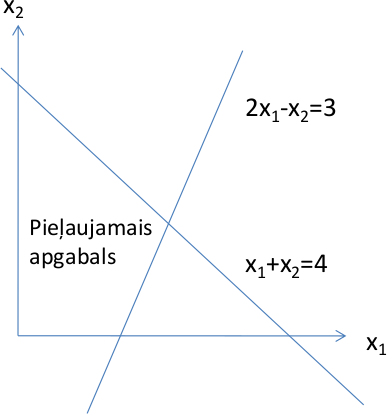

### Afīnās mērogošanas metode

Afīnā mērogošana ir atsevišķs gadījums iekšējā punkta metodēm.

**Uzdevums:**

$$
\mathbf{x} = \left(
\begin{array}{c}
x_1\\
x_2\\
\ldots\\
x_n
\end{array} \right),\;\;
A=\left(
\begin{array}{cccc}
a_{11} & a_{12} & \ldots & a_{1n}\\
\ldots & \ldots & \ldots & \ldots\\
a_{m1} & a_{m2} & \ldots & a_{mn}
\end{array} \right),\;\;
\mathbf{b}=\left(
\begin{array}{c}
b_1\\
\ldots\\
b_m
\end{array} \right).
$$

$$
\textcolor{blue}{\max(c_1 x_1 + c_2 x_2 + \ldots + c_n x_n)},\;\;\text{kur}\;\;
\left\{ \begin{array}{l}
A\mathbf{x} = \mathbf{b},\\
x_1 \geq 0,\, x_2 \geq 0,\, \ldots,\, x_n \geq 0.\\
\end{array} \right.
$$

**Afīnās mērogošanas metodes soļi:** Sākam ar kaut kādu lineārās programmas atrisinājumu $\mathbf{x} = (x_1, x_2, \ldots, x_n)$. Atkārto šādu darbību virkni:

1. Novelk elipsoīdu ap tekošo atrisinājumu $\mathbf{x} = (x_1, x_2, \ldots, x_n)$, kas pieskaras visām plaknēm $x_i=0$.
2. Atrod, kurā elipsoīda punktā mērķfunkcija ir maksimāla. (Maksimumu meklē visos elipsoīda punktos, arī kur $A\mathbf{x}=\mathbf{b}$ neizpildās.) Atrasto maksimumu apzīmē ar $\mathbf{x}' = (x'_1, x'_2, \ldots, x'_n)$.
3. Projicē vektoru $\mathbf{x}' - \mathbf{x}$ uz plakni $Ax=0$. Iegūto projekciju apzīmē ar $\mathbf{z} = (z_1, z_2, \ldots, z_n)$.
4. Jebkuram $a \in \mathbb{R}$, vektors $\mathbf{x} + a \mathbf{z}$ apmierina nosacījumus $A\mathbf{x} = b$. Aprēķinām maksimālo $a$, pie kura $x_i + az_i \geq 0$ (t.i. joprojām $x_i \geq 0$).
5. Jaunais atrisinājums būs $\mathbf{x}' = (x'_1, x'_2, \ldots, x'_n)$, kur $x'_i = x_i + 0.96 \cdot a \cdot z_i$.

Šeit $\beta = 0.96$ ir *soļa garums* (*step size*), ko bieži izmanto praksē. Atkarībā no situācijas var izvēlēties arī citas vērtības $\beta \in \left[ \frac{2}{3};1 \right)$.

#### Afīnās mērogošanas aprēķina piemērs

**LP uzdevums:**

$$
\textcolor{blue}{\max \left( -\frac{x_1}{3} + x_2 \right)},\;\;\text{kur}\;\;
\left\{
\begin{array}{l}
x_1 + x_2 \leq 4,\\
2x_1 - x_2 \leq 3,\\
x_1 \geq 0, x_2 \geq 0.
\end{array} \right.
$$

**Sākumpunkts:** $x_1=1$, $x_2=1$.

**Pārveidošana standartformā:** Pārveido LP formā, kur ir tikai vienādības.

$$
\max \left( -\frac{x_1}{3} + x_2 \right),\;\;\text{kur}\;\;
\left\{
\begin{array}{l}
x_1 + x_2 + x_3 = 4,\\
2x_1 - x_2 + x_4 = 3,\\
x_1 \geq 0, x_2 \geq 0, x_3 \geq 0, x_4 \geq 0.
\end{array} \right.
$$

**Sākumpunkts:** $x_1=1$, $x_2=1$, $x_3=2$, $x_4=2$.

**1.solis**

* Koordinātu transformācija. $x_1=1+y_1$, $x_2=1+y_2$, $x_3=2+y_3$, $x_4=2+y_4$. Koordinātu pārveidojums: $(1, 1, 2, 2) \rightarrow (0, 0, 0, 0)$.
* Jaunā programma.

  $$
  \textcolor{blue}{\max \left( -\frac{y_1 + 1}{3} + (y_2+1) = -\frac{y_1}{3} + y_2 + \frac{2}{3} \right)}\;\;\text{jeb}\;\;
  \textcolor{blue}{\max \left( -\frac{y_1}{3} + y_2 \right) },\;\;\text{kur}
  $$

  $$
  \left\{
  \begin{array}{l}
  y_1 + y_2 + y_3 = 0,\\
  2y_1 - y_2 + y_4 = 0,\\
  y_1 \geq -1,\; y_2 \geq -1,\; y_3 \geq -2,\; y_4 \geq -2.
  \end{array} \right.
  $$

**2.solis**

* Koordinātu "saspiešana". $y_1=z_1$, $y_2=z_2$, $y_3=2z_3$, $y_4=2z_4$.
* Jaunā programma:

  $$
  \textcolor{blue}{\max \left( -\frac{z_1}{3} + z_2 \right)},\;\;\text{kur}\;\;
  \left\{
  \begin{array}{l}
  z_1 + z_2 + 2z_3 = 0,\\
  2z_1 - z_2 + 2z_4 = 0,\\
  z_1 \geq -1, z_2 \geq -1, z_3 \geq -1, z_4 \geq -1.
  \end{array} \right.
  $$

Tekošais punkts -- vienādā apkārtnē no visiem ierobežojumiem.

**3.solis**

$$
\textcolor{blue}{\max \left( -\frac{z_1}{3} + z_2 \right)},\;\;\text{kur}\;\;
\left\{
\begin{array}{l}
2z_1-z_2 + 2z_3 = 0,\\
z_1+z_2 + 2z_4 = 0,\\
z_1 \geq -1, z_2 \geq -1, z_3 \geq -1, z_4 \geq -1.
\end{array} \right.
$$

Sfēra, kas pieskaras visiem ierobežojumiem:

$$
z_1^2 + z_2^2 + z_3^2 + z_4^2 = 1.
$$

**4.solis:** Ievērojam, ka izteiksmes $a_1z_1 + a_2z_2 +\ldots + a_nz_n$ maksimums uz sfēras

$$
z_1^2 + z_2^2 + \ldots + z_n^2 = 1
$$

tiek sasniegts virzienā

$$
z_1 = a_1,\;z_2=a_2,\,\ldots,\;z_n = a_n.
$$

Mūsu gadījumā izteiksmei $\displaystyle -\frac{z_1}{3} + z_2$ maksimums ir uz tā vektora, kas rāda virzienā $z_{\max} = (z_1,z_2,z_3,z_4) = (-1/3,1,0,0)$.

**5.solis:** Vēlamies projicēt $z_{\max} = (-1/3, 1, 0, 0)$ uz divdimensiju hipertelpu (divu trīsdimensiju hipertelpu šķēlumu), kur izpildās nosacījumi:

$$
\left\{
\begin{array}{l}
z_1 + z_2 + 2z_3 = 0,\\
2z_1 - z_2 + 2z_4 = 0.
\end{array} \right.
$$

Koeficientu matrica ir

$$
B = \left(
\begin{array}{cccc}
1 & 1 & 2 & 0 \\
2 & -1 & 0 & 2
\end{array} \right)
$$

Aprēķinām $B \cdot B^T$ un $B \cdot z_{\max}$

$$
B \cdot B^T =
\left(
\begin{array}{cccc}
1 & 1 & 2 & 0 \\
2 & -1 & 0 & 2
\end{array} \right) \cdot
\left(
\begin{array}{cc}
1 & 2 \\
1 & -1 \\
2 & 0 \\
0 & 2
\end{array} \right)
=
\left(
\begin{array}{cc}
6 & 1\\
1 & 9
\end{array} \right)
$$

$$
B \cdot z_{\max} = B \cdot \left( \begin{array}{c}
-1/3\\
1\\
0\\
0 \end{array} \right) = \left(
\begin{array}{c}
2/3\\
-5/3
\end{array} \right)
$$

**6.solis:** Risinām sistēmu $B \cdot B^T \cdot w = B \cdot z_{max}$.

$$
\left\{ \begin{array}{l}
6w_1 + w_2 = \frac{2}{3}\\
w_1 + 9w_2 = -\frac{5}{3}
\end{array} \right.
$$

Vienādojumu sistēmas atrisinājums ir

$$
w_1 = \frac{23}{159},\;\;w_2 = -\frac{32}{159}.
$$

**7.solis:** Projekcijas vektora virziens:

$$
p = z - B^T \cdot w =
\left( \begin{array}{c}
-\frac{1}{3}\\
1\\
0\\
0 \end{array} \right) -
\left( \begin{array}{cc}
1 & 2\\
1 & -1\\
2 & 0\\
0 & 2 \end{array} \right) \cdot
\left( \begin{array}{c}
\frac{23}{159}\\
-\frac{32}{159} \end{array} \right) =
\left( \begin{array}{c}
-\frac{12}{159}\\
\frac{104}{159}\\
-\frac{46}{159}\\
\frac{64}{159}
\end{array} \right).
$$

**8.solis:** Novelkam taisni virzienā $p$. Šo taisni var uzdot parametriski:

$$
\left\{ \begin{array}{l}
z_1 = -12t,\\
z_2 = 104t,\\
z_3 = -46t,\\
z_4 = 64t,
\end{array} \right.
$$

kur $t$ ir parametrs.

Tagad jānosaka pirmais krustpunkts starp šo taisni un plaknēm $z_i \geq -1$ (virzienā $t \geq 0$). Tas ir $t = 1/46$, kur mūsu taisne krusto $z_3 \geq -1$.

**9.solis:** Tātad jaunais atrisinājums būs

$$
\left\{ \begin{array}{l}
z_1 = -0.96 \cdot 12 \cdot \frac{1}{46} = -0.25043,\\
z_2 = 0.96 \cdot 104 \cdot \frac{1}{46} = 2.17044,\\
z_3 = -0.96 \cdot 46 \cdot \frac{1}{46} = 0.96000,\\
z_4 = 0.96 \cdot 64 \cdot \frac{1}{46} = 1.33565.
\end{array} \right.
$$

Pārveidojam atpakaļ uz sākotnējās koordinātēm:

$$
\left\{ \begin{array}{l}
y_1 = z_1 = -0.25043\\
y_2 = z_2 = 2.17044\\
y_3 = 2z_3 = 1.92000\\
y_4 = 2z_4 = 2.67130
\end{array} \right.;\;\;
\left\{ \begin{array}{l}
x_1 = 1 + y_1 = 0.74957\\
x_2 = 1 + y_2 = 3.17044\\
x_3 = 2 + y_3 = 3.92000\\
x_4 = 2 + y_4 = 4.67130
\end{array} \right.
$$

*Afīnās mērogošanas galarezultāts.*

Maksimizēt $\displaystyle -\frac{x_1}{3} + x_2$ pie nosacījumiem:

$$
\left\{
\begin{array}{l}
x_1 + x_2 \leq 4,\\
2x_1 - x_2 \leq 3,\\
x_1 \geq 0, x_2 \geq 0.
\end{array} \right.
$$

No punkta $(x_1,x_2) = (1,1)$ pēc 1.iterācijas ieguvām $(0.74957;3.17044)$