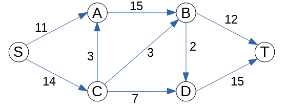
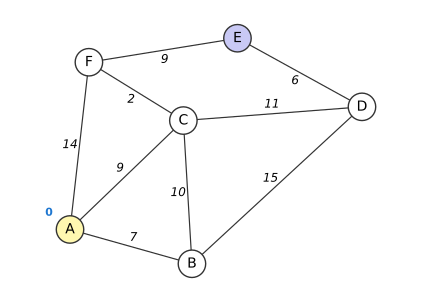
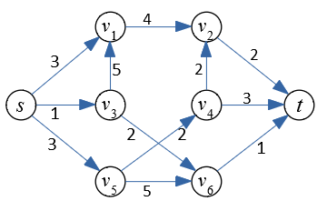

# 9. Lineārās programmēšanas ievads

Šajā nodaļā uzzinām, kāpēc vajadzīga lineāru izteiksmju maksimizēšana, ko parasti sauc par *lineāro programmēšanu*. Un arī, kāpēc lineārās optimizācijas uzdevumi pierakstāmi noteiktā formā.

**Mācīšanās rezultāti (learning outcomes):** 

* Pierakstīt optimizācijas uzdevumus kā lineāras programmas.
* Analizēt matricu (nulles summas) spēles. 
* Risināt lineārās programmēšanas uzdevumus ar simpleksa algoritmu.

## Standarti optimizācijas uzdevumi

**Optimizācijas uzdevumu veidi**

Optimizācijas uzdevumos maksimizējam (vai minimizējam) kādu izteiksmi (piemēram, peļņu vai izmaksas). Vai nu visā izteiksmes definīcijas apgabalā, vai arī pie dotiem nosacījumiem jeb ierobežojumiem.

* Optimizācija bez nosacījumiem: Minimizēt $f(x_1, x_2, \ldots, x_n)$. Ja $f$ ir lineāra funkcija, tad tā var pieņemt cik patīk lielas (vai mazas) vērtības.

* Optimizācija ar nosacījumiem: Minimizēt $f(x_1, x_2, \ldots, x_n)$ pie nosacījumiem

  $$
  \begin{array}{l}
  c_1(x_1, x_2, \ldots, x_n) \geq 0, \ldots, c_k(x_1, x_2, \ldots, x_n) \geq 0,\\
  d_1(x_1, x_2, \ldots, x_n) = 0, \ldots, d_{\ell}(x_1, x_2, \ldots, x_n) = 0.\\
  \end{array}
  $$

**Lineārā programmēšana:** Minimizēt $\displaystyle \sum\limits_{i=1}^{n} b_ix_i$ pie nosacījumiem

$$
\left\{ \begin{array}{l}
c_{11} x_1 + c_{12} x_2 + \ldots + c_{1n} x_n \leq d_1,\\
\ldots,\\
c_{m1} x_1 + c_{m2} x_2 + \ldots + c_{mn} x_n \leq d_m,
\end{array} \right.
$$

> *Piezīme:* Vārds "programmēšana" lietots nozīmē "plānošana". Dažus optimizācijas uzdevumu veidus sauc par programmēšanu jau kopš 1920.-tajiem gadiem.

**Kvadrātiskā programmēšana** (*Kursā netiek aplūkota, bet arī praktiski nozīmīga.*)

Minimizēt sekojošu izteiksmi:

$$
\sum\limits_{i,j=1}^{n} a_{ij}x_ix_j +  \sum\limits_{i=1}^{n} b_ix_i
$$

pie nosacījumiem

$$
\left\{
\begin{array}{l}
c_{11} x_1 + c_{12} x_2 + \ldots + c_{1n} x_n \leq d_1,\\
\ldots,\\
c_{m1} x_1 + c_{m2} x_2 + \ldots + c_{mn} x_n \leq d_m,
\end{array} \right.
$$

Šajā gadījumā minimizējamā funkcija ir kvadrātiska, bet nosacījumi ir lineāri.

**Veselo skaitļu programmēšana** jeb lineārā programmēšana veselos skaitļos (*Integer Programming*): uzdevums tāds pats kā lineārā programmēšanā, tikai klāt nāk nosacījums, ka visi $x_1, x_2, \ldots, x_n$ ir veseli skaitļi.

Ar lineārajām programmām veselos skaitļos var aprakstīt daudzus interesantus un praktiski svarīgus uzdevumus, bet nav zināms algoritms, kas ātri (polinomiālā laikā) atrisina patvaļīgu veselo skaitļu programmu.


## Lineāro programmu grafiskā interpretācija

**Vispārīgais LP uzdevums:** Lineārā programmēšana apraksta daudzas praktiskas problēmas, tai eksistē efektīvi algoritmi.

Vispārīgais LP uzdevums: Atrast $\textcolor{blue}{\max\left(c_1x_1 + \ldots + c_nx_n\right)}$, ja izpildās nosacījumi:

$$
\left\{
\begin{array}{l}
a_{11}x_1 + a_{12}x_2 + \ldots + a_{1n}x_n \leq b_1\\
\ldots\\
a_{m1}x_1 + a_{m2}x_2 + \ldots + a_{mn}x_n \leq b_m
\end{array} \right.
$$

**Divdimensiju piemērs:** Atrast $\textcolor{blue}{\max(2x_1 + 3x_2)}$, kur

$$
\left\{ \begin{array}{l}
x_1 - 2x_2 \leq 4,\\
x_1 + x_2 \leq 18,\\
x_2 \leq 10,\\
x_1,x_2 \geq 0.
\end{array} \right.
$$

> *Piezīme:* Katrs maksimizācijas uzdevums ekvivalents kādam minimizācijas uzdevumam (un otrādi). Piemēram: $\max(2x_1 + 3x_2) = -\min(-2x_1 - 3x_2).$ Turpmāk apskatīsim tikai maksimizācijas uzdevumus.

**Piemēra grafiskā interpretācija:** Atrast $\textcolor{blue}{\max(2x_1 + 3x_2)}$, kur

$$
\left\{ \begin{array}{l}
x_1 - 2x_2 \leq 4,\\
x_1 + x_2 \leq 18,\\
x_2 \leq 10,\\
x_1,x_2 \geq 0.
\end{array} \right.
$$


Attēlā viegli redzēt uzdevuma atrisinājumu -- tas ir punkts $(8,10)$. Lielākam dimensiju skaitam var būt grūti veidot šādu attēlu. Tipiskos LP uzdevumos *pieļaujamais apgabals* (*feasible region*) ir galīgs. Citādi var gadīties, ka maksimuma nemaz nav -- izteiksme var pieņemt patvaļīgi lielas vērtības. Pirms LP risināšanas mēdz pārbaudīt, vai pieļaujamais apgabals ir galīgs.

**Optimuma atrašanās:** Attēlos var pamanīt divus nozīmīgus faktus:

* **Fakts 1:** Mērķfunkcija savu maksimumu sasniedz pieļaujamā apgabala stūrī.
* **Fakts 2:** Ja kādā stūri $a_1x_1 + \ldots + a_nx_n$ nesasniedz maksimumu, tad vienā no blakus stūriem $a_1x_1 + \ldots + a_nx_n$ ir lielāka vērtība.

Divu dimensiju gadījumā, piemēram, par 2.faktu var pārliecināties, lietojot ģeometrisko interpretāciju un 
šķirojot gadījumus:

* **(a)** Ja visos kaimiņu stūros mērķa funkcijas vērtības ir mazākas, $c_1x_1 + c_2x_2 \leq c$, tad stūris ir maksimums.
* **(b)** Ja visos kaimiņu stūros mērķa funkcijas vērtības ir lielākas, $c_1x_1+c_2x_2 \geq c$, tad tad stūris ir minimums.
* **(c)** Citos gadījumos stūris nav ne maksimums, ne minimums, tad atrodas gan blakus stūris ar lielāku mērķa funkcijas vērtību $c_1x_1+c_2x_2$ vērtību, gan arī ar mazāku vērtību.


Arī lielākam dimensiju skaitam maksimums vai minimums noteikti atrodas kādā apgabala "stūrī", 
jo apgabals, kuru nosaka lineāru nevienādību sistēma, noteikti ir *slēgts* un *izliekts*.

**Definīcija:** (1) Ģeometrisku figūru sauc par slēgtu, ja līdz ar katru konverģējošu punktu virkni $(\mathbf{a}^{(n)})$ 
tā satur arī šīs virknes robežu $\mathbf{a}^{\ast}$ (citiem vārdiem - satur apgabalu kopā ar visu robežu).  
(2) Ģeometrisku figūru sauc par izliektu, ja līdz ar katriem diviem punktiem $\mathbf{a}$ un $\mathbf{b}$ tā 
satur arī visu nogriezni ar punktiem $\mathbf{x}(t) = (1-t)\mathbf{a} + t\mathbf{b}$, kur $t \in [0;1]$. 


## Lineāru programmu piemēri

### Diētas problēma

Doti ierobežojumi (cilvēka uztura vajadzības) un jāpieņem lēmums par produktu iepirkšanu.

* **Mērķis:** Samazināt izmaksas diētai, kas apmierina visas cilvēka uztura vajadzības.
* **Mainīgie:** Ar $x_1, x_2, \ldots, x_n$ apzīmējam dažādu pārtikas produktu daudzumus, ko iekļaut diētā.
* **Mērķa funkcija:** $\textcolor{blue}{\min\left( z = c_1x_1 + c_2x_2 + \ldots + c_nx_n \right)}$, kur $c_i$ ir izmaksas $i$-tajam pārtikas produktam par vienu vienību.
* **Ierobežojumi:** Sasniegt nepieciešamo uzturvielu daudzumu, piemēram, kalorijām, olbaltumvielām, vitamīniem.

  $$
  \begin{array}{ll}
  a_{11}x_1 + a_{12}x_2 + \ldots + a_{1n}x_n \geq d_1 & (\text{Uzturviela 1}) \\
  a_{21}x_1 + a_{22}x_2 + \ldots + a_{2n}x_n \geq d_2 & (\text{Uzturviela 2}) \\
  &\vdots \\
  a_{m1}x_1 + a_{m2}x_2 + \ldots + a_{mn}x_n \geq d_m & (\text{Uzturviela m}) \\
  x_i \geq 0 & (\text{Nevar apēst negatīvu daudzumu produkta})\\
  \end{array}
  $$

> *Piezīme:* Ja produktu daudzumi ir mērāmi veselos skaitļos (piemēram, veselā skaitā iepakojumu), tad iegūstam lineāro programmēšanu veselos skaitļos. Ja dažiem mainīgajiem jābūt veseliem, bet citi drīkst būt patvaļīgi reāli skaitļi, tad tā ir jauktā veselo skaitļu programmēšana (*mixed integer programming*).

**Leonīds Kantorovičs (Leonid Kantorovich, 1912-1986):** Optimāla izejvielu izmantošana finiera rūpniecībā (1939.g.). Agrīni optimizācijas uzdevumi mēdz būt saistīti ar ražošanas plānošanu.


### Maksimālā plūsma orientētā grafā

Plūsmu maksimizācijas uzdevumi ir lineārās programmēšanas uzdevumu atsevišķs gadījums. 
Tiem ir specializēti algoritmi (Forda-Falkersona vai Edmonda-Karpa algoritmi), 
bet tos var risināt arī ar lineārās programmēšanas līdzekļiem un 
izmantot lineārās programmēšanas (tsk. duālās problēmas) teorijas ilustrēšanai.


**Maksimālās plūsmas uzdevuma jēdzieni:**

* Dots orientēts plūsmas grafs $N = (V, E)$ un tajā divas virsotnes $s, t \in V$, ko sauc attiecīgi par *ieteku* (*source*) un *izteku* (*sink*).
* Uz grafa šķautnēm $(u,v)$ var definēt dažādas funkcijas, ko apzīmē ar $g(u,v)$ vai $g_{uv}$.

**Definīcija:** Par šķautnes ietilpību (*capacity*) sauc maksimālo plūsmu, ko var piešķirt attiecīgajai 
šķautnei. Ietilpību atzīmē ar $c: E \to \mathbb{R}^+$.

**Definīcija:** Par *plūsmu* (*flow*) sauc funkciju $f : E \to \mathbb{R}$, kas apmierina šādus nosacījumus:

* *Ietilpības ierobežojums:* plūsma ne uz vienas šķautnes nav negatīva un nepārsniedz tās ietilpību, t.i., $0 \leq f_{uv} \leq c_{uv}$ visiem $(u, v) \in E$.
* *Plūsmas saglabāšanās:* katrā virsotnē, izņemot ieteku un izteku, ienākošo plūsmu summa ir vienāda ar izejošo plūsmu summu:

  $$
  \forall v \in V \setminus \{s, t\} \quad
  \sum_{u:\ (u, v) \in E} f_{uv} = \sum_{u:\ (v, u) \in E} f_{vu}.
  $$

**Definīcija:** *Plūsmas vērtība* ir plūsmas daudzums, kas pārvietojas no ietekas uz izteku: no ietekas izejošā plūsma mīnus ietekā ienākošā plūsma. Ja ietekā neienāk un no iztekas neiziet neviena šķautne (kā piemērā zemāk), tad

$$
|f| = \sum_{v:\ (s,v) \in E} f_{sv} = \sum_{u:\ (u,t) \in E} f_{ut}.
$$

**Definīcija:** *Maksimālās plūsmas problēma* nozīmē atrast plūsmu (plūsmas vērtību uz katras grafa šķautnes), kas no ietekas uz izteku novada iespējami daudz, t.i., atrast plūsmu $f_\textrm{max}$ ar maksimālo vērtību $|f|$.

> *Piezīme:* Starp divām virsotnēm $u, v$ var būt šķautnes abos virzienos $(u,v)$ un $(v,u)$ ar atšķirīgām ietilpībām. Ja abās ir nenulles plūsma, tad abas plūsmas var samazināt par mazāko no tām (plūsma no $u$ uz $v$ un atpakaļ savstarpēji kompensējas), tāpēc var uzskatīt, ka vismaz vienā virzienā plūsma ir $0$. Neorientētā grafā katru šķautni $\lbrace u, v \rbrace$ aizstāj ar divām orientētām šķautnēm $(u,v)$ un $(v,u)$ ar to pašu ietilpību. Dažās grāmatās plūsmu definē antisimetriski ($f_{uv} = -f_{vu}$); tas ir cits pieraksts tam pašam jēdzienam.

**Piemērs:** Atrast maksimālo plūsmu no $S$ uz $T$ grafā, kurā pie katras šķautnes uzrakstīta tās ietilpība:



Katrai šķautnei $(u,v)$ piekārtojam mainīgo $f_{uv}$ -- plūsmu pa šo šķautni. Maksimizējam no $S$ izejošo plūsmu; ierobežojumos ir plūsmas saglabāšanās katrā starpvirsotnē $A, B, C, D$ un ietilpības ierobežojumi:

$$
\textcolor{blue}{\max \left( f_{SA} + f_{SC} \right)},\;\;\text{kur}\;\;
\left\{ \begin{array}{ll}
f_{SA} + f_{CA} = f_{AB} & (A),\\
f_{AB} + f_{CB} = f_{BT} + f_{BD} & (B),\\
f_{SC} = f_{CA} + f_{CB} + f_{CD} & (C),\\
f_{CD} + f_{BD} = f_{DT} & (D),\\
0 \leq f_{SA} \leq 11,\;\; 0 \leq f_{SC} \leq 14,\;\; 0 \leq f_{AB} \leq 15, & \\
0 \leq f_{CA} \leq 3,\;\; 0 \leq f_{CB} \leq 3,\;\; 0 \leq f_{CD} \leq 7, & \\
0 \leq f_{BT} \leq 12,\;\; 0 \leq f_{BD} \leq 2,\;\; 0 \leq f_{DT} \leq 15. & \\
\end{array} \right.
$$

Programma [figs/max-flow-lp.py](figs/max-flow-lp.py) atrod maksimālo plūsmu $|f| = 21$, piemēram:

| Šķautne | $SA$ | $SC$ | $AB$ | $CA$ | $CB$ | $CD$ | $BT$ | $BD$ | $DT$ |
| --- | --- | --- | --- | --- | --- | --- | --- | --- | --- |
| Plūsma $f_{uv}$ | 11 | 10 | 14 | 3 | 0 | 7 | 12 | 2 | 9 |
| Ietilpība $c_{uv}$ | 11 | 14 | 15 | 3 | 3 | 7 | 12 | 2 | 15 |

Optimālā plūsma nav vienīgā: piemēram, var ņemt $f_{CA} = 0$, $f_{CB} = 3$, $f_{AB} = 11$. Lielāka plūsma nav iespējama, jo virsotņu kopu sadalot $\lbrace S, A, B, C \rbrace$ un $\lbrace D, T \rbrace$, no pirmās daļas uz otro ved tikai šķautnes $BT$, $BD$ un $CD$ ar kopējo ietilpību $12 + 2 + 7 = 21$. Šāds sadalījums ir *minimālais griezums*; tas ir maksimālās plūsmas uzdevuma duālā uzdevuma atrisinājums.


### Viena avota īsāko ceļu uzdevums

Dots grafs ar nenegatīviem šķautņu garumiem $w_{uv}$ un sākuma virsotne $s$. Jāatrod īsāko ceļu garumi no $s$ uz visām pārējām virsotnēm.

Katrai virsotnei $v$ piesaista mainīgo $x_{v}$ -- attālumu no sākuma virsotnes $s$ (to sauc arī par virsotnes *potenciālu*).

**Mērķfunkcija:**
Maksimizēt visu mainīgo summu $\sum_{v} x_{v}$. (Ja vajag tikai vienu mērķa virsotni $t$, var maksimizēt $x_t$; tad $x_t$ būs attālums līdz $t$, bet pārējie $x_v$ var būt mazāki par attālumiem.)

**Ierobežojumi:**

* Sākuma virsotnē $x_s = 0$.
* Katrai orientētai šķautnei $(u,v)$: $x_{v}-x_{u} \leq w_{uv}$ (*trijstūra nevienādība*: līdz $v$ nevar būt tālāk kā līdz $u$ plus šķautnes $(u,v)$ garums). Neorientētā grafā katrai šķautnei $\lbrace u,v \rbrace$ ir divas nevienādības: $x_v - x_u \leq w_{uv}$ un $x_u - x_v \leq w_{uv}$.

Šķiet dīvaini, ka īsākos ceļus atrod ar *maksimizāciju*. Taču ierobežojumi neļauj nevienam $x_v$ pārsniegt attālumu $d(s,v)$: pa īsākā ceļa $s = v_0, v_1, \ldots, v_k = v$ šķautnēm saskaitot nevienādības, iegūst $x_v - x_s \leq d(s,v)$. Savukārt $x_v = d(s,v)$ visas nevienādības izpilda. Tāpēc maksimums ir sasniegts, kad katrs $x_v$ ir tieši attālums. (Ja kāda virsotne no $s$ nav sasniedzama, tad LP ir neierobežots.)

**Piemērs:** Atrast īsāko ceļu garumus no virsotnes $A$ uz visām pārējām virsotnēm šajā neorientētajā grafā:



$$
\textcolor{blue}{\max \left( x_A + x_B + x_C + x_D + x_E + x_F \right)},\;\;\text{kur}\;\;
\left\{ \begin{array}{ll}
x_A = 0, & \\
\lvert x_B - x_A \rvert \leq 7, & \lvert x_C - x_A \rvert \leq 9,\\
\lvert x_F - x_A \rvert \leq 14, & \lvert x_C - x_B \rvert \leq 10,\\
\lvert x_D - x_B \rvert \leq 15, & \lvert x_D - x_C \rvert \leq 11,\\
\lvert x_F - x_C \rvert \leq 2, & \lvert x_E - x_D \rvert \leq 6,\\
\lvert x_E - x_F \rvert \leq 9. & \\
\end{array} \right.
$$

Šeit $\lvert x_v - x_u \rvert \leq w$ ir saīsināts pieraksts divām lineārām nevienādībām $x_v - x_u \leq w$ un $x_u - x_v \leq w$.

Programma [figs/shortest-paths-lp.py](figs/shortest-paths-lp.py) nolasa grafu no faila [figs/shortest-paths-example.json](figs/shortest-paths-example.json) (to pašu, no kura [figs/shortest-paths-example.py](figs/shortest-paths-example.py) zīmē attēlu) un atrod:

| Virsotne $v$ | $A$ | $B$ | $C$ | $D$ | $E$ | $F$ |
| --- | --- | --- | --- | --- | --- | --- |
| Attālums $x_v = d(A,v)$ | 0 | 7 | 9 | 20 | 20 | 11 |
| Iepriekšējā virsotne ceļā | -- | $A$ | $A$ | $C$ | $F$ | $C$ |

Mērķfunkcijas vērtība ir $0 + 7 + 9 + 20 + 20 + 11 = 67$. Īsāko ceļu koku veido tās šķautnes, kurās nevienādība pārvēršas par vienādību; piemēram, īsākais ceļš uz $E$ ir $A \to C \to F \to E$ ar garumu $9 + 2 + 9 = 20$.

> *Piezīme:* Praksē īsākos ceļus no vienas virsotnes meklē ar Dijkstras algoritmu, nevis ar LP: ar kaudzi (*binary heap*) tas strādā $O((\lvert V \rvert + \lvert E \rvert) \log \lvert V \rvert)$ laikā, ir vienkāršs, bet vispārīgs LP risinātājs ir daudz lēnāks un patērē vairāk atmiņas. Ja šķautnēm var būt negatīvi garumi, lieto Belmana-Forda algoritmu. LP formulējums ir noderīgs teorijai: tā duālais uzdevums ir minimālo izmaksu plūsma, kas no $s$ uz katru citu virsotni nosūta vienu vienību, un LP formulējumam var viegli pievienot papildu lineārus ierobežojumus.


### Optimālā prefiksu koda garumi

Hafmana algoritms (sk. lekciju [Entropija un Hafmana koki]({{ '/lectures/lossless_entropy_and_huffman/' | relative_url }})) arī atrisina optimizācijas uzdevumu. Doti ziņojumi ar varbūtībām $p_1, \ldots, p_n$; jāizvēlas kodavārdu garumi $\ell_1, \ldots, \ell_n$ tā, lai vidējais koda garums būtu minimāls. Pēc Krafta-Makmilana nevienādības prefiksu kods ar garumiem $\ell_i$ eksistē tad un tikai tad, ja $\sum_i 2^{-\ell_i} \leq 1$. Tātad *optimālā prefiksu koda uzdevums* ir:

$$
\textcolor{blue}{\min \left( \sum_{i=1}^n p_i \ell_i \right)},\;\;\text{kur}\;\;
\left\{ \begin{array}{l}
\sum\limits_{i=1}^n 2^{-\ell_i} \leq 1,\\
\ell_i \in \lbrace 1, 2, 3, \ldots \rbrace.\\
\end{array} \right.
$$

Mērķfunkcija ir lineāra, bet Krafta nevienādība attiecībā pret $\ell_i$ nav lineāra, un mainīgajiem jābūt veseliem skaitļiem.

**Relaksācija:** Ja veselumu atmet (atļauj reālus $\ell_i > 0$), tad optimums ir $\ell_i = -\log_2 p_i$, un minimālā vērtība ir entropija:

$$
\sum_{i=1}^n p_i \ell_i = -\sum_{i=1}^n p_i \log_2 p_i = H(p).
$$

(To var pārbaudīt ar Lagranža reizinātājiem; vienādība Krafta nevienādībā izpildās, jo $\sum_i 2^{\log_2 p_i} = \sum_i p_i = 1$.) Tātad entropija ir šīs optimizācijas relaksācijas optimums, bet Hafmana kods -- veselo skaitļu uzdevuma optimums. Relaksācija dod apakšējo novērtējumu $H(p) \leq L_{\text{Huffman}}$. Savukārt noapaļotie garumi $\ell_i = \lceil -\log_2 p_i \rceil$ izpilda Krafta nevienādību un dod vidējo garumu mazāku par $H(p) + 1$, tāpēc $L_{\text{Huffman}} < H(p) + 1$. Atstarpe starp relaksāciju un veselo skaitļu atrisinājumu ir mazāka par $1$ bitu -- tas ir tieši Šenona teorēmas "$+1$".

**Veselo skaitļu lineārā programma:** Uzdevumu var pārrakstīt ar lineāriem ierobežojumiem, ja ievieš bināros mainīgos $y_{i\ell} \in \lbrace 0,1 \rbrace$: $y_{i\ell} = 1$ nozīmē, ka $i$-tā ziņojuma kodavārda garums ir $\ell$ (pietiek ar $\ell = 1, \ldots, n-1$):

$$
\textcolor{blue}{\min \left( \sum_{i=1}^n \sum_{\ell=1}^{n-1} \ell\, p_i\, y_{i\ell} \right)},\;\;\text{kur}\;\;
\left\{ \begin{array}{ll}
\sum\limits_{\ell=1}^{n-1} y_{i\ell} = 1 & \text{katram}\ i \;\;(\text{katram ziņojumam viens garums}),\\
\sum\limits_{i=1}^n \sum\limits_{\ell=1}^{n-1} 2^{-\ell}\, y_{i\ell} \leq 1 & (\text{Krafta nevienādība}),\\
y_{i\ell} \in \lbrace 0, 1 \rbrace. & \\
\end{array} \right.
$$

Skaitļi $2^{-\ell}$ šeit ir konstantes, tāpēc visi ierobežojumi ir lineāri.

**Piemērs:** Varbūtības $p = (0.4;\ 0.3;\ 0.2;\ 0.1)$. Programma [figs/prefix-code-lengths.py](figs/prefix-code-lengths.py) atrisina veselo skaitļu LP un salīdzina ar Hafmana kodu:

| | $\ell_1$ | $\ell_2$ | $\ell_3$ | $\ell_4$ | Vidējais garums |
| --- | --- | --- | --- | --- | --- |
| Relaksācija $-\log_2 p_i$ | $1.322$ | $1.737$ | $2.322$ | $3.322$ | $H(p) \approx 1.846$ |
| Veselo skaitļu LP | $1$ | $2$ | $3$ | $3$ | $1.9$ |
| Hafmana kods | $1$ | $2$ | $3$ | $3$ | $1.9$ |
| $\lceil -\log_2 p_i \rceil$ | $2$ | $2$ | $3$ | $4$ | $2.4$ |

Veselo skaitļu LP atrod tos pašus garumus kā Hafmana algoritms, un $1.846 \leq 1.9 < 2.846$. Noapaļošana uz augšu dod derīgu, bet neoptimālu kodu ($2.4$); arī tas iekļaujas Šenona robežā $H(p) + 1$.

Praksē optimālos garumus, protams, atrod ar Hafmana algoritmu $O(n \log n)$ laikā; veselo skaitļu LP vispārīgajā gadījumā ir NP-grūts uzdevums. Piemērs rāda, kā viens un tas pats uzdevums izskatās optimizācijas valodā: entropija ir relaksācijas optimums, Hafmana kods -- veselo skaitļu optimums.


### Resursu piešķiršanas problēma

Populārs tuvinājums ekonomikā pazīstamai problēmai (*Resource allocation problem*). Spēja to efektīvi risināt var atbildēt uz filozofisku jautājumu -- vai ir nepieciešams tirgus?

* **Mērķis:** Maksimizēt peļņu, nosakot optimālos ražošanas apjomus dažādiem produktiem, ievērojot pastāvošos ierobežojumus.
* **Mainīgie:** $x_1, x_2, \ldots, x_n$ ir produktu ražošanas apjomi.
* **Mērķa funkcija:** $\textcolor{blue}{\max \left( z = c_1x_1 + c_2x_2 + \ldots + c_nx_n \right)}$, kur $c_i$ ir peļņa, saražojot vienu vienību ar $i$-to produktu.
* **Ierobežojumi:** Resursu pieejamības ierobežojumi -- darbs, izejvielas, kapitāls.

  $$
  \begin{array}{ll}
  a_{11}x_1 + a_{12}x_2 + \ldots + a_{1n}x_n \leq b_1 & (\text{Resurss 1}) \\
  a_{21}x_1 + a_{22}x_2 + \ldots + a_{2n}x_n \leq b_2 & (\text{Resurss 2}) \\
  &\vdots \\
  a_{m1}x_1 + a_{m2}x_2 + \ldots + a_{mn}x_n \leq b_m & (\text{Resurss m}) \\
  x_i \geq 0 & (\text{Nevar ražot negatīvus daudzumus})\\
  \end{array}
  $$

**Skaitlisks piemērs:**

* Kāpostu sēklu pietiek 3 hektāru apsēšanai.
* Burkānu sēklu pietiek 4 hektāru apsēšanai.
* Ir pieejami 5 brīvi hektāri.
* Peļņa ir 1200 EUR par kāpostu hektāru un 1700 EUR par burkānu hektāru. Uzdevums ir maksimizēt peļņu.

**Formalizēts uzdevums:** $\textcolor{blue}{\max \left( 1200x_k + 1700x_b \right)}$, kur

$$
\left\{ \begin{array}{l}
x_k \leq 3,\\
x_b \leq 4\\
x_k + x_b \leq 5,\\
x_k,x_b \geq 0.
\end{array} \right.
$$

1. Uzzīmēt pieļaujamo apgabalu (*feasible region*); kāpostus zīmēt uz horizontālās taisnes, burkānus uz vertikālās taisnes.
2. Atrast un atzīmēt pieļaujamā apgabala stūrus -- tos 2D plaknes punktus, kuros vismaz 2 no dotajām nevienādībām pārvēršas par vienādībām.
3. Uzzīmēt plaknē peļņas gradienta vektoru $(1200, 1700)$.
4. Atrast vistālāko stūri pieļaujamajā apgabalā, uz kuru var aizbraukt ar šo gradienta vektoru.

**Definīcija:** Skalārs lauks (*scalar field*) ir reālvērtīga funkcija, kas definēta katrā telpas punktā. Piemēram, divu dimensiju gadījumā katram $(x_1,x_2)$ atbilst vērtība $f(x_1,x_2)$. Piemēram, katrai kāpostu un burkānu apsētajai vērtībai var izrēķināt peļņu: $f(x_k,x_b) = 1200x_k + 1700 x_b$.

> *Piezīme:* Skalāriem laukiem nav sakara ar galīgiem laukiem (algebrisko struktūru, kas parādījās Rīda-Solomona kodos).

**Definīcija:** Par *gradientu* skalāram laukam $f$ sauc vektoru $\nabla f(x_1, x_2)$, kas definēts katram $(x_1,x_2) \in \mathbb{R}^2$. To definē šādi:

$$
\nabla f(x_1, x_2) = \left( \frac{\partial f}{\partial x_1}(x_1, x_2), \frac{\partial f}{\partial x_2}(x_1, x_2) \right)
$$

Mūsu piemērā peļņas funkcijas parciālie atvasinājumi ir attiecīgi $1200$ un $1700$ (konstantas vērtības). Tātad peļņas funkcija vienmērīgi aug gradienta vektora norādītajā virzienā.


## Divu spēlētāju matricu spēles

Divi spēlētāji $X$ un $Y$ vienlaikus izvēlas katrs vienu no saviem gājieniem: spēlētājs $X$
izvēlas kādu no $n$ rindām, spēlētājs $Y$ -- kādu no $m$ kolonnām. Spēli apraksta
*maksājumu matrica* $A = (a_{ij})$ ar izmēru $n \times m$: ja $X$ izvēlas $i$-to rindu un $Y$ --
$j$-to kolonnu, tad $X$ samaksā spēlētājam $Y$ summu $a_{ij}$. Spēlētājs $X$ šo samaksu
minimizē, spēlētājs $Y$ -- maksimizē.

> *Piezīme:* Tās ir *nulles summas spēles*: viss, ko samaksā $X$, nonāk pie $Y$, tātad abu
> ieguvumu summa ir $0$. Ja $a_{ij} < 0$, tad faktiski $Y$ maksā spēlētājam $X$.
> Spēles, kurās tā nav (piemēram, cietumnieku dilemma), aplūkotas apakšnodaļas beigās.

### Tīrās stratēģijas un sedlu punkts

*Tīrā stratēģija* (*pure strategy*) nozīmē vienmēr izvēlēties vienu un to pašu gājienu.

**Piemērs:** Aplūkojam spēli ar maksājumu matricu

$$
A = \left( \begin{array}{cc}
1 & 2 \\
4 & 8 \\
\end{array} \right).
$$

Spēlētājam $Y$ 2. kolonna ir izdevīgāka par 1. kolonnu pie jebkuras $X$ izvēles ($2 > 1$ un
$8 > 4$); saka, ka 2. kolonna *dominē* pār 1. kolonnu. Līdzīgi spēlētājam $X$ 1. rinda dominē
pār 2. rindu ($1 < 4$ un $2 < 8$). Tātad $X$ izvēlas 1. rindu, $Y$ -- 2. kolonnu, un $X$ samaksā
$a_{12} = 2$. Nevienam no spēlētājiem nav izdevīgi vienpusēji mainīt savu izvēli.

**Definīcija:** Matricas elements $a_{rs}$ ir *sedlu punkts*, ja tas ir lielākais savā rindā un
mazākais savā kolonnā.

Ja $a_{rs}$ ir sedlu punkts, tad, izvēloties $r$-to rindu, $X$ samaksā ne vairāk kā $a_{rs}$
(tas ir rindas maksimums), bet, izvēloties $s$-to kolonnu, $Y$ saņem ne mazāk kā $a_{rs}$
(tas ir kolonnas minimums). Tātad abu spēlētāju optimālās stratēģijas ir tīrās, un spēles
iznākums ir $a_{rs}$. Iepriekšējā piemērā sedlu punkts ir $a_{12} = 2$.

**Piemērs:** Spēlē "akmens, papīrs, šķēres" abiem spēlētājiem ir trīs gājieni: akmens (R),
papīrs (P) un šķēres (S). Uzvarētājs saņem no zaudētāja $1$, neizšķirta gadījumā neviens
nemaksā. Rindas un kolonnas sakārtojot secībā R, P, S, maksājumu matrica ir

$$
A = \left( \begin{array}{ccc}
0 & 1 & -1 \\
-1 & 0 & 1 \\
1 & -1 & 0 \\
\end{array} \right).
$$

Šai matricai sedlu punkta nav: katrā rindā lielākais elements ir $1$, bet katrā kolonnā
mazākais elements ir $-1$. Jebkurai tīrajai stratēģijai pretiniekam ir labākā atbilde, ar kuru
tas vienmēr uzvar. Tāpēc šādās spēlēs gājienus jāizvēlas nejauši.

### Jauktās stratēģijas

*Jauktā stratēģija* (*mixed strategy*) izvēlas katru gājienu ar noteiktu varbūtību. Spēlētāja
$X$ jaukto stratēģiju apraksta varbūtību vektors $\mathbf{x} = (x_1,\ldots,x_n)^T$, spēlētāja $Y$ --
varbūtību vektors $\mathbf{y} = (y_1,\ldots,y_m)^T$, kur

$$
x_1 + \ldots + x_n = 1,\quad y_1 + \ldots + y_m = 1,\quad x_i \geq 0,\; y_j \geq 0.
$$

(Šādus vektorus sauc arī par *stohastiskiem vektoriem*.) Tīrā stratēģija ir jauktās stratēģijas
īpašgadījums: vektors ar vienu vieninieku un pārējām nullēm.

Ja spēlētāji izvēlas gājienus neatkarīgi, tad vidējā samaksa (matemātiskā cerība), ko $X$
samaksā spēlētājam $Y$, ir

$$
\mathbf{x}^T A \mathbf{y} = \sum_{i=1}^{n}\sum_{j=1}^{m} x_i\,a_{ij}\,y_j.
$$

**Piemērs:** Spēlē "akmens, papīrs, šķēres" spēlētājs $X$ izvēlas $\mathbf{x}^T = (1/2, 0, 1/2)$,
bet spēlētājs $Y$ -- $\mathbf{y}^T = (1/2, 1/3, 1/6)$. Vidējā samaksa ir

$$
\mathbf{x}^T A \mathbf{y} =
\left( \begin{array}{ccc}
\frac{1}{2} & 0 & \frac{1}{2} \end{array} \right) \cdot
\left( \begin{array}{ccc}
0 & 1 & -1 \\
-1 & 0 & 1 \\
1 & -1 & 0 \\
\end{array} \right) \cdot
\left(
\begin{array}{c}
\frac{1}{2}\\
\frac{1}{3}\\
\frac{1}{6}
\end{array} \right) =
\left( \begin{array}{ccc}
\frac{1}{2} & 0 & -\frac{1}{2} \end{array} \right) \cdot
\left(
\begin{array}{c}
\frac{1}{2}\\
\frac{1}{3}\\
\frac{1}{6}
\end{array} \right) = \frac{1}{4} - \frac{1}{12} = \frac{1}{6}.
$$

Vektora $\mathbf{x}^T A = (1/2,\, 0,\, -1/2)$ koordinātes ir vidējās samaksas, ja $Y$ izvēlas
attiecīgi R, P vai S. Ja $Y$ zina $\mathbf{x}$, tad viņam izdevīgāk vienmēr izvēlēties R
(lielākā koordināte), un $X$ samaksās vidēji $1/2$. Turpretī ar $\mathbf{x}^T = (1/3, 1/3, 1/3)$
iegūst $\mathbf{x}^T A = (0, 0, 0)$, tātad $X$ vidēji neko nezaudē, lai ko darītu $Y$.
Tāpēc stratēģija $(1/2, 0, 1/2)$ nav optimāla.

Šis piemērs parāda vispārīgu īpašību. Ja $Y$ zina spēlētāja $X$ stratēģiju $\mathbf{x}$, tad
viņa *labākā atbilde* (*best response*) ir tīrā stratēģija: kolonna ar lielāko vektora
$\mathbf{x}^T A$ koordināti. Tā kā $\mathbf{x}^T A \mathbf{y}$ ir šī vektora koordinātu vidējā vērtība ar
svariem $y_j$, tā nevar pārsniegt lielāko koordināti:

$$
\max_{\mathbf{y}} \mathbf{x}^T A \mathbf{y} = \max_{j} \left(\mathbf{x}^T A\right)_j.
$$

Līdzīgi spēlētāja $X$ labākā atbilde uz $\mathbf{y}$ ir rinda ar mazāko vektora $A\mathbf{y}$
koordināti: $\min_{\mathbf{x}} \mathbf{x}^T A \mathbf{y} = \min_i \left(A\mathbf{y}\right)_i$.

**Piemērs:** Ja spēlētājs $X$ izvēlas $\mathbf{x}^T = (0.7, 0.2, 0.1)$ (akmeni ar varbūtību $70\%$,
papīru ar $20\%$, šķēres ar $10\%$), tad $\mathbf{x}^T A = (-0.1,\, 0.6,\, -0.5)$, un spēlētāja $Y$
labākā atbilde ir $\mathbf{y}^T = (0, 1, 0)$ -- vienmēr izvēlēties papīru.

**Definīcija:** Matricu spēles *vērtība* ir mazākā vidējā samaksa, ko spēlētājs $X$ var sev
garantēt, ja $Y$ zina viņa jaukto stratēģiju un atbild uz to vislabākajā veidā:

$$
v(A) = \min_{\mathbf{x}} \max_{\mathbf{y}} \mathbf{x}^T A \mathbf{y}
= \min_{\mathbf{x}} \max_{j} \left(\mathbf{x}^T A\right)_j.
$$

Šeit minimumu ņem pa visiem varbūtību vektoriem $\mathbf{x}$, maksimumu -- pa visiem $\mathbf{y}$.
Stratēģija $\mathbf{x}^{\ast}$, kurā šis minimums tiek sasniegts, ir spēlētāja $X$ *optimālā stratēģija*.

### Optimālā stratēģija ar lineāru programmu

<!-- https://www.matem.unam.mx/~omar/math340/matrix-games.html -->

Izteiksme $\min_{\mathbf{x}} \max_j (\mathbf{x}^T A)_j$ nav lineāra, bet to var pārveidot par lineāru
programmu (sk. *Matrix Games* [Cam16]({{ '/lectures/linear_algorithms/' | relative_url }}#Cam16)).
Ievieš papildu mainīgo $z$, kas nav mazāks par nevienu vektora $\mathbf{x}^T A$ koordināti, un
minimizē to. Optimumā $z$ ir vienāds ar lielāko koordināti. Spēlētāja $X$ lineārā programma
(mainīgie $x_1,\ldots,x_n$ un $z$):

$$
\textcolor{blue}{\min(z)},\;\text{kur}
\left\{ \begin{array}{l}
z \geq a_{1j}x_1 + a_{2j}x_2 + \ldots + a_{nj}x_n \quad (j = 1,\ldots,m), \\
x_1 + x_2 + \ldots + x_n  = 1,\\
x_1, x_2, \ldots, x_n \geq 0.
\end{array} \right.
$$

Spēlētājs $Y$ spriež simetriski: lai kādu $\mathbf{y}$ viņš izvēlas, $X$ atbildēs ar rindu, kurā
$A\mathbf{y}$ koordināte ir mazākā. Tātad $Y$ maksimizē $\min_i (A\mathbf{y})_i$; tā ir lineāra
programma ar mainīgajiem $y_1,\ldots,y_m$ un $w$:

$$
\textcolor{blue}{\max(w)},\;\text{kur}
\left\{ \begin{array}{l}
w \leq a_{i1}y_1 + a_{i2}y_2 + \ldots + a_{im}y_m \quad (i = 1,\ldots,n), \\
y_1 + y_2 + \ldots + y_m  = 1,\\
y_1, y_2, \ldots, y_m \geq 0.
\end{array} \right.
$$

Abām programmām ir pieļaujami atrisinājumi, un to mērķa funkcijas ir ierobežotas
($z \geq \min_{i,j} a_{ij}$ un $w \leq \max_{i,j} a_{ij}$), tāpēc abām eksistē optimums. Turklāt
šīs programmas ir viena otrai *duālas* (sk. tālāk nodaļā par dualitāti), tāpēc pēc stiprās
dualitātes teorēmas to optimālās vērtības sakrīt. Tas ir viens no veidiem, kā pierādīt
fon Neimana minimaksa teorēmu (1928).

**Teorēma (minimaksa teorēma):** Katrai matricai $A$ abiem spēlētājiem eksistē optimālās
jauktās stratēģijas $\mathbf{x}^{\ast}$, $\mathbf{y}^{\ast}$, un

$$
v(A) = \min_{\mathbf{x}} \max_{\mathbf{y}} \mathbf{x}^T A \mathbf{y}
= \max_{\mathbf{y}} \min_{\mathbf{x}} \mathbf{x}^T A \mathbf{y}.
$$

Tātad nav svarīgi, kurš spēlētājs "atklāj" savu stratēģiju pirmais: spēlētājs $X$ var
garantēt, ka samaksās ne vairāk kā $v(A)$, bet $Y$ -- ka saņems ne mazāk kā $v(A)$.

**Secinājums (optimalitātes pārbaude):** Jebkuriem varbūtību vektoriem $\mathbf{x}$, $\mathbf{y}$ ir spēkā

$$
\min_i \left(A\mathbf{y}\right)_i \leq \mathbf{x}^T A \mathbf{y} \leq \max_j \left(\mathbf{x}^T A\right)_j,
$$

tāpēc $\min_i (A\mathbf{y})_i \leq v(A) \leq \max_j (\mathbf{x}^T A)_j$. Tātad stratēģijas
$\mathbf{x}^{\ast}$ un $\mathbf{y}^{\ast}$ ir optimālas tad un tikai tad, ja

$$
\max_j \left((\mathbf{x}^{\ast})^T A\right)_j = \min_i \left(A \mathbf{y}^{\ast}\right)_i,
$$

un šī kopīgā vērtība ir $v(A)$.

### Skaitlisks spēles piemērs

<!-- https://youtu.be/feb9j65Iz4w?si=tGIUByy4Hc5fwr_b -->

Aplūkosim spēli ar maksājumu matricu (sk. [Str18]({{ '/lectures/linear_algorithms/' | relative_url }}#Str18))

$$
A = \left( \begin{array}{cc}
1 & 8 \\
4 & 2 \\
\end{array} \right).
$$

Sedlu punkta nav (rindu maksimumi ir $8$ un $4$, kolonnu minimumi -- $1$ un $2$).
Abas lineārās programmas atrisināsim ar Python bibliotēku `pulp`.
Spēlētāja $X$ programma ($\min z$, kur $z \geq x_1 + 4x_2$ un $z \geq 8x_1 + 2x_2$):

```python
from pulp import *

model = LpProblem(sense=LpMinimize)

x1 = LpVariable(name="x1", lowBound=0)
x2 = LpVariable(name="x2", lowBound=0)
z = LpVariable(name="z")

model += z - 1*x1 - 4*x2 >= 0
model += z - 8*x1 - 2*x2 >= 0
model += x1 + x2 == 1 
model += z  # Mērķa funkcija

status = model.solve(PULP_CBC_CMD(msg=False))
print(f"(x1,x2) = {x1.value(), x2.value()}")
print(f"Value of the game = {model.objective.value()}")
```

Optimālā stratēģija ir $(\mathbf{x}^{\ast})^T = (2/9, 7/9)$, un $z = 3\frac{1}{3}$.

Spēlētāja $Y$ programma ($\max w$, kur $w \leq y_1 + 8y_2$ un $w \leq 4y_1 + 2y_2$):

```python
from pulp import *

model = LpProblem(sense=LpMaximize)

y1 = LpVariable(name="y1", lowBound=0)
y2 = LpVariable(name="y2", lowBound=0)
w = LpVariable(name="w")

model += 1*y1 + 8*y2 - w >= 0
model += 4*y1 + 2*y2 - w >= 0
model += y1 + y2 == 1 
model += w  # Mērķa funkcija

status = model.solve(PULP_CBC_CMD(msg=False))
print(f"(y1,y2) = {y1.value(), y2.value()}")
print(f"Value of the game = {model.objective.value()}")
```

Optimālā stratēģija ir $(\mathbf{y}^{\ast})^T = (2/3, 1/3)$, un $w = 3\frac{1}{3}$ -- tāpat kā $z$,
kā to paredz minimaksa teorēma.

Pārbaudām optimalitāti ar secinājumu no minimaksa teorēmas:

$$
(\mathbf{x}^{\ast})^T A = \left(\frac{2}{9}, \frac{7}{9}\right) \cdot \left( \begin{array}{cc}
1 & 8 \\
4 & 2 \\
\end{array} \right) =
\left( \frac{2}{9} \cdot 1 + \frac{7}{9} \cdot 4,\; \frac{2}{9} \cdot 8  + \frac{7}{9} \cdot 2 \right) =
\left( \frac{10}{3}, \frac{10}{3} \right),
$$

$$
A \mathbf{y}^{\ast} = \left( \begin{array}{cc}
1 & 8 \\
4 & 2 \\
\end{array} \right) \cdot \left( \begin{array}{c}
2/3\\
1/3\\
\end{array} \right) = \left( \begin{array}{c}
10/3\\
10/3\\
\end{array} \right).
$$

Tātad $\max_j ((\mathbf{x}^{\ast})^T A)_j = \min_i (A\mathbf{y}^{\ast})_i = 10/3$, un spēles vērtība ir
$v(A) = 3\frac{1}{3}$: vidēji $X$ samaksā spēlētājam $Y$ $3\frac{1}{3}$ vienības.

Abos vektoros visas koordinātes ir vienādas. Tā nav sagadīšanās, bet *vienaldzības princips*
(*indifference principle*): ja optimālā stratēģija $\mathbf{x}^{\ast}$ izvēlas $i$-to rindu ar
pozitīvu varbūtību, tad $(A\mathbf{y}^{\ast})_i = v(A)$, un ja $\mathbf{y}^{\ast}$ izvēlas $j$-to kolonnu ar
pozitīvu varbūtību, tad $((\mathbf{x}^{\ast})^T A)_j = v(A)$. Citiem vārdiem, pret pretinieka
optimālo stratēģiju visi gājieni, ko spēlētājs lieto, dod vienādu vidējo rezultātu. (Tie ir
komplementaritātes nosacījumi abām lineārajām programmām.)

Mazām spēlēm vienaldzības princips ļauj optimālās stratēģijas atrast bez LP. Šajā piemērā abi
spēlētāji lieto abus gājienus, tāpēc

$$
x_1 + 4x_2 = 8x_1 + 2x_2,\;\; x_1 + x_2 = 1 \;\Rightarrow\; x_1 = \frac{2}{9};\qquad
y_1 + 8y_2 = 4y_1 + 2y_2,\;\; y_1 + y_2 = 1 \;\Rightarrow\; y_1 = \frac{2}{3}.
$$

### Spēles ar nenulles summu

Ja abu spēlētāju ieguvumu summa nav konstanta (piemēram, abi var reizē iegūt vai reizē zaudēt),
tad spēli apraksta divas matricas jeb tabula ar pāriem (spēlētāja $X$ ieguvums, spēlētāja
$Y$ ieguvums), un *abi* spēlētāji savu ieguvumu maksimizē. (Ieguvums var būt arī negatīvs,
piemēram, cietumsoda gadi ar mīnusa zīmi.)

Šādām spēlēm lineārā programmēšana ir mazāk noderīga. Ar LP var atrast spēlētāja
*maksimina stratēģiju* -- to, kas maksimizē garantēto ieguvumu, pieņemot, ka otrs spēlētājs
rīkojas mums visneizdevīgāk. Nulles summas spēlē tā ir optimālā stratēģija, bet nenulles summas
spēlē otram spēlētājam nav mērķa mums kaitēt: viņš maksimizē savu ieguvumu. Tāpēc šeit
centrālais jēdziens ir *Neša līdzsvars* (*Nash equilibrium*) -- stratēģiju pāris, kurā nevienam
spēlētājam nav izdevīgi vienpusēji mainīt savu stratēģiju. Neša līdzsvara atrašana divu spēlētāju
spēlē nav lineāras programmas uzdevums (to risina, piemēram, ar Lemkes-Hausona algoritmu).

**Piemērs (cietumnieku dilemma):**

|     | $Y$: sadarbojas | $Y$: nodod |
| --- | --- | --- |
| $X$: sadarbojas | $(3,3)$ | $(0,5)$ |
| $X$: nodod | $(5,0)$ | $(1,1)$ |

Katram spēlētājam "nodod" dominē pār "sadarbojas" ($5 > 3$ un $1 > 0$), tāpēc vienīgais Neša
līdzsvars ir (nodod, nodod) ar ieguvumiem $(1,1)$, lai gan (sadarbojas, sadarbojas) abiem dotu
vairāk. Šeit maksimina stratēģija ("nodod" garantē $1$, "sadarbojas" -- tikai $0$) sakrīt ar
līdzsvaru.

**Piemērs (maksimina stratēģija nav Neša līdzsvars):**

|     | $Y$: pa kreisi | $Y$: pa labi |
| --- | --- | --- |
| $X$: augšā | $(3,2)$ | $(0,1)$ |
| $X$: apakšā | $(1,2)$ | $(1,1)$ |

Spēlētāja $X$ maksimina stratēģija ir "apakšā": tā garantē ieguvumu $1$, bet "augšā" var dot $0$,
ja $Y$ izvēlas "pa labi". Taču spēlētājam $Y$ "pa kreisi" vienmēr dod vairāk ($2 > 1$), tāpēc
viņš "pa labi" neizvēlēsies. Vienīgais Neša līdzsvars ir (augšā, pa kreisi) ar ieguvumiem
$(3,2)$: $X$ to zina un izvēlas "augšā".


## Kāpostu-burkānu uzdevums un tā duālais

**Piemērs:** Zemniekam ir $5$ hektāri zemes. Kāpostu sēklu pietiek ne vairāk kā $3$ ha, 
burkānu sēklu -- ne vairāk kā $4$ ha. Viens hektārs kāpostu dod $1200$ eiro peļņas, 
viens hektārs burkānu -- $1700$ eiro. Ar $x_k$ un $x_b$ apzīmējam kāpostu un burkānu 
platību hektāros:

$$
\textcolor{blue}{\max \left( 1200x_k + 1700x_b \right)},\;\;\text{kur}\;\;
\left\{ \begin{array}{l}
x_k \leq 3,\\
x_b \leq 4,\\
x_k + x_b \leq 5,\\
x_k,x_b \geq 0.
\end{array} \right.
$$

Atrisinājums: $(x_k, x_b) = (1,4)$. Mērķfunkcija: $1200 \cdot 1 + 1700 \cdot 4 = 8000$.

Pieļaujamais apgabals ir piecstūris ar virsotnēm $(0,0)$, $(3,0)$, $(3,2)$, $(1,4)$, $(0,4)$. 
Peļņas līmeņa līnijas $1200x_k + 1700x_b = z$ ir paralēlas taisnes; palielinot $z$, tās 
pārvietojas gradienta $\mathbf{c} = (1200, 1700)$ virzienā. Pēdējā līmeņa līnija, kurai 
vēl ir kopīgs punkts ar pieļaujamo apgabalu, iet caur virsotni $(1,4)$:


*Pieļaujamais apgabals (zils) un peļņas līmeņa līnijas; optimālā līnija $1200x_k + 1700x_b = 8000$ pieskaras apgabalam virsotnē $(1,4)$.*

**Duālais uzdevums:** Kā pārliecināties, ka programmas atrastais $(1,4)$ tiešām ir optimāls 
(un labāk nevar)? Visas trīs nevienādības var piereizināt ar nenegatīviem skaitļiem 
$y_1, y_2, y_3$ un saskaitīt:

$$
y_1 x_k + y_2 x_b + y_3 (x_k + x_b) = (y_1 + y_3)\,x_k + (y_2 + y_3)\,x_b \leq 3y_1 + 4y_2 + 5y_3.
$$

Ja $y_1 + y_3 \geq 1200$ un $y_2 + y_3 \geq 1700$, tad (jo $x_k, x_b \geq 0$) kreisā puse 
nav mazāka par peļņu $1200x_k + 1700x_b$, tātad $3y_1 + 4y_2 + 5y_3$ ir peļņas augšējais 
novērtējums. Labāko (mazāko) novērtējumu meklē *duālais uzdevums*:

$$
\textcolor{blue}{\min \left( 3y_1 + 4y_2 + 5y_3 \right)},\;\;\text{kur}\;\;
\left\{ \begin{array}{l}
y_1 + y_3 \geq 1200,\\
y_2 + y_3 \geq 1700,\\
y_1,y_2,y_3 \geq 0.
\end{array} \right.
$$

Atrisinājums: $(y_1, y_2, y_3) = (0, 500, 1200)$. Mērķfunkcija: $3 \cdot 0 + 4 \cdot 500 + 5 \cdot 1200 = 8000$. 
Tā kā augšējais novērtējums sakrīt ar atrasto peļņu, $(x_k, x_b) = (1,4)$ ir optimāls.

**Primārais un duālais LP uzdevumi matricu pierakstā:** Apzīmējam

$$
\mathbf{x} = \left( \begin{array}{c}
x_k \\
x_b \\
\end{array} \right),\;\;
\mathbf{y} = \left( \begin{array}{c}
y_1 \\
y_2 \\
y_3 \\
\end{array} \right),\;\;
\mathbf{c} = \left( \begin{array}{c}
1200 \\
1700 \\
\end{array} \right),\;\;
A = \left( \begin{array}{cc}
1 & 0 \\
0 & 1 \\
1 & 1 \\
\end{array} \right),\;\;
\mathbf{b} = \left( \begin{array}{c}
3 \\
4 \\
5 \\
\end{array} \right).
$$

$$
(P): \textcolor{blue}{\max \left( \mathbf{c}^T \mathbf{x} \right)},\;\;\text{kur}\;\;
A\mathbf{x} = \left( \begin{array}{cc}
1 & 0 \\
0 & 1 \\
1 & 1 \\
\end{array} \right) \left( \begin{array}{c}
x_k \\
x_b \\
\end{array} \right) \leq \left( \begin{array}{c}
3 \\
4 \\
5 \\
\end{array} \right),\;\; \mathbf{x} \geq \mathbf{0}.
$$

$$
(D): \textcolor{blue}{\min \left( \mathbf{b}^T \mathbf{y} \right)},\;\;\text{kur}\;\;
A^T\mathbf{y} = \left( \begin{array}{ccc}
1 & 0 & 1 \\
0 & 1 & 1 \\
\end{array} \right) \left( \begin{array}{c}
y_1 \\
y_2 \\
y_3 \\
\end{array} \right) \geq \left( \begin{array}{c}
1200 \\
1700 \\
\end{array} \right),\;\; \mathbf{y} \geq \mathbf{0}.
$$

Katrai primārā uzdevuma nevienādībai (matricas $A$ rindiņai) atbilst viens duālais mainīgais $y_i$, 
bet katram primārajam mainīgajam (matricas $A$ kolonnai) -- viena duālā uzdevuma nevienādība.

### Duālās problēmas interpretācijas

**Augšējie novērtējumi.** Katrs duālā uzdevuma pieļaujamais punkts $\mathbf{y}$ dod peļņas 
augšējo novērtējumu $\mathbf{b}^T \mathbf{y}$, arī tad, ja tas nav optimāls. Šajā uzdevumā 
visiem trim aplūkotajiem $\mathbf{y}$ ir $y_1 + y_3 = 1200$ un $y_2 + y_3 = 1700$, tāpēc 
saskaitītās nevienādības kreisā puse ir tieši peļņa:

| $(y_1, y_2, y_3)$ | Saskaitītā nevienādība | Novērtējums |
| --- | --- | --- |
| $(1200, 1700, 0)$ | $1200 x_k + 1700 x_b \leq 1200 \cdot 3 + 1700 \cdot 4$ | $10400$ |
| $(200, 700, 1000)$ | $200 x_k + 700 x_b + 1000 (x_k + x_b) \leq 200 \cdot 3 + 700 \cdot 4 + 1000 \cdot 5$ | $8400$ |
| $(0, 500, 1200)$ | $500 x_b + 1200 (x_k + x_b) \leq 500 \cdot 4 + 1200 \cdot 5$ | $8000$ |

Pirmais novērtējums izmanto tikai sēklu ierobežojumus: to sasniegtu punktā $(3,4)$, kas 
neievēro zemes ierobežojumu. Pēdējais novērtējums, ko dod duālā uzdevuma optimālais 
atrisinājums $\mathbf{y}^{\ast} = (0, 500, 1200)$, ir $8000$ un tiek sasniegts punktā $(1,4)$, 
tāpēc to vairs uzlabot nevar.

$(x_k, x_b)$ plaknē katra saskaitītā nevienādība ir pusplakne, kas satur visu pieļaujamo 
apgabalu. Jo labāks duālais atrisinājums, jo tuvāk apgabalam atrodas pusplaknes robeža:


*Trīs duālā uzdevuma pieļaujamie punkti $\mathbf{y}$ un atbilstošās taisnes $1200x_k + 1700x_b = \mathbf{b}^T\mathbf{y}$. Pieļaujamais apgabals visos gadījumos atrodas zem taisnes; optimālā $\mathbf{y}^{\ast}$ taisne to skar virsotnē $(1,4)$.*

Vispārīgi (*vājā dualitāte*, sk. tālāk): jebkuram primārā uzdevuma pieļaujamajam $\mathbf{x}$ 
un jebkuram duālā uzdevuma pieļaujamajam $\mathbf{y}$ ir spēkā $\mathbf{c}^T \mathbf{x} \leq \mathbf{b}^T \mathbf{y}$; 
vienādība iespējama tikai tad, ja abi ir optimāli.

**Ēnu cenas (*shadow prices*).** Duālā atrisinājuma komponente $y_i$ parāda, par cik pieaugtu 
optimālā peļņa, ja $i$-tā ierobežojuma labo pusi palielinātu par $1$:

* $y_1 = 0$: papildu kāpostu sēklas peļņu nepalielina -- jau tagad kāposti aizņem tikai $1$ ha no $3$ iespējamiem.
* $y_2 = 500$: hektārs papildu burkānu sēklu dod $+500$ eiro -- vienu kāpostu hektāru aizstāj ar burkāniem ($1700 - 1200 = 500$).
* $y_3 = 1200$: papildu zemes hektārs dod $+1200$ eiro -- uz tā var iesēt vēl neizmantotās kāpostu sēklas.

Ēnu cena ir augstākā cena, par kādu ir izdevīgi iegādāties papildu resursa vienību; tā nav 
resursa tirgus cena. Ēnu cenas ir spēkā tikai nelielām izmaiņām, kamēr optimums paliek 
tajā pašā virsotnē ar tiem pašiem aktīvajiem ierobežojumiem. Piemēram, $y_3 = 1200$ ir 
spēkā, ja zemes platība ir no $4$ līdz $7$ ha. Ja zemes ir vairāk par $7$ ha, tad optimums 
ir $(3,4)$, zemes ēnu cena kļūst $0$, bet sēklu ēnu cenas kļūst $1200$ un $1700$.

**Fizikāls modelis.** Iedomāsimies, ka pieļaujamais apgabals ir trauks, kurā ripo lodīte, 
un "gravitācijas spēks" $\mathbf{c} = (1200, 1700)$ velk to mērķfunkcijas pieauguma virzienā. 
Lodīte apstājas optimālajā virsotnē $(1,4)$, atbalstoties pret abām "sienām" 
$x_b = 4$ un $x_k + x_b = 5$. Sienu reakcijas spēki ir vērsti pa šo sienu normālēm 
$(0,1)$ un $(1,1)$, un to lielumi ir tieši duālie mainīgie: 
$y_2 (0,1) + y_3 (1,1) = 500 \cdot (0,1) + 1200 \cdot (1,1) = (1200, 1700) = \mathbf{c}$. 
Siena $x_k = 3$ lodītei nepieskaras, tāpēc tās reakcija $y_1 = 0$.

**Vispārīgs gadījums:** Kāpostu-burkānu uzdevumā mērķfunkciju maksimizē, visi ierobežojumi 
ir $\leq$ un visi mainīgie ir nenegatīvi. Šādam primārajam uzdevumam (P) duālais (D) ir:

$$
(P): \textcolor{blue}{\max\left( \mathbf{c}^T \mathbf{x} \right)},\;\;\text{kur}\;\;
A \mathbf{x} \leq \mathbf{b},\;\; \mathbf{x} \geq \mathbf{0}.
$$

$$
(D): \textcolor{blue}{\min\left( \mathbf{b}^T \mathbf{y} \right)},\;\;\text{kur}\;\;
A^T \mathbf{y} \geq \mathbf{c},\;\; \mathbf{y} \geq \mathbf{0}.
$$

Duālā uzdevuma duālais ir atkal primārais uzdevums. Tāpēc tikpat labi var sākt ar 
minimizācijas uzdevumu $\min \mathbf{c}^T \mathbf{x}$, kur $A\mathbf{x} \geq \mathbf{b}$, $\mathbf{x} \geq \mathbf{0}$; 
tā duālais ir $\max \mathbf{b}^T \mathbf{y}$, kur $A^T\mathbf{y} \leq \mathbf{c}$, $\mathbf{y} \geq \mathbf{0}$.


## Vispārīga LP uzdevuma duālais

Duālos mēdz pierakstīt arī tādiem LP uzdevumiem, kuri nav standartformā. Mērķa funkcija primārajā uzdevumā var būt gan jāminimizē, gan jāmaksimizē, nevienādības vai vienādības ierobežojumos var būt uz jebkuru pusi, dažreiz mainīgie $x_i$ nevar būt negatīvi, citreiz tie netiek ierobežoti. Visi šādi uzdevumi pārveidojas par duālajiem.

**Primārā lineārā programma:** Definēsim lineāru programmu $(P)$, ko sauksim par *primāro LP*:

$$
(P): \textcolor{blue}{\min \left( c_1 x_1 + c_2 x_2 + \ldots + c_n x_n \right)},\;\;\text{kur}\;\;
\left\{ \begin{array}{l}
a_{11} x_1 + a_{12} x_2 + \ldots + a_{1n} x_n  \;\;\textcolor{red}{?}\;\; b_1,\\
\ldots\\
a_{k1} x_1 + a_{k2} x_2 + \ldots + a_{kn} x_n \;\;\textcolor{red}{?}\;\; b_k,\\
x_1 \textcolor{red}{?} 0,\; x_2 \textcolor{red}{?} 0,\;\ldots\;  x_n \textcolor{red}{?} 0.\\
\end{array} \right.
$$

Šeit LP var nebūt standartformā:

* Nosacījumiem $a_{i1} x_1 + a_{i2} x_2 + \ldots + a_{in} x_n \;\;\textcolor{red}{?}\;\; b_i$, jautājuma zīmes vietā var būt jebkura zīme ($\geq$, $\leq$, $=$).
* Mainīgajiem $x_i$ var būt nosacījumi $x_i \geq 0$, $x_i \leq 0$, vai arī var nebūt nosacījuma uz $x_i$.

**Definīcija:** Par *duālo programmu* sauc lineāro programmu:

$$
(D): \textcolor{blue}{\max \left( b_1 y_1 + b_2 y_2 + \ldots + b_k y_k \right)},\;\;\text{kur}\;\;
\left\{ \begin{array}{l}
a_{11} y_1 + a_{21} y_2 + \ldots + a_{k1} y_k  \;\;\textcolor{red}{?}\;\; c_1,\\
a_{12} y_1 + a_{22} y_2 + \ldots + a_{k2} y_k  \;\;\textcolor{red}{?}\;\; c_2,\\
\ldots\\
a_{1n} y_1 + a_{2n} y_2 + \ldots + a_{kn} y_k \;\;\textcolor{red}{?}\;\; c_n,\\
y_1 \textcolor{blue}{?} 0,\; y_2 \textcolor{blue}{?} 0,\;\ldots\; y_k \textcolor{blue}{?} 0 \\
\end{array} \right.
$$

Simbolus zilo jautājuma zīmju $\textcolor{blue}{?}$ vietā nosaka šādi:

| Primārais nosacījums $i$ | Atbilstošais duālais mainīgais |
| --- | --- |
| ${\displaystyle \sum_{j=1}^n a_{ij}x_j \textcolor{blue}{\geq} b_i}$ |	$y_i \textcolor{blue}{\geq} 0$ |
| ${\displaystyle \sum_{j=1}^n a_{ij}x_j \textcolor{blue}{\leq} b_i}$ |	$y_i \textcolor{blue}{\leq} 0$ |
| ${\displaystyle \sum_{j=1}^n a_{ij}x_j \textcolor{blue}{=} b_i}$ | $y_i\;\;\textcolor{blue}{\text{bez ierobežojuma}}$ |

Simbolus sarkano jautājuma zīmju $\textcolor{red}{?}$ vietā nosaka šādi:

| Primārais mainīgais $x_j$ | Atbilstošais duālais nosacījums |
| --- | --- |
| $x_j \textcolor{red}{\geq} 0$ | ${\displaystyle \sum_{i=1}^k  a_{ij} y_i \;\;\textcolor{red}{\leq}\;\; c_j}$ |
| $x_j \textcolor{red}{\leq} 0$ | ${\displaystyle \sum_{i=1}^k  a_{ij} y_i \;\;\textcolor{red}{\geq}\;\; c_j}$ |
| $x_j\;\;\textcolor{red}{\text{bez ierobežojuma}}$ | ${\displaystyle \sum_{i=1}^k a_{ij} y_i \;\;\textcolor{red}{=}\;\; c_j}$ |


**Piemērs:** Aplūkojam primāro LP uzdevumu, kura ierobežojumos saliktas visādu veidu nevienādības:

$$
\textcolor{blue}{\max \left( 4x_1 + 2x_2 - x_3 \right)},\;\; \text{kur}\;\;
\left\{
\begin{array}{l}
x_1 + x_2 + x_3 = 20\\
2x_1 - x_2 \geq 6\\
3x_1 + 2x_2 + x_3 \leq 40\\
x_1,x_2 \geq 0
\end{array} \right.
$$

Tas pats matricu pierakstā, kur $\mathbf{x}$ ir kolonnas vektors ar 3 koordinātēm $x_1,x_2,x_3$:

$$
(P): \textcolor{blue}{\max \left( (4, 2, -1) \cdot \mathbf{x} \right)},\;\;\text{kur}\;\;
\left(
\begin{array}{ccc}
1 & 1 & 1\\
2 & -1 & 0\\
3 & 2 & 1
\end{array} \right) \left(
\begin{array}{c}
x_1\\
x_2\\
x_3 \end{array} \right)
\begin{array}{c}
=^{\textcolor{blue}{(a)}}\\
\geq^{\textcolor{blue}{(b)}} \\
\leq^{\textcolor{blue}{(c)}}
\end{array}
\left(
\begin{array}{c}
20\\
6 \\
40
\end{array} \right)\;\;\text{un}
$$

$$
x_1 \geq^{\textcolor{blue}{(d)}} 0,\; x_2 \geq^{\textcolor{blue}{(e)}} 0,
x_3\;\text{bez nosac.}^{\textcolor{blue}{(f)}}
$$

**Atbilstošais duālais LP uzdevums:** Apzīmējam $\mathbf{y}$ kolonnas vektoru ar 3 koordinātēm: $y_1, y_2, y_3$. Tad

$$
(D): \textcolor{blue}{ \min \left(  (20,6,-40) \cdot \mathbf{y}  \right) },\;\;\text{kur}\;\;
\left(
\begin{array}{ccc}
1 & 2 & 3\\
1 & -1 & 2\\
1 & 0 & 1
\end{array} \right) \left(
\begin{array}{c}
y_1\\
y_2\\
y_3 \end{array} \right)
\begin{array}{c}
\geq^{\textcolor{blue}{(d)}}\\
\geq^{\textcolor{blue}{(e)}} \\
=^{\textcolor{blue}{(f)}}
\end{array}
\left(
\begin{array}{c}
4\\
2 \\
-1
\end{array} \right)\;\;\text{un}
$$

$$
y_1\;\text{bez nosac.}^{\textcolor{blue}{(a)}},\;
y_2 \leq^{\textcolor{blue}{(b)}} 0,\;
y_3 \geq^{\textcolor{blue}{(c)}} 0.
$$

Duālajā uzdevumā koeficientus iegūst, transponējot matricu $A$. ienādību un nevienādību tipus nosaka atbilstoši augšminētajiem noteikumiem: Piemēram, ja $x_1 \geq 0$ primārajā problēmā, tad $x_1$ mainīgajam atbilstošais duālais vienādojums $y_1 + 2y_2 + 3y_3 \geq 4$ (arī nevienādība $\geq$).


## Dualitātes teorēmas: kopsavilkums algoritmiem

Nākamajā lekcijā aplūkotie LP algoritmi -- elipsoīda algoritms, afīnās mērogošanas metode un it īpaši primāli duālā centrālā ceļa metode -- izmanto dažus dualitātes faktus. Šeit tie apkopoti vienotā pierakstā, bez pierādījumiem (izņemot vienkāršākos).

### Primārais un duālais uzdevums standartformā

Iekšējā punkta metodes formulē LP *standartformā*: visi ierobežojumi ir vienādības un visi mainīgie ir nenegatīvi. Nevienādības pārveido par vienādībām ar papildmainīgajiem (*slack variables*): $\mathbf{a}_i^T\mathbf{x} \leq b_i$ aizstāj ar $\mathbf{a}_i^T\mathbf{x} + x'_i = b_i$, $x'_i \geq 0$. Ja $A$ ir $m \times n$ matrica, tad

$$
(P): \textcolor{blue}{\min \left( \mathbf{c}^T \mathbf{x} \right)},\;\;\text{kur}\;\;
A\mathbf{x} = \mathbf{b},\;\; \mathbf{x} \geq \mathbf{0};
$$

$$
(D): \textcolor{blue}{\max \left( \mathbf{b}^T \mathbf{y} \right)},\;\;\text{kur}\;\;
A^T\mathbf{y} + \mathbf{s} = \mathbf{c},\;\; \mathbf{s} \geq \mathbf{0}.
$$

Šeit $\mathbf{x}, \mathbf{s} \in \mathbb{R}^n$ un $\mathbf{y} \in \mathbb{R}^m$. Saskaņā ar iepriekšējās nodaļas tabulu: vienādībām $A\mathbf{x} = \mathbf{b}$ atbilst duālie mainīgie $y_i$ bez zīmes ierobežojuma, bet mainīgajiem $x_j \geq 0$ -- duālās nevienādības $(A^T\mathbf{y})_j \leq c_j$. Starpības $\mathbf{s} = \mathbf{c} - A^T\mathbf{y} \geq \mathbf{0}$ sauc par *duālajiem papildmainīgajiem* (*dual slacks*; simpleksa algoritmā tās ir *reducētās izmaksas*). Tātad katram primārajam mainīgajam $x_j$ atbilst viens duālais papildmainīgais $s_j$.

### Vājā dualitāte un dualitātes atstarpe

Ja $\mathbf{x}$ ir pieļaujams uzdevumam (P), bet $(\mathbf{y}, \mathbf{s})$ -- uzdevumam (D), tad

$$
\mathbf{c}^T\mathbf{x} - \mathbf{b}^T\mathbf{y}
= (A^T\mathbf{y} + \mathbf{s})^T\mathbf{x} - (A\mathbf{x})^T\mathbf{y}
= \mathbf{s}^T\mathbf{x} = \sum_{j=1}^n x_j s_j \geq 0.
$$

Starpību $\mathbf{c}^T\mathbf{x} - \mathbf{b}^T\mathbf{y} = \mathbf{x}^T\mathbf{s}$ sauc par *dualitātes atstarpi* (*duality gap*). No šīs vienādības izriet:

* Katrs duāli pieļaujams $\mathbf{y}$ dod apakšējo novērtējumu $\mathbf{b}^T\mathbf{y} \leq \mathbf{c}^T\mathbf{x}$ visiem primāli pieļaujamiem $\mathbf{x}$ (*vājā dualitāte*).
* Ja $\mathbf{x}^T\mathbf{s} = 0$, tad $\mathbf{x}$ un $(\mathbf{y}, \mathbf{s})$ abi ir optimāli -- tas ir *optimalitātes sertifikāts*.
* Ja $\mathbf{x}^T\mathbf{s} \leq \varepsilon$, tad $\mathbf{c}^T\mathbf{x}$ atšķiras no optimuma ne vairāk kā par $\varepsilon$, pat ja optimums nav zināms. Iekšējā punkta metodes to izmanto kā apstāšanās kritēriju.
* Ja (P) ir neierobežots (mērķfunkcija var būt patvaļīgi maza), tad (D) nav pieļaujamu punktu, un otrādi.

### Stiprā dualitāte

**Teorēma (stiprā dualitāte):** Ja (P) ir optimāls atrisinājums $\mathbf{x}^{\ast}$, tad arī (D) ir optimāls atrisinājums $(\mathbf{y}^{\ast}, \mathbf{s}^{\ast})$, un $\mathbf{c}^T\mathbf{x}^{\ast} = \mathbf{b}^T\mathbf{y}^{\ast}$.

(Pierādījumu parasti iegūst no Farkaša lemmas vai no simpleksa algoritma: kad tas apstājas, reducētās izmaksas dod duālo atrisinājumu.) Kopā ar vājo dualitāti tas nozīmē, ka primārajam un duālajam uzdevumam iespējamas tikai šādas kombinācijas:

| | (D) ir optimums | (D) neierobežots | (D) nav pieļaujams |
| --- | --- | --- | --- |
| (P) ir optimums | iespējams, $\mathbf{c}^T\mathbf{x}^{\ast} = \mathbf{b}^T\mathbf{y}^{\ast}$ | nav iespējams | nav iespējams |
| (P) neierobežots | nav iespējams | nav iespējams | iespējams |
| (P) nav pieļaujams | nav iespējams | iespējams | iespējams |

**Secinājums (optimizācija $\to$ pieļaujamība):** $\mathbf{x}$ un $(\mathbf{y}, \mathbf{s})$ ir optimāli tad un tikai tad, ja tie apmierina šādu lineāru vienādību un nevienādību sistēmu:

$$
A\mathbf{x} = \mathbf{b},\;\; \mathbf{x} \geq \mathbf{0},\;\;
A^T\mathbf{y} + \mathbf{s} = \mathbf{c},\;\; \mathbf{s} \geq \mathbf{0},\;\;
\mathbf{c}^T\mathbf{x} \leq \mathbf{b}^T\mathbf{y}.
$$

Tāpēc pietiek ar algoritmu, kas atrod *kaut vienu* punktu, kas apmierina lineāru nevienādību sistēmu. To izmanto elipsoīda algoritms.

### Komplementaritātes nosacījumi

Dualitātes atstarpe $\sum_j x_j s_j$ ir nenegatīvu saskaitāmo summa. Tā ir $0$ tikai tad, ja katrs saskaitāmais ir $0$:

**Teorēma (komplementaritāte, *complementary slackness*):** Pieļaujami $\mathbf{x}$ un $(\mathbf{y}, \mathbf{s})$ ir optimāli tad un tikai tad, ja

$$
x_j s_j = 0\;\;\text{visiem}\;\; j = 1, \ldots, n,
$$

t.i., katram $j$ vai nu $x_j = 0$, vai arī $j$-tā duālā nevienādība izpildās kā vienādība ($s_j = 0$).

**Piemērs:** Kāpostu-burkānu uzdevumā (sk. augstāk; tas ir maksimizācijas uzdevums ar nevienādībām $\leq$) komplementaritātes nosacījumi ir divu veidu: $y_i = 0$, ja $i$-tais primārais ierobežojums nav aktīvs, un $j$-tā duālā nevienādība ir vienādība, ja $x_j > 0$. Optimālajā punktā $(x_k, x_b) = (1, 4)$:

* $x_k = 1 < 3$, tātad pirmais ierobežojums nav aktīvs, un $y_1 = 0$;
* $x_k > 0$ un $x_b > 0$, tātad $y_1 + y_3 = 1200$ un $y_2 + y_3 = 1700$.

No tā $y_3 = 1200$ un $y_2 = 500$ -- tas ir tieši duālais optimums $(0, 500, 1200)$. Zinot primāro optimumu, duālo var atrast, atrisinot lineāru vienādojumu sistēmu.

### Optimalitātes nosacījumi un centrālais ceļš

Apvienojot pieļaujamību un komplementaritāti, $\mathbf{x}$ ir optimāls uzdevumam (P) un $(\mathbf{y}, \mathbf{s})$ ir optimāls uzdevumam (D) tad un tikai tad, ja

$$
\left\{ \begin{array}{ll}
A\mathbf{x} = \mathbf{b} & (\text{primārā pieļaujamība}),\\
A^T\mathbf{y} + \mathbf{s} = \mathbf{c} & (\text{duālā pieļaujamība}),\\
X S \mathbf{e} = \mathbf{0} & (\text{komplementaritāte}),\\
\mathbf{x} \geq \mathbf{0},\;\; \mathbf{s} \geq \mathbf{0}. &
\end{array} \right.
$$

Šeit $X = \operatorname{diag}(x_1, \ldots, x_n)$ un $S = \operatorname{diag}(s_1, \ldots, s_n)$ ir diagonālmatricas, bet $\mathbf{e} = (1, \ldots, 1)^T$; tātad $X S \mathbf{e} = (x_1 s_1, \ldots, x_n s_n)^T$. Šos nosacījumus sauc arī par *KKT nosacījumiem* (Karuša-Kūna-Takera). Pirmie divi bloki ir lineāri, bet komplementaritāte nav lineāra (tajā ir reizinājumi $x_j s_j$). Dažādi algoritmi šos nosacījumus apstrādā dažādi:

* *Simpleksa algoritms* vienmēr uztur $A\mathbf{x} = \mathbf{b}$, $\mathbf{x} \geq \mathbf{0}$ un komplementaritāti (nebāzes mainīgie $x_j = 0$, bāzes mainīgajiem $s_j = 0$) un pārvietojas pa virsotnēm, līdz arī $\mathbf{s} \geq \mathbf{0}$.
* *Iekšējā punkta metodes* uztur $\mathbf{x} > \mathbf{0}$ un $\mathbf{s} > \mathbf{0}$ (stingri pozitīvus) un pakāpeniski tuvina reizinājumus $x_j s_j$ nullei.

**Centrālais ceļš (*central path*):** Komplementaritātes nosacījumu $x_j s_j = 0$ aizstāj ar $x_j s_j = \mu$ visiem $j$, kur $\mu > 0$ ir parametrs:

$$
A\mathbf{x} = \mathbf{b},\;\;
A^T\mathbf{y} + \mathbf{s} = \mathbf{c},\;\;
X S \mathbf{e} = \mu \mathbf{e},\;\;
\mathbf{x} > \mathbf{0},\;\; \mathbf{s} > \mathbf{0}.
$$

Ja abiem uzdevumiem eksistē stingri pieļaujami punkti ($\mathbf{x} > \mathbf{0}$, $\mathbf{s} > \mathbf{0}$) un matricas $A$ rindiņas ir lineāri neatkarīgas, tad katram $\mu > 0$ šai sistēmai ir tieši viens atrisinājums $(\mathbf{x}(\mu), \mathbf{y}(\mu), \mathbf{s}(\mu))$. Šo punktu līkni sauc par *centrālo ceļu*. Tā īpašības:

* Uz centrālā ceļa dualitātes atstarpe ir $\mathbf{x}(\mu)^T\mathbf{s}(\mu) = n\mu$; tātad $\mu$ tieši nosaka, cik tālu esam no optimuma.
* Kad $\mu \to 0$, centrālais ceļš tiecas uz (P) un (D) optimālajiem atrisinājumiem.
* Kad $\mu \to \infty$ (un pieļaujamais apgabals ir ierobežots), $\mathbf{x}(\mu)$ tiecas uz pieļaujamā apgabala *analītisko centru* -- punktu, kurā $\sum_j \ln x_j$ ir maksimāla.
* $\mathbf{x}(\mu)$ ir *barjeruzdevuma* $\min \left( \mathbf{c}^T\mathbf{x} - \mu \sum_j \ln x_j \right)$, kur $A\mathbf{x} = \mathbf{b}$, atrisinājums: tā optimalitātes nosacījums ir $\mathbf{c} - \mu X^{-1}\mathbf{e} = A^T\mathbf{y}$, un, apzīmējot $s_j = \mu / x_j$, iegūst tieši $x_j s_j = \mu$. Tātad centrālais ceļš sasaista barjerfunkcijas ideju ar dualitāti.

**Piemērs:** $\min x_1$, kur $x_1 + x_2 = 1$, $x_1, x_2 \geq 0$ (optimums $\mathbf{x}^{\ast} = (0, 1)$). Duālais uzdevums: $\max y$, kur $y + s_1 = 1$, $y + s_2 = 0$, $s_1, s_2 \geq 0$ (optimums $y^{\ast} = 0$). Centrālā ceļa vienādojumi $x_1(1 - y) = \mu$, $x_2 \cdot (-y) = \mu$, $x_1 + x_2 = 1$ dod:

| $\mu$ | $x_1(\mu)$ | $x_2(\mu)$ | $y(\mu)$ | Atstarpe $x_1 s_1 + x_2 s_2 = 2\mu$ |
| --- | --- | --- | --- | --- |
| $10$ | $0.4875$ | $0.5125$ | $-19.5125$ | $20$ |
| $1$ | $0.3820$ | $0.6180$ | $-1.6180$ | $2$ |
| $0.1$ | $0.0901$ | $0.9099$ | $-0.1099$ | $0.2$ |
| $0.01$ | $0.0099$ | $0.9901$ | $-0.0101$ | $0.02$ |

Lieliem $\mu$ punkts ir tuvu analītiskajam centram $(1/2, 1/2)$, bet, $\mu$ samazinot, tas tuvojas optimumam $(0, 1)$ no pieļaujamā apgabala iekšpuses.

**Ko izmanto katrs algoritms:**

| Algoritms | Izmantotais dualitātes rezultāts |
| --- | --- |
| Elipsoīda algoritms | Stiprā dualitāte: optimizācija reducējas uz pieļaujama punkta meklēšanu |
| Afīnās mērogošanas metode | Duālā novērtējuma $\mathbf{y}$ un dualitātes atstarpe apstāšanās kritērijam |
| Primāli duālā centrālā ceļa metode | Optimalitātes nosacījumi, centrālais ceļš, atstarpe $\mathbf{x}^T\mathbf{s} = n\mu$ |


## Uzdevumi

**9.1. uzdevums:** Dots orientēts grafs ar ieteku $s$, izteku $t$ un šķautņu ietilpībām:



Uzrakstīt lineāru programmu, kuras atrisinājums ir maksimālā plūsma no $s$ uz $t$: norādīt mainīgos, mērķfunkciju un visus ierobežojumus. (Lineārā programma nav jārisina.)

**Atbilde:** Katrai šķautnei $(u,v)$ ieviešam mainīgo $f_{uv}$ -- plūsmu pa šo šķautni (indeksos virsotnes $v_i$ apzīmējam ar $i$). Grafā ir $12$ šķautnes, tātad $12$ mainīgie.

*Mērķfunkcija:* maksimizēt no ietekas izejošo plūsmu (ietekā neienāk neviena šķautne):

$$
\textcolor{blue}{\max \left( f_{s1} + f_{s3} + f_{s5} \right)}.
$$

*Plūsmas saglabāšanās* katrā starpvirsotnē $v_1, \ldots, v_6$ (ienākošā plūsma = izejošā plūsma):

$$
\left\{ \begin{array}{ll}
f_{s1} + f_{31} = f_{12} & (v_1),\\
f_{12} + f_{42} = f_{2t} & (v_2),\\
f_{s3} = f_{31} + f_{36} & (v_3),\\
f_{54} = f_{42} + f_{4t} & (v_4),\\
f_{s5} = f_{54} + f_{56} & (v_5),\\
f_{36} + f_{56} = f_{6t} & (v_6).
\end{array} \right.
$$

*Ietilpības ierobežojumi* (plūsma nav negatīva un nepārsniedz ietilpību):

$$
\begin{array}{llll}
0 \leq f_{s1} \leq 3, & 0 \leq f_{s3} \leq 1, & 0 \leq f_{s5} \leq 3, & 0 \leq f_{31} \leq 5,\\
0 \leq f_{12} \leq 4, & 0 \leq f_{42} \leq 2, & 0 \leq f_{2t} \leq 2, & 0 \leq f_{4t} \leq 3,\\
0 \leq f_{36} \leq 2, & 0 \leq f_{54} \leq 2, & 0 \leq f_{56} \leq 5, & 0 \leq f_{6t} \leq 1.
\end{array}
$$

Kopā ir $12$ mainīgie, $6$ vienādības un $24$ vienkāršas nevienādības (apakšējās un augšējās robežas). Mērķfunkcijas vietā var maksimizēt arī izteku ienākošo plūsmu $f_{2t} + f_{4t} + f_{6t}$ -- plūsmas saglabāšanās dēļ abas izteiksmes ir vienādas.

*Piezīme:* Atrisinot šo lineāro programmu (piemēram, ar `pulp`), iegūst maksimālo plūsmu $5$. Lielāka tā nevar būt, jo šķautnes $v_2 \to t$, $v_5 \to v_4$ un $v_6 \to t$ atdala $\lbrace s, v_1, v_2, v_3, v_5, v_6 \rbrace$ no $\lbrace v_4, t \rbrace$, un to kopējā ietilpība ir $2 + 2 + 1 = 5$. $\square$

**9.2. uzdevums (informācijas asimetrija):** Programmatūras uzņēmums pārdod gada licences. Klienti ir divu veidu: *mazie* uzņēmumi licenci vērtē par $4$ tūkst. EUR, *lielie* -- par $10$ tūkst. EUR. Lielie uzņēmumi ir $50\%$ no visiem klientiem, bet pārdevējs nezina, kura veida ir konkrētais klients (klients to zina; tā ir *informācijas asimetrija*). Licences izplatīšanas izmaksas var neņemt vērā.

Pārdevējs piedāvā *līgumu izvēlni* -- divas licences versijas $(q_M, t_M)$ un $(q_L, t_L)$, kur $q \in [0;1]$ ir funkcionalitātes daļa (pilnai versijai $q = 1$, bet $q = 0$ nozīmē, ka licenci nepērk), un $t$ ir cena. Klients ar vērtējumu $v$, izvēloties versiju $(q, t)$, iegūst labumu $v q - t$, un katrs klients izvēlas sev izdevīgāko versiju vai arī nepērk neko.

1. Cik ieņēmumu uz vienu klientu pārdevējs iegūtu, ja *zinātu* katra klienta veidu?
2. Uzrakstīt lineāru programmu, kas maksimizē pārdevēja sagaidāmos ieņēmumus uz vienu klientu, ja klienta veids nav zināms. Paskaidrot, kāpēc ierobežojumi ir lineāri.
3. Atrisināt šo lineāro programmu. Kura klientu grupa iegūst *informācijas rentu* (labumu, kas lielāks par $0$) un kāpēc?
4. Kā mainās atbilde, ja lielo uzņēmumu īpatsvars ir tikai $30\%$?

**Atbilde:**

1. Zinot klienta veidu, pārdevējs katram pārdod pilnu versiju par tā vērtējumu: mazajiem par $4$, lielajiem par $10$. Sagaidāmie ieņēmumi $0.5 \cdot 4 + 0.5 \cdot 10 = 7$ tūkst. EUR.
2. Mainīgie: $q_M, q_L \in [0;1]$, $t_M, t_L$. Lineārā programma:

   $$
   \textcolor{blue}{\max \left( 0.5\, t_M + 0.5\, t_L \right)},\;\;\text{kur}\;\;
   \left\{ \begin{array}{ll}
   4 q_M - t_M \geq 0 & (\text{IR}_M),\\
   10 q_L - t_L \geq 0 & (\text{IR}_L),\\
   10 q_L - t_L \geq 10 q_M - t_M & (\text{IC}_L),\\
   4 q_M - t_M \geq 4 q_L - t_L & (\text{IC}_M),\\
   0 \leq q_M \leq 1,\;\; 0 \leq q_L \leq 1. &
   \end{array} \right.
   $$

   *Dalības ierobežojumi* (IR, *individual rationality*): katram klientam pirkt savu versiju nav sliktāk nekā nepirkt neko. *Stimulu saderības ierobežojumi* (IC, *incentive compatibility*): katram klientam sava versija nav sliktāka par otra veida klientam paredzēto -- citādi lielais uzņēmums izliktos par mazo. Visi ierobežojumi ir lineāri, jo vērtējumi $4$ un $10$ ir konstantes un labums $v q - t$ ir lineārs pēc $q$ un $t$.
3. Optimumā aktīvi ir ierobežojumi $\text{IR}_M$ un $\text{IC}_L$, un $q_L = 1$. Tad $t_M = 4 q_M$ un $t_L = 10 - 6 q_M$, tātad ieņēmumi

   $$
   0.5 \cdot 4 q_M + 0.5 \cdot (10 - 6 q_M) = 5 - q_M.
   $$

   Tie ir maksimāli pie $q_M = 0$: optimālā izvēlne ir $(q_M, t_M) = (0, 0)$ un $(q_L, t_L) = (1, 10)$, ieņēmumi $5$ tūkst. EUR (atrisinot LP ar datoru, iegūst to pašu). Pārdevējs mazajiem uzņēmumiem neko nepārdod, lai gan tie licenci vērtē pozitīvi -- tas ir informācijas asimetrijas radīts efektivitātes zudums. Ja mazajiem uzņēmumiem pārdotu daļu funkcionalitātes $q_M > 0$, tad lielie uzņēmumi varētu pirkt šo lētāko versiju un iegūt labumu $10 q_M - 4 q_M = 6 q_M$. Tāpēc tiem par pilno versiju būtu jāsamazina cena par $6 q_M$ -- šī atlaide ir lielo uzņēmumu *informācijas renta*. Pie $q_M = 0$ renta ir $0$; ja pārdotu abiem pilnu versiju par cenu $4$, lielo uzņēmumu renta būtu $6$.
4. Ja lielo uzņēmumu ir $30\%$, tad ieņēmumi ir $0.7 \cdot 4 q_M + 0.3 \cdot (10 - 6 q_M) = 3 + q_M$, un optimums ir $q_M = 1$: abiem klientu veidiem pārdod pilnu versiju par cenu $4$, ieņēmumi $4$ tūkst. EUR, bet lielie uzņēmumi saņem informācijas rentu $6$. Pārdevējam vienmēr jāizvēlas starp efektivitāti (apkalpot visus) un rentas ierobežošanu (nepārdot mazajiem).

*Piezīme:* Šādus uzdevumus, kur līguma slēdzējs nezina otras puses slēpto informāciju (*hidden information*), mikroekonomikā sauc par *nelabvēlīgās atlases* (*adverse selection*) jeb *skrīninga* uzdevumiem. Klasisks piemērs ir Akerlofa "citronu tirgus" (1970): lietoto auto pircēji nezina auto kvalitāti, tāpēc gatavi maksāt tikai vidējo cenu, un labu auto īpašnieki izstājas no tirgus. $\square$

**9.3. uzdevums:** Divi spēlētāji spēlē matricu spēli ar maksājumu matricu

$$
A = \left( \begin{array}{rrr}
3 & -1 & 2 \\
-2 & 4 & 1 \\
4 & 0 & 3 \\
\end{array} \right).
$$

Kā šajā lekcijā, spēlētājs $X$ izvēlas rindiņu, spēlētājs $Y$ -- kolonnu, un $X$ samaksā spēlētājam $Y$ summu $a_{ij}$ ($X$ to minimizē, $Y$ -- maksimizē).

1. Vai spēlei ir sedlu punkts?
2. Vai kādu rindiņu vai kolonnu var izslēgt, jo tā ir sliktāka par citu (*dominēta*)?
3. Atrast abu spēlētāju optimālās jauktās stratēģijas un spēles vērtību.
4. Uzrakstīt lineāro programmu, kuras atrisinājums ir spēlētāja $X$ optimālā stratēģija.

**Atbilde:**

1. Katrā rindiņā $X$ jārēķinās ar sliktāko gadījumu -- lielāko elementu: $3$, $4$, $4$; vislabāk ir $\min = 3$ (1.rindiņa). Katrā kolonnā $Y$ garantēti iegūst mazāko elementu: $-2$, $-1$, $1$; vislabāk ir $\max = 1$ (3.kolonna). Tā kā $1 < 3$, sedlu punkta nav, un optimālās stratēģijas ir jauktas.
2. 3.rindiņa $(4, 0, 3)$ katrā kolonnā ir lielāka par 1.rindiņu $(3, -1, 2)$, tāpēc minimizējošais spēlētājs $X$ 3.rindiņu nekad neizvēlas. Atlikušajā $2 \times 3$ matricā neviena kolonna nav dominēta.
3. Lai $X$ izvēlas 1.rindiņu ar varbūtību $p$ un 2.rindiņu ar varbūtību $1 - p$. Spēlētāja $Y$ vidējais ieguvums katrai kolonnai:

   $$
   \text{1.kolonna: } 3p - 2(1-p) = 5p - 2,\quad
   \text{2.kolonna: } -p + 4(1-p) = 4 - 5p,\quad
   \text{3.kolonna: } 2p + (1-p) = 1 + p.
   $$

   Spēlētājs $X$ minimizē šo trīs taišņu maksimumu (augšējo apliecēju). Tas ir $4 - 5p$, ja $p \leq 1/2$; $1 + p$, ja $1/2 \leq p \leq 3/4$; $5p - 2$, ja $p \geq 3/4$. Mazākā vērtība ir pie $p = 1/2$, kur krustojas 2. un 3.kolonnas taisnes: $v = 3/2$. Tātad $\mathbf{x}^{\ast} = (1/2, 1/2, 0)$.

   Spēlētājs $Y$ lieto tikai 2. un 3.kolonnu (1.kolonna pie $p = 1/2$ dod tikai $1/2 < 3/2$). Ja 2.kolonnu izvēlas ar varbūtību $q$, tad pēc vienaldzības principa 1. un 2.rindiņai jādod vienāds rezultāts: $-q + 2(1-q) = 4q + (1-q)$, no kā $q = 1/6$. Tātad $\mathbf{y}^{\ast} = (0, 1/6, 5/6)$.

   Pārbaude (sk. secinājumu no minimaksa teorēmas):

   $$
   (\mathbf{x}^{\ast})^T A = \left( \tfrac{1}{2}, \tfrac{3}{2}, \tfrac{3}{2} \right),\;\;
   \max = \tfrac{3}{2};\qquad
   A\mathbf{y}^{\ast} = \left( \tfrac{3}{2}, \tfrac{3}{2}, \tfrac{5}{2} \right)^T,\;\;
   \min = \tfrac{3}{2}.
   $$

   Abas vērtības sakrīt, tātad abas stratēģijas ir optimālas, un spēles vērtība ir $v(A) = 3/2$ (vidēji $X$ samaksā spēlētājam $Y$ $1.5$ vienības).
4. Spēlētāja $X$ lineārā programma (mainīgie $x_1, x_2, x_3, z$):

   $$
   \textcolor{blue}{\min(z)},\;\;\text{kur}\;\;
   \left\{ \begin{array}{l}
   3x_1 - 2x_2 + 4x_3 \leq z,\\
   -x_1 + 4x_2 \leq z,\\
   2x_1 + x_2 + 3x_3 \leq z,\\
   x_1 + x_2 + x_3 = 1,\\
   x_1, x_2, x_3 \geq 0.
   \end{array} \right.
   $$

   Tās atrisinājums ir $\mathbf{x}^{\ast} = (1/2, 1/2, 0)$, $z = 3/2$. $\square$

**9.4. uzdevums:** Dota lineārā programma

$$
\textcolor{blue}{\max \left( 3x_1 + 2x_2 \right)},\;\;\text{kur}\;\;
\left\{ \begin{array}{l}
x_1 + x_2 \leq 5,\\
x_1 + 3x_2 \leq 12,\\
2x_1 + x_2 \leq 8,\\
x_1, x_2 \geq 0.
\end{array} \right.
$$

1. Uzrakstīt duālo lineāro programmu.
2. Izmantojot tikai vājo dualitāti, pamatot, ka mērķfunkcijas vērtība nevar pārsniegt $15$.
3. Apgalvots, ka $\mathbf{x}^{\ast} = (3, 2)$ ir optimāls atrisinājums. Ar komplementaritātes nosacījumiem atrast duālo atrisinājumu $\mathbf{y}^{\ast}$ un pārbaudīt, ka $\mathbf{x}^{\ast}$ tiešām ir optimāls.
4. Par cik aptuveni mainīsies optimālā vērtība, ja pirmā ierobežojuma labo pusi palielinās no $5$ līdz $5.1$? Un ja otrā ierobežojuma labo pusi samazinās no $12$ līdz $11$?
5. Vai duālā programma var būt neierobežota (t.i., tās mērķfunkcija var būt patvaļīgi maza)?

**Atbilde:**

1. Katram ierobežojumam atbilst duālais mainīgais $y_1, y_2, y_3 \geq 0$, katram mainīgajam $x_j \geq 0$ -- duālā nevienādība:

   $$
   \textcolor{blue}{\min \left( 5y_1 + 12y_2 + 8y_3 \right)},\;\;\text{kur}\;\;
   \left\{ \begin{array}{l}
   y_1 + y_2 + 2y_3 \geq 3,\\
   y_1 + 3y_2 + y_3 \geq 2,\\
   y_1, y_2, y_3 \geq 0.
   \end{array} \right.
   $$

2. Punkts $\mathbf{y} = (3, 0, 0)$ ir duāli pieļaujams: $3 \geq 3$ un $3 \geq 2$. Tā vērtība ir $5 \cdot 3 = 15$, tāpēc pēc vājās dualitātes $3x_1 + 2x_2 \leq 15$ katram pieļaujamam $\mathbf{x}$. (Tieši: $3x_1 + 2x_2 \leq 3x_1 + 3x_2 = 3(x_1 + x_2) \leq 15$.)
3. $\mathbf{x}^{\ast} = (3, 2)$ ir pieļaujams: $3 + 2 = 5 \leq 5$, $3 + 6 = 9 \leq 12$, $6 + 2 = 8 \leq 8$. Otrais ierobežojums nav aktīvs ($9 < 12$), tāpēc $y_2 = 0$. Tā kā $x_1 > 0$ un $x_2 > 0$, abas duālās nevienādības ir vienādības: $y_1 + 2y_3 = 3$ un $y_1 + y_3 = 2$. No tā $y_3 = 1$, $y_1 = 1$, tātad $\mathbf{y}^{\ast} = (1, 0, 1) \geq \mathbf{0}$ -- duāli pieļaujams. Mērķfunkciju vērtības: $3 \cdot 3 + 2 \cdot 2 = 13$ un $5 \cdot 1 + 12 \cdot 0 + 8 \cdot 1 = 13$. Tās sakrīt, tātad abi atrisinājumi ir optimāli.
4. Ēnu cena $y_1^{\ast} = 1$, tāpēc optimālā vērtība pieaug par aptuveni $1 \cdot 0.1 = 0.1$, līdz $13.1$. (Pārbaude: jaunais optimums ir $(2.9;\ 2.2)$ ar vērtību $8.7 + 4.4 = 13.1$.) Otrā ierobežojuma ēnu cena ir $y_2^{\ast} = 0$: samazinot labo pusi līdz $11$, optimums nemainās, jo $\mathbf{x}^{\ast}$ šim ierobežojumam joprojām atbilst ($9 \leq 11$).
5. Nē. Primārajai programmai ir pieļaujams punkts (piemēram, $\mathbf{x} = (0, 0)$ vai $\mathbf{x}^{\ast}$), un pēc vājās dualitātes katra duālā vērtība ir vismaz $3x_1 + 2x_2$ šajā punktā. Tātad duālās mērķfunkcijas vērtības ir ierobežotas no apakšas. $\square$
