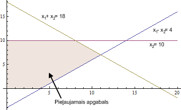
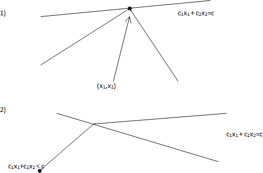

# 9. Lineārās programmēšanas ievads

Šajā nodaļā uzzinām, kāpēc vajadzīga lineāru izteiksmju maksimizēšana, ko parasti sauc par *lineāro programmēšanu*. Un arī, kāpēc lineārās optimizācijas uzdevumi pierakstāmi noteiktā formā.

**Mācīšanās rezultāti (learning outcomes):** 

* Pierakstīt optimizācijas uzdevumus kā lineāras programmas.
* Analizēt matricu (nulles summas) spēles. 
* Risināt lineārās programmēšanas uzdevumus ar simpleksa algoritmu.

## Standarti optimizācijas uzdevumi

**Optimizācijas uzdevumu veidi**

Optimizācijas uzdevumos maksimizējam (vai minimizējam) kādu izteiksmi (piemēram, peļņu vai izmaksas). Vai nu visā izteiksmes definīcijas apgabalā, vai arī pie dotiem nosacījumiem jeb ierobežojumiem.

* Optimizācija bez nosacījumiem: Minimizēt $f(x_1, x_2, \ldots, x_n)$. Ja $f$ ir lineāra funkcija, tad tā var pieņemt cik patīk lielas (vai mazas) vērtības.

* Optimizācija ar nosacījumiem: Minimizēt $f(x_1, x_2, \ldots, x_n)$ pie nosacījumiem

  $$
  \begin{array}{l}
  c_1(x_1, x_2, \ldots, x_n) \geq 0, \ldots, c_k(x_1, x_2, \ldots, x_n) \geq 0,\\
  d_1(x_1, x_2, \ldots, x_n) = 0, \ldots, d_{\ell}(x_1, x_2, \ldots, x_n) = 0.\\
  \end{array}
  $$

**Lineārā programmēšana:** Minimizēt $\displaystyle \sum\limits_{i=1}^{n} b_ix_i$ pie nosacījumiem

$$
\left\{ \begin{array}{l}
c_{11} x_1 + c_{12} x_2 + \ldots + c_{1n} x_n \leq d_1,\\
\ldots,\\
c_{m1} x_1 + c_{m2} x_2 + \ldots + c_{mn} x_n \leq d_m,
\end{array} \right.
$$

> *Piezīme:* Vārds "programmēšana" lietots nozīmē "plānošana". Dažus optimizācijas uzdevumu veidus sauc par programmēšanu jau kopš 1920.-tajiem gadiem.

**Kvadrātiskā programmēšana** (*Kursā netiek aplūkota, bet arī praktiski nozīmīga.*)

Minimizēt sekojošu izteiksmi:

$$
\sum\limits_{i,j=1}^{n} a_{ij}x_ix_j +  \sum\limits_{i=1}^{n} b_ix_i
$$

pie nosacījumiem

$$
\left\{
\begin{array}{l}
c_{11} x_1 + c_{12} x_2 + \ldots + c_{1n} x_n \leq d_1,\\
\ldots,\\
c_{m1} x_1 + c_{m2} x_2 + \ldots + c_{mn} x_n \leq d_m,
\end{array} \right.
$$

Šajā gadījumā minimizējamā funkcija ir kvadrātiska, bet nosacījumi ir lineāri.

**Veselo skaitļu programmēšana** jeb lineārā programmēšana veselos skaitļos (*Integer Programming*): uzdevums tāds pats kā lineārā programmēšanā, tikai klāt nāk nosacījums, ka visi $x_1, x_2, \ldots, x_n$ ir veseli skaitļi.

Ar lineārajām programmām veselos skaitļos var aprakstīt daudzus interesantus un praktiski svarīgus uzdevumus, bet nav zināms algoritms, kas ātri (polinomiālā laikā) atrisina patvaļīgu veselo skaitļu programmu.


## Lineāro programmu grafiskā interpretācija

**Vispārīgais LP uzdevums:** Lineārā programmēšana apraksta daudzas praktiskas problēmas, tai eksistē efektīvi algoritmi.

Vispārīgais LP uzdevums: Atrast $\textcolor{blue}{\max\left(c_1x_1 + \ldots + c_nx_n\right)}$, ja izpildās nosacījumi:

$$
\left\{
\begin{array}{l}
a_{11}x_1 + a_{12}x_2 + \ldots + a_{1n}x_n \leq b_1\\
\ldots\\
a_{m1}x_1 + a_{m2}x_2 + \ldots + a_{mn}x_n \leq b_m
\end{array} \right.
$$

**Divdimensiju piemērs:** Atrast $\textcolor{blue}{\max(2x_1 + 3x_2)}$, kur

$$
\left\{ \begin{array}{l}
x_1 - 2x_2 \leq 4,\\
x_1 + x_2 \leq 18,\\
x_2 \leq 10,\\
x_1,x_2 \geq 0.
\end{array} \right.
$$

> *Piezīme:* Katrs maksimizācijas uzdevums ekvivalents kādam minimizācijas uzdevumam (un otrādi). Piemēram: $\max(2x_1 + 3x_2) = -\min(-2x_1 - 3x_2).$ Turpmāk apskatīsim tikai maksimizācijas uzdevumus.

**Piemēra grafiskā interpretācija:** Atrast $\textcolor{blue}{\max(2x_1 + 3x_2)}$, kur

$$
\left\{ \begin{array}{l}
x_1 - 2x_2 \leq 4,\\
x_1 + x_2 \leq 18,\\
x_2 \leq 10,\\
x_1,x_2 \geq 0.
\end{array} \right.
$$



Attēlā viegli redzēt uzdevuma atrisinājumu -- tas ir punkts $(8,10)$. Lielākam dimensiju skaitam var būt grūti veidot šādu attēlu. Tipiskos LP uzdevumos *pieļaujamais apgabals* (*feasible region*) ir galīgs. Citādi var gadīties, ka maksimuma nemaz nav -- izteiksme var pieņemt patvaļīgi lielas vērtības. Pirms LP risināšanas mēdz pārbaudīt, vai pieļaujamais apgabals ir galīgs.

**Optimuma atrašanās:** Attēlos var pamanīt divus nozīmīgus faktus:

* **Fakts 1:** Mērķfunkcija savu maksimumu sasniedz pieļaujamā apgabala stūrī.
* **Fakts 2:** Ja kādā stūri $a_1x_1 + \ldots + a_nx_n$ nesasniedz maksimumu, tad vienā no blakus stūriem $a_1x_1 + \ldots + a_nx_n$ ir lielāka vērtība.

Divu dimensiju gadījumā, piemēram, par 2.faktu var pārliecināties, lietojot ģeometrisko interpretāciju un 
šķirojot gadījumus:

* **(a)** Ja visos kaimiņu stūros mērķa funkcijas vērtības ir mazākas, $c_1x_1 + c_2x_2 \leq c$, tad stūris ir maksimums.
* **(b)** Ja visos kaimiņu stūros mērķa funkcijas vērtības ir lielākas, $c_1x_1+c_2x_2 \geq c$, tad tad stūris ir minimums.
* **(c)** Citos gadījumos stūris nav ne maksimums, ne minimums, tad atrodas gan blakus stūris ar lielāku mērķa funkcijas vērtību $c_1x_1+c_2x_2$ vērtību, gan arī ar mazāku vērtību.



Arī lielākam dimensiju skaitam maksimums vai minimums noteikti atrodas kādā apgabala "stūrī", 
jo apgabals, kuru nosaka lineāru nevienādību sistēma, noteikti ir *slēgts* un *izliekts*.

**Definīcija:** (1) Ģeometrisku figūru sauc par slēgtu, ja līdz ar katru konverģējošu punktu virkni $(\mathbf{a}^{(n)})$ 
tā satur arī šīs virknes robežu $\mathbf{a}^{\ast}$ (citiem vārdiem - satur apgabalu kopā ar visu robežu).  
(2) Ģeometrisku figūru sauc par izliektu, ja līdz ar katriem diviem punktiem $\mathbf{a}$ un $\mathbf{b}$ tā 
satur arī visu nogriezni ar punktiem $\mathbf{x}(t) = (1-t)\mathbf{a} + t\mathbf{b}$, kur $t \in [0;1]$. 


## Lineāru programmu piemēri

### Diētas problēma

Doti ierobežojumi (cilvēka uztura vajadzības) un jāpieņem lēmums par produktu iepirkšanu.

* **Mērķis:** Samazināt izmaksas diētai, kas apmierina visas cilvēka uztura vajadzības.
* **Mainīgie:** Ar $x_1, x_2, \ldots, x_n$ apzīmējam dažādu pārtikas produktu daudzumus, ko iekļaut diētā.
* **Mērķa funkcija:** $\textcolor{blue}{\min\left( z = c_1x_1 + c_2x_2 + \ldots + c_nx_n \right)}$, kur $c_i$ ir izmaksas $i$-tajam pārtikas produktam par vienu vienību.
* **Ierobežojumi:** Sasniegt nepieciešamo uzturvielu daudzumu, piemēram, kalorijām, olbaltumvielām, vitamīniem.

  $$
  \begin{array}{ll}
  a_{11}x_1 + a_{12}x_2 + \ldots + a_{1n}x_n \geq d_1 & (\text{Uzturviela 1}) \\
  a_{21}x_1 + a_{22}x_2 + \ldots + a_{2n}x_n \geq d_2 & (\text{Uzturviela 2}) \\
  &\vdots \\
  a_{m1}x_1 + a_{m2}x_2 + \ldots + a_{mn}x_n \geq d_m & (\text{Uzturviela m}) \\
  x_i \geq 0 & (\text{Nevar apēst negatīvu daudzumu produkta})\\
  \end{array}
  $$

> *Piezīme:* Ja produktu daudzumi ir mērāmi veselos skaitļos (piemēram, veselā skaitā iepakojumu), tad iegūstam lineāro programmēšanu veselos skaitļos. Ja dažiem mainīgajiem jābūt veseliem, bet citi drīkst būt patvaļīgi reāli skaitļi, tad tā ir jauktā veselo skaitļu programmēšana (*mixed integer programming*).

**Leonīds Kantorovičs (Leonid Kantorovich, 1912-1986):** Optimāla izejvielu izmantošana finiera rūpniecībā (1939.g.). Agrīni optimizācijas uzdevumi mēdz būt saistīti ar ražošanas plānošanu.


### Maksimālā plūsma orientētā grafā

Plūsmu maksimizācijas uzdevumi ir lineārās programmēšanas uzdevumu atsevišķs gadījums, 
tiem ir specializēti algoritmi (Forda-Falkersona vai Edmonda-Karpa algoritmi). 
Bet tos var efektīvi risināt arī ar lineārās programmēšanas līdzekļiem un 
izmantot lineārās programmēšanas (tsk. duālās problēmas) teorijas ilustrēšanai.


**Maksimālās plūsmas uzdevuma jēdzieni:**

* Dots neorientēts plūsmas grafs $N = (V, E)$, kurā $s, t \in V$, ko sauc attiecīgi par *ieteku* (*source*) un *izteku* (*sink*).
* Uz grafa šķautnēm $(u,v)$ var definēt dažādas funkcijas, ko apzīmē ar $g(u,v)$ vai $g_{uv}$.

**Definīcija:**  Par šķautnes ietilpību (*capacity*) sauc maksimālo plūsmu, ko var piešķirt attiecīgajai 
šķautnei. Ietilpību atzīmē ar $c: E \to \mathbb{R}^+$.

**Definīcija:** Par *plūsmu* (*flow*) sauc funkciju $f : E \to \mathbb{R}$, kas apmierina šādus nosacījumus:

* Plūsma ne uz vienas šķautnes nevar pārsniegt tās kapacitāti. Citiem vārdiem, $f_{uv} \leq c_{uv}$ visiem $(u, v) \in E$.
* Plūsmu summa, kas ienāk virsotnē, ir vienāda ar plūsmu summu, kas iziet no virsotnes, izņemot ieteku un izteku. Citiem vārdiem:

  $$
  \forall v \in V \quad \left( v \not\in \{s, t\} \quad \Rightarrow \quad
  \sum_{u:(u, v) \in E, f_{uv}>0} f_{uv} = \sum_{u:(v, u) \in E, f_{vu}>0} f_{vu}. \right)
  $$

> *Piezīme:* Plūsmas ir asimetriskas: $f_{uv} = -f_{vu}$ visiem $(u, v) \in E$.

**Definīcija:** Plūsmas vērtība ir plūsmas daudzums, kas pārvietojas no ietekas uz izteku. Plūsmas $f : E \to \mathbb{R}^+$ gadījumā to aprēķina šādi:

$$
|f| = \sum_{v:\ (s,v) \in E} f_{sv} = \sum_{u:\ (u,t) \in E} f_{ut}.
$$

**Definīcija:** Maksimālās plūsmas problēma nozīmē atrast plūsmas funkciju (plūsmu uz katras grafa šķautnes), kas maksimāli daudz plūsmu novada no ietekas uz izteku. Citiem vārdiem, atrod $f_\textrm{max}$ ar maksimālo vērtību.

> *Piezīme:* Maksimālās plūsmas uzdevumus var vispārināt arī orientētiem grafiem. Šajā gadījumā starp katrām divām virsotnēm $u,v \in V$ var būt šķautnes abos virzienos $(u,v)$ un $(v,u)$ ar atšķirīgām kapacitātēm. Plūsmas var piešķirt katrai šķautnei atsevišķi -- un šīs plūsmas orientētos grafos nemēdz būt negatīvas. (Ja eksistē nenulles plūsma no $u$ uz $v$, tad plūsma pretējā virzienā ir $0$. Ja šis noteikums neizpildās, tad abas nenulles plūsmas pretējos virzienos var noīsināt, lai tas izpildītos.)


### Viena avota īsāko ceļu uzdevums

Katrai virsotnei $v$ piesaista mainīgo $x_{v}$, kas atbilst 
attālumam no sākuma virsotnes $s$.

**Mērķfunkcija:**
Maksimizēt $x_{t}$ (potenciālu beigu virsotnē $t$) vai arī 
visu mainīgo summu (dotajai sākuma virsotnei $s$): $\sum_{v} x_{v}$
**Ierobežojumi:**

* Sākuma virsotnē $x_s = 0$
* Katrai šķautnei $(u,v)$: $x_{v}-x_{u} \leq w_{u,v}$. 


### Resursu piešķiršanas problēma

Populārs tuvinājums ekonomikā pazīstamai problēmai (*Resource allocation problem*). Spēja to efektīvi risināt var atbildēt uz filozofisku jautājumu -- vai ir nepieciešams tirgus?

* **Mērķis:** Maksimizēt peļņu, nosakot optimālos ražošanas apjomus dažādiem produktiem, ievērojot pastāvošos ierobežojumus.
* **Mainīgie:** $x_1, x_2, \ldots, x_n$ ir produktu ražošanas apjomi.
* **Mērķa funkcija:** $\textcolor{blue}{\max \left( z = c_1x_1 + c_2x_2 + \ldots + c_nx_n \right)}$, kur $c_i$ ir peļņa, saražojot vienu vienību ar $i$-to produktu.
* **Ierobežojumi:** Resursu pieejamības ierobežojumi -- darbs, izejvielas, kapitāls.

  $$
  \begin{array}{ll}
  a_{11}x_1 + a_{12}x_2 + \ldots + a_{1n}x_n \leq b_1 & (\text{Resurss 1}) \\
  a_{21}x_1 + a_{22}x_2 + \ldots + a_{2n}x_n \leq b_2 & (\text{Resurss 2}) \\
  &\vdots \\
  a_{m1}x_1 + a_{m2}x_2 + \ldots + a_{mn}x_n \leq b_m & (\text{Resurss m}) \\
  x_i \geq 0 & (\text{Nevar ražot negatīvus daudzumus})\\
  \end{array}
  $$

**Skaitlisks piemērs:**

* Kāpostu sēklu pietiek 3 hektāru apsēšanai.
* Burkānu sēklu pietiek 4 hektāru apsēšanai.
* Ir pieejami 5 brīvi hektāri.
* Peļņa ir 1200 EUR par kāpostu hektāru un 1700 EUR par burkānu hektāru. Uzdevums ir maksimizēt peļņu.

**Formalizēts uzdevums:** $\textcolor{blue}{\max \left( 1200x_k + 1700x_b \right)}$, kur

$$
\left\{ \begin{array}{l}
x_k \leq 3,\\
x_b \leq 4\\
x_k + x_b \leq 5,\\
x_k,x_b \geq 0.
\end{array} \right.
$$

1. Uzzīmēt pieļaujamo apgabalu (*feasible region*); kāpostus zīmēt uz horizontālās taisnes, burkānus uz vertikālās taisnes.
2. Atrast un atzīmēt pieļaujamā apgabala stūrus -- tos 2D plaknes punktus, kuros vismaz 2 no dotajām nevienādībām pārvēršas par vienādībām.
3. Uzzīmēt plaknē peļņas gradienta vektoru $(1200, 1700)$.
4. Atrast vistālāko stūri pieļaujamajā apgabalā, uz kuru var aizbraukt ar šo gradienta vektoru.

**Definīcija:** Skalārs lauks (*scalar field*) ir reālvērtīga funkcija, kas definēta katrā telpas punktā. Piemēram, divu dimensiju gadījumā katram $(x_1,x_2)$ atbilst vērtība $f(x_1,x_2)$. Piemēram, katrai kāpostu un burkānu apsētajai vērtībai var izrēķināt peļņu: $f(x_k,x_b) = 1200x_k + 1700 x_b$.

> *Piezīme:* Skalāriem laukiem nav sakara ar galīgiem laukiem (algebrisko struktūru, kas parādījās Rīda-Solomona kodos).

**Definīcija:** Par *gradientu* skalāram laukam $f$ sauc vektoru $\nabla f(x_1, x_2)$, kas definēts katram $(x_1,x_2) \in \mathbb{R}^2$. To definē šādi:

$$
\nabla f(x_1, x_2) = \left( \frac{\partial f}{\partial x_1}(x_1, x_2), \frac{\partial f}{\partial x_2}(x_1, x_2) \right)
$$

Mūsu piemērā peļņas funkcijas parciālie atvasinājumi ir attiecīgi $1200$ un $1700$ (konstantas vērtības). Tātad peļņas funkcija vienmērīgi aug gradienta vektora norādītajā virzienā.

### Duālais uzdevums

Iedomāsimies, ka vēlamies pierādīt, ka $(x_k,x_b) = (1,4)$ ir optimālais kāpostu-burkānu lineārās programmas atrisinājums.

Apskatām sistēmu:

$$
\left\{ \begin{array}{l}
x_k \leq 3,\\
x_b \leq 4\\
x_k + k_b \leq 5,\\
x_k,x_b \geq 0.
\end{array} \right.
$$

Tajā pirmo nevienādību var pareizināt ar kaut kādu skaitli, piemēram, $y_1 = 1200$ un otro nevienādību ar skaitli $y_2 = 1700$, un trešo nevienādību ar $0$ un tad var iegūt, ka

$$
\left\{ \begin{array}{l}
1200x_k \leq 3600,\\
1700x_b \leq 6800\\
\end{array} \right.
$$

Saskaitot abas nevienādības, iegūstam, ka $1200x_k + 1700x_b \leq 10400$.

Bet var arī dabūt citus novērtējumus. Teiksim, pirmo nevienādību reizina ar $y_1 = 200$; 
otro ar $y_2 = 700$ un trešo ar $y_3 = 1000$. Var dabūt jau labāku novērtējumu.


## Divu spēlētāju matricu spēles

Divi spēlētāji $X$ un $Y$ vienlaikus izvēlas vienu no galīga skaita gājienu. Piemēram, spēlētājs $X$ izvēlas rindu $x_i$ un spēlētājs $Y$ izvēlas kolonnu $y_j$.

Matricas $A = (a_{ij})$ elements $a_{ij}$ parāda, cik spēlētājs $X$ maksā spēlētājam $Y$. Spēlētājs $X$ vēlas šo samaksu minimizēt, bet spēlētājs $Y$ vēlas to maksimizēt.

> *Piezīme:* Šīs ir nulles summas spēles (atšķiras no cietumnieku dilemmas); viss, ko samaksā spēlētājs $X$ nonāk pie spēlētāja $Y$. (Ja $Y$ zaudē un maksā spēlētājam $X$, tad matricā $A$ raksta negatīvus skaitļus.)

**Piemērs:** Aplūkojam $2 \times 2$ matricu:

$$
A = \left( \begin{array}{cc}
1 & 2 \\
4 & 8 \\
\end{array} \right)
$$

Šajā matricā spēlētājs $Y$ vienmēr izvēlēsies otro kolonnu $y_2$, jo $2 > 1$ un $8 > 4$. Pie jebkura $X$ gājiena (jeb rindas) ir labāk izvēlēties otro kolonnu.

Savukārt spēlētājs $X$ vienmēr izvēlēsies pirmo rindu $x_1$, jo skaitlis $a_{12} = 2$ ir mazāks nekā $a_{22} = 8$ un spēlētājs $X$ vēlas minimizēt to, kas jāmaksā otram spēlētājam.

> *Piezīme:* Skaitli $a_{12}$, kas ir mazākais par jebko citu savā kolonnā, bet lielāks par jebko citu savā rindiņā, saucas *sedlu punkts*. Ja spēlei eksistē sedlu punkts, tad abu spēlētāju optimālās stratēģijas ir deterministiskas (*pure strategies*).

**Piemērs:** Aplūkojam spēli, kurā abi spēlētāji $X,Y$ izvēlas vienu no trim gājieniem: "akmens" (R), "papīrs" (P), "šķēres" (S). Maksājumu matrica ir sekojoša:

$$
A = \left( \begin{array}{ccc}
0 & 1 & -1 \\
-1 & 0 & 1 \\
1 & -1 & 0 \\
\end{array} \right)
$$

> *Piezīme:* Šādai spēles matricai neeksistē sedlu punkts, tāpēc stratēģija nevienam spēlētājam nevar stabilizēties uz kādu vienu gājienu. Ja otrs spēlētājs zinās otra spēlētāja stratēģiju (viņa deterministisko nākamo gājienu), tad otram spēlētājam ir optimāli izvēlēties savu gājienu atkarībā no tā. Šādās situācijās arī eksistē optimāla stratēģija, bet tā ir *jaukta stratēģija* (*mixed strategy*) -- tā izvēlas gājienus ar noteiktām varbūtībām.

### Jauktās stratēģijas

Jauktās stratēģijas apraksta *stohastiski vektori*. Ja spēlētājam $X$ ir $n$ iespējami gājieni, bet spēlētājam $Y$ ir $m$ iespējami gājieni, tad tos var

$$
\mathbf{x} = \left(
  \begin{array}{c}
  x_1\\
  x_2\\
  \ldots\\
  x_n
  \end{array} \right),\;\;\;
\mathbf{y} = \left(
  \begin{array}{c}
  y_1\\
  y_2\\
  \ldots\\
  y_m
  \end{array} \right).
$$

Stohastiskie vektori apmierina sakarības: $x_1 + x_2 + \ldots + x_n = 1$, $y_1 + \ldots + y_m = 1$ un visi $x_i$ un $y_j$ ir nenegatīvi.

Spēles rezultātu apraksta vektoru/matricu reizinājums $\mathbf{x}^T A \mathbf{y}$.

**Piemērs:** Akmens, papīra, šķēru spēlē var izvēlēties spēlētājam $X$ jauktu stratēģiju $\mathbf{x}^T = (1/2, 0, 1/2)$ un spēlētājam $Y$ jauktu stratēģiju $\mathbf{y}^T = (1/2, 1/3, 1/6)$. Tad atkārtoti spēlējot, vidējā vērtība, ko iegūst spēlētājs $Y$ ir šāda:

$$
\mathbf{x}^T A \mathbf{y} =
\left( \begin{array}{ccc}
\frac{1}{2} & 0 & \frac{1}{2} \end{array} \right) \cdot
\left( \begin{array}{ccc}
0 & 1 & -1 \\
-1 & 0 & 1 \\
1 & -1 & 0 \\
\end{array} \right) \cdot
\left(
\begin{array}{c}
\frac{1}{2}\\
\frac{1}{3}\\
\frac{1}{6}
\end{array} \right) =
\left( \begin{array}{ccc}
\frac{1}{2} & 0 & -\frac{1}{2} \end{array} \right) \cdot
\left(
\begin{array}{c}
\frac{1}{2}\\
\frac{1}{3}\\
\frac{1}{6}
\end{array} \right) = \frac{1}{4} - \frac{1}{12} = \frac{1}{6}.
$$

Esam ieguvuši, ka spēlētājs $X$ katrā gājienā zaudē vidēji $\frac{1}{6}$, lai gan spēles matrica ir simetriska ($a_{ij} = -a_{ji}$), t.i. spēle pret abiem spēlētājiem ir ar vienādiem noteikumiem (vajadzētu varēt panākt vērtību $0$). Tāpēc jauktā stratēģija $\mathbf{x}$ nav optimāla.

**Definīcija:** Par matricu spēles *vērtību* sauc mazāko zaudējumu, ko var sev garantēt spēlētājs $X$, izvēloties optimālo no visām stohastiskajām stratēģijām:

$$
v(A) = \min_{\text{visiem}\;\mathbf{x}} \left(
\max_{\text{visiem}\;\mathbf{y}} \mathbf{x}^T A \mathbf{y}
\right).
$$

Pagaidām uzdevums neizskatās pēc lineāras programmas -- izteiksmē, kura jāminimizē ietilpst nezināms vektors $\mathbf{y}$, kas apraksta otra spēlētāja jaukto stratēģiju, ko mēs nevaram kontrolēt.

Var izmantot sekojošu triku: Fiksējam savu stratēģiju $\mathbf{x}$. Ja pretinieks $Y$ šo $\mathbf{x}$ jau zina, tad viņam eksistē optimāla atbildes stratēģija $\mathbf{y}$, kas ir deterministiska -- tā vienkārši izvēlas reizinājumā $\mathbf{x}^T \cdot A$ lielāko koordināti un liek tur vērtību $1$.

**Piemērs:** Ja akmens-papīra-šķēru spēlē Spēlētājs $X$ izvēlas jauktu stratēģiju $\mathbf{x}^T = (0.7, 0.2, 0.1)$ (t.i. $X$ apsola izvēlēties "akmeni" ar $70\%$ varbūtību, "papīru" ar $20\%$ varbūtību, bet "šķēres" ar $10\%$ varbūtību), tad spēlētājam $Y$ ir optimāli atbildēt ar stratēģiju $\mathbf{y}^T = (0, 1, 0)$ jeb $100\%$ gadījumos izvēlēties "papīru".

### Optimālā stratēģija ar lineāru programmu

<!-- https://www.matem.unam.mx/~omar/math340/matrix-games.html -->

Matricu spēles ir risināmas ar lineārās programmēšanas līdzekļiem -- sk. *Matrix Games* [[Cam16]](#Cam16). Tā kā spēlētājs $X$ zina, ka otrs spēlētājs (iespējams, pēc ilgākiem novērojumiem) uzzinās viņa jaukto stratēģiju un izvēlēsies optimālo atbildi $y_j$ (maksimālo elementu no matricu reizinājuma $\mathbf{x}^T A$), tad spēlētājs $X$ "minimizē maksimumu" jeb atrod savu gājienu varbūtības $x_1, \ldots, x_n$, izmantojot lineāru programmu:

$$
\textcolor{blue}{\min(z)},\;\text{kur}
\left\{ \begin{array}{l}
(z, z, \ldots, z) \geq \mathbf{x}^T A, \\
x_1 + x_2 + \ldots + x_n  = 1,\\
x_1, x_2, \ldots, x_n \geq 0.
\end{array} \right.
$$

Otrs spēlētājs $Y$ zina, ka pirmais spēlētājs $X$ izvēlēsies optimālo (minimālo) atbildi $x_i$ uz katru viņa jaukto stratēģiju $\mathbf{y}$, tad arī spēlētājs $Y$ var atrast savu gājienu varbūtības $y_1,\ldots, y_m$, izmantojot lineāru programmu:

$$
\textcolor{blue}{\max(w)},\;\text{kur}
\left\{ \begin{array}{l}
(w, w, \ldots, w) \leq A \mathbf{y}, \\
y_1 + y_2 + \ldots + y_m  = 1,\\
y_1, y_2, \ldots, y_m \geq 0.
\end{array} \right.
$$

Spēles vērtība (ko pie abu spēlētāju optimālām stratēģijām spēlētājs $X$ maksā spēlētājam $Y$) ir viena un tā pati abos gadījumos.

**Teorēma (Minimaksa teorēma):** Katrai matricai $A$ *spēles vērtību* var izteikt divos līdzvērtīgos veidos:

$$
v(A) = \min_{\text{visiem}\;\mathbf{x}} \left(
\max_{\text{visiem}\;\mathbf{y}} \mathbf{x}^T A \mathbf{y}
\right) =
\max_{\text{visiem}\;\mathbf{y}} \left(
\min_{\text{visiem}\;\mathbf{x}} \mathbf{x}^T A \mathbf{y}
\right).
$$

**Secinājums:** Ja esam uzminējuši kaut kādas stratēģijas $\mathbf{x}^{\ast}$ un $\mathbf{y}^{\ast}$ attiecīgi spēlētājiem $X$ un $Y$, tad tās abas ir optimālas tad un tikai tad, ja izpildās vienādība:

$$
\min ((\mathbf{x}^{\ast})^T A) = \max (A \mathbf{y}).
$$

Stohastiskie vektori apraksta slēgtu ierobežotu kopu (tādas kopas sauc par kompaktām).

Veierštrāsa teorēma par ekstremālo vērtību kompaktā kopā nozīmē to, ka abām lineārajām programmām eksistē atrisinājumi un tātad katrai matricu spēlei eksistē optimālā jauktā stratēģija katram no spēlētājiem. Sk. [https://en.wikipedia.org/wiki/Extreme_value_theorem](https://en.wikipedia.org/wiki/Extreme_value_theorem).

### Skaitlisks spēles piemērs

<!-- https://youtu.be/feb9j65Iz4w?si=tGIUByy4Hc5fwr_b -->

Aplūkosim spēli ar sekojošu matricu (sk. [[Str18]](#Str18)):

$$
A = \left( \begin{array}{cc}
1 & 8 \\
4 & 2 \\
\end{array} \right).
$$

Kā parasti, spēlētājs $X$ izvēlas rindiņu šajā matricā, bet spēlētājs $Y$ izvēlas kolonnu. Izveidojam lineāras programmas, lietojot Python bibliotēku `pulp`. Primārā problēma (spēlētāja $X$ jauktā stratēģija):

```python
from pulp import *

model = LpProblem(sense=LpMinimize)

x1 = LpVariable(name="x1", lowBound=0)
x2 = LpVariable(name="x2", lowBound=0)
z = LpVariable(name="z")

model += z - 1*x1 - 4*x2 >= 0
model += z - 8*x1 - 2*x2 >= 0
model += x1 + x2 == 1 
model += z  # Mērķa funkcija

status = model.solve(PULP_CBC_CMD(msg=False))
print(f"(x1,x2) = {x1.value(), x2.value()}")
print(f"Value of the game = {model.objective.value()}")
```

Stratēģija ir $(\mathbf{x}^{\ast})^T = (x_1,x_2) = (2/9, 7/9)$ un spēles vērtība $z = 3\frac{1}{3}$.

Duālā problēma (spēlētāja $Y$ jauktā stratēģija):

```python
from pulp import *

model = LpProblem(sense=LpMaximize)

y1 = LpVariable(name="y1", lowBound=0)
y2 = LpVariable(name="y2", lowBound=0)
w = LpVariable(name="w")

model += 1*y1 + 8*y2 - w >= 0
model += 4*y1 + 2*y2 - w >= 0
model += y1 + y2 == 1 
model += w  # Mērķa funkcija

status = model.solve(PULP_CBC_CMD(msg=False))
print(f"(y1,y2) = {y1.value(), y2.value()}")
print(f"Value of the game = {model.objective.value()}")
```

Stratēģija ir $(\mathbf{y}^{\ast})^T = (y_1,y_2) = (2/3, 1/3)$ un spēles vērtība $w = 3\frac{1}{3}$.

Pēc minimaksa teorēmas abām spēles vērtībām $z$ un $w$ ir jāsakrīt.

Optimālās stratēģijas var piereizināt ar matricu $A$ (vienu no kreisās puses, otru -- no labās puses):

$$
(\mathbf{x}^{\ast})^T A = (2/9, 7/9) \cdot \left( \begin{array}{cc}
1 & 8 \\
4 & 2 \\
\end{array} \right) =
\left( \frac{2}{9} \cdot 1 + \frac{7}{9} \cdot 4, \frac{2}{9} \cdot 8  + \frac{7}{9} \cdot 2 \right) =
\left( \frac{30}{9}, \frac{30}{9} \right) =  \left( 3\frac{1}{3}, 3\frac{1}{3} \right).
$$

$$
A \cdot \mathbf{y} = \left( \begin{array}{cc}
1 & 8 \\
4 & 2 \\
\end{array} \right) \cdot \left( \begin{array}{c}
2/3\\
1/3\\
\end{array} \right) = \left( \begin{array}{c}
10/3\\
10/3\\
\end{array} \right) = \left( \begin{array}{c}
3\frac{1}{3}\\
3\frac{1}{3}\\
\end{array} \right).
$$

Abos gadījumos iegūstam vektorus ar vairākām identiskām vērtībām $3\frac{1}{3}$. Šī sakarība izpildās jauktām stratēģijām; to var izmantot optimālo vērtību atrašanai. To, ka visām derīgajām izvēlēm atbildīs vienādas varbūtības spēļu teorijā sauc par *vienaldzības principu* (*Indifference Principle*).


### Spēles ar nenulles summu

Lineārā programmēšana ir mazāk noderīga, lai analizētu spēles, kurās 
abu spēlētāju ieguvumi summā nedod $0$ (piemēram, abi reizē var uzvarēt vai 
abi reizē - zaudēt). 

**Piemērs: Cietumnieku dilemma:** 

|     | B: sadarbojas | B: nodod | 
| --- | --- | --- |
| A: sadarbojas | $(3,3)$ | $(0,5)$ |
| A: nodod | $(5,0)$ | $(1,1)$ |

Ja ir runa par cietumsodiem, var ieviest arī negatīvu vērtību (*payoff*), piemēram, atņemt visiem 
skaitļiem šajā matricā $5$. 

Lineāru programmu no viena spēlētāja viedokļa (piemārm $A$) var uzrakstīt, 
lai tā norādītu uz "maksiminu" (maksimālo garantēto ieguvumu, kurš ir iegūstams pieņemot, 
ka otrais spēlētājs var rīkoties tā, lai mums būtu visneizdevīgāk). 

Vai maksimins 


**Piemērs: Matrica, kur maksimins nav Neša līdzsvars** 

|     | B: pa kreisi | B: pa labi |
| --- | --- | --- |
| A: augšā | $(3,2)$ | $(0,1)$ | 
| A: apakšā | $(1,2)$ | $(1,1)$ |

Maksimina stratēģija spēlētājam $A$ ir izvēlēties apakšējo rindu
(lai nerastos vērtība $0$, ja $B$ spēlē "pa labi"). 
Toties Neša līdzsvars ir augšā pa kreisi. 


## Simpleksa algoritms

Simpleksalgoritma pamatideja:

1. Sāk ar $v$ -- patvaļīgu stūri pieļaujamajā apgabalā.
2. Kamēr stūrim $v$ blakus atrodas stūris $u$, kurā $c_{11}x_1+\ldots+c_nx_n$ 
   vērtība ir lielāka, aizstāj $v$ ar $u$.

Atkārto otro soli tik ilgi, kamēr nevar atrast blakus stūri, kurā mērķa funkcijai ir 
lielāka vērtība. Ja tāda blakus stūra nav, tad mērķa funkcija jau sasniegusi maksimālo 
vērtību visā pieļaujamajā apgabalā.


### Uzdevuma pārveidojums standartformā

Par uzdevuma standartformu sauc uzdevumu tādā formā, ka nosacījumi ir nevienādības formā $x_i \geq 0$ vai arī vienādības.
Piemēram, lai nosacījumu $x_1 - 2x_2 \leq 4$ pārvērstu standartformā, ievieš papildus mainīgo 
(*slack variable*) $x_3 \geq 0$. Tātad:

$$
\begin{array}{l}
x_1-2x_2 \leq 4\;\; \Leftrightarrow \\
x_1-2x_2+x_3=4,\;x_3 \geq 0\\
\end{array}
$$

Tādā veidā var iegūt ekvivalentu uzdevumu, kurā vienīgās nevienādības ir formā $x_i \geq 0$.

Jo vairāk nevienādību, jo vairāk papildus mainīgo:

**Piemērs:** $\textcolor{blue}{\max \left( 2x_1 + 3x_2 \right)}$, kur

$$
\left\{ \begin{array}{l}
x_1-2x_2 \leq 4,\\
x_1+x_2 \leq 18,\\
x_2 \leq 10,\\
x_1,x_2 \geq 0.
\end{array} \right.
$$

Pārveidojam: $\textcolor{blue}{\max \left( 2x_1 + 3x_2 \right)}$, kur

$$
\left\{ \begin{array}{l}
x_1-2x_2+x_3=4,\\
x_1+x_2+x_4=18,\\
x_2+x_5=10,\\
x_1,x_2,x_3,x_4,x_5 \geq 0.
\end{array} \right.
$$

### Nosacījumiem atbilstošais apgabals


Stūris -- punkts, kur krustojas $2$ taisnes, kas atbilst nosacījumam - ir punkts, kurā divi no mainīgajiem $x_1,\ldots,x_n$ vienādi ar $0$.

Attēls ar stūriem:


Plaknes gadījumā stūri var aprakstīt, pasakot kuri divi mainīgie ir vienādi ar $0$. Vairāku dimensiju gadījumā ir līdzīgi. Trīs dimensiju gadījumā stūris ir punkts, kurā $3$ mainīgie ir $0$.

Ja ir $k$ dimensijas (meklē $\textcolor{blue}{\max \left(a_1x_1 + \ldots + a_kx_k\right)}$), tad stūris ir punkts, kurā sastopas $k$ plaknes $n$-dimensiju telpā, t.i. $k$ mainīgie ir vienādi ar $0$.

### Simpleksalgoritma tabula

Simpleksalgoritma parādīšanai turpinām agrāko piemēru:

$$
\textcolor{blue}{\max \left( 2x_1+3x_2 \right)}
$$

$$
\left\{ \begin{array}{l}
x_1-2x_2+x_3=4\\
x_1+x_2+x_4=18\\
x_2+x_5=10\\
x_1,x_2,x_3,x_4,x_5 \geq 0
\end{array} \right.
$$

Simpleksalgoritma soļus ērti pierakstīt ar tabulas palīdzību. Sākotnējo tabulu sastāda tabulas rindiņās ierakstot uzdevuma ierobežojumus. Tabulas pēdējā rindiņa raksta funkciju, kuru maksimizēt.

<table>
<thead>
<tr><th style="background-color:#e6e6e6;">$x_1$</th><th style="background-color:#e6e6e6;">$x_2$</th><th>$x_3$</th><th>$x_4$</th><th>$x_5$</th><th>$b_i$</th><th>Atbilstošā izteiksme</th></tr>
</thead>
<tbody>
<tr><td style="background-color:#e6e6e6;">$1$</td><td style="background-color:#e6e6e6;">$-2$</td><td>$1$</td><td>$0$</td><td>$0$</td><td>$4$</td><td>$x_1 - 2x_2 + x_3 = 4$</td></tr>
<tr><td style="background-color:#e6e6e6;">$1$</td><td style="background-color:#e6e6e6;">$1$</td><td>$0$</td><td>$1$</td><td>$0$</td><td>$18$</td><td>$x_1 + x_2 + x_4 = 18$</td></tr>
<tr><td style="background-color:#e6e6e6;">$0$</td><td style="background-color:#e6e6e6;">$1$</td><td>$0$</td><td>$0$</td><td>$1$</td><td>$10$</td><td>$x_2 + x_5 = 10$</td></tr>
<tr><td style="background-color:#e6e6e6;"><b>2</b></td><td style="background-color:#e6e6e6;"><b>3</b></td><td><b>0</b></td><td><b>0</b></td><td><b>0</b></td><td><b>0</b></td><td>$\max\left(2x_1+3x_2\right)$</td></tr>
</tbody>
</table>

* Šīs tabulas pēdējā rindiņa atbilst vērtībām $x_1 = 0$, $x_2 = 0$. Tos abus sauc par *brīvajiem mainīgajiem* (*non-basic variables*, *tight variables*).
* Visi citi $x_3,x_4,x_5 \neq 0$ ir *pamatmainīgie* (*basic variables*, *loose variables*).

> *Piezīme:* Tā kā par pirmo tuvinājumu izvēlējāmies $(x_1, x_2) = (0,0)$, tad sagadījās tā, ka brīvie mainīgie ir $x_1, x_2$, kuri bija doti sākumā, bet pamatmainīgie ir no jauna ieviestie (*slack*) mainīgie $x_3,x_4,x_5$. Bet turpmāk brīvie/pamata mainīgie visu laiku mainīsies vietām -- tie allaž atkarīgi no tuvinājuma punkta.

### Pirmais simpleksalgoritma solis

Esam stūrī, kuru apraksta iepriekšējā tabula. Pārbauda, vai blakus stūrī vērtība nav lielāka

1. Atrod brīvo mainīgo, kuru palielinot mērķfunkcija pieaug visstraujāk. (Ir arī citi simpleksalgoritma varianti, kuri izvēlas kādu citu brīvo mainīgo, pie kura ir pozitīvs koeficients mērķfunkcijai -- ne vienmēr lielākais koeficients būs optimāls.)
2. Palielina šo mainīgo. Tas bija $0$, tagad pozitīvs, vienlaikus mainot pamatmainīgos tā, lai visi nosacījumi paliktu patiesi.
3. Tur, kur kāds no pamatmainīgajiem kļūst $0$, apstājas.

Izteiksmē $\max \left( 2x_1+3x_2 \right)$ lielākais pozitīvais koeficients ir pie $x_2$; var palielināt to. (Kaut arī varētu arī palielināt $x_1$.)

Ja $x_2$ pieaug par $d$: $x_1-2x_2+x_3$ samazinās par $2d$. Pēc nosacījumiem izteiksmei jābūt vienādai ar $4$. Lai to panāktu $x_3$ palielina par $2d$. $x_1+x_2+x_4$ pieaug par $d$. Lai saglabātu vienādību, $x_4$ samazina par $d$; $x_2+x_5$ pieaug par $d$. Jāsamazina $x_5$ par $d$.

Par cik var palielināt $x_2$, nepadarot citu mainīgo negatīvu? $x_3=4$, $x_4=18$, $x_5=10$.

Palielinot $x_2$ par $d$: $x_3= 4 + 2d$; $x_4=18 - d$; $x_5=10 - d$. Ja $d = 10$, tad $x_5 = 0$. Ja $d > 10$, $x_5 < 0$. Tātad maksimālais palielinājums ir $10$.

Tādā gadījumā mēs būsim pārgājuši no stūra, kurā $x_1 = x_2 = 0$ uz stūri, kurā $x_1 = x_5 = 0$. Tāpēc jāmaina vietām kolonna $x_2$ un kolonna $x_5$:

<table>
<thead>
<tr><th style="background-color:#e6e6e6;">$x_1$</th><th style="background-color:#e6e6e6;">$x_5$</th><th>$x_3$</th><th>$x_4$</th><th>$x_2$</th><th>$b_i$</th><th>Atbilstošā izteiksme</th></tr>
</thead>
<tbody>
<tr><td style="background-color:#e6e6e6;">$1$</td><td style="background-color:#e6e6e6;">$0$</td><td>$1$</td><td>$0$</td><td style="background-color:#b3ccff;">$-2$</td><td>$4$</td><td>$x_1 - 2x_2 + x_3 = 4$</td></tr>
<tr><td style="background-color:#e6e6e6;">$1$</td><td style="background-color:#e6e6e6;">$0$</td><td>$0$</td><td>$1$</td><td style="background-color:#b3ccff;">$1$</td><td>$18$</td><td>$x_1 + x_2 + x_4 = 18$</td></tr>
<tr><td style="background-color:#e6e6e6;">$0$</td><td style="background-color:#e6e6e6;">$1$</td><td>$0$</td><td>$0$</td><td>$1$</td><td>$10$</td><td>$x_2 + x_5 = 10$</td></tr>
<tr><td style="background-color:#e6e6e6;"><b>2</b></td><td style="background-color:#e6e6e6;"><b>0</b></td><td><b>0</b></td><td><b>0</b></td><td><b>3</b></td><td><b>0</b></td><td>$\max\left(2x_1+3x_2\right)$</td></tr>
</tbody>
</table>

Pēc kolonnu apmainīšanas, tabula jāpārveido par ekvivalentu tabulu standartformā (standartformas tabulā pamatmainīgajiem atbilstošie vienādojumi veido vienības matricu, apakšējā rindā ir visas nulles).

1. Pareizina 3.rindu ar $2$, pieskaita 1.rindai: $(x_1+x_3-2x_2)+2(x_5+x_2)=4 + 2 \cdot 10$
2. Atņem 3.rindu no 2.rindas

<table>
<thead>
<tr><th style="background-color:#e6e6e6;">$x_1$</th><th style="background-color:#e6e6e6;">$x_5$</th><th>$x_3$</th><th>$x_4$</th><th>$x_2$</th><th>$b_i$</th><th>Atbilstošā izteiksme</th></tr>
</thead>
<tbody>
<tr><td style="background-color:#e6e6e6;">$1$</td><td style="background-color:#e6e6e6;">$2$</td><td>$1$</td><td>$0$</td><td>$0$</td><td>$24$</td><td>$x_1 + 2x_5 + x_3 = 24$</td></tr>
<tr><td style="background-color:#e6e6e6;">$1$</td><td style="background-color:#e6e6e6;">$-1$</td><td>$0$</td><td>$1$</td><td>$0$</td><td>$8$</td><td>$x_1 - x_5 + x_4 = 8$</td></tr>
<tr><td style="background-color:#e6e6e6;">$0$</td><td style="background-color:#e6e6e6;">$1$</td><td>$0$</td><td>$0$</td><td>$1$</td><td>$10$</td><td>$x_2 + x_5 = 10$</td></tr>
<tr><td style="background-color:#e6e6e6;"><b>2</b></td><td style="background-color:#e6e6e6;"><b>0</b></td><td><b>0</b></td><td><b>0</b></td><td style="background-color:#b3ccff;"><b>3</b></td><td><b>0</b></td><td>$\max\left(2x_1+3x_2\right)$</td></tr>
</tbody>
</table>

Visbeidzot, atbrīvojamies no nenulles koeficienta pēdējā rindā: No apakšējās rindas atņem trīskāršotu 3.rindu:

<table>
<thead>
<tr><th style="background-color:#e6e6e6;">$x_1$</th><th style="background-color:#e6e6e6;">$x_5$</th><th>$x_3$</th><th>$x_4$</th><th>$x_2$</th><th>$b_i$</th><th>Atbilstošā izteiksme</th></tr>
</thead>
<tbody>
<tr><td style="background-color:#e6e6e6;">$1$</td><td style="background-color:#e6e6e6;">$2$</td><td>$1$</td><td>$0$</td><td>$0$</td><td>$24$</td><td>$x_1 + 2x_5 + x_3 = 24$</td></tr>
<tr><td style="background-color:#e6e6e6;">$1$</td><td style="background-color:#e6e6e6;">$-1$</td><td>$0$</td><td>$1$</td><td>$0$</td><td>$8$</td><td>$x_1 - x_5 + x_4 = 8$</td></tr>
<tr><td style="background-color:#e6e6e6;">$0$</td><td style="background-color:#e6e6e6;">$1$</td><td>$0$</td><td>$0$</td><td>$1$</td><td>$10$</td><td>$x_2 + x_5 = 10$</td></tr>
<tr><td style="background-color:#e6e6e6;"><b>2</b></td><td style="background-color:#e6e6e6;"><b>-3</b></td><td><b>0</b></td><td><b>0</b></td><td><b>0</b></td><td><b>-30</b></td><td>$\max\left(2x_1-3x_5\right)$</td></tr>
</tbody>
</table>

Iegūta tabula standartformā. Pirmā simpleksalgoritma soļa beigas.

### Otrais simpleksalgoritma solis

Tā kā palielinot $x_5$ mērķa funkcija samazinātos, atliek palielināt $x_1$.

$x_1 = x_1 + d$; $x_3 = x_3 - d$; $x_3 = 24 - d$, $x_4 = x_4 - d$, $x_4 = 8 - d$. Ja $d=8$, tad $x_4=0$.

Tātad var mainīt vietām kolonnas $x_1$ un $x_4$:

<table>
<thead>
<tr><th style="background-color:#e6e6e6;">$x_4$</th><th style="background-color:#e6e6e6;">$x_5$</th><th>$x_3$</th><th>$x_1$</th><th>$x_2$</th><th>$b_i$</th><th>Atbilstošā izteiksme</th></tr>
</thead>
<tbody>
<tr><td style="background-color:#e6e6e6;">$0$</td><td style="background-color:#e6e6e6;">$2$</td><td>$1$</td><td style="background-color:#b3ccff;">$1$</td><td>$0$</td><td>$24$</td><td>$x_1 + 2x_5 + x_3 = 24$</td></tr>
<tr><td style="background-color:#e6e6e6;">$1$</td><td style="background-color:#e6e6e6;">$-1$</td><td>$0$</td><td>$1$</td><td>$0$</td><td>$8$</td><td>$x_1 - x_5 + x_4 = 8$</td></tr>
<tr><td style="background-color:#e6e6e6;">$0$</td><td style="background-color:#e6e6e6;">$1$</td><td>$0$</td><td>$0$</td><td>$1$</td><td>$10$</td><td>$x_2 + x_5 = 10$</td></tr>
<tr><td style="background-color:#e6e6e6;"><b>0</b></td><td style="background-color:#e6e6e6;"><b>-3</b></td><td><b>0</b></td><td style="background-color:#b3ccff;"><b>2</b></td><td><b>0</b></td><td><b>-30</b></td><td>$\max\left(2x_1-3x_5\right)$</td></tr>
</tbody>
</table>

Pārveidojam standartformā: No pirmās rindas atņemam otro rindu. Un no pēdējās rindas atņemam divkāršotu otro rindu.

<table>
<thead>
<tr><th style="background-color:#e6e6e6;">$x_4$</th><th style="background-color:#e6e6e6;">$x_5$</th><th>$x_3$</th><th>$x_1$</th><th>$x_2$</th><th>$b_i$</th><th>Atbilstošā izteiksme</th></tr>
</thead>
<tbody>
<tr><td style="background-color:#e6e6e6;">$-1$</td><td style="background-color:#e6e6e6;">$3$</td><td>$1$</td><td>$0$</td><td>$0$</td><td>$16$</td><td>$-x_4 + 3x_5 + x_3 = 16$</td></tr>
<tr><td style="background-color:#e6e6e6;">$1$</td><td style="background-color:#e6e6e6;">$-1$</td><td>$0$</td><td>$1$</td><td>$0$</td><td>$8$</td><td>$x_1 - x_5 + x_4 = 8$</td></tr>
<tr><td style="background-color:#e6e6e6;">$0$</td><td style="background-color:#e6e6e6;">$1$</td><td>$0$</td><td>$0$</td><td>$1$</td><td>$10$</td><td>$x_2 + x_5 = 10$</td></tr>
<tr><td style="background-color:#e6e6e6;"><b>-2</b></td><td style="background-color:#e6e6e6;"><b>-1</b></td><td><b>0</b></td><td><b>0</b></td><td><b>0</b></td><td><b>-46</b></td><td>$\max\left(-2x_4-x_5\right)$</td></tr>
</tbody>
</table>

Brīvos mainīgos nevar palielināt tā, lai izteiksmes vērtība palielinātos, jo visi koeficienti izteiksmē $-2x_4 - x_5$ ir negatīvi. Sasniegts maksimums.

### Atrisinājuma iegūšana

Abi brīvie mainīgie $x_4 = x_5 = 0$. Ievietojam tos sākotnējā sistēmā:

$$
\left\{ \begin{array}{l}
x_1-2x_2+x_3=4,\\
x_1+x_2+x_4=18,\\
x_2+x_5=10,\\
x_1,x_2,x_3,x_4,x_5 \geq 0.
\end{array} \right.
$$

Iegūstam:

$$
\left\{ \begin{array}{l}
x_1-2x_2+x_3=4,\\
x_1+x_2=18,\\
x_2=10,\\
x_1,x_2,x_3 \geq 0.
\end{array} \right.
$$

Jeb $(x_1,x_2) = (8, 10)$ un $(x_3,x_4,x_5) = (0,0,16)$.  
Ievietojam iegūtās vērtības sākotnējā mērķa funkcijā:

$$
2x_1 + 3x_2 = 2 \cdot 8 + 3 \cdot 10  = 16 + 30 = 46.
$$

Tātad lielākā vērtība, ko var sasniegt $2x_1 + 3x_2$ pie dotajiem nosacījumiem ir $46$, kas iestājas pie $(x_1, x_2) = (8, 10)$.

## Simpleksalgoritms vispārīgajā formā

**LP uzdevums:** Atrast $\textcolor{blue}{\max(c_1x_1 + \ldots + c_nx_n)}$, ja izpildās $k+n$ nosacījumi:

$$
\left\{
\begin{array}{l}
a_{11}x_1 + a_{12}x_2 + \ldots + a_{1n}x_n = b_1\\
\ldots\\
a_{k1}x_1 + a_{m2}x_2 + \ldots + a_{kn}x_n = b_k\\
x_1,x_2,\ldots,x_n \geq 0
\end{array} \right.
$$

| $x_1$ | $\ldots$ | $x_{n-k}$ | $x_{n-k+1}$ |  | $\ldots$ | $x_n$ | $b_i$ | Atbilstošā izteiksme |
| --- | --- | --- | --- | --- | --- | --- | --- | --- |
| $a_{1,1}$ | $\ldots$ | $a_{1,n-k}$ | $a_{1,n-k+1}$ | $\ldots$ | $\ldots$ | $a_{1,n}$ | $b_1$ | $a_{1,1}x_1+\ldots+a_{1,n}x_n=b_1$ |
| $a_{2,1}$ | $\ldots$ | $a_{2,n-k}$ | $a_{2,n-k+1}$ | $\ldots$ | $\ldots$ | $a_{2,n}$ | $b_2$ | $a_{2,1}x_1+\ldots+a_{2,n}x_n=b_2$ |
| $\ldots$ | $\ldots$ | $\ldots$ | $\ldots$ | $\ldots$ | $\ldots$ | $\ldots$ | $\ldots$ | $\ldots$ |
| $c_1$ | $\ldots$ | $c_{n-k}$ | $c_{n-k+1}$ | $c_{n-k+2}$ | $\ldots$ | $c_n$ |  | $\max(c_1x_1 + \ldots + c_nx_n)$ |

<!-- TODO: Bottom tables: $x_1 = 0, \ldots, x_{n-k} = 0$ and $x_i \neq 0$. -->

Ar šo *simpleksalgoritma tabulu* (*simplex tableau*), kas ir taisnstūrveida $(k+1) \times (n+1)$ matrica, veiksim rindu un kolonnu pārveidojumus.

### Pārveidošana standartformā

**Tāpat kā agrāk:** Mainīgie $x_1,\ldots,x_n \geq 0$ apmierina $k$ lineāras vienādības ($k < n$).

**Papildus zināms:** Simpleksalgoritms atrodas stūrī: $x_1,\ldots,x_{n-k} = 0$.

| $x_1$ | $\ldots$ | $x_{n-k}$ | $x_{n-k+1}$ |  | $\ldots$ | $x_{n}$ | $b_i$ | Atbilstošā izteiksme |
| --- | --- | --- | --- | --- | --- | --- | --- | --- |
| $a_{1,1}$ | $\ldots$ | $a_{1,n-k}$ | $1$ | $0$ | $\ldots$ | $0$ | $b_1$ |  |
|  |  |  | $0$ | $1$ | $\ldots$ | $0$ | $b_2$ |  |
|  |  |  | $\ldots$ | $\ldots$ | $\ldots$ | $\ldots$ | $\ldots$ |  |
|  |  |  | $0$ | $0$ | $\ldots$ | $1$ | $b_k$ |  |
| $c_1$ | $\ldots$ | $c_{n-k}$ | $0$ | $0$ | $\ldots$ | $0$ |  |  |
| $x_1 = 0, \ldots, x_{n-k} = 0$ |  |  | $x_i \neq 0$ |  |  |  |  |  |


