### Forda-Falkersona/Edmonda-Karpa algoritms

Forda-Falkersona algoritms atrod maksimālo plūsmu orientētā grafā ar noteiktām šķautņu kapacitātēm. Forda-Falkersona algoritms neapraksta, kā izvēlēties palielinošo šķautni. Dažreiz tās var izvēlēties ļoti neefektīvi -- tā, ka algoritma darbības laiks ir atkarīgs nevis no virsotņu vai šķautņu skaita, bet no skaitliskajām kapacitātēm (kas var būt ļoti lieli skaitļi).

Tāpēc ir izplatīts Forda-Falkersona algoritma variants -- *Edmonda-Karpa* algoritms, sk [https://bit.ly/2YMhkkC](https://bit.ly/2YMhkkC). Tas izvēlas palielinošo ceļu no iztekas $s$ līdz ietekai $t$ izmantojot BFS apstaigāšanu (lietojot atlikuma grafu $G_f$ tai plūsmai $f$, kas jau atrasta). Tas ir efektīvs algoritms; tam vajadzīgi $O(n^2 m)$ soļi, kur $n = \lvert V \rvert$ ir virsotņu skaits, bet $m = \lvert E \rvert$ ir šķautņu skaits.

Šo optimālo variantu Forda-Falkersona algoritmam ierosināja Jefims Dinics (Yefim Dinitz, 1970) un neatkarīgi no viņa Edmonds un Karps (1972).

Edmonda-Karpa algoritmā no ietekas (*source*) $s$ citas virsotnes apciemo BFS-secībā (secībā, kas rodas meklējot platumā jeb *Breadth First Search*). Tad visas virsotnes sakārto pēc to BFS atrašanas indeksiem un vienmēr $v_i$ apmeklē pirms $v_j$, ja $i<j$.

### Edmonda-Karpa algoritma piemērs

Darbināt Edmonda-Karpa algoritmu uz šāda grafa:

Zīmējumus var sakārtot pāros šādi:

1. Uzzīmēt pašreizējo atlikumu plūsmas grafu (*residual graph*) un izcelt uz tā palielinošo ceļu (*augmenting path*), ievērojot BFS secību. Pašā sākumā atlikumu plūsmas grafs sakrīt ar ievades grafu, jo visas plūsmas ir $0$.
2. Pēc tam zīmē sākotnējo grafu, uz kura atzīmē visas plūsmas un kapacitātes kā skaitļu pārīšus `f/c` (pirmais skaitlītis -- cik liela plūsma; otrais skaitlītis -- šķautnes kapacitāte).

**1.solis:** Palielinošais ceļš: $p = \left\langle s,v_1,v_2,t \right\rangle$, pievienojam uz tā plūsmu $f_p = \min(3,4,2) = 2$.

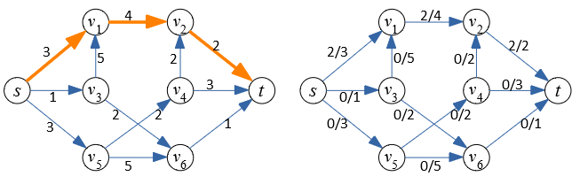

**2.solis:** Palielinošais ceļš: $p = \left\langle s,v_3,v_6,t \right\rangle$, pievienojam uz tā plūsmu $f_p = \min(1,2,1) = 1$.

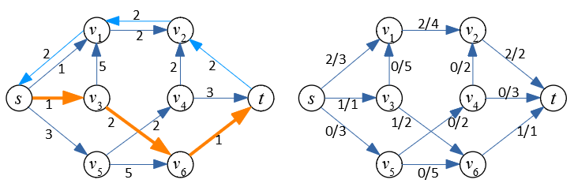

**3.solis:** Palielinošais ceļš: $p = \left\langle s,v_5,v_4,t \right\rangle$, pievienojam uz tā plūsmu $f_p = \min(3,2,3) = 2$.

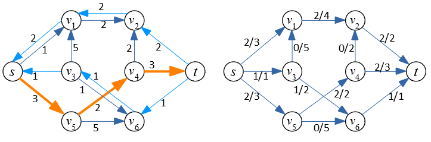

**4.solis:** Beigās atlikumu plūsmas grafs ir tāds, kā dots zīmējumā. Vairs nav palielinošu ceļu no $s$ uz $t$ ar pozitīvu ietilpību.

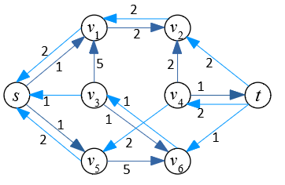

**Secinājums:** Plūsma parādīta attēlā; un minimālais griezums (*the minimum cut*) kas vienāds ar maksimālo plūsmu, aprakstāms ar divām disjunktām virsotņu kopām, kas atdala $s$ un $t$.

$$
V_1 = \{ s,v_1,v_2,v_3,v_5,v_6 \}\;\;\text{and}\;\;V_2 = \{ v_4, t \}.
$$

Minimālā griezuma kapacitāte ir $w(v_2,t) + w(v_5,v_4) + w(v_6,t) = 2 + 2 + 1 = 5$. Tā ir summa visām šķautnēm, kas iet no $V_1$ uz $V_2$.

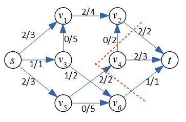

## Uzdevumi

**9.1. uzdevums:**

**(A)** Izpildiet Edmonds-Karpa algoritmu dotajā plūsmu grafā. Katra šķautne tajā apzīmēta ar skaitli, kas parāda tās *kapacitāti*. Katrā solī iezīmējiet palielinošo ceļu (*augmenting path*) un uzskaitiet šī ceļa virsotnes. Palieliniet plūsmu uz šī ceļa un uzzīmējiet *atlikuma plūsmas* grafu (*residual flow*). Katra šķautne ir apzīmēta ar skaitļiem `f/c` -- pašreizējā plūsma `f` (pēc pēc plūsmas palielināšanas) un arī malas ietilpība `c`, kas nemainās.

Nākamajā solī atkal parādiet atlikuma plūsmas grafu, iezīmējiet palielinošo ceļu, atrodiet atlikušo plūsmu. Un blakus šim atlikušajam grafikam parādiet jaunu oriģinālā grafika kopiju ar atjauninātiem plūsmas skaitļiem. Tātad, katrā fāzē tiek parādīti divi orientēti grafi:

* Pašreizējais atlikuma grafs (pirmajā solī tas ir vienkārši dotais grafs, kurā visas plūsmas ir vienādas ar 0). Šajā grafikā tiek parādītas tikai malu ietilpības (bet tajā mēdz būt iezīmētas arī *apgrieztās šķautnes* -- *reverse edges*). Šajā grafikā var ar BFS apstaigāt šķautnes, meklējot palielinošo ceļu.
* Oriģinālais grafs ar visām pievienotajām plūsmām. Šajā grafikā jāparāda arī plūsmas, izmantojot divu skaitļu notāciju `f/c`.

> *Piezīme:* Edmonda-Karpa algoritmā iztekas virsotnei $s$ un arī visām virsotnēm zem tās, bērnu apmeklēšana ar BFS pārstaigāšanas algoritmu notiek alfabētiskā secībā.

**(B)** Uzzīmējiet sākotnējo grafu ar jau izrēķinātajām maksimālajām plūsmām (izmantojiet tādu pašu divu skaitļu malu marķēšanu `f/c`). Parādiet minimālo griezumu (*min-cut*), kas neļauj turpmākus palielinošos ceļus. To var iezīmēt kā līniju, kas šķērso plūsmas grafu, sadala to divās daļās. Vai vienkārši uzskaitiet grafa virsotņu sadalījumu divās nešķeļošās (*disjoint*) kopās, kas veido griezumu.

**Atbilde:**

**(A)** Sekojot Edmonda-Karpa algoritmam secīgi izvēlamies palielinošos ceļus (*augmenting paths*) -- sākam ar īsākajiem. Kā arī -- ar alfabētiski pirmajiem, ja ir vairāki palielinošie ceļi vienādā garumā.

1.solis: Palielina plūsmu par $11$ vienībām uz palielinošā ceļa $S \rightarrow A \rightarrow B \rightarrow T$ (izcelts oranžā krāsā).

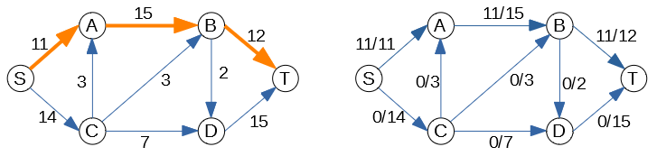

2.solis: Palielina plūsmu par $1$ uz palielinošā ceļa $S \rightarrow C \rightarrow B \rightarrow T$.

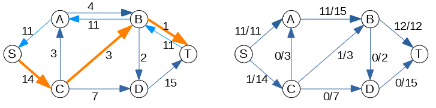

3.solis: Palielina plūsmu par $7$ uz palielinošā ceļa $S \rightarrow C \rightarrow D \rightarrow T$.

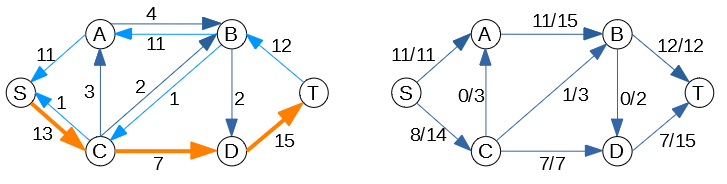

4.solis: Palielina plūsmu par $2$ uz palielinošā ceļa $S \rightarrow C \rightarrow B \rightarrow D \rightarrow T$.

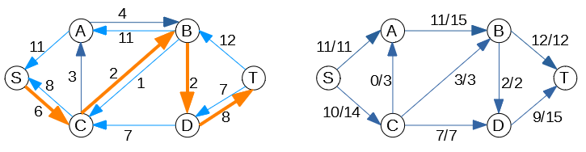

Pēdējais atlikuma grafs vairs nesatur nevienu palielinošo ceļu, kas savienotu ieteku $S$ ar izteku $T$, tāpēc algoritms beidz darbu. Kopumā esam izveidojuši plūsmu, kas ir $11 + 1 + 7 + 2 = 21$ vienības.

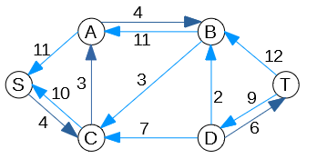

**(B)** Pārzīmējam plūsmas grafu, parādot katrai šķautnei plūsmu un kapacitāti. Minimālais griezums ir parādīts ar sarkanu raustītu līniju. Tas sadala grafa virsotnes divās kopās: $S,A,B,C$ un $D,T$; visas šķautnes ir piesātinātas -- un plūsma sasniegusi maksimumu. Kā zināms, minimālā griezuma kapacitāte vienāda ar maksimālo plūsmu. Šī maksimālā plūsma ir $7+2 + 12 = 21$.

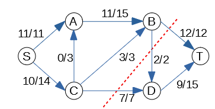

$\square$
