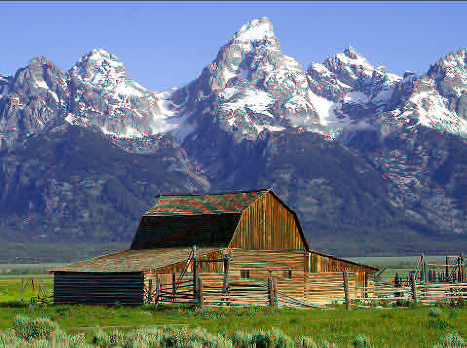
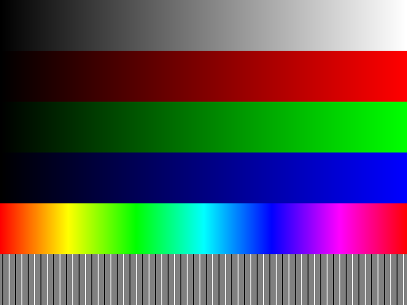
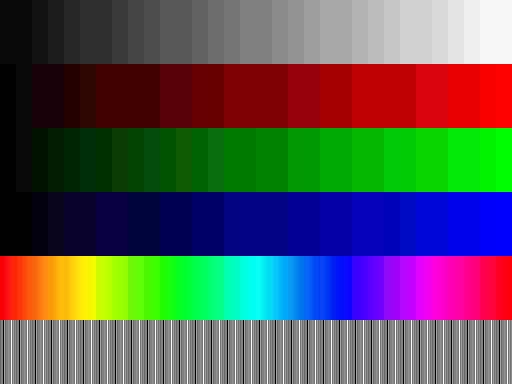

# Zudumradošā saspiešana un kļūdu korekcija: Beigu uzdevumi

Uzdevumi aptver nodaļas par attēlu un audio saspiešanu (JPEG, krāsu telpas, DCT, AVIF),
video un audio kodekiem, Heminga kodiem un Tanera grafiem, kā arī Rīda-Solomona kodiem un galīgajiem laukiem.
Apzīmējumi ir tādi paši kā attiecīgajās nodaļās.

* Uzdevumus ar atzīmi **(uz papīra)** var izpildīt ar roku vai ar kalkulatoru; aprēķinu tajos nav daudz.
* Uzdevumos ar atzīmi **(ar datoru)** vajag Python 3. Noderīgās bibliotēkas:
  ```bash
  pip install numpy scipy pillow galois
  ```
  `numpy` -- masīvi un FFT, `scipy` -- DCT (`scipy.fft.dct`) un WAV faili (`scipy.io.wavfile`),
  `pillow` -- attēli (arī animēti GIF, WebP un AVIF), `galois` -- galīgie lauki $\text{GF}(p)$ un $\text{GF}(2^k)$ un Rīda-Solomona kodi.

**Noderīgas vērtības:** $\cos\frac{\pi}{8} \approx 0.92388$, $\;\cos\frac{3\pi}{8} \approx 0.38268$, $\;\frac{1}{\sqrt{2}} \approx 0.70711$, $\;\log_{10} 2 \approx 0.30103$.

## JPEG saspiešana

**1. uzdevums (DCT ar roku) (uz papīra):** Izmantojiet ortonormēto DCT ar $N = 4$ no lekcijas
[5. Zudumradošā saspiešana: attēli un audio]({{ '/lectures/lossy_images_and_audio/' | relative_url }})
(nodaļa "Skaitlisks piemērs: DCT ar $N = 4$"): $y = C x$, kur matricas $C$ rindas ir
$(a, a, a, a)$, $(b, c, -c, -b)$, $(a, -a, -a, a)$, $(c, -b, b, -c)$ un $a = \frac{1}{2}$, $b = \frac{1}{\sqrt{2}} \cos\frac{\pi}{8}$, $c = \frac{1}{\sqrt{2}} \cos\frac{3\pi}{8}$.

* **(a)** Aprēķiniet $y = C x$ signālam $x = (4, 8, 8, 4)$. Pārbaudiet Parsevāla vienādību $\sum x_n^2 = \sum y_k^2$.
* **(b)** Kāpēc koeficienti $y_1$ un $y_3$ ir nulles? Formulējiet vispārīgu apgalvojumu par simetriskiem signāliem ($x_n = x_{N-1-n}$) un pamatojiet to ar bāzes vektoru simetriju.
* **(c)** Kvantizējam visus koeficientus ar vienu un to pašu soli $Q = 10$: $\hat{y}_k = Q \cdot \operatorname{round}(y_k / Q)$. Atrodiet atjaunoto signālu $x' = C^T \hat{y}$ un kvadrātisko kļūdu $\sum (x_n - x'_n)^2$. Pārbaudiet, ka tā sakrīt ar $\sum (y_k - \hat{y}_k)^2$.
* **(d)** $4 \times 4$ blokā $A$ visas četras rindas ir $(4, 8, 8, 4)$. Neveicot reizināšanu ar $16$ elementiem, atrodiet $B = C A C^T$. *Norāde:* vispirms transformējiet kolonnas (katra kolonna ir konstanta), pēc tam -- rindas.
* **(e)** JPEG pirms DCT no katra $8 \times 8$ bloka pikseļa atņem $128$. Kurš koeficients $B_{u,v}$ no tā mainās un par cik? Kāda ir $B_{0,0}$ saistība ar bloka vidējo gaišumu?

**2. uzdevums (Krāsu telpas) (uz papīra):** Oranžas krāsas pikselim ir $(R, G, B) = (255, 128, 0)$.

* **(a)** Aprēķiniet $Y$, $\mathrm{Cb}$, $\mathrm{Cr}$ pēc JFIF formulām ($Y = 0.299 R + 0.587 G + 0.114 B$, $\mathrm{Cb} = 128 + \frac{B - Y}{1.772}$, $\mathrm{Cr} = 128 + \frac{R - Y}{1.402}$) un noapaļojiet līdz veseliem skaitļiem.
* **(b)** No noapaļotajām vērtībām atjaunojiet $(R, G, B)$ ar apgrieztajām formulām un noapaļojiet. Vai iegūstat sākotnējo krāsu? Kurā solī rodas zudums?
* **(c)** Pārveidojiet to pašu krāsu YIQ telpā ($R, G, B \in [0;1]$, t.i., vērtības dalītas ar $255$; matrica $M$ ir lekcijā). Kura no komponentēm $I$, $Q$ ir tuvu nullei? Saistiet to ar lekcijas apgalvojumu, ka $I$ ass atbilst pārejai no oranžās uz zilo krāsu.
* **(d)** Kas notiek, ja krāsai ar tādu pašu $Y$ maina $I$ un $Q$ zīmes, t.i., $(Y, I, Q) \to (Y, -I, -Q)$? Atrodiet atbilstošo $(R, G, B)$ ar $M^{-1}$ un paskaidrojiet, kāpēc ne katrs YIQ trijnieks ir attēlojama RGB krāsa.
* **(e)** Pierādiet, ka pelēkām krāsām ($R = G = B$) vienmēr $\mathrm{Cb} = \mathrm{Cr} = 128$ un $I = Q = 0$.
* **(f)** Attēls ir $1000 \times 1000$ pikseļu. Cik baitu aizņem nesaspiestas $Y$, $\mathrm{Cb}$, $\mathrm{Cr}$ plaknes ar 4:4:4, 4:2:2 un 4:2:0 krāsainības izretināšanu? Kāpēc izretina tieši $\mathrm{Cb}$ un $\mathrm{Cr}$, bet ne $Y$?

**3. uzdevums (Atkārtojiet bojājumu) (ar datoru):** Izmantojiet laboratorijas darba
[Apzināti sabojājam JPEG](https://kapsitis.github.io/lu-advanced-algorithms/lectures/lossy_images_and_audio/jpeg_lab/lv/)
programmu <a href="{{ '/lectures/lossy_images_and_audio/jpeg_lab/jpeg_lab.py' | relative_url }}" download>jpeg_lab.py</a>
(parametru aprakstu skatiet laboratorijas darba tabulā "Kā programma ir veidota" vai ar `python jpeg_lab.py --help`).
Ievades attēls ir fotogrāfija
<a href="{{ '/lectures/lossy_images_and_audio/jpeg_lab/barns_grand_tetons.png' | relative_url }}" download>barns_grand_tetons.png</a>
($959 \times 715$ pikseļi). Ar noklusētajiem parametriem `jpeg_lab.py` iegūst $\mathrm{PSNR} = 26.84$ dB un novērtēto izmēru $123.3$ KiB.


*Oriģināls: barns_grand_tetons.png.*

Tālāk redzami trīs atkodēti attēli. Katrs no tiem iegūts ar `jpeg_lab.py`, mainot ne vairāk kā divus parametrus
(salīdzinot ar noklusētajiem). Programma ir deterministiska, tāpēc ar pareiziem parametriem iegūsiet tieši tādu pašu attēlu.

| Attēls | PSNR (visi kanāli) | Novērtētais izmērs |
| --- | --- | --- |
| <a href="{{ '/lectures/lossy_final_problemsets/figs/target-a.png' | relative_url }}" download>target-a.png</a> | $21.28$ dB | $34.9$ KiB |
| <a href="{{ '/lectures/lossy_final_problemsets/figs/target-b.png' | relative_url }}" download>target-b.png</a> | $19.46$ dB | $102.7$ KiB |
| <a href="{{ '/lectures/lossy_final_problemsets/figs/target-c.png' | relative_url }}" download>target-c.png</a> | $20.56$ dB | $145.6$ KiB |


*Attēls A.*


*Attēls B.*



*Attēls C.*

* **(a)** Aplūkojiet attēlus palielinātus (piemēram, debesis, kalnu malas, šķūņa dēļus un sētu). Katram attēlam aprakstiet redzamo bojājumu un uzminiet, kurš JPEG solis (1.-5.) ir mainīts.
* **(b)** Atrodiet parametrus, ar kuriem `jpeg_lab.py` iegūst katru no attēliem A, B, C. Pārbaudiet sakritību ar nelielu Python skriptu, kas nolasa abus PNG failus ar Pillow un izdrukā lielāko pikseļu vērtību starpību (pareizai atbildei tā ir $0$).
* **(c)** Attēlā A izmēriet režģa soli pikseļos. Kā no režģa soļa un no tā, cik "gludi" izskatās bloki, var secināt abus mainītos parametrus?
* **(d)** Attēlam C PSNR ir sliktāks nekā noklusētajam palaidienam, bet izmērs -- lielāks. Paskaidrojiet, kāpēc šī izmaiņa ir zaudējums abos aspektos vienlaikus. Kāda krāsa parādās ap tumšajām sētas latām, un no kurienes tā rodas?
* **(e)** Sintētiskais attēls <a href="{{ '/lectures/lossy_final_problemsets/figs/gradient-bands.png' | relative_url }}" download>gradient-bands.png</a> ($512 \times 384$, uzzīmēts ar <a href="{{ '/lectures/lossy_final_problemsets/figs/make_gradient_bands.py' | relative_url }}" download>make_gradient_bands.py</a>) satur pelēktoņu un $R$, $G$, $B$ gradientus, krāsu loku un plānas vertikālas līnijas. Attēls <a href="{{ '/lectures/lossy_final_problemsets/figs/target-d.png' | relative_url }}" download>target-d.png</a> iegūts no tā, mainot divus parametrus ($\mathrm{PSNR} = 29.20$ dB, izmērs $1.4$ KiB). Atrodiet tos. Kāpēc gludie gradienti pārvēršas "kāpnēs", un ko pasaka kāpņu pakāpiena platums?

| | |
| --- | --- |
|  |  |
| *gradient-bands.png* | *Attēls D* |

* **(f)** Izveidojiet savu sintētisku attēlu (piemēram, ar diagonālu gradientu, apli vai tekstu) un atrodiet parametru kombināciju, kas tajā rada pēc iespējas pamanāmāku bojājumu pie novērtētā izmēra ne mazāka par noklusētā palaidiena izmēru. Īsi aprakstiet, kāpēc tieši šis attēls ir "neērts" JPEG.

## Citi attēlu, audio un video kodējumi

**4. uzdevums (Animēts attēls) (ar datoru):** Lekcijā animēts AVIF fails izveidots ar skriptu
[animated_avif.py]({{ '/lectures/lossy_images_and_audio/figs/animated_avif.py' | relative_url }}).
Izveidojiet līdzīgu animāciju ar savu sižetu.

* **(a)** Uzrakstiet Python programmu (Pillow un NumPy), kas uzzīmē $2$ sekundes garu animāciju ar $25$ kadriem sekundē, $320 \times 180$ pikseļi, kurā redzams kustīgs objekts uz vienkrāsaina fona: piemēram, pulksteņa rādītājs, kas pagriežas par $360^\circ$, vai krāsu gradienta josla, kas slīd pāri ekrānam. Animācijai jābūt bezšuvju cilpai (pēdējam kadram jāsavienojas ar pirmo). Kā jāizvēlas ātrums, lai tā būtu?
* **(b)** Saglabājiet to pašu kadru virkni trīs formātos: animēts GIF, animēts WebP un animēts AVIF (`Image.save(..., save_all=True, append_images=..., duration=..., loop=0)`). Salīdziniet failu izmērus ar kopējo nesaspiesto kadru izmēru ($50 \cdot 320 \cdot 180 \cdot 3$ baiti).
* **(c)** GIF var izmantot ne vairāk kā $256$ krāsas vienā kadrā. Kā tas izpaužas krāsu gradientā? Ko dara Pillow, pārveidojot RGB kadru par paletes kadru (salīdziniet `Image.quantize(..., dither=Image.Dither.NONE)` un `dither=Image.Dither.FLOYDSTEINBERG`)?
* **(d)** Pievienojiet fonam nelielu gadījuma troksni (katram pikselim un katram kadram neatkarīgi, piemēram, $\pm 8$). Kā mainās visu trīs failu izmēri? Paskaidrojiet, kāpēc troksnis kaitē gan intra prognozei kadra iekšpusē, gan prognozei no iepriekšējā kadra (sk. P-freimus video lekcijā).
* **(e)** Atkārtojiet (d) ar *vienu* trokšņa rakstu visiem kadriem (troksnis "pielīp" fonam). Kā tagad mainās failu izmēri, salīdzinot ar (d) punktu? Kurš formāts no tā iegūst visvairāk, un kāpēc?

**5. uzdevums (Skaņa frekvencēs) (ar datoru):** Ar NumPy izveidojiet $2$ sekundes garu monofonisku signālu ar paraugu ņemšanas frekvenci $f_s = 48\,000$ Hz:
A mažora akordu ar toņiem $440$ Hz (A4), $440 \cdot 2^{4/12}$ Hz (C♯5) un $440 \cdot 2^{7/12}$ Hz (E5), katrs ar amplitūdu $0.2$, un vēl klusu toni $470$ Hz ar amplitūdu $0.002$. Saglabājiet to kā 16 bitu WAV failu (`scipy.io.wavfile.write`) un noklausieties.

* **(a)** Aprēķiniet signāla spektru ar `numpy.fft.rfft` un uzzīmējiet $\lvert X(f) \rvert$ decibelos ($20 \log_{10}$) frekvencēm $0$--$2000$ Hz. Atrodiet četras virsotnes. Kāda ir frekvenču izšķirtspēja (attālums starp blakus FFT frekvencēm hercos) $2$ sekunžu signālam un $0.02$ sekunžu fragmentam? Vai $470$ Hz toni var atšķirt no $440$ Hz toņa abos gadījumos?
* **(b)** "Saspiešana frekvencēs": sadaliet signālu kadros pa $N = 1024$ paraugiem, katram kadram aprēķiniet `scipy.fft.dct(..., norm="ortho")`, paturiet tikai $K$ koeficientus ar lielāko absolūto vērtību (pārējos aizstājiet ar $0$) un atjaunojiet ar `scipy.fft.idct`. Ja $K = 8, 16, 32, 64$, aprēķiniet signāla un trokšņa attiecību $\mathrm{SNR} = 10 \log_{10} \frac{\sum x_n^2}{\sum (x_n - x'_n)^2}$ un noklausieties rezultātu. Pie kāda $K$ pazūd klusais $470$ Hz tonis? Vai tas ir dzirdams oriģinālā blakus skaļajam $440$ Hz tonim (sk. frekvenču maskēšanu)?
* **(c)** Signāla vidū (pie $1.0$ s) pievienojiet asu klikšķi (viens paraugs ar vērtību $0.9$). Atkārtojiet (b) ar $K$, kas ir $1/16$ no $N$, kadru garumiem $N = 4096$ un $N = 256$. Uzzīmējiet kļūdu $x - x'$ laikā ap klikšķi. Cik milisekundes pirms klikšķa kļūda sākas abos gadījumos? Salīdziniet ar priekšmaskēšanas ilgumu ($5$--$20$ ms) un paskaidrojiet, kāpēc MP3 un Opus pārejās izmanto īsus logus.
* **(d)** Izveidojiet $5000$ Hz toni ar $f_s = 8000$ Hz un noklausieties (WAV failam norādiet $f_s = 8000$). Kādu frekvenci dzirdat? Pārbaudiet ar FFT un paskaidrojiet ar Naikvista teorēmu.
* **(e)** *(Neobligāti.)* Kodētāji nekodē tikai "$K$ lielākos koeficientus": to vietā katrai frekvenču joslai izvēlas kvantizācijas soli. Kvantizējiet DCT koeficientus ar soli, kas aug līdz ar frekvenci (piemēram, $q_k = q_0 \cdot (1 + k/64)$), un salīdziniet SNR un skanējumu ar (b) pie aptuveni vienāda nenulles koeficientu skaita.

**6. uzdevums (Teorijas jautājumi par kodekiem) (uz papīra):** Katram apgalvojumam norādiet, vai tas ir patiess vai aplams, un pamatojiet ar vienu vai diviem teikumiem (vai pretpiemēru).

* **(a)** JPEG kvantizācija ir vienīgais JPEG solis, kurā zūd informācija.
* **(b)** Ja DCT koeficientus kvantizē ar soli $Q$ un noapaļošanas kļūda ir vienmērīgi sadalīta, tad vidējā kvadrātiskā kļūda pikseļos ir $Q^2 / 12$ neatkarīgi no tā, cik koeficientu kļūst par nullēm.
* **(c)** Divkāršojot visus kvantizācijas soļus, JPEG faila izmērs samazinās apmēram divas reizes.
* **(d)** PSNR $40$ dB nozīmē, ka vidējā kvadrātiskā kļūda ir $100$ reizes mazāka nekā pie PSNR $20$ dB.
* **(e)** AVIF atkodētājs ir apmēram tikpat lēns kā AVIF iekodētājs, jo abi izpilda vienus un tos pašus soļus.
* **(f)** Video ar GOP struktūru `IBBPBBPBB` var sākt skatīties no jebkura kadra, neatkodējot iepriekšējos.
* **(g)** Opus fails ar $32$ kbit/s satur precīzas frekvenču komponentes līdz $20$ kHz.
* **(h)** Faila paplašinājuma maiņa no `.webm` uz `.mkv` nemaina ne konteineru, ne kodeku, bet daudzi atskaņotāji to tāpat atskaņos.

## Heminga kodi un Tanera grafi

**7. uzdevums (Heminga kods un tā paplašinājums) (uz papīra):** Izmantojam Heminga kodu $[7,4,1]$ no lekcijas
[7. Kļūdu korekcija: Heminga kodi]({{ '/lectures/lossy_hamming/' | relative_url }}): virkni $x_1 x_2 x_3 x_4$ pārraida kā $x_1 x_2 x_3 y_1 x_4 y_2 y_3$, kur $y_1 = x_1 \oplus x_2 \oplus x_3$, $y_2 = x_1 \oplus x_2 \oplus x_4$, $y_3 = x_1 \oplus x_3 \oplus x_4$. Pozīcijām atbilst binārie indeksi $111, 110, 101, 100, 011, 010, 001$.

* **(a)** Nokodējiet ziņojumu `1011`.
* **(b)** Saņemts `1110101`. Aprēķiniet *sindromu* $(s_1, s_2, s_3)$, kur $s_i = 1$ tad un tikai tad, ja kontrolbits $y_i$ nesakrīt ar formulu. Parādiet, ka sindroms, uzrakstīts kā trīs bitu skaitlis $s_1 s_2 s_3$, ir tieši kļūdainās pozīcijas binārais indekss. Izlabojiet kļūdu.
* **(c)** No (a) punkta koda vārda tika sabojāti *divi* pēdējie biti, un saņemts `1010110`. Ko izdarīs atkodētājs, kas pieņem, ka kļūda ir ne vairāk kā viena? Kādu ziņojumu tas izvadīs?
* **(d)** Paplašinātajā Heminga kodā pievieno astoto bitu $y_0$ -- visu septiņu bitu paritāti. Pierādiet, ka jebkuri divi šī koda vārdi atšķiras vismaz $4$ pozīcijās. Kā atkodētājs ar $y_0$ un sindromu var atšķirt gadījumus "nav kļūdu", "viena kļūda (izlabojama)" un "divas kļūdas (tikai pamanāmas)"? Pielietojiet to (c) punkta situācijai.
* **(e)** Pamatojiet, ka $y_0 = x_2 \oplus x_3 \oplus x_4$ jebkuram koda vārdam.

**8. uzdevums (Tanera grafs un dzēsumi) (uz papīra; (e) ar datoru):** Kodu ar $8$ bitiem $b_1, \ldots, b_8$ uzdod četras pārbaudes:

$$
\begin{array}{l}
p_1:\; b_1 \oplus b_2 \oplus b_3 \oplus b_5 = 0, \\
p_2:\; b_1 \oplus b_2 \oplus b_4 \oplus b_6 = 0, \\
p_3:\; b_1 \oplus b_3 \oplus b_4 \oplus b_7 = 0, \\
p_4:\; b_2 \oplus b_3 \oplus b_4 \oplus b_8 = 0.
\end{array}
$$

* **(a)** Uzrakstiet pārbaudes matricu $H$ un uzzīmējiet Tanera grafu. Pamatojiet, ka $b_1, \ldots, b_4$ var izvēlēties brīvi, bet $b_5, \ldots, b_8$ ir no tiem viennozīmīgi noteikti. Nokodējiet $b_1 b_2 b_3 b_4 = $ `1011`. Salīdziniet ar 7. uzdevumu: kāds tas ir kods?
* **(b)** No (a) punkta koda vārda dzēsumu kanālā pazuda biti $b_1$, $b_2$, $b_5$. Atjaunojiet tos ar noplēšanas (*peeling*) algoritmu, katrā solī norādot izmantoto pārbaudi.
* **(c)** Pazuda biti $b_1, b_2, b_3, b_4$. Parādiet, ka noplēšanas algoritms "iestrēgst" jau pirmajā solī. Vai pazudušos bitus tomēr var viennozīmīgi atjaunot, atrisinot četru vienādojumu sistēmu pēc moduļa $2$? Atjaunojiet tos.
* **(d)** Atrodiet četru dzēsumu kopu, ko *nevar* viennozīmīgi atjaunot ar nekādu algoritmu. Kā tā saistīta ar koda vārdiem, kuros ir tieši četri vieninieki? Kāpēc jebkurus trīs dzēsumus var atjaunot vienmēr?
* **(e)** *(Ar datoru.)* Uzrakstiet funkciju `peel(H, received)`, kas dzēsumus (apzīmētus ar `None`) atjauno ar noplēšanu. Uzģenerējiet nejaušu LDPC kodu ar $n = 1200$ bitiem, kurā katrs bits ir $3$ pārbaudēs un katrā pārbaudē ir $6$ biti (piemēram, sajaucot $3n$ šķautņu "galus" nejaušā secībā). Katram $\varepsilon \in \lbrace 0.30, 0.35, 0.40, 0.45, 0.50 \rbrace$ $100$ reizes izdzēsiet katru bitu ar varbūtību $\varepsilon$ un saskaitiet, cik reizes noplēšana atjauno visu. Izskaidrojiet, kāpēc pietiek pārbaudīt tikai nulles koda vārdu. Pie kāda $\varepsilon$ atkodēšana pēkšņi sāk neizdoties? (Teorētiskā robeža šādiem kodiem ir $\varepsilon \approx 0.429$; maksimālā iespējamā -- $1 - k/n = 0.5$.)

## Rīda-Solomona kodi un galīgie lauki

**9. uzdevums (Rīda-Solomona kods laukā GF(7)) (uz papīra):** Laukā $\text{GF}(7) = \lbrace 0, 1, \ldots, 6 \rbrace$ (darbības pēc moduļa $7$) ziņojuma blokā ir $k = 2$ skaitļi $a_1, a_2$, ziņojuma polinoms $f(x) = a_1 x + a_2$, un nosūta $s = 5$ vērtības $f(0), f(1), \ldots, f(4)$. Apzīmējumi ir tādi paši kā lekcijā
[8. Kļūdu korekcija: Rīda-Solomona kodi]({{ '/lectures/lossy_reed_solomon/' | relative_url }}).

* **(a)** Uzrakstiet apgriezto elementu tabulu: $a^{-1}$ katram $a \in \lbrace 1, \ldots, 6 \rbrace$.
* **(b)** Nokodējiet ziņojumu $3, 5$.
* **(c)** Cik pazaudētas vērtības (dzēsumus) un cik kļūdainas vērtības šis kods garantēti labo? Kāds ir lielākais $s$, ko var izmantot laukā $\text{GF}(7)$, un cik kļūdu tad varētu labot?
* **(d)** Saņemts $r = (\ast, 1, \ast, \ast, 3)$, kur $\ast$ ir pazaudēta vērtība. Atjaunojiet ziņojumu ar Lagranža interpolāciju.
* **(e)** Saņemts $r = (5, 1, 6, 0, 3)$; viena vērtība var būt kļūdaina, bet nav zināms, kura. Ar Berlekampa-Velča metodi ($Y(x) = x + y_0$, $Z(x) = z_2 x^2 + z_1 x + z_0$) atrodiet kļūdas vietu un ziņojumu.
* **(f)** Pārbaudiet savu atbildi citādi: atrodiet taisni, kas iet caur vismaz četriem no pieciem punktiem $(i, r_i)$. Kāpēc šāda pārlase nav praktiska lielākiem $k$ un $s$?

**10. uzdevums (Lauks GF(8) un Rīda-Solomona kodi baitiem) (uz papīra (a)-(c); ar datoru (d)-(f)):** Lauku $\text{GF}(8)$ veido polinomi ar koeficientiem no $\lbrace 0, 1 \rbrace$, kuru pakāpe nepārsniedz $2$, un reizināšana notiek pēc moduļa $p(x) = x^3 + x + 1$ (sk. lekcijas tabulas). Elementu $b_2 x^2 + b_1 x + b_0$ pierakstām arī kā trīs bitu virkni $b_2 b_1 b_0$ vai skaitli ($x^2 + 1 = $ `101` $= 5$). Apzīmējam $\alpha = x$.

* **(a)** Aprēķiniet $\alpha^0, \alpha^1, \ldots, \alpha^7$ kā trīs bitu virknes. Pārliecinieties, ka $\alpha^0, \ldots, \alpha^6$ ir visi septiņi nenulles elementi (t.i., $\alpha$ ir *primitīvs* elements).
* **(b)** Izmantojot (a) punkta tabulu kā "logaritmu tabulu", aprēķiniet $(x^2 + 1) \cdot (x + 1)$ un $(x^2 + x)^{-1}$. Pārbaudiet ar lekcijas reizināšanas tabulu. Kāpēc saskaitīšana šajā laukā ir bitu XOR?
* **(c)** Rīda-Solomona kods laukā $\text{GF}(8)$ ar $k = 2$: $f(x) = a_1 x + a_2$. Nokodējiet ziņojumu $a_1 = \alpha$, $a_2 = 1$, aprēķinot $f$ vērtības punktos $0, 1, \alpha, \alpha^2$. Cik bitu ir ziņojumā un cik -- koda vārdā?
* **(d)** Bibliotēkā `galois` lauku izveido ar `GF = galois.GF(2**3)`; elementi ir NumPy masīvi, ar kuriem darbojas `+`, `*`, `**` un `np.linalg.solve`. Pārbaudiet (a)-(c) punkta aprēķinus ar `galois`. Pēc tam uzrakstiet funkcijas `rs_encode(msg, s)` un `berlekamp_welch(r, k)` lekcijas apzīmējumos (vērtības punktos $0, 1, \alpha, \ldots$) un pārbaudiet tās laukā $\text{GF}(2^8)$ ar $k = 8$, $s = 16$ un nejauši sabojātām vērtībām. Cik kļūdu izdodas labot un kas notiek, ja kļūdu ir par vienu vairāk?
* **(e)** Klase `galois.ReedSolomon(255, 223)` realizē CD un kosmosa sakaru standartos lietoto kodu laukā $\text{GF}(2^8)$ (katrs simbols ir baits; kods ir *sistemātisks* -- ziņojuma baiti paliek nemainīti, tiem pievieno $32$ kontrolbaitus; tas atšķiras no lekcijas varianta, bet lineārās algebras pamatā ir tas pats). Nokodējiet ar to teksta ziņojumu, sabojājiet $16$ pēc kārtas esošus baitus ($128$ bitus) un atkodējiet ar `rs.decode(..., errors=True)`. Atkārtojiet ar $17$ sabojātiem baitiem. Ko atgriež atkodētājs?
* **(f)** Salīdziniet (e) punkta rezultātu ar Heminga kodu $[7,4,1]$, kurā lieko bitu proporcionāli ir pat vairāk ($3$ no $7$, salīdzinot ar $32$ no $255$): $223 \cdot 8$ ziņojuma bitus sadala blokos pa $4$ bitiem un katru bloku nokodē atsevišķi. Cik no $128$ pēc kārtas sabojātajiem bitiem Heminga kods spētu izlabot? Kāpēc Rīda-Solomona kodi ir piemēroti kļūdu "uzliesmojumiem" (*burst errors*), piemēram, skrāpējumiem uz kompaktdiska?
